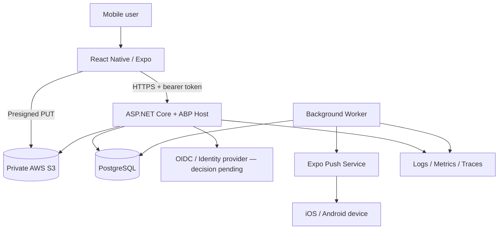
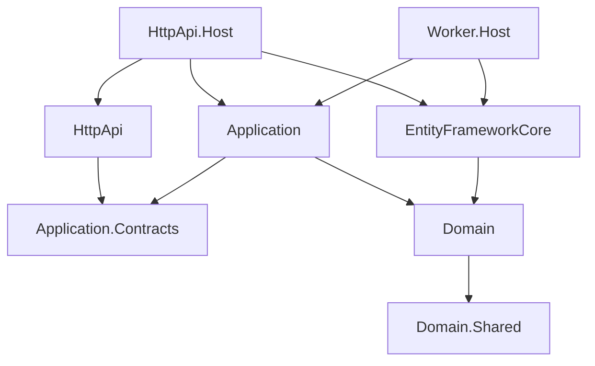
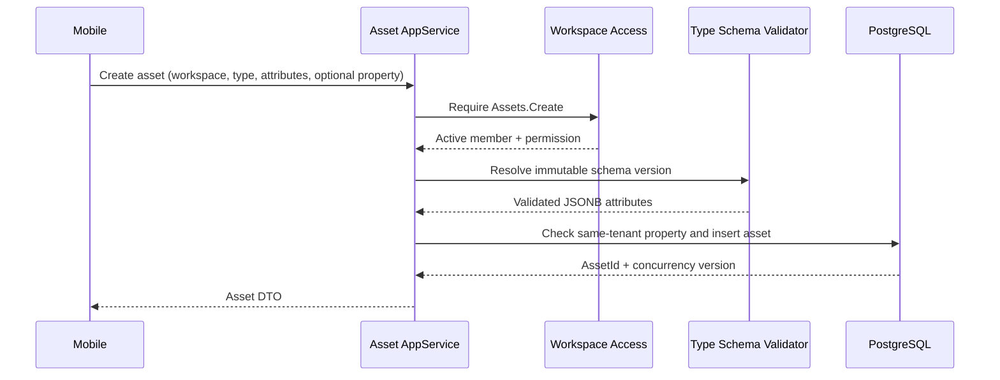

# Kepnora Architecture Overview

**Version:** 1.0-draft  
**Status:** Proposed architecture — identity and ABP compatibility gates remain open  
**Scope:** Phase 1 mobile-first asset and maintenance management  
**Companion documents:** `README.md`, `kepnora-project-context.md`

---

## 1. Purpose and Audience

This document describes the end-to-end architecture of Kepnora: how the Expo mobile application, ASP.NET Core/ABP backend, PostgreSQL persistence, AWS S3 storage and background processing cooperate to deliver asset inventory, maintenance scheduling, service history and reminders.

It is intended for engineers, architects, reviewers and coding agents. It describes **architecture and implementation contracts**, not a claim that the system is deployed. Detailed table definitions, endpoint payloads and UI specifications belong in separate documents. The diagrams and code here are reference designs subject to the explicitly marked decisions.

### 1.1 Non-goals

- A provider marketplace, booking engine, payment processing or provider CRM in Phase 1.
- A microservices deployment or distributed event bus at MVP launch.
- Replacing ABP's tenant management with a parallel custom tenant registry.
- Treating a selected tenant ID, JWT claim or client header as proof of membership.
- Guaranteeing exactly-once push delivery over external providers.

## 2. Product Context and Architectural Drivers

Kepnora allows a person or household to catalog assets, associate assets with optional properties, track warranties and documents, define maintenance schedules, record completed work and receive reminders. A vehicle, laptop or other standalone asset **must not require a property**. A user may eventually participate in multiple workspaces, with different permissions in each.

| Driver | Architecture response | Verification |
|---|---|---|
| Mobile-first experience | React Native + Expo + TypeScript | iOS/Android navigation and offline-error tests |
| Multi-workspace membership | One ABP tenant per workspace, explicit membership | Two-workspace identity POC |
| Tenant data isolation | ABP `IMultiTenant`, authorization, database constraints | Cross-tenant integration tests |
| Dynamic asset schemas | Versioned asset type definitions and JSONB | Schema validation and migration tests |
| Correct recurring maintenance | Domain recurrence calculator and durable occurrences | Calendar, DST and concurrency tests |
| Secure document storage | Private S3, presigned uploads, finalize checks | Object-level access tests |
| Reliable reminders | Outbox and durable worker, idempotent dispatch | Retry and crash-recovery tests |
| Lean MVP operations | ABP layered modular monolith | Deploy and restore drills |

## 3. System Context



**Trust boundaries:** the mobile app is untrusted; S3 upload URLs confer narrowly scoped temporary capability; background workers are privileged processes but must not bypass tenant-scoped domain invariants; push providers are external and can fail or duplicate messages.

## 4. Deployment Shape

A single backend deployment contains ABP application modules, HTTP API exposure, EF Core infrastructure and cross-cutting facilities. A separately hosted worker process may reuse domain/application contracts and persistence infrastructure without hosting public HTTP endpoints. A single PostgreSQL database is the MVP default; every workspace-owned row is tenant scoped.

```text
Mobile App (Expo / React Native)
    |
    +-- OAuth/OIDC session + generated API client
    |
    v
HTTPS / API Gateway or Load Balancer
    |
    v
Kepnora.HttpApi.Host (ABP)
    |-- Authentication and tenant resolution
    |-- Workspace membership and permission boundary
    |-- Application Services / DTO validation
    |-- Domain Services and aggregates
    |-- EF Core repositories / Unit of Work
    |-- Outbox writer
    |
    +---- PostgreSQL
    +---- AWS S3

Kepnora.Worker
    |-- Occurrence generation
    |-- Reminder planning / dispatch
    |-- Upload intent cleanup
    +---- PostgreSQL / S3 / Expo Push
```

### 4.1 Why a modular monolith

Phase 1 requires transactional consistency across maintenance completion, occurrence transitions and outbox creation. Deploying independent microservices would introduce distributed transaction and operational complexity before it provides product value. ABP module boundaries are retained so future provider discovery, booking and billing can be extracted if demand justifies it.

## 5. Technology Baseline and Version Policy

| Layer | Selected direction | Status |
|---|---|---|
| Mobile | React Native, Expo, TypeScript, Expo Router | Selected |
| Client state | TanStack Query for server data, Zustand for limited local state | Proposed baseline |
| Forms | React Hook Form + Zod | Proposed baseline |
| Secure token storage | Expo SecureStore | Selected direction |
| Backend | ASP.NET Core .NET 10 + ABP Framework | Selected direction; exact ABP release unverified |
| Persistence | EF Core + PostgreSQL/Npgsql | Selected |
| Flexible metadata | PostgreSQL JSONB | Selected |
| Documents | AWS S3 private bucket | Selected |
| Push | Expo Notifications / Expo Push | Proposed baseline |
| API typing | OpenAPI-generated TypeScript client | Selected direction |
| Observability | Structured logs, traces, metrics | Required; vendor pending |

**Compatibility gate:** scaffold the exact ABP edition/release, compile against .NET 10 and the selected EF Core/Npgsql versions, run migration tests, and pin versions before finalizing implementation snippets. ABP APIs in this document are conceptual unless confirmed by that scaffold.

## 6. ABP Layering and Dependency Rules



The actual ABP template may introduce additional module projects. This diagram expresses **dependency direction**, not an exact generated solution. `Domain.Shared` contains shared constants, enums, error codes and permission names; `Domain` contains entities, aggregates and business rules; `Application.Contracts` contains DTOs and service interfaces; `Application` orchestrates use cases and authorization; `HttpApi` exposes explicit HTTP contracts; `EntityFrameworkCore` maps entities and migrations.

### 6.1 Layer responsibilities

| Layer | Allowed | Not allowed |
|---|---|---|
| Mobile | Render, validate UX, call API, cache responses | Authoritative tenant authorization or recurrence calculations |
| HttpApi | Route binding, transport validation, status mapping | Domain recurrence logic or raw database access |
| Application | Membership checks, orchestration, UoW boundaries | Direct S3 credentials in DTOs or UI-specific logic |
| Domain | Invariants, recurrence, state transitions | HTTP or Expo dependencies |
| EntityFrameworkCore | Mapping, queries, migrations, concurrency | Authorization by itself |
| Worker | Durable background execution, tenant context | Silent bypass of domain rules |

## 7. Domain Module Map

| Module | Owns | Depends on |
|---|---|---|
| Identity integration | Authenticated subject mapping and session contract | Selected identity provider |
| Workspaces | Tenant membership, roles, workspace lifecycle | ABP Tenant Management, identity mapping |
| Properties | Property metadata and lifecycle | Workspaces |
| Asset Catalog | Global and tenant custom type definitions, immutable versions | Workspaces |
| Assets | Inventory, optional property association, asset attributes | Properties, Asset Catalog |
| Maintenance | Rules, occurrences, readings, completion records | Assets |
| Documents | Upload intents, metadata, S3 object references | Assets, Maintenance |
| Notifications | Preferences, device registrations, reminder deliveries | Maintenance, Workspaces |
| Dashboard/Search | Read projections, filtered search | Other modules' public read contracts |

Modules may share a database in Phase 1 but should not mutate each other's tables through ad hoc SQL. Cross-module reads should use published query services or deliberate read models; avoid circular application dependencies.

## 8. Workspace, ABP Tenant and Membership

**Canonical mapping:** one Kepnora workspace corresponds to one ABP Tenant Management tenant (`AbpTenants` in common ABP schemas; verify actual migration). The ABP tenant ID is the workspace ID used in tenant-owned domain records. There is no separate `tenants` table for the same concept.

```text
ABP Tenant (workspace)
   |
   +-- TenantMembers (membership / Owner / Member / status)
   +-- Properties
   +-- Assets
   +-- MaintenanceRules / Occurrences / Records
   +-- Documents / UploadIntents
   +-- NotificationPreferences / ReminderDeliveries

Global identity subject --< TenantMembers >-- ABP Tenant
```

### 8.1 Important identity limitation

Standard ABP Identity and its tenant-local user/role semantics **must not be assumed** to support one global person logging into multiple tenants with different workspace roles. A proof of concept must select either a supported host/global identity design with membership-aware permissions or an external OIDC subject mapped to a global user registry. Do not implement a duplicate tenant-local user for each workspace without an explicit product and security decision.

### 8.2 Authorization sequence

1. Authenticate the caller and resolve a stable subject.
2. Parse the requested workspace ID from a documented route or resolver.
3. Check that the workspace exists and is active.
4. Verify an active `(UserId, TenantId)` membership through a trusted membership service.
5. Evaluate the requested workspace permission.
6. Enter the ABP tenant scope for the application operation.
7. Apply resource-level authorization and database constraints.
8. Return a stable error without exposing another tenant's resource details.

`ICurrentTenant.Change(tenantId)` changes data scope; it **does not grant permission**. A client-provided `__tenant` value or header must not bypass the membership boundary.

### 8.3 Proposed authorization matrix

| Action | Owner | Member | Resource condition |
|---|---|---|---|
| View assets/properties | Yes | Yes | Same workspace |
| Create/edit assets | Yes | Yes | Same-workspace references |
| Complete maintenance | Yes | Yes | Same-workspace occurrence |
| Manage documents | Yes | Yes | Same-workspace target |
| Edit workspace settings | Yes | No | Active membership |
| Invite/remove members | Yes | No | Never remove last active Owner |
| Delete workspace | Yes | No | Reauthentication and deletion workflow |

Roles and permissions are **proposals**, not a claim about ABP's built-in grants. A membership-aware permission provider or explicit policy layer must be chosen and tested.

## 9. Tenant Resolution and Application Service Boundary

A single tenant resolution strategy is required. The preferred API design is explicit workspace-scoped routes such as `/api/v1/workspaces/{workspaceId}/assets`; actual ABP conventional controller routing must be checked against generated OpenAPI. The backend must not trust a `TenantId` in a request body when a route workspace is authoritative.

```csharp
// Conceptual ABP application-service pseudocode.
// Validate against the pinned ABP release before compiling.
[Authorize]
public class AssetAppService : ApplicationService
{
    private readonly IWorkspaceAccess _access;
    private readonly IRepository<Asset, Guid> _assets;

    public AssetAppService(
        IWorkspaceAccess access,
        IRepository<Asset, Guid> assets)
    {
        _access = access;
        _assets = assets;
    }

    public async Task<AssetDto> GetAsync(Guid workspaceId, Guid assetId)
    {
        await _access.RequireAsync(
            CurrentUser.GetId(), workspaceId, "Kepnora.Assets.Read");

        using (CurrentTenant.Change(workspaceId))
        {
            var asset = await _assets.FindAsync(assetId);
            if (asset is null || asset.TenantId != workspaceId)
            {
                throw new EntityNotFoundException(typeof(Asset), assetId);
            }

            return ObjectMapper.Map<Asset, AssetDto>(asset);
        }
    }
}
```

**Critical:** `IWorkspaceAccess` must query membership independently of the selected tenant's domain filters. The sample illustrates boundary ordering, not a finalized ABP API surface.

## 10. Data Model and Persistence Boundaries

PostgreSQL is the source of truth for domain data. ABP owns its infrastructure tables and migrations. Kepnora owns its domain tables. The authoritative tenant registry is ABP Tenant Management; global identity persistence remains pending the identity POC.

### 10.1 Principal entities

| Entity | Tenant ownership | Notes |
|---|---|---|
| ABP Tenant | Host-managed | One workspace |
| TenantMember | Host/global membership lookup | References ABP tenant and global identity |
| Property | Required workspace | Optional parent for assets |
| AssetTypeDefinition | Global or workspace | Versioned schema |
| Asset | Required workspace | Nullable `PropertyId` |
| MaintenanceRule | Required workspace | Time or mileage recurrence |
| MaintenanceOccurrence | Required workspace | Durable schedule key and lifecycle |
| MaintenanceRecord | Required workspace | Completed/ad hoc history and costs |
| OdometerReading | Required workspace | Observed readings, never guessed |
| UploadIntent | Required workspace | Temporary upload authorization |
| Document | Required workspace | Private S3 metadata |
| DeviceRegistration | User-global | Device token not inherently one workspace |
| NotificationPreference | Workspace + user | Per-workspace reminder settings |
| ReminderDelivery | Required workspace | Retry/deduplication ledger |
| OutboxMessage | Explicit workspace context | Durable event dispatch |

### 10.2 PostgreSQL with T-SQL-style formatting

Use `PascalCase` identifiers, uppercase keywords, four-space indentation and named constraints. Keep **PostgreSQL syntax**; do not use SQL Server types or functions. Quoted identifiers preserve case. This is an illustrative domain table; ABP's own table naming follows its migrations.

```sql
CREATE TABLE "TenantMembers"
(
    "TenantId" UUID NOT NULL,
    "UserId" UUID NOT NULL,
    "Role" VARCHAR(20) NOT NULL,
    "Status" VARCHAR(20) NOT NULL,
    "JoinedAt" TIMESTAMPTZ NOT NULL DEFAULT CURRENT_TIMESTAMP,
    "RemovedAt" TIMESTAMPTZ NULL,

    CONSTRAINT "PK_TenantMembers"
        PRIMARY KEY ("TenantId", "UserId"),

    CONSTRAINT "CK_TenantMembers_Role"
        CHECK ("Role" IN ('Owner', 'Member')),

    CONSTRAINT "CK_TenantMembers_Status"
        CHECK ("Status" IN ('Active', 'Invited', 'Removed'))
);

CREATE INDEX "IX_TenantMembers_UserId_Active"
    ON "TenantMembers" ("UserId", "TenantId")
    WHERE "Status" = 'Active';
```

The user FK is intentionally omitted pending identity design. Tenant FK must reference the actual ABP tenant table after inspecting generated migrations. Do not copy this snippet into production migrations unchanged.

### 10.3 Same-tenant referential integrity

Every tenant-owned reference must be validated in application code and, where feasible, by composite database foreign keys. For example, `(TenantId, PropertyId)` on an Asset must reference `(TenantId, Id)` on Property. A nullable `PropertyId` permits standalone assets. A valid GUID belonging to another tenant is still an invalid reference.

### 10.4 ABP `IMultiTenant` filters

`IMultiTenant.TenantId` can be nullable in ABP's contract, so enforce non-null tenant ownership for Kepnora domain entities separately. Do not indiscriminately disable `IDataFilter<IMultiTenant>` to query global asset templates. Explicitly design a read service that includes global templates plus tenant-specific definitions, while protecting mutation of global templates.

### 10.5 Unit of Work

Use ABP Unit of Work boundaries for application commands. A maintenance completion must atomically update the occurrence, write a maintenance record, update the next recurrence anchor where applicable and insert an outbox event. Do not make a network push request inside the database transaction.

## 11. Asset Inventory Architecture

Assets represent physical or digital possessions. A property can group home equipment, but is not required for cars, bicycles, laptops or other standalone assets. An asset belongs to exactly one workspace. AssetTypeDefinition may be global or workspace-specific, with immutable schema versions so existing asset attributes remain interpretable after an administrator edits a custom type.

### 11.1 Asset creation flow



### 11.2 Invariants

- The asset's `TenantId` is server-assigned from the validated workspace.
- If `PropertyId` is present, the property must belong to that workspace and not be archived under a policy that forbids assignment.
- Unknown JSONB fields and invalid types are rejected with field-level errors.
- A type schema version is immutable after publication.
- Archive preserves maintenance and document history; destructive deletion requires a separate retention workflow.

## 12. Maintenance Domain Architecture

Maintenance is the most correctness-sensitive domain. It owns `MaintenanceRule`, `MaintenanceOccurrence`, `MaintenanceRecord` and `OdometerReading`. UI cards are projections; the database lifecycle is separate from derived due states.

### 12.1 Lifecycle versus display status

| Persisted lifecycle | Meaning |
|---|---|
| `Open` | Actionable occurrence not finalized |
| `Completed` | Finished with a service record |
| `Skipped` | Intentionally skipped |
| `Cancelled` | Invalidated or cancelled |

`Upcoming`, `Due`, `Overdue` and `Unknown` are **derived display states**, not persisted lifecycle values. A completed occurrence is never rendered overdue merely because its original due date is in the past.

### 12.2 Recurrence inputs

A rule may have a time-based interval, a mileage threshold or a future explicitly specified hybrid policy. Time recurrence supports scheduled-anchor and completion-anchor modes. Scheduled anchoring preserves the intended calendar cadence; completion anchoring moves the next due date relative to actual completion. Month-end clamping must avoid drift (e.g., January 31 to February end and then March 31 where the chosen rule requires it).

### 12.3 Date and timezone policy

Store instants in UTC where they represent actual events. Store the workspace/property IANA timezone and distinguish date-only due dates from timestamped reminder delivery. Calendar recurrence should be computed using local dates, not a fixed count of 24-hour periods. DST gaps and overlaps need an ADR: for reminders in an invalid or ambiguous local time, the worker must apply a deterministic policy. Do not silently invent that policy in code.

### 12.4 Mileage-based maintenance

Mileage is based on observed readings. Missing readings produce `Unknown` rather than fabricated progress. Readings need asset ownership, recorded-at timestamp, source and monotonicity policy. An odometer replacement or correction requires an explicit audit trail rather than silently overwriting history.

### 12.5 Occurrence identity and concurrency

A unique `(TenantId, RuleId, ScheduleKey)` prevents duplicate occurrence generation across concurrent workers. `ScheduleKey` must be stable for the same recurrence instance. Completing an occurrence twice must not create two service records; use an idempotency key, optimistic concurrency and a transaction. A duplicate request with the same key should return the original result when safe.

### 12.6 Completion sequence

```mermaid
sequenceDiagram
    participant Mobile
    participant App as Maintenance AppService
    participant DB as PostgreSQL / UoW
    participant Worker
    Mobile->>App: Complete occurrence + idempotency key
    App->>App: Check membership and ownership
    App->>DB: Load occurrence with concurrency version
    App->>DB: Insert record; set Completed; insert outbox
    DB-->>App: Commit
    App-->>Mobile: Completion result
    Worker->>DB: Claim outbox event
    Worker->>Worker: Recompute next occurrence/reminders
```

### 12.7 Cancellation and editing

Changing a rule must not rewrite historical completion records. Future open occurrences may need regeneration under a documented policy, with audit of previous schedules. Cancelling a rule should suppress future reminder dispatch. Re-enabling must be idempotent and should not resurrect completed occurrences.

## 13. Background Processing and Outbox

Background work includes generating upcoming occurrences, planning reminder deliveries, dispatching push messages and cleaning up abandoned uploads. A durable queue/outbox is preferred over in-process fire-and-forget work.

### 13.1 Worker contract

1. Claim a bounded batch with concurrency-safe locking.
2. Read the trusted `TenantId` from a persisted work item.
3. Validate tenant status and enter `ICurrentTenant.Change` for the operation.
4. Execute idempotent domain/application logic.
5. Commit state and retry metadata.
6. Dispose the tenant scope, even on exceptions.
7. Retry transient failures with bounded exponential backoff and dead-letter visibility.

The worker must not assume an ambient HTTP tenant context. It must never use a broad filter disable as a shortcut to process all tenants in one domain query.

### 13.2 At-least-once semantics

A process may crash after an external push succeeds but before the delivery ledger is updated. Consequently, exactly-once external delivery cannot be promised. Design stable deduplication keys and suppression checks; make duplicate pushes rare and observable, but acknowledge they remain possible.

## 14. Document Storage Architecture

Document metadata is stored in PostgreSQL; file bytes live in a private S3 bucket. The client must not receive long-lived AWS credentials or public object ACLs. Objects use server-generated keys containing a tenant namespace and random identifiers; user filenames are metadata, not trusted path components.

### 14.1 Upload flow

```mermaid
sequenceDiagram
    participant App as Expo Mobile
    participant API as Document AppService
    participant S3 as Private S3
    participant DB as PostgreSQL
    App->>API: Create upload intent (asset, MIME, size)
    API->>API: Membership + target ownership + quota validation
    API->>DB: Persist pending upload intent
    API-->>App: Short-lived presigned PUT + intent ID
    App->>S3: PUT object
    S3-->>App: Upload response
    App->>API: Finalize intent
    API->>S3: HEAD object / verify size and key
    API->>DB: Commit Document metadata; mark finalized
    API-->>App: Document DTO
```

### 14.2 Security and failure rules

- The presigned URL is scoped to one object key and a short lifetime.
- Finalize validates actual object metadata and checks the intent has not expired or already been consumed.
- A client must not finalize another user's or tenant's intent.
- Malware scanning and file-type verification are policy decisions; high-risk file types should be rejected until a scanning policy exists.
- Download requests require fresh membership and document ownership checks before issuing short-lived presigned GET URLs.
- Abandoned intents and orphan objects are cleaned by an idempotent worker; deletion must not race with a successful finalize.

## 15. Notification Architecture

A user can register a mobile device globally; notification preferences are scoped by workspace and user. A maintenance occurrence may generate several planned reminders, but each `(TenantId, UserId, OccurrenceId, ReminderKind, ScheduleVersion)` must have a stable deduplication key.

### 15.1 Reminder pipeline

```text
Maintenance rule / occurrence changes
    -> Outbox event
    -> Reminder planner
    -> NotificationPreference + timezone evaluation
    -> ReminderDelivery ledger
    -> Push dispatcher
    -> Expo Push API
    -> Ticket/receipt handling and retry
```

### 15.2 Dispatch safeguards

- Re-check occurrence lifecycle and due state immediately before sending.
- Suppress a reminder after completion, cancellation, opt-out or membership revocation.
- Honor local quiet hours and the chosen DST policy.
- Treat invalid device tokens as a reason to deactivate registrations.
- Log delivery state and provider ticket IDs without storing secrets.
- Use backoff and dead-letter handling for persistent provider failures.

## 16. Dashboard and Search

Dashboard is a read model, not a separate owner of business state. It aggregates counts by property, asset category and maintenance due state. Queries must filter by the validated workspace, exclude archived items according to documented rules and avoid N+1 fetches.

Search covers property names, asset names, type labels and optionally document metadata; full document content indexing is deferred. Query strings are parameterized. Pagination uses stable ordering and bounded page sizes. Any raw SQL or full-text query must explicitly apply tenant predicates even if EF Core filters are bypassed.

## 17. React Native Client Architecture

```text
app/                        Expo Router routes
src/features/               Feature screens and view models
src/api/                    Generated API client and transport
src/auth/                   Session and token lifecycle
src/workspaces/             Active workspace selection
src/components/             Shared UI
src/lib/query/              TanStack Query configuration
src/lib/storage/            SecureStore adapters
```

The actual frontend folder structure is defined in `implementation/frontend-project-structure.md` when authored. The mobile app must not replicate authoritative recurrence or membership logic.

### 17.1 Workspace-aware cache keys

```typescript
const assetKeys = {
  list: (workspaceId: string, filters: AssetFilters) =>
    ['workspaces', workspaceId, 'assets', filters] as const,
  detail: (workspaceId: string, assetId: string) =>
    ['workspaces', workspaceId, 'assets', assetId] as const,
};
```

On workspace switching, cancel in-flight requests for the previous workspace, clear or isolate sensitive cached data, reset navigation state and refetch permissions. A stale API response from the previous workspace must not populate the current screen.

### 17.2 Session handling

Use the selected OIDC flow with PKCE where supported. Store tokens only in secure storage, avoid tokens in logs and URLs, refresh with single-flight coordination, and force sign-out when refresh fails. Deep links require both authentication and resource authorization after navigation.

### 17.3 Offline policy

Phase 1 may cache read-only views for responsiveness. Offline writes and conflict resolution are **not automatically in scope**. Forms should preserve unsent input where practical, show explicit retry states and never imply a completion succeeded without a server confirmation.

## 18. API Contract Standards

Group 3 will define the endpoint catalog. Until then, routes below are **proposed**, not confirmed ABP conventional controller output.

```http
GET /api/v1/workspaces/{workspaceId}/assets?cursor=...&pageSize=25
Authorization: Bearer <access-token>
```

```json
{
  "items": [
    {
      "id": "asset-guid",
      "name": "Family Car",
      "propertyId": null,
      "assetTypeVersion": 2
    }
  ],
  "nextCursor": null
}
```

### 18.1 Contract principles

- Request DTOs do not accept arbitrary tenant ownership overrides.
- Pagination is bounded and deterministic.
- Mutations that can be retried use explicit idempotency contracts.
- Date-only values and UTC instants are distinct in schemas.
- Validation errors use stable codes and field paths.
- Authorization errors do not leak cross-tenant resource existence.
- OpenAPI is generated from the actual backend and used to generate a TypeScript client.

### 18.2 Error contract proposal

```json
{
  "code": "Kepnora:AssetNotFound",
  "message": "The requested asset was not found.",
  "details": null,
  "validationErrors": [],
  "correlationId": "trace-id"
}
```

This example is conceptual. Final error shape must align with ABP's exception handling and client generator, rather than introducing an unrelated parallel envelope.

## 19. Security Architecture

Security is defense in depth: authentication, membership authorization, permission evaluation, resource ownership, EF Core tenant filters, same-tenant foreign keys and S3 object authorization. No single layer substitutes for the others.

| Threat | Primary control | Test |
|---|---|---|
| Tenant ID spoofing | Membership-aware authorization | Tenant Z forbidden for member of X/Y |
| IDOR on asset/document | Resource ownership check | Cross-tenant GUID returns safe error |
| EF filter bypass | Explicit tenant predicates + DB constraints | Raw SQL negative test |
| Worker tenant bleed | Scoped `ICurrentTenant` and cleanup | Alternating X/Y jobs |
| Stale membership | Per-request validation or bounded revocation cache | Revoked user denied next request |
| Presigned URL misuse | Short TTL, object-key scope | Wrong key/expired URL rejected |
| Duplicate maintenance | Unique schedule key + concurrency | Parallel completion test |
| Sensitive logs | Structured redaction | Token/document URL not logged |

## 20. Performance and Scalability

### 20.1 Expected access patterns

- List assets by workspace with optional property/category filters.
- Fetch open maintenance occurrences ordered by due date.
- Fetch asset history by asset and descending completion date.
- Fetch documents by asset and maintenance record.
- Fetch reminder deliveries by due dispatch time and state.

### 20.2 Database indexes

Use tenant-leading composite indexes on tenant-owned read paths; do not index every JSONB attribute by default. Add targeted GIN or expression indexes only for measured filters. Evaluate query plans using PostgreSQL `EXPLAIN (ANALYZE, BUFFERS)` on representative data. Keep SQL keywords uppercase and identifiers PascalCase in documentation.

### 20.3 API safeguards

Bound page size, enforce upload limits, limit concurrent upload intents, apply request timeouts and cancellation tokens, and avoid loading full asset/document graphs for list endpoints. Workers use bounded batches and backpressure.

## 21. Reliability and Recovery

| Failure | Required behavior |
|---|---|
| DB unavailable | Fail request safely, no false completion acknowledgement |
| S3 upload succeeds but finalize fails | Intent remains retryable until expiry; cleanup later |
| Outbox worker crashes after commit | Message remains claimable/retryable |
| Push provider times out | Retry with dedupe and visibility |
| Membership revoked during session | Next protected request denied |
| Two workers generate same occurrence | Unique key permits one durable occurrence |
| User switches workspace mid-request | Response tagged to original workspace; mobile discards stale result |
| Migration fails | Deployment stops; database rollback/restore plan executed |

## 22. Observability

Use correlation IDs across mobile API calls, HTTP requests, application services and worker jobs. Log tenant ID and resource ID when safe, but never bearer tokens, presigned URLs, file bytes or private document content. Capture metrics for request latency, authorization denials, worker lag, outbox backlog, reminder failures, upload-finalize failures and database pool saturation.

Every worker failure must include enough non-sensitive context to replay safely: job type, tenant ID, dedupe key, attempt number and correlation ID.

## 23. Testing Strategy

### 23.1 Unit tests

Test recurrence arithmetic, month-end behavior, lifecycle transitions, schema validation, permission matrices, reminder suppression and idempotency key parsing without infrastructure.

### 23.2 Integration tests

Use real PostgreSQL for EF Core filters, migrations, composite foreign keys, JSONB, transaction behavior and concurrency. Mocking `IRepository` alone is insufficient to prove tenant isolation.

### 23.3 End-to-end tests

Test signup, workspace provisioning, adding standalone and property-linked assets, maintenance completion, document upload/finalize, reminders, tenant switching and revoked membership. Test at least two workspaces with one user and a third forbidden workspace.

### 23.4 Required security scenarios

| ID | Scenario | Expected |
|---|---|---|
| SEC-01 | Member of X requests asset from Y | Denied without existence disclosure |
| SEC-02 | Member supplies Y `PropertyId` when creating X asset | Rejected |
| SEC-03 | Removed member retains old access token | Denied on next protected request |
| SEC-04 | Worker processes X then Y | No cross-tenant state leakage |
| SEC-05 | User changes client-side workspace ID | Server revalidates membership |
| SEC-06 | Member downloads document from Y | No presigned URL issued |
| SEC-07 | Parallel completion requests | One service record and lifecycle transition |
| SEC-08 | Global template read in X/Y | Readable per policy, not mutable by members |
| SEC-09 | Raw SQL query omits tenant filter | Fails test/code review gate |
| SEC-10 | Duplicate reminder dispatch | Deduped where controllable, external semantics documented |

## 24. CI/CD and Environments

Use development, staging and production environments with separate credentials and S3 buckets/prefix policies. CI must build backend and mobile, run unit tests, run PostgreSQL integration tests, validate migrations, generate and diff OpenAPI, scan dependencies and enforce secret detection. Production migration execution should be explicit, observable and reversible through a tested backup/restore procedure.

The deployment target (ECS, App Runner, Kubernetes or another AWS runtime) is an open infrastructure decision. Do not create Kubernetes manifests merely because ABP can run in containers.

## 25. Architecture Decision Gates

| ID | Decision | Current status | Required evidence |
|---|---|---|---|
| ADR-01 | ABP edition and version compatible with .NET 10 | Open | Compiled scaffold and tests |
| ADR-02 | Global identity / OpenIddict vs external OIDC | Open | One user, two workspaces POC |
| ADR-03 | Membership-aware ABP permission integration | Open | Owner X / Member Y tests |
| ADR-04 | Tenant resolver strategy and route conventions | Open | Generated OpenAPI and spoofing tests |
| ADR-05 | ABP tenant provisioning / admin user behavior | Open | Retry and crash-recovery tests |
| ADR-06 | DST gap/overlap and reminder quiet hours | Open | Calendar fixture tests |
| ADR-07 | Hybrid mileage/time recurrence | Deferred | Product decision |
| ADR-08 | Worker scheduler/outbox transport | Open | Crash/retry POC |
| ADR-09 | Document scanning and retention | Open | Threat model and policy |
| ADR-10 | Hosting topology | Open | Operational cost and restore drill |

## 26. Implementation Order and Architecture Gates

1. **M0 — Scaffold:** pin ABP packages; compile .NET 10 host, worker and migrations against PostgreSQL.
2. **M1 — Identity POC:** demonstrate one global subject with Owner in X, Member in Y and no access to Z.
3. **M2 — Tenant and authorization:** implement ABP tenant provisioning, membership, permission evaluation and integration tests.
4. **M3 — Inventory:** properties, asset types, assets, JSONB validation and standalone assets.
5. **M4 — Maintenance:** recurrence calculator, occurrence persistence, completion UoW and idempotency.
6. **M5 — Documents:** private S3 intents, upload/finalize and ownership tests.
7. **M6 — Notifications:** durable outbox, reminder planner, worker and push delivery.
8. **M7 — Mobile completion:** dashboard, search, settings, workspace switching and error states.
9. **M8 — Release:** security review, load tests, observability, backups and staged rollout.

Do not finalize Group 3 API contracts until M0/M1 establish actual ABP identity and controller behavior. Group 3 may document **proposed** endpoints while clearly marking them as such.

## 27. Cross-Document Ownership

| Document | Authority |
|---|---|
| `README.md` | Documentation map and global conventions |
| `kepnora-project-context.md` | Product intent, scope and vocabulary |
| `architecture-overview.md` | System boundaries and integration patterns |
| `architecture/tenant-isolation.md` | Detailed tenant and authorization implementation |
| `database-overview.md` | Authoritative schema, DDL and migrations |
| `architecture/architecture-decision-records.md` | Finalized choices and rationale |
| `api/` | Endpoint and DTO contracts |
| `features/` | Feature flows, errors and acceptance criteria |
| `implementation/` | Solution layout, CI and coding conventions |
| `ui/` | Mobile navigation and design system |

When documents disagree, **do not silently select the newest text**. Flag the conflict, resolve the relevant ADR and update both documents together. Until an ADR is accepted, proposed implementation examples are non-binding.

## 28. Architecture Acceptance Checklist

- [ ] A real ABP scaffold compiles on the selected .NET runtime and provider versions.
- [ ] Only one authoritative ABP tenant registry exists.
- [ ] One global user can access multiple workspaces with different roles.
- [ ] Tenant switching never authorizes by header/route alone.
- [ ] All workspace-owned domain entities enforce tenant ownership.
- [ ] Cross-tenant foreign keys are rejected at the database layer.
- [ ] Standalone assets with `PropertyId = null` work end to end.
- [ ] Custom asset schemas are versioned and validated.
- [ ] Persisted maintenance lifecycle excludes due-display statuses.
- [ ] Time recurrence and mileage rules have deterministic tests.
- [ ] Completion transaction is concurrency-safe and idempotent.
- [ ] S3 uploads/downloads require resource authorization.
- [ ] Workers set and restore tenant scope.
- [ ] Reminders use durable dispatch and documented delivery semantics.
- [ ] Mobile cache is isolated by workspace.
- [ ] Generated OpenAPI matches actual controllers and DTOs.
- [ ] Database migrations, backup and recovery are tested.

## 29. Final Architectural Principle

Kepnora should be simple to deploy, rigorous about tenant boundaries and reliable about maintenance history. ABP provides the application foundation; **Kepnora's membership rules, domain invariants and security tests remain explicit responsibilities of the product**. The architecture is ready for detailed design only after the open identity and compatibility gates are validated.
