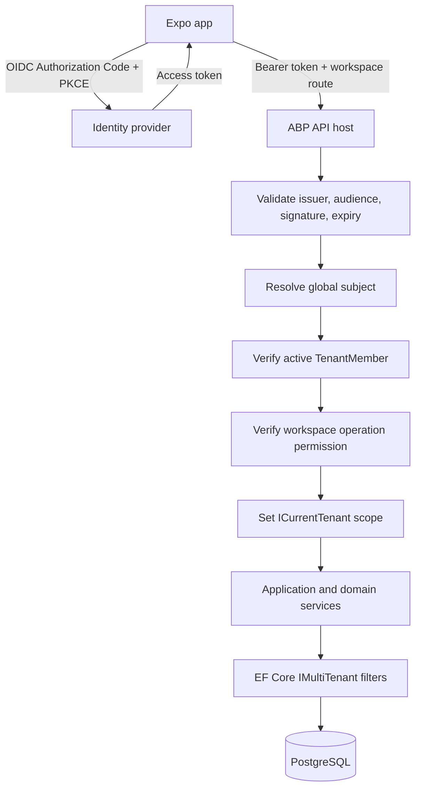

# Kepnora — Authentication and Authorization Architecture

**Intended location:** `docs/architecture/authentication-authorization.md`  
**Version:** 1.0 — implementation-oriented draft  
**Status:** Proposed architecture with a **blocking identity POC**  
**Stack:** .NET 10 · ASP.NET Core · ABP Framework · PostgreSQL · React Native / Expo  
**Related:** `architecture-decision-records.md` (ADR-004–008, 017–018, 023, 025), `tenant-isolation.md`, `../database-overview.md`, `../mvp-build-order.md`

> **Fundamental rule:** Authentication identifies a global user. Workspace membership authorizes entry to a workspace. Operation permissions authorize an action. `ICurrentTenant` scopes data; it never establishes the right to access that data.

---

## 1. Purpose

This specification defines the complete Phase 1 identity and access flow: sign-up, login, token refresh, logout, mobile session restoration, workspace onboarding, workspace selection, invitation/membership, roles, permission checks, protected API calls, tenant context, revocation and security testing.

The most consequential unresolved question is whether the chosen ABP Identity/OpenIddict configuration can support **one global login identity with memberships in multiple ABP tenants** without conflicting with tenant-local user storage or permission behavior. **Do not implement the full onboarding system until this is proven.**

The proposed code in this document is illustrative and must be adapted to the **pinned ABP version and actual generated OpenAPI**. No routes or interfaces below are asserted to be framework defaults.

## 2. Phase 1 scope

**Included:** personal accounts; authentication; workspace provisioning; workspace list/switch; Owner and Member roles; invitation acceptance if selected for MVP; protected asset, property, maintenance and document operations; push-device association; audit; session and permission revocation.

**Excluded:** enterprise SAML SSO, public sharing, organization billing, provider identity/portals, marketplace trust verification, bookings, payments and complex RBAC role editors. Those may be considered in later phases.

## 3. Domain vocabulary

| Concept | Meaning | Source of truth |
|---|---|---|
| Global subject | Stable identity of one person across workspaces | Chosen Identity/OIDC architecture |
| Workspace | User-facing collection of assets and people | One ABP tenant |
| ABP tenant | Platform's authoritative workspace tenant | ABP Tenant Management |
| Membership | `(TenantId, GlobalUserId)` role/status | Kepnora `TenantMembers` |
| Owner | Member allowed to administer workspace | Membership and permission evaluator |
| Member | Member allowed to use regular features | Membership and permission evaluator |
| Permission | Specific allowed operation | Server-side permission policy |
| Active workspace | User's selected workspace in mobile UI | Client state, **not** authority |
| Tenant scope | Ambient ABP data filtering context | `ICurrentTenant` |
| Session | Tokens plus server-side identity/revocation state | Identity provider and mobile secure storage |

One global user may be Owner of Workspace X and Member of Workspace Y. Their role in X must not grant Owner access in Y.

## 4. Non-negotiable invariants

1. **One workspace equals one ABP tenant**; do not create a parallel custom `Tenants` registry.
2. **One global user can join multiple ABP tenants**; prove feasibility before M1.
3. **Every protected workspace request** requires active membership and the operation permission.
4. `ICurrentTenant.Change` does not prove membership; a valid JWT does not prove workspace access.
5. Workspace IDs in routes, headers or bodies are untrusted until authorized.
6. Tenant-owned domain entities require a non-null tenant ID, even if ABP `IMultiTenant` exposes nullable `Guid?`.
7. A resource lookup must constrain both workspace tenant ID and resource ID.
8. Tenant membership changes must take effect within a defined revocation bound.
9. The mobile app must not show cached data from one workspace after switching to another.
10. Authentication and authorization failures must not leak data or resource existence from another workspace.
11. Workers use explicit service authority and trusted tenant context, not fabricated human identities.
12. Tokens, secrets and S3 presigned URLs must not appear in logs or analytics events.

## 5. High-level request model



No client-controlled parameter can skip `Member` or `Permission`. The order of membership lookup and ABP tenant resolution needs version-specific integration work; the invariant remains the same even if the implementation uses middleware/interceptors instead of an explicit pipeline.

## 6. Identity architecture decision gate

### 6.1 Candidate A — ABP Identity / OpenIddict

Use a host/global identity subject, OpenIddict for OIDC token issuance, and Kepnora membership/permission bridging. **Do not assume** ABP's out-of-the-box tenant-local user and role model matches this requirement.

**Advantages:** integrates with ABP conventions and identity administration.  
**Risks:** host vs tenant user stores, tenant resolution at login, tenant-specific role grants, refresh token claims and ABP permission provider behavior.

### 6.2 Candidate B — External OIDC provider

Use an external identity provider with one global subject. ABP validates access tokens, maps the external subject to an internal stable identifier and performs workspace authorization via `TenantMembers`.

**Advantages:** clear separation between login identity and tenant membership.  
**Risks:** token validation, user provisioning, account linking, logout/revocation, vendor cost and complexity.

### 6.3 Selection matrix

| Criterion | Candidate A | Candidate B | Required proof |
|---|---|---|---|
| One global subject across X/Y | Unknown pending POC | Likely by design, verify | Same user logs in once |
| Tenant-specific roles | Custom bridge may be needed | Custom bridge needed | Owner X / Member Y |
| Native PKCE login | Verify OpenIddict setup | Verify provider SDK | iOS/Android device flow |
| Refresh/logout | Verify server/client semantics | Verify provider semantics | Expiry/revocation tests |
| ABP permissions | Integration POC | Integration POC | No role leakage |
| Operations/cost | Depends on hosting/edition | Depends on provider | Cost and support review |

**Decision remains OPEN** until ADR-005 is updated with evidence, exact package versions, diagrams and test results.

## 7. M0 proof of concept: executable acceptance

### Test setup

- Provision ABP tenants X and Y through the actual Tenant Management module.
- Create global user U using the selected identity approach.
- Add U as Owner of X and Member of Y.
- Create user V who owns Y but has no membership in X.
- Create one asset in each tenant.
- Obtain real signed access tokens through the selected flow.

### POC scenarios

| ID | Action | Required result |
|---|---|---|
| AUTH-POC-01 | U logs in once | Stable global subject |
| AUTH-POC-02 | U lists workspaces | X and Y only |
| AUTH-POC-03 | U reads X asset | Allowed |
| AUTH-POC-04 | U reads Y asset | Allowed |
| AUTH-POC-05 | U manages X membership | Allowed |
| AUTH-POC-06 | U manages Y membership | Denied |
| AUTH-POC-07 | V reads X asset | Denied without leak |
| AUTH-POC-08 | Remove U from Y | Next Y request denied within policy |
| AUTH-POC-09 | U refreshes token | No unauthorized Y restoration |
| AUTH-POC-10 | U logs out and signs back in | X remains accessible, Y remains denied |
| AUTH-POC-11 | Change tenant header/body | Cannot elevate or switch scope |
| AUTH-POC-12 | Inspect database | One authoritative ABP tenant registry |

**M0 exit artifacts:** compiled solution, test report, actual ABP schema, chosen identity provider, configured issuer/audience, route/tenant resolver policy, global user identifier mapping, permission bridge and ADR-005 approval.

## 8. Authentication protocol

### 8.1 Recommended native mobile flow

Use **OpenID Connect Authorization Code with PKCE** through the system browser. Avoid collecting user passwords in custom mobile forms unless a documented security review explicitly approves that architecture. Never embed a client secret in the Expo app.

```text
Expo app -> system browser -> identity authorization endpoint
         <- redirect with authorization code
Expo app -> token endpoint + PKCE verifier
         <- access token (+ refresh token if supported)
Expo app -> GET /api/me/workspaces
         <- authorized workspace summaries
```

The redirect URI, deep-link scheme, token scopes and exact SDK APIs must be verified against the selected provider and Expo version. Use an approved browser authentication library rather than a homemade OAuth implementation.

### 8.2 Token validation

The API validates signature, algorithm, issuer, audience, expiry and intended scope. Reject unsigned tokens and tokens from an untrusted issuer. Map the provider's stable subject to the internal global user key using a single documented strategy.

**Do not treat** email address, display name or mutable username as a stable identity key.

### 8.3 Token claims

Claims may include subject, issuer, audience, expiry and scopes. Workspace membership and role claims are optional hints; **membership database remains authoritative** for current access. Do not issue a permanently trusted list of tenant IDs in a long-lived token.

## 9. Session and refresh lifecycle

| Event | Client action | Server behavior |
|---|---|---|
| First login | Browser + PKCE | Issue validated session |
| App restart | Restore secure credentials | Validate/refresh as needed |
| Access token near expiry | Single-flight refresh | Validate refresh policy |
| Refresh failure | Clear session and navigate to login | Reject protected requests |
| Logout | Clear secure storage and tenant caches | Revoke tokens/session when supported |
| Password/identity change | Reauthenticate when required | Apply provider security policy |
| Workspace membership revoked | Remove workspace from UI after denial | Deny protected requests |

Use a **single-flight refresh** mechanism so parallel API requests do not rotate the same refresh token concurrently. Refresh-token rotation and reuse detection depend on the chosen provider and must be tested rather than assumed.

## 10. React Native storage rules

- Store access and refresh tokens in **Expo SecureStore**, subject to platform behavior and supported size constraints.
- Do not store credentials in AsyncStorage, Zustand persistence or analytics.
- Persist only non-secret UI preferences in ordinary storage.
- Clear all tenant-scoped caches and sensitive state at logout.
- Handle SecureStore restoration failure as signed-out state.
- On app resume, verify token validity and refresh membership-sensitive data.
- Do not log authorization headers or tokens in request interceptors.

### Illustrative session interface

```typescript
export interface AuthSession {
  accessToken: string;
  expiresAtEpochSeconds: number;
  refreshToken?: string;
}

export interface AuthProvider {
  signIn(): Promise<void>;
  getAccessToken(): Promise<string | null>;
  refresh(): Promise<string | null>;
  signOut(): Promise<void>;
}
```

The interface is Kepnora-specific sample code, not a claim about Expo or an ABP SDK.

## 11. First-login onboarding

1. Complete OIDC login and resolve the global user.
2. Query active workspaces for the subject.
3. If none exist, offer to create a personal workspace.
4. Create workspace through a **server-controlled, idempotent** provisioning workflow.
5. Provision ABP tenant, workspace profile and first Owner membership.
6. Mark workspace Ready only after membership and authorization are verified.
7. Select workspace and navigate to empty dashboard.
8. Offer property creation, but allow the user to skip it.
9. Allow standalone assets with `PropertyId = NULL`.

Do not force every account to create a property. Do not mark onboarding complete merely because an ABP tenant row was inserted.

## 12. Workspace provisioning failure recovery

A workflow may crash after ABP tenant creation but before first Owner membership. A naive retry might create duplicate tenants.

**Proposed state model:** `Pending` → `Ready`, with `Failed`/retry reconciliation if needed. These are **provisioning workflow states**, not a second tenant registry.

| Failure point | Recovery requirement |
|---|---|
| Before tenant creation | Retry safely |
| After tenant creation, before membership | Reuse same tenant via idempotency key |
| After membership, before response | Return existing Ready workspace |
| Concurrent duplicate requests | At most one workspace per idempotency operation |
| Permanent provisioning error | Preserve diagnostic/audit evidence |

The exact transaction boundaries depend on the ABP Tenant Management service and database setup. Do not claim one database transaction covers all steps until verified.

## 13. Workspace membership schema

The canonical model is `TenantMembers(TenantId, UserId, Role, Status, ...)` as described in `database-overview.md`. `TenantId` refers to the ABP tenant. `UserId` refers to the **global identity key selected in M0**.

```sql
-- Conceptual index; reconcile with actual EF Core migration.
CREATE UNIQUE INDEX "UX_TenantMembers_TenantId_UserId"
    ON "TenantMembers" ("TenantId", "UserId");

CREATE INDEX "IX_TenantMembers_UserId_Status"
    ON "TenantMembers" ("UserId", "Status");
```

If `(TenantId, UserId)` is already the primary key, the separate unique index is redundant and must **not** be created. Treat this as a query-shape illustration, not deployable DDL.

## 14. Membership state machine

```text
Invited --accept--> Active --remove--> Removed
    |                  |
    +--expire--------> Removed
                       |
                       +--reinvite--> Invited (policy dependent)
```

Only `Active` membership grants access. Invitation acceptance must bind to the intended authenticated global subject, not just an unverified email string. Expiration, invite revocation and rejoining semantics require a product policy before implementation.

## 15. Permission model

Use named permissions rather than scattering string checks of role names across controllers.

| Permission | Owner | Member |
|---|---|---|
| `Kepnora.Workspace.View` | Yes | Yes |
| `Kepnora.Workspace.Manage` | Yes | No |
| `Kepnora.Members.Manage` | Yes | No |
| `Kepnora.Properties.Read` | Yes | Yes |
| `Kepnora.Properties.Write` | Yes | Yes |
| `Kepnora.Assets.Read` | Yes | Yes |
| `Kepnora.Assets.Write` | Yes | Yes |
| `Kepnora.Maintenance.Read` | Yes | Yes |
| `Kepnora.Maintenance.Write` | Yes | Yes |
| `Kepnora.Documents.Read` | Yes | Yes |
| `Kepnora.Documents.Write` | Yes | Yes |
| `Kepnora.Notifications.ManageOwn` | Yes | Yes |

These are **proposed Kepnora permission names**, not ABP built-ins. Define them once in Application.Contracts or the appropriate permission-definition module. Confirm the ABP permission integration can evaluate the **membership role in the requested workspace**.

## 16. Authorization order

For a workspace-scoped API call:

1. Authenticate and resolve stable global subject.
2. Validate workspace ID syntax and resolve ABP tenant existence safely.
3. Read **active membership** from a trusted host/global-safe source.
4. Evaluate named operation permission in that workspace.
5. Enter scoped `ICurrentTenant.Change(workspaceId)`.
6. Query requested resource by `(TenantId, Id)`.
7. Validate related entities and domain invariants.
8. Execute mutation with concurrency and idempotency protection.
9. Emit audit/outbox events and return a safe response.

Membership lookup may require a carefully designed host-side repository because normal tenant filters can hide cross-workspace membership data. This exception does **not** authorize globally querying asset or maintenance tables.

## 17. Authorization service contract

```csharp
public interface IWorkspaceAuthorizationService
{
    Task RequireAsync(
        Guid workspaceId,
        Guid globalUserId,
        string permission,
        CancellationToken cancellationToken = default);
}
```

### Illustrative implementation

```csharp
public sealed class WorkspaceAuthorizationService
    : IWorkspaceAuthorizationService
{
    private readonly ITenantMembershipReader _membershipReader;
    private readonly IWorkspacePermissionEvaluator _permissionEvaluator;

    public WorkspaceAuthorizationService(
        ITenantMembershipReader membershipReader,
        IWorkspacePermissionEvaluator permissionEvaluator)
    {
        _membershipReader = membershipReader;
        _permissionEvaluator = permissionEvaluator;
    }

    public async Task RequireAsync(
        Guid workspaceId,
        Guid globalUserId,
        string permission,
        CancellationToken cancellationToken = default)
    {
        var membership = await _membershipReader.FindActiveAsync(
            workspaceId, globalUserId, cancellationToken);

        if (membership is null)
        {
            throw new AbpAuthorizationException(
                "Active workspace membership is required.");
        }

        if (!await _permissionEvaluator.IsGrantedAsync(
            workspaceId, globalUserId, permission, cancellationToken))
        {
            throw new AbpAuthorizationException(
                "The requested operation is not permitted.");
        }
    }
}
```

`ITenantMembershipReader` and `IWorkspacePermissionEvaluator` are proposed application interfaces. The exception, DI registrations, ABP authorization hooks and exact repository APIs must be verified against the pinned framework version.

## 18. Protected application service example

```csharp
public async Task<AssetDto> GetAsync(
    Guid workspaceId,
    Guid assetId,
    CancellationToken cancellationToken)
{
    var globalUserId = _globalUserContext.RequireUserId();

    await _workspaceAuthorization.RequireAsync(
        workspaceId,
        globalUserId,
        KepnoraPermissions.Assets.Read,
        cancellationToken);

    using (_currentTenant.Change(workspaceId))
    {
        var asset = await _assetRepository.FirstOrDefaultAsync(
            x => x.TenantId == workspaceId && x.Id == assetId,
            cancellationToken: cancellationToken);

        if (asset is null)
        {
            throw new EntityNotFoundException(typeof(Asset), assetId);
        }

        return ObjectMapper.Map<Asset, AssetDto>(asset);
    }
}
```

**Illustrative only.** Adapt repository overloads, global user context, ABP exception mapping and cancellation support to the actual scaffold. Avoid duplicate authorization checks that disagree between middleware and Application Services; document the single authoritative enforcement strategy.

## 19. Tenant resolution and route strategy

Proposed API shape:

```http
GET    /api/me/workspaces
POST   /api/me/workspaces
GET    /api/workspaces/{workspaceId}/assets
POST   /api/workspaces/{workspaceId}/assets
GET    /api/workspaces/{workspaceId}/assets/{assetId}
POST   /api/workspaces/{workspaceId}/maintenance/occurrences/{id}/complete
```

These are **product routes**, not confirmed ABP auto-controller URLs. Confirm final route shape via OpenAPI after M0.

**Rules:**

- Route workspace ID is a requested scope, not a trusted claim.
- Reject conflicting tenant header/route values.
- Reject or ignore `TenantId` in DTO bodies consistently.
- Never let an untrusted tenant resolver change scope without membership verification.
- API should avoid revealing whether a private tenant exists to non-members.

## 20. ABP `ICurrentTenant` and `IMultiTenant`

ABP's `IMultiTenant` filter helps constrain tenant-owned EF Core entities to the ambient tenant. `ICurrentTenant.Change` changes that ambient context for a scope.

```csharp
using (_currentTenant.Change(workspaceId))
{
    // Membership and operation permission were checked first.
    await _assetRepository.InsertAsync(asset);
}
```

**Never** use `Change(workspaceId)` alone as proof that the caller is allowed to act. Verify `TenantId` is non-null on tenant-owned entities in domain and database constraints, even though `IMultiTenant.TenantId` is nullable by interface design.

## 21. Resource ownership enforcement

### Asset creation

Validate active membership and Assets.Write; validate that optional `PropertyId` belongs to the same tenant; validate selected asset type is global or tenant-owned; validate published schema version and JSONB fields; derive `TenantId` on server.

### Maintenance completion

Validate occurrence, rule and asset all belong to requested tenant. Ensure occurrence is `Open`; insert one history record, transition to `Completed`, update anchor and add outbox event in one Unit of Work. Prevent duplicate completion.

### Document access

Authorize workspace membership and document ownership **before** issuing presigned S3 URLs. Previously issued URLs remain valid until expiry, so use short TTL and avoid logging them.

### Dashboard and search

Apply tenant scope in the database query, not after fetching results into memory. Do not leak aggregate counts or search suggestions from another tenant.

## 22. Owner/Member administration

Proposed rules:

- Owner can invite/remove members and change permitted workspace roles.
- Member cannot manage membership.
- A user cannot elevate their own role through a client payload.
- The **last active Owner** cannot be removed or demoted.
- Concurrent Owner removals must be protected transactionally.
- Revoked users lose access even if their access token is still valid.
- Membership changes must emit audit events and invalidate relevant caches.

Last-owner safety cannot be guaranteed by a simple UI confirmation or an unprotected `COUNT(*)` followed by delete. Use an appropriate transaction/lock or concurrency strategy proven in PostgreSQL tests.

## 23. Invitations and account linking

Invitation support is a Phase 1 design option, not a claim that implementation already exists. If included:

1. Owner invites a normalized email address or stable intended identity.
2. Server creates a time-limited, single-use invitation token stored hashed.
3. Recipient authenticates using the global identity provider.
4. Server verifies the intended recipient binding and token state.
5. Membership is created or activated idempotently.
6. Invite token is consumed and audited.

**Never** accept an invitation solely because the client supplies the invited email. Define policies for email changes, existing members, expired invitations, duplicate invitations and account linking before enabling the flow.

## 24. Revocation and cache strategy

Membership checks can be cached only if a documented revocation bound is met. For initial beta, prefer simple authoritative reads or very short TTL with explicit invalidation rather than long-lived role claims.

| Event | Required behavior |
|---|---|
| Remove member | Deny protected requests within approved bound |
| Change Owner → Member | Immediately or promptly remove Owner-only permissions |
| Delete workspace | Stop access and future worker operations |
| Sign out | Clear client secrets/caches; revoke provider session if supported |
| Disable global user | Block all workspaces |
| Rotate refresh token | Old token reuse handled per provider policy |

The revocation bound is an **open operational decision**. It must be measurable and tested; do not claim instantaneous revocation if a cache or signed token prevents it.

## 25. Mobile navigation and workspace switching

```text
App launch
  ├── No valid session -> Login
  └── Valid session -> Fetch my workspaces
          ├── None -> Create workspace
          ├── One -> Select automatically
          └── Multiple -> Workspace picker
                    -> Dashboard
                    -> Assets / Maintenance / Documents / Settings
```

When switching X → Y:

1. Update active workspace only after Y is verified accessible.
2. Cancel X in-flight requests where supported.
3. Partition or invalidate TanStack Query data by workspace ID.
4. Reset workspace-specific Zustand slices.
5. Discard stale X responses if they arrive after switch.
6. Reload dashboard and permissions for Y.
7. Handle a revoked workspace by navigating to the picker.

### Query-key convention

```typescript
export const assetKeys = {
  list: (workspaceId: string, filters: AssetFilters) =>
    ['workspace', workspaceId, 'assets', 'list', filters] as const,
  detail: (workspaceId: string, assetId: string) =>
    ['workspace', workspaceId, 'assets', 'detail', assetId] as const,
};
```

No client cache partition substitutes for backend authorization.

## 26. Client API request and refresh handling

```typescript
export async function authorizedFetch(
  url: string,
  init: RequestInit,
  auth: AuthProvider
): Promise<Response> {
  const token = await auth.getAccessToken();
  if (!token) throw new Error('Authentication required');

  const headers = new Headers(init.headers);
  headers.set('Authorization', `Bearer ${token}`);

  return fetch(url, { ...init, headers });
}
```

This minimal example intentionally omits refresh retries. The production implementation needs a single-flight refresh coordinator, bounded retry (never infinite 401 loops), abort signals and an error mapper. Do not replay non-idempotent mutations automatically unless an idempotency key or equivalent protection exists.

## 27. Error contract

| Condition | Suggested HTTP status | UI behavior |
|---|---|---|
| No/expired authentication | 401 | Refresh once or return to login |
| No active workspace membership | 403 | Remove workspace from picker / show access lost |
| Insufficient operation permission | 403 | Explain action unavailable |
| Cross-tenant asset ID | 404 | Safe not-found screen |
| Concurrent update | 409 | Reload and show conflict |
| Invalid input | 400 or 422 | Field-level validation |
| Rate limited | 429 | Respect retry policy |
| Unexpected failure | 500 | Generic error and correlation ID |

Actual ABP error envelopes and exception mapping must be confirmed in integration tests. Do not expose private tenant or asset names in denied responses.

## 28. Authentication threat model

| Threat | Mitigation | Test |
|---|---|---|
| Token theft | SecureStore, TLS, short access token lifetime | Storage/log review |
| OAuth code interception | PKCE and exact redirect URI | Auth callback tests |
| Wrong issuer/audience | Strict JWT validation | Forged token test |
| Stale membership claim | DB membership check | Revoke while token valid |
| Tenant header spoofing | Authorized resolver | Header/route mismatch |
| IDOR against asset | `(TenantId, Id)` lookup | Guess Y asset from X |
| Role escalation | Server-side permission evaluator | Member modifies role |
| Invitation token reuse | Single-use hashed token | Double accept |
| Refresh token race | Single-flight refresh | Parallel 401 requests |
| Cross-workspace cache leak | Workspace-keyed query cache | Switch during fetch |
| Worker impersonation | Service authority | Job without user context |
| Logout with stale app state | Cache and token purge | Relaunch/deep link |

## 29. Backend test fixture

```text
Global User U1
  - Tenant X: Owner, Active
  - Tenant Y: Member, Active
Global User U2
  - Tenant Y: Owner, Active
Global User U3
  - No membership

Asset AX -> Tenant X
Asset AY -> Tenant Y
Property PX -> Tenant X
Property PY -> Tenant Y
```

Every protected Application Service should be tested with this fixture, including denied cross-tenant resource IDs, role checks, stale membership and direct repository access. Use real PostgreSQL for relational and EF Core tenant-filter verification.

## 30. Test catalog

| ID | Scenario | Expected |
|---|---|---|
| AUTH-001 | Anonymous calls protected API | 401 |
| AUTH-002 | Wrong issuer token | 401 |
| AUTH-003 | Wrong audience token | 401 |
| AUTH-004 | Expired token without refresh | 401 |
| AUTH-005 | U1 lists workspaces | X and Y only |
| AUTH-006 | U3 lists workspaces | None |
| AUTH-007 | U1 reads X asset | Allowed |
| AUTH-008 | U1 reads Y asset | Allowed |
| AUTH-009 | U1 manages X members | Allowed |
| AUTH-010 | U1 manages Y members | 403 |
| AUTH-011 | U2 reads X asset | Safe denial |
| AUTH-012 | U1 changes body TenantId | Cannot change scope |
| AUTH-013 | U1 changes tenant header | Cannot change scope |
| AUTH-014 | U1 requests AY under X route | Safe 404 |
| AUTH-015 | U1 references PY from X asset | Rejected |
| AUTH-016 | U1 revoked from Y | Y access denied within bound |
| AUTH-017 | U1 refreshes after Y revocation | Y remains denied |
| AUTH-018 | Two simultaneous last-owner removals | At least one rejected |
| AUTH-019 | Duplicate workspace provisioning | One resulting workspace |
| AUTH-020 | Crash after ABP tenant creation | Retry recovers membership |
| AUTH-021 | Concurrent refresh attempts | Single refresh flight |
| AUTH-022 | Logout then deep link | Login required |
| AUTH-023 | Switch X→Y during X fetch | No X data shown in Y |
| AUTH-024 | Invitation accepted twice | One membership |
| AUTH-025 | Expired invitation accepted | Denied |
| AUTH-026 | Cross-tenant S3 download | Denied |
| AUTH-027 | Revoked member pending push | Suppressed |
| AUTH-028 | Worker X handles Y rule | Denied or safely skipped |
| AUTH-029 | Logs after auth failure | No token/presigned URL |
| AUTH-030 | One global user in two ABP tenants | POC passed |

## 31. Observability and audit

Capture correlation ID, global subject (or service principal), requested tenant ID, permission, resource ID and result. Avoid logging passwords, access/refresh tokens, invitation tokens, personal document contents or presigned URLs.

Recommended events:

- Login success/failure (avoid sensitive identity leakage).
- Workspace created, selected, provisioning failed/recovered.
- Membership invited, activated, revoked or role changed.
- Permission denied and cross-tenant resource denied.
- Session revoked or suspicious refresh reuse detected.
- Administrative tenant-filter bypass, if ever allowed.

Audit retention and privacy policy must be decided before production.

## 32. Database and transaction considerations

- ABP Tenant Management owns the authoritative tenant registry.
- `TenantMembers` references that registry and the chosen global identity key.
- Use unique membership `(TenantId, UserId)`.
- Index membership by global user for workspace listing.
- Protect last-owner and invitation acceptance invariants transactionally.
- Domain FK constraints must prevent cross-tenant references.
- A membership table alone does not authorize a request; the server must enforce it.
- A valid `ICurrentTenant` does not prove membership.
- Do not assume ABP host/tenant identity FKs until M0 schema inspection.

## 33. Background jobs and service principals

Jobs have no interactive user session. They must carry a **trusted persisted tenant ID**, enter a bounded `ICurrentTenant.Change` scope and use explicit service authorization. Do not fabricate a user ID to bypass membership checks.

A reminder worker must also revalidate the **recipient's** active membership, notification preference and occurrence state before sending. A worker's authority to process tenant X is not permission to notify a removed member.

## 34. Delivery milestones

| Milestone | Authentication/authorization work | Exit evidence |
|---|---|---|
| M0 | ABP compatibility, global identity POC, PKCE, resolver design | Compiled demo + ADR-005 |
| M1 | Login/session, membership, workspace provisioning, roles | Integration suite + mobile onboarding |
| M2 | Property/type permission and visibility | Tenant-crossing tests |
| M3 | Asset ownership and concurrency | CRUD + IDOR tests |
| M4 | Maintenance graph and completion permissions | Concurrent completion tests |
| M5 | S3 upload/download authorization | Presign/finalize tests |
| M6 | Worker authority, push recipient revalidation | Retry/revocation tests |
| M7 | Dashboard/search scope, mobile cache isolation | Switch and search tests |
| M8 | Full security review, restore and beta | Go/no-go evidence |

## 35. Open decisions register

| ID | Decision | Needed by |
|---|---|---|
| OAUTH-01 | ABP Identity/OpenIddict vs external OIDC | M0 |
| OAUTH-02 | Exact global user identifier and mapping | M0 |
| OAUTH-03 | ABP permission integration strategy | M0 |
| OAUTH-04 | Route/tenant resolver precedence | M0 |
| OAUTH-05 | Exact ABP edition/version compatible with .NET 10 | M0 |
| OAUTH-06 | Membership revocation bound and cache policy | M1 |
| OAUTH-07 | Invitation flow included in initial MVP? | M1 |
| OAUTH-08 | Last-owner transaction/locking strategy | M1 |
| OAUTH-09 | Refresh rotation, session lifetime and logout semantics | M1 |
| OAUTH-10 | Aggregate concurrency token choice | M1/M3 |
| OAUTH-11 | Sensitive audit retention | M8 |
| OAUTH-12 | Account deletion and token revocation policy | M8 |

## 36. Definition of done

- [ ] Selected identity provider and ABP package versions are pinned.
- [ ] One global subject can access X and Y with different permissions.
- [ ] One ABP tenant registry exists; no duplicate custom Tenants table.
- [ ] All protected APIs enforce active membership and named permissions.
- [ ] `ICurrentTenant` is used only after authorization or via an equivalent trusted enforcement mechanism.
- [ ] Revoked membership is denied within a measured policy bound.
- [ ] Workspace provisioning is idempotent and recoverable.
- [ ] Last Owner cannot be removed by concurrent requests.
- [ ] Mobile login uses an approved PKCE flow and SecureStore.
- [ ] Refresh/logout/session restoration are tested on iOS and Android.
- [ ] Workspace switching cannot show stale tenant data.
- [ ] Cross-tenant asset, maintenance, document and search requests are denied.
- [ ] Worker service authority and recipient checks are tested.
- [ ] Authentication error responses and logs do not expose secrets.
- [ ] `AUTH-*` and `AUTH-POC-*` test suites pass on real infrastructure where required.

## 37. Final implementation guidance

**Do not begin by writing a login screen and assuming identity is solved.** First prove the global-user-to-multiple-ABP-tenants model with real signed tokens, permissions and tenant-owned records. Then build onboarding and workspace membership on that proven foundation. This is the dependency that protects every later Kepnora module from expensive architectural rework.
