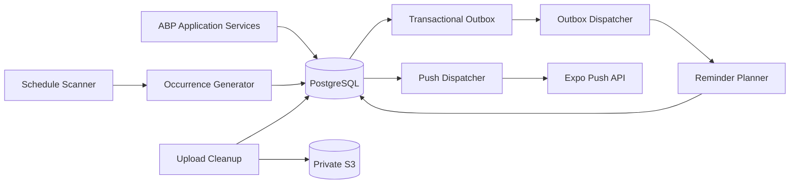

# Kepnora — Background Jobs, Outbox and Reliable Processing

**Intended path:** `docs/architecture/background-jobs-and-outbox.md`  
**Version:** 1.0-draft  
**Status:** Implementation-oriented architecture; provider and ABP package APIs pending M0 POC  
**Scope:** Phase 1 MVP · .NET 10 · ABP Framework · EF Core · PostgreSQL · AWS S3 · Expo Push  
**Related:** `architecture-decision-records.md` (ADR-005, ADR-008, ADR-011–016), `tenant-isolation.md`, `authentication-authorization.md`, `../database-overview.md`, `../mvp-build-order.md`

---

## 1. Purpose

This specification defines the **durable background execution model** for Kepnora's Phase 1 asset maintenance platform. It covers maintenance occurrence generation, reminder planning, Expo push dispatch, S3 upload-intent cleanup, outbox publication, retries, concurrency, observability, failure recovery, authorization and operational testing.

The objective is to keep background work correct when the API restarts, multiple worker replicas run, external providers time out, and a user changes workspaces or revokes a membership.

**Do not assume that an ABP background job API, event outbox or distributed locking behavior exists in a particular form until the selected ABP version and edition are pinned and compiled.** Code snippets below are architectural examples, not guaranteed drop-in ABP APIs.

## 2. Scope and non-goals

**Included:** deterministic maintenance schedule generation; time/mileage reminder evaluation; outbox persistence; delivery intent deduplication; Expo token dispatch; upload-intent expiration and orphan reconciliation; retries, leases, metrics and tenant-safe workers.

**Excluded:** Phase 2 provider discovery sync, provider quote ingestion, Phase 3 booking/payment processing, user-visible exact-once push delivery and unbounded cron jobs that load all tenants into memory.

## 3. Invariants

| ID | Invariant | Test |
|---|---|---|
| JOB-01 | Every tenant-owned job carries a trusted ABP TenantId | Forged tenant payload denied |
| JOB-02 | Worker tenant context is restored after each job | X then Y isolation test |
| JOB-03 | Background jobs never fabricate human membership | Service authority test |
| JOB-04 | Occurrence generation uses deterministic schedule keys | Repeated batch test |
| JOB-05 | Only Open/Completed/Skipped/Cancelled are persisted lifecycle values | SQL check test |
| JOB-06 | Upcoming/Due/Overdue are derived read states | Clock tests |
| JOB-07 | No mileage is invented; unknown readings stay unknown | No-reading test |
| JOB-08 | Completion, history and outbox write are one DB transaction | Fault injection |
| JOB-09 | External side effects cannot participate in PostgreSQL UoW | Crash after send test |
| JOB-10 | Duplicate worker execution cannot duplicate logical intent | Unique key test |
| JOB-11 | Reminder dispatch rechecks membership and occurrence | Revocation test |
| JOB-12 | S3 objects remain private; cleanup is scoped | Cross-tenant cleanup test |
| JOB-13 | Workers process bounded batches | Large backlog test |
| JOB-14 | Poison jobs are observable and recoverable | DLQ/replay test |
| JOB-15 | ABP outbox and custom outbox must not duplicate one event stream | Schema/handler audit |

## 4. Processing topology



The drawing separates **logical roles**; it does not mandate a microservices deployment. A single ABP host plus one separately scaled worker process is sufficient initially. Run workers as hosted services only if process lifetime, deployment and shutdown guarantees are acceptable.

## 5. M0 infrastructure decision gate

Choose exactly one implementation for each responsibility:

| Concern | Candidate | Proof required |
|---|---|---|
| Persistent job scheduling | ABP-supported background job provider, or dedicated scheduler | Survives restart and supports multi-replica coordination |
| Domain event outbox | ABP distributed event outbox, or custom PostgreSQL outbox | Same transaction as business write; retry-safe |
| Worker claim/lease | Provider's native claim, or PostgreSQL `FOR UPDATE SKIP LOCKED` | Two replicas do not process same lease concurrently |
| Recurring scan | Provider scheduler or hosted timer with durable checkpoint | Catch-up after downtime |
| Service authority | Explicit backend service principal/context | No spoofed user identity |
| Concurrency token | Pinned ABP concurrency stamp or mapped version | Conflicts observable |

**Decision rule:** prefer the ABP-native capability when it demonstrably meets the semantics. Do not install both ABP distributed event outbox and a second custom outbox for the same domain event.

## 6. Transactional consistency model

```text
HTTP command or worker domain operation
  BEGIN PostgreSQL transaction
    Validate tenant and domain state
    Mutate aggregate
    Insert history / occurrence as needed
    Insert outbox event (same transaction)
  COMMIT

Independent dispatcher
  Claim outbox event
  Invoke idempotent handler / external service
  Record success or retry metadata
```

**No distributed transaction** spans PostgreSQL and Expo/S3. Database atomicity guarantees only the state and outbox row committed together; the external effect is delivered at least once or best effort according to provider behavior.

## 7. Delivery semantics vocabulary

- **At-most-once:** work may be lost, but not retried.
- **At-least-once:** work is retried; duplicate execution is possible.
- **Effectively once:** logical database effect is unique due to idempotency constraints, even if handler executes repeatedly.
- **Exactly once end-to-end:** not promised for Expo push or S3 operations.
- **Retryable:** transient failures can be attempted again safely.
- **Poison job:** permanently failing work moved to an observable terminal/dead-letter state.

Never label a push notification “delivered” merely because Expo accepted a send request; provider tickets and device receipt have different semantics.

## 8. Job taxonomy

| Job | Trigger | Tenant scope | Idempotency key | External dependency |
|---|---|---|---|---|
| OccurrenceGeneration | Scheduled scan, rule create/edit, completion | Tenant | `(TenantId, RuleId, ScheduleKey)` | None |
| ReminderPlanning | Due evaluation / occurrence change | Tenant | `(TenantId, OccurrenceId, RecipientId, ReminderKind, WindowKey)` | None |
| PushDispatch | Pending reminder intent | Tenant + global device | DeliveryIntent ID | Expo |
| UploadIntentCleanup | Expiration schedule | Tenant | Intent ID / object key | S3 |
| OutboxDispatch | Committed outbox row | Tenant or explicit global | Event ID | Depends on handler |
| DeviceTokenCleanup | Provider invalid-token response | User-global | Token fingerprint | Expo result |
| Reconciliation | Startup / periodic recovery | Tenant or explicitly host-scoped | Batch/checkpoint | PostgreSQL/S3 |

## 9. Database schema ownership

The actual schema is defined in `database-overview.md` and compiled EF Core migrations. The following names are **logical examples**; do not create duplicate tables if the chosen ABP outbox/job provider already owns them.

- `MaintenanceRules`, `MaintenanceOccurrences`, `MaintenanceRecords`, `AssetOdometerReadings`
- `NotificationPreferences`, `ReminderDeliveries`, `DeviceRegistrations`
- `UploadIntents`, `Documents`
- Selected outbox and scheduler tables, owned by the selected provider

Use PostgreSQL, PascalCase identifiers, uppercase SQL keywords, named constraints and tenant-aware keys.

## 10. Outbox envelope

A domain outbox event should include:

| Field | Meaning |
|---|---|
| EventId | Stable UUID deduplication identity |
| TenantId | Trusted tenant context or explicit global marker |
| EventType | Versioned event name |
| EventVersion | Schema version |
| AggregateId | Related domain object |
| OccurredAt | UTC creation timestamp |
| Payload | Minimal immutable event data |
| CorrelationId | End-to-end tracing |
| CausationId | Triggering command/event |
| Attempts | Delivery attempt counter |
| AvailableAt | Earliest retry timestamp |
| LeaseOwner/LeaseUntil | Only if custom dispatcher chosen |
| Status | Pending, Processing, Succeeded, DeadLetter as appropriate |

Do not include access tokens, presigned S3 URLs, document contents or unredacted personal information in payloads.


## 11. Outbox claim and concurrency

Use the selected provider’s native safe claiming mechanism. If a custom PostgreSQL dispatcher is approved, claim in a short transaction using row locks and a lease. Do not hold a DB transaction open while calling Expo or S3.

```sql
SELECT
    E."Id",
    E."TenantId",
    E."EventType",
    E."Payload"
FROM "OutboxEvents" AS E
WHERE E."Status" = 'Pending'
  AND E."AvailableAt" <= NOW()
ORDER BY E."AvailableAt", E."Id"
FOR UPDATE SKIP LOCKED
LIMIT @BatchSize;
```

**Illustrative only:** `OutboxEvents` may not exist if ABP outbox is selected. Claim must atomically mark rows leased before committing; the `SELECT` alone does not implement a durable lease. Leases need expiration, fencing/version checks and heartbeat or bounded handler timeouts.

### Acceptance and regression checks

- Two dispatchers cannot own one live lease.
- Lease expires after worker crash.
- Old lease owner cannot overwrite new owner state.
- Handler never sends while DB lock is held.


## 12. Retry and backoff

Classify failures before retry: transient database timeout, provider 429/5xx, network disconnect and short-lived S3 errors are retryable; invalid token, unauthorized tenant, malformed payload and deleted aggregate are terminal or require reconciliation.

Use capped exponential backoff with jitter, bounded attempts, and a dead-letter record. Retry policy belongs to the selected provider; do not layer multiple independent retry loops without calculating the effective maximum attempts.

```text
attempt 1: immediate
attempt 2: short backoff + jitter
attempt 3: longer backoff + jitter
...
after max attempts: DeadLetter + alert + operator replay path
```

The durations are configuration, not product guarantees.

### Acceptance and regression checks

- Transient error retries.
- Permanent validation error does not hot-loop.
- Dead-letter event is visible and replayable.
- Retry preserves EventId and TenantId.


## 13. Idempotency and deduplication

Deduplication must occur at the **business effect** boundary. A unique EventId prevents duplicate event storage but cannot prevent repeated effects after a crash. Use a durable processed-event marker, deterministic occurrence schedule key, unique delivery intent and command idempotency key as appropriate.

```sql
CREATE UNIQUE INDEX "UX_MaintenanceOccurrences_Rule_ScheduleKey"
    ON "MaintenanceOccurrences" ("TenantId", "RuleId", "ScheduleKey");
```

This is an example from the domain model; verify whether the constraint already exists in the compiled migration before adding it.

### Acceptance and regression checks

- Two concurrent occurrence jobs insert one row.
- Duplicate completion creates one service record.
- Duplicate reminder planning creates one intent.
- Replayed outbox event preserves logical result.


## 14. Trusted tenant context in workers

A worker must obtain `TenantId` from trusted persisted job metadata, not from a mobile-controlled message. It must establish `ICurrentTenant.Change` only inside a bounded scope and restore it even when exceptions occur. Workers are **service principals**, not fake human users.

```csharp
public async Task ProcessAsync(Guid tenantId, Guid ruleId, CancellationToken ct)
{
    // tenantId is from a trusted persisted job, not an HTTP request body.
    using (_currentTenant.Change(tenantId))
    {
        var rule = await _rules.FindByTenantAndIdAsync(tenantId, ruleId, ct);
        if (rule is null) return;
        await _generator.GenerateAsync(rule, ct);
    }
}
```

Repository interfaces are proposed Kepnora abstractions, not claimed ABP built-ins. Host-wide scans must use explicitly privileged infrastructure, then dispatch one trusted tenant job at a time.

### Acceptance and regression checks

- Worker X cannot load rule Y.
- Tenant context restored after exception.
- Parallel worker scopes remain isolated.
- No fake user claims are issued.


## 15. Occurrence generation algorithm

For each active maintenance rule, calculate all schedule keys within a bounded planning horizon using one shared domain calculator. Insert missing `Open` occurrences under a unique `(TenantId, RuleId, ScheduleKey)` constraint. Do not change completed history during regeneration.

```text
load eligible rule and its last anchor
compute deterministic due dates / mileage thresholds
for each candidate in bounded horizon:
    derive stable schedule key
    insert if absent, protected by unique constraint
commit batch and checkpoint
```

Time rules can be scheduled-anchored or completion-anchored. The exact month-end clamp, timezone/DST and edit policy remain ADR-012 open decisions; implement tests before enabling the scheduler.

### Acceptance and regression checks

- Jan 31 monthly case deterministic.
- DST transition uses rule-local policy.
- Retry does not create duplicates.
- Completed occurrences remain immutable.


## 16. Mileage-triggered maintenance

Mileage must come from explicit user readings. No worker may estimate vehicle mileage from time or interpolate unrecorded distance. When a rule has no reading, return an `Unknown` evaluation rather than fabricating Due/Overdue.

A new reading may trigger re-evaluation. Corrections require auditable policy and must not rewrite completed service history. The schema should not silently introduce hybrid time-or-mileage semantics unless separately approved.

### Acceptance and regression checks

- No reading remains Unknown.
- Late reading reevaluates deterministically.
- Correction is auditable.
- No inferred odometer value.


## 17. Due status and lifecycle separation

Persist only `Open`, `Completed`, `Skipped`, `Cancelled` as occurrence lifecycle states. `Upcoming`, `Due`, `Overdue` are derived UI classifications based on rule-local time/mileage and grace policy.

The same calculator must power API list, dashboard counts and reminder planning. Do not let a worker persist `Overdue` in the lifecycle column.

### Acceptance and regression checks

- SQL CHECK rejects Overdue.
- Dashboard matches API on same clock.
- Overdue becomes current without mutation.
- Completed occurrence no longer planned.


## 18. Completion event emission

Completing maintenance is one database transaction: validate occurrence and asset/rule graph; insert service record; mark `Completed`; update completion anchor when applicable; insert outbox event; commit.

An external push call must not occur inside this transaction. A crash after commit must leave a durable event to retry. A crash before commit must leave no partial completion.

### Acceptance and regression checks

- Injected failure rolls back all writes.
- Crash after commit leaves pending event.
- Concurrent completion creates one record.
- Duplicate request returns stable result/conflict.


## 19. Reminder planning

For each eligible `Open` occurrence, calculate recipient-specific reminder windows and create durable delivery intents with a unique key. Use workspace timezone and recipient preference policy as specified in ADR-016.

A planner must never send directly to Expo; planning and dispatch are separate. Do not create reminders for `Skipped`, `Cancelled` or `Completed` occurrences.

### Acceptance and regression checks

- One intent per recipient/window.
- Closed occurrence has no new intent.
- Quiet-hours rules applied consistently.
- Planner restart catches missed windows.


## 20. Push dispatch

At send time re-read the occurrence and active membership, validate preferences, resolve user-global device registrations and submit minimal content to Expo. Track provider ticket and receipt semantics separately if implemented.

A provider response may confirm acceptance, not delivery to a handset. Crash after sending may cause a duplicate; do not promise exactly-once presentation.

### Acceptance and regression checks

- Revoked member suppressed.
- Completed occurrence suppressed.
- Invalid device token disabled.
- 429 retries with backoff.
- Duplicate send possibility documented.


## 21. S3 intent cleanup

Upload-intent cleanup scans expired pending intents in bounded batches, verifies ownership and expected object key, reconciles S3 state and deletes only eligible orphan objects. Never delete a finalized document just because a stale intent exists.

S3 and PostgreSQL are separate systems: cleanup must be idempotent and safe if delete succeeds but DB update fails, or vice versa.

### Acceptance and regression checks

- Cross-tenant object never deleted.
- Finalized document retained.
- Expired intent cleaned after retry.
- S3 timeout safely retried.


## 22. Worker lifecycle and shutdown

On startup, resume expired leases and reconcile incomplete work. During shutdown, stop claiming new jobs, let in-flight work finish within the configured grace period, and release/expire leases safely. Use cancellation tokens, but do not treat cancellation as proof that external sends were not performed.

### Acceptance and regression checks

- SIGTERM does not lose committed work.
- Expired lease recovered.
- Long-running batch bounded.
- Cancellation leaves replayable state.


## 23. Batching and rate limits

Use bounded batches for tenant enumeration, rule generation, outbox dispatch and cleanup. Set separate concurrency limits for DB-bound and network-bound work. Apply per-provider rate limits and tenant fairness so one large workspace cannot starve all others.

Measure real throughput before selecting batch sizes. Avoid loading millions of rows into memory; stream/paginate using stable ordering and checkpoints.

### Acceptance and regression checks

- Large tenant does not exhaust RAM.
- One tenant does not starve others.
- Provider throttling respected.
- Checkpoint resumes correctly.


## 24. Event schema evolution

Version event types and payloads. Workers may process events created by an older application version after deployment. Prefer additive changes, explicit version handlers and compatibility tests. Do not deserialize unknown event versions into silently defaulted fields.

### Acceptance and regression checks

- Old event processed after upgrade.
- Unknown version dead-lettered safely.
- Payload redacts secrets.
- Rolling deploy compatible.


## 25. Monitoring and metrics

Collect queue depth, oldest pending age, processing latency, retries, dead letters, per-tenant job throughput, occurrence generation lag, reminder suppression counts, push provider errors, orphan S3 counts and worker restart count.

Logs must include correlation ID, job ID, tenant ID, event type and attempt without leaking tokens, S3 URLs or document contents.

### Acceptance and regression checks

- Alert fires on stuck backlog.
- One event traced end to end.
- No secrets in logs.
- Metrics distinguish accepted vs delivered.


## 26. Incident response

When reminders stop, inspect queue depth, dead letters, worker health, provider errors and tenant membership changes. When duplicates occur, inspect idempotency keys and crash windows. When cross-tenant leakage is suspected, disable the affected worker and preserve audit evidence before replaying.

Replaying jobs is a privileged operation requiring audit and a documented runbook.

### Acceptance and regression checks

- Stuck queue recoverable.
- Dead letter replay authorized.
- Cross-tenant incident disables worker.
- Replay preserves original identity.


## 27. Deployment topology

MVP may run API and worker in one process only if background execution survives planned deployment semantics; a separate worker deployment often makes scaling and restart behavior clearer. Both must use the same pinned ABP modules, migrations and tenant isolation rules.

Do not add Kafka, Kubernetes or microservices without a measured need. The initial architecture remains a modular monolith.

### Acceptance and regression checks

- API restart does not lose durable jobs.
- Two replicas coordinate claims.
- Worker uses least-privilege credentials.
- Deploy handles schema compatibility.


## 28. Test environments

Use disposable **real PostgreSQL** and a fake push provider/S3 adapter for deterministic tests; supplement with isolated integration tests against actual AWS S3 and Expo sandbox/test devices as appropriate. EF Core InMemory cannot verify `FOR UPDATE SKIP LOCKED`, uniqueness or PostgreSQL transactions.

### Acceptance and regression checks

- Migrations apply from zero.
- Concurrent claims tested in PostgreSQL.
- Provider failure simulated.
- Clock controlled in recurrence tests.


## 29. Security test matrix

Run a two-tenant fixture: User A Owner X/Member Y, User B Owner Y, User C no membership; Assets AX/AY; Rules RX/RY; Occurrences OX/OY; Documents DX/DY. Exercise host scanner, tenant workers, dispatch and cleanup with mismatched IDs.

A job’s tenant ID is not a substitute for resource ownership verification.

### Acceptance and regression checks

- X worker cannot modify Y occurrence.
- X reminder cannot expose Y data.
- X cleanup cannot delete Y object.
- Context restoration after X failure.


## 30. Failure injection matrix

Inject failure after each critical boundary: before commit, after commit, after lease claim, after external push accepted, after S3 deletion, after provider timeout and during shutdown. Assert both database state and future retry behavior.

### Acceptance and regression checks

- No partial domain commit.
- No lost committed outbox.
- Duplicate external effect acknowledged.
- Poison message visible.


## 31. API/mobile integration

The mobile app does not schedule background server jobs directly. It issues authenticated domain commands; backend persists domain state and outbox events. Mobile refreshes via typed API and displays derived maintenance statuses. Push deep links must reauthorize on open.

### Acceptance and regression checks

- Mobile retry idempotent.
- Push deep link unauthorized denied.
- No fake client-side due status.
- Workspace cache isolated.


## 32. Implementation milestones

**M0:** select job/outbox provider and prove lease/retry behavior. **M1:** tenant service authority. **M4:** recurrence and completion events. **M5:** upload cleanup. **M6:** reminder planning and Expo dispatch. **M7:** dashboard lag indicators. **M8:** crash recovery, performance, backup and incident drills.

### Acceptance and regression checks

- Each gate has test evidence.
- No provider selected by assumption.
- Milestone demo reproducible.
- Runbooks committed.


## 33. Open decisions

The following must be settled by ADR before production: actual ABP background provider/version, outbox ownership, job scheduling topology, lease duration, batch size, retry policy, dead-letter retention, reminder offsets, quiet hours, timezone/DST/month-end policy, S3 intent TTL, cleanup grace period, Expo ticket/receipt tracking and user-facing duplicate semantics.

### Acceptance and regression checks

- ADRs linked to code changes.
- Configuration has safe defaults.
- No hidden assumptions in handlers.
- Open decisions block relevant gate.


## 34. Sample C# domain event and handler contract

```csharp
public sealed record MaintenanceCompletedV1(
    Guid EventId,
    Guid TenantId,
    Guid OccurrenceId,
    Guid AssetId,
    DateTimeOffset CompletedAt);

public interface IIdempotentDomainEventHandler<in TEvent>
{
    Task HandleAsync(TEvent message, CancellationToken cancellationToken);
}
```

These are **proposed application contracts**, not ABP built-in types. Use the chosen ABP event API when implementing. The handler should read the current database state rather than trusting an old event payload as the current authorization truth.

## 35. Sample retry decision function

```csharp
public enum FailureDisposition
{
    Retry,
    DeadLetter,
    Suppress
}

public static FailureDisposition Classify(
    int? httpStatusCode,
    bool invalidDeviceToken,
    bool recipientRevoked)
{
    if (recipientRevoked) return FailureDisposition.Suppress;
    if (invalidDeviceToken) return FailureDisposition.Suppress;
    if (httpStatusCode is 429 or >= 500) return FailureDisposition.Retry;
    return FailureDisposition.DeadLetter;
}
```

This is a simplified illustration. Actual provider errors, timeouts, idempotency and retry policy must be mapped against the chosen SDK. `Suppress` must still produce an auditable terminal intent state.

## 36. Operational runbook: backlog recovery

1. Confirm API and worker health, current deployment and schema version.
2. Measure pending age, attempts, dead letters and tenant distribution.
3. Check PostgreSQL locks, connections and slow queries.
4. Check external provider rate limits and failures.
5. Stop duplicate workers or invalid configuration before replay.
6. Restore valid expired leases; resume in bounded batches.
7. Verify logical deduplication counts and user-facing effects.
8. Record incident timeline, corrective tests and ADR changes.

## 37. Operational runbook: missed maintenance reminders

1. Identify affected tenant and occurrence IDs without exposing private data.
2. Verify occurrence is still `Open` and due calculation is correct.
3. Verify recipient active membership and notification preferences.
4. Inspect reminder intent dedup key and dispatch status.
5. Inspect Expo acceptance/ticket/receipt errors where available.
6. Decide whether late delivery is useful or should be suppressed.
7. Replay only with an authorized operator action and audit trail.
8. Add regression coverage for the failure mode.

## 38. Operational runbook: S3 orphan cleanup

1. Enumerate expired intents in bounded tenant-scoped batches.
2. Confirm document is not finalized or referenced by live metadata.
3. Verify object key and tenant ownership from trusted records.
4. Delete only eligible orphan objects with retry-safe behavior.
5. Mark cleanup outcome or retain pending reconciliation state.
6. Audit deletions and monitor unexpected spikes.

## 39. Definition of done

- [ ] ABP provider and outbox strategy selected via POC and ADR.
- [ ] No duplicate outbox stream exists for the same domain event.
- [ ] Every worker validates trusted tenant context and resource ownership.
- [ ] Recurrence and reminder planning are deterministic and idempotent.
- [ ] Completion and outbox commit in one PostgreSQL transaction.
- [ ] Retry, lease expiry, dead-letter and replay are tested.
- [ ] Expo push suppression and provider failure cases are tested.
- [ ] S3 orphan cleanup cannot delete finalized or foreign-tenant objects.
- [ ] Queue lag, retries and failures are observable.
- [ ] Multi-replica, restart and shutdown recovery tests pass.
- [ ] Open ADR-012, ADR-015 and ADR-016 policy choices are resolved before release.

## 40. Final implementation principle

**Make the database business effect deterministic, the outbox durable, external delivery retryable, and tenant authority explicit.** Do not promise exactly-once effects from external services. Do not allow a worker to bypass the security boundary that protects the same data through HTTP APIs.
