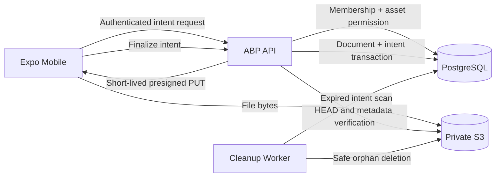
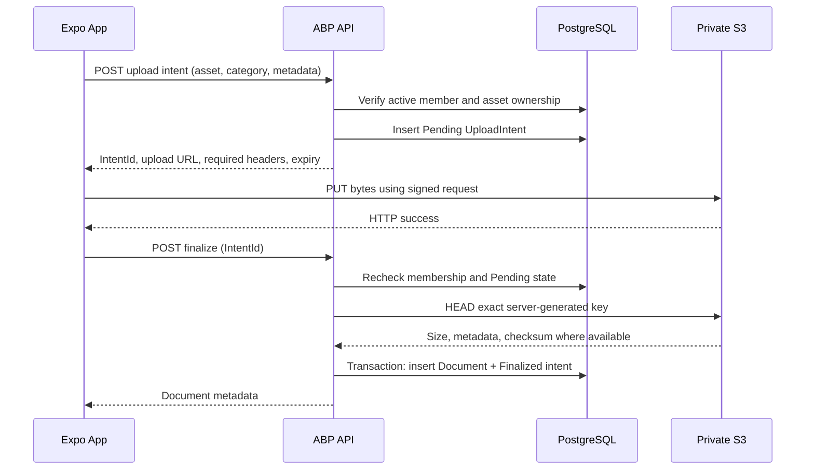

# Kepnora — File Storage, Documents and AWS S3

**Intended path:** `docs/architecture/file-storage.md`  
**Version:** 1.0-draft  
**Status:** Phase 1 implementation specification; operational policies and ABP integration pending validation  
**Platform:** .NET 10 · ASP.NET Core · ABP Framework · EF Core · PostgreSQL · AWS S3 · React Native/Expo  
**Related documents:** `../database-overview.md` §17, `architecture-decision-records.md` ADR-008/014/015/019/020, `tenant-isolation.md`, `authentication-authorization.md`, `background-jobs-and-outbox.md`, `../mvp-build-order.md`

---

## 1. Purpose

Define a secure, reliable file lifecycle for Kepnora's private asset documents, photos, receipts, manuals and warranties. Users manage documents **inside the Kepnora mobile app**. The backend authorizes each operation, while file bytes are stored in private S3 rather than PostgreSQL.

The architecture must remain correct under network interruption, duplicate mobile requests, expired upload URLs, workspace switching, account revocation, S3 errors and background-worker restarts.

**Central rule:** A file's S3 object key is a storage locator, never proof of authorization. The ABP tenant, active membership, operation permission, asset ownership and database metadata determine access.

## 2. Scope

**Phase 1 included**

- Attach private files to authorized assets, including assets with `PropertyId = NULL`.
- Upload photos, receipts, manuals, warranties and other allowed document categories.
- View document metadata and retrieve authorized short-lived download links.
- Archive documents without silently destroying maintenance history.
- Retry interrupted uploads safely and clean expired intents/orphan objects.
- Protect objects through IAM, encryption, private bucket configuration and audit logs.
- Enforce tenant boundaries in APIs, PostgreSQL relationships, S3 keys and workers.

**Excluded from Phase 1**

- Public file sharing and publicly accessible document links.
- Provider-accessible document libraries.
- Phase 2 provider quotes or Phase 3 booking/payment attachments.
- Collaborative document editing and OCR/AI extraction.
- Unrestricted arbitrary uploads or user-controlled bucket/object keys.
- Guaranteed offline file availability or cross-device automatic local sync.

## 3. Canonical storage decisions

| Decision | Value | Status |
|---|---|---|
| Binary storage | Private AWS S3 bucket | Accepted — design |
| Metadata storage | PostgreSQL `UploadIntents` and `Documents` | Accepted — design |
| Tenant model | One workspace = one ABP Tenant | Accepted — design |
| Upload transport | Server-authorized presigned PUT | Accepted — design |
| Finalization | Server HEAD/metadata check + DB transaction | Accepted — design |
| Download | Server-authorized short-lived presigned GET | Accepted — design |
| Upload state | Pending, Finalized, Expired, Rejected | Accepted — design |
| Object-key layout | `tenants/{tenantId}/assets/{assetId}/documents/{documentId}/{opaqueName}` | Proposed |
| URL lifetime | Short, bounded TTL | Numeric value open |
| File-size limits | Per-category/server-enforced | Numeric values open |
| Malware scanning | Policy to select before beta | Open |
| Retention/deletion | Archive first; retention policy pending | Open |
| Encryption | S3 server-side encryption | Accepted — design; KMS choice open |
| Direct upload | App → S3; no byte proxy through API | Accepted — design |

## 4. Security and reliability invariants

| ID | Invariant | Evidence |
|---|---|---|
| FILE-001 | Every document belongs to exactly one ABP tenant | Non-null `TenantId` and integration test |
| FILE-002 | Document asset belongs to same tenant | Composite FK |
| FILE-003 | Upload intent asset belongs to same tenant | Composite FK |
| FILE-004 | `ICurrentTenant` does not prove membership | Denied cross-tenant API test |
| FILE-005 | Caller never chooses arbitrary S3 key | Request contract test |
| FILE-006 | Bucket and objects are private | IAM and public-access verification |
| FILE-007 | Finalize validates object actually exists | HEAD and failure test |
| FILE-008 | Finalize verifies expected object metadata | Mismatch rejection |
| FILE-009 | One upload intent creates at most one document | Unique constraint |
| FILE-010 | Repeated finalize is idempotent | Retry test |
| FILE-011 | Download requires fresh authorization | Revocation test |
| FILE-012 | Presigned URL may survive revocation until expiry | Explicit residual risk |
| FILE-013 | DB transaction does not include S3 operation | Crash recovery test |
| FILE-014 | Cleanup cannot delete finalized objects | Race/lease test |
| FILE-015 | Workers use trusted tenant context | X/Y worker test |
| FILE-016 | Logs do not contain presigned URLs or private file bytes | Log review |
| FILE-017 | `Asset.PropertyId` may be null | Standalone car attachment test |
| FILE-018 | Client retries do not bypass quota/size limits | Duplicate request test |

## 5. Architecture and data flow



The API never trusts a successful client upload message. It confirms S3 object existence and metadata before finalizing.

## 6. End-to-end upload sequence



The mobile app must not assume that a successful S3 PUT means a document exists in the Kepnora library. Only successful finalization establishes the visible document.

## 7. Identity, tenant and permission boundary

The server must:

1. Authenticate the global user via the selected OIDC solution.
2. Parse the workspace ID from the approved API contract.
3. Verify active `TenantMembers` relationship for that workspace.
4. Verify document/asset operation permission.
5. Enter `ICurrentTenant.Change(workspaceId)` in a scoped operation.
6. Load asset/document/intent using explicit `(TenantId, Id)` criteria.
7. Validate cross-entity ownership before issuing any presigned URL.
8. Audit the operation and return only the necessary metadata.

A valid token or tenant header alone is insufficient. Background cleanup uses service authority rather than fabricating a human membership.

## 8. Proposed API contracts

**Routes below are proposed.** Confirm final ABP auto-controller or explicit-controller routes from the running host's OpenAPI after M0.

| Method | Route | Purpose |
|---|---|---|
| POST | `/api/workspaces/{workspaceId}/assets/{assetId}/documents/upload-intents` | Create authorized upload intent |
| POST | `/api/workspaces/{workspaceId}/documents/upload-intents/{intentId}/finalize` | Validate and finalize |
| GET | `/api/workspaces/{workspaceId}/assets/{assetId}/documents` | Paginated list |
| GET | `/api/workspaces/{workspaceId}/documents/{documentId}` | Metadata/detail |
| POST | `/api/workspaces/{workspaceId}/documents/{documentId}/download-url` | Authorized presigned GET |
| POST | `/api/workspaces/{workspaceId}/documents/{documentId}/archive` | Archive metadata |
| POST | `/api/workspaces/{workspaceId}/documents/upload-intents/{intentId}/cancel` | Cancel pending upload, if policy permits |

Do not expose a general-purpose “sign arbitrary S3 key” endpoint.

## 9. Create upload intent: request and response

```json
{
  "category": "Receipt",
  "fileName": "oil-change-receipt.pdf",
  "contentType": "application/pdf",
  "sizeBytes": 238144,
  "clientRequestId": "b2d935b7-6f42-480e-a23b-64f6dc94bd92"
}
```

The asset ID and workspace ID come from the validated route. The server derives `RequestedByUserId`, `TenantId`, `ObjectKey` and intent ID. Never accept these as trusted request fields.

```json
{
  "intentId": "7d6ec568-c09f-4dd6-b99c-22dcd3f7b2e7",
  "uploadUrl": "<short-lived presigned URL>",
  "method": "PUT",
  "requiredHeaders": {
    "Content-Type": "application/pdf"
  },
  "expiresAt": "2026-10-29T23:30:00Z"
}
```

These values are illustrative, not actual signed URLs. Keep the upload URL out of analytics, crash reports and debug logs.

## 10. Upload intent validation

Validate before persisting or presigning:

- Authenticated user is an active workspace member.
- User has upload permission and can access the asset.
- Asset is not archived/deleted if policy prohibits new attachments.
- Category is an allowed value.
- Filename is normalized for display, not used as a trusted object key.
- Content type is on an allowlist; extension is not sufficient evidence.
- Declared size is positive and within the configured limit.
- Per-user/workspace upload quotas and rate limits are enforced.
- `clientRequestId` is unique within the intended idempotency scope.
- TTL and required signed headers are generated server-side.

For presigned PUT, S3 cannot enforce every application-level rule solely from a declared `Content-Type` header. Verify actual object size and relevant metadata at finalize, and enforce an upload policy appropriate to the chosen signing method. If strict upload-size constraints are needed before bytes enter S3, evaluate presigned POST policy conditions or a controlled upload proxy.

## 11. Object key design

Proposed opaque object key:

```text
tenants/{tenantId}/assets/{assetId}/documents/{documentId}/{randomOpaqueName}
```

Example:

```text
tenants/aaaaaaaa-aaaa-aaaa-aaaa-aaaaaaaaaaaa/
assets/bbbbbbbb-bbbb-bbbb-bbbb-bbbbbbbbbbbb/
documents/cccccccc-cccc-cccc-cccc-cccccccccccc/
f67c8c17bba847ce9d0f6c7e7d2a4b9a
```

The example is line-wrapped for readability; actual keys are one string. `documentId` may be preallocated during intent creation, but the `Documents` row is not inserted until finalization.

**Rules:** never include email, user name, address, original filename or token in the key. Do not trust a caller-provided key. Do not use prefix matching as a substitute for DB authorization. Validate the exact stored key on every storage operation.

## 12. PostgreSQL metadata model

The proposed `database-overview.md` §17 schema is authoritative for this design. Do not create a conflicting table in a new migration.

**`UploadIntents`:** `Id`, `TenantId`, `AssetId`, `RequestedByUserId`, `ObjectKey`, `ExpectedContentType`, `ExpectedSizeBytes`, `Status`, `ExpiresAt`, `CreatedAt`.

**`Documents`:** `Id`, `TenantId`, `AssetId`, `UploadIntentId`, `Category`, `FileName`, `ContentType`, `SizeBytes`, `ObjectKey`, `CreatedAt`, `IsArchived`.

The current proposed schema does **not** yet include checksum, actual detected MIME type, scan status, original image dimensions, version history, retention-until date or storage provider metadata. Adding any of these requires a reviewed migration and corresponding DTO change.

## 13. PostgreSQL constraints

```sql
-- Illustrative excerpt of existing proposed database-overview constraints.
-- Do not run these again if the migration already created them.

ALTER TABLE "UploadIntents"
    ADD CONSTRAINT "UQ_UploadIntents_TenantId_Id"
        UNIQUE ("TenantId", "Id");

ALTER TABLE "Documents"
    ADD CONSTRAINT "FK_Documents_UploadIntents"
        FOREIGN KEY ("TenantId", "UploadIntentId")
        REFERENCES "UploadIntents" ("TenantId", "Id");

ALTER TABLE "Documents"
    ADD CONSTRAINT "UQ_Documents_UploadIntent"
        UNIQUE ("UploadIntentId");
```

The proposed database overview also requires unique `ObjectKey` and same-tenant asset foreign keys. Confirm all constraints using actual EF Core migrations and PostgreSQL integration tests.

## 14. Upload intent state machine

```text
Pending
  ├── verified object + DB commit ──> Finalized
  ├── TTL exceeded ────────────────> Expired
  └── invalid metadata / policy ───> Rejected

Finalized, Expired, Rejected are terminal logical states.
```

A transient S3 HEAD failure must **not** automatically become `Rejected`; leave the intent retryable while it remains valid. An expired intent must not finalize even if its S3 object still exists, unless a separate recovery policy is explicitly approved.

## 15. Finalize transaction and idempotency

Finalization must reauthorize the user and asset; inspect intent status and expiry; HEAD the **exact stored object key**; verify expected size and signed metadata; and insert the document while marking the intent `Finalized` in one PostgreSQL transaction.

```text
BEGIN
  SELECT UploadIntent FOR UPDATE
  IF Finalized:
      SELECT existing Document by UploadIntentId
      RETURN existing result
  IF not Pending or expired:
      REJECT
  VERIFY previously obtained S3 HEAD evidence is still valid
  INSERT Documents(...)
  UPDATE UploadIntents SET Status = 'Finalized'
COMMIT
```

**Important race:** a HEAD before transaction does not prevent object replacement between HEAD and commit if a presigned PUT URL remains usable. Consider unique keys with one-time application intents, short TTL, checksum constraints and/or S3 version IDs, and explicitly prevent or detect post-finalize overwrite. The precise immutability strategy is an open implementation decision.

The unique `Documents.UploadIntentId` constraint is the final duplicate safeguard. On a duplicate conflict, reload the existing document and return it only if it matches the same authorized intent.

## 16. Illustrative C# application contract

```csharp
public sealed record CreateUploadIntentInput(
    string Category,
    string FileName,
    string ContentType,
    long SizeBytes,
    Guid ClientRequestId);

public sealed record UploadIntentResult(
    Guid IntentId,
    string UploadUrl,
    IReadOnlyDictionary<string, string> RequiredHeaders,
    DateTimeOffset ExpiresAt);

public interface IDocumentAppService
{
    Task<UploadIntentResult> CreateIntentAsync(
        Guid workspaceId,
        Guid assetId,
        CreateUploadIntentInput input,
        CancellationToken cancellationToken);

    Task<DocumentDto> FinalizeAsync(
        Guid workspaceId,
        Guid intentId,
        CancellationToken cancellationToken);
}
```

These are proposed Kepnora interfaces, not built-in ABP types. Actual DTOs and cancellation behavior must be aligned with the pinned ABP version.

## 17. S3 adapter boundary

```csharp
public interface IPrivateObjectStorage
{
    Task<PresignedUpload> CreateUploadUrlAsync(
        string objectKey,
        string contentType,
        TimeSpan lifetime,
        CancellationToken cancellationToken);

    Task<StoredObjectMetadata?> HeadAsync(
        string objectKey,
        CancellationToken cancellationToken);

    Task<Uri> CreateDownloadUrlAsync(
        string objectKey,
        string downloadName,
        TimeSpan lifetime,
        CancellationToken cancellationToken);

    Task DeleteAsync(
        string objectKey,
        CancellationToken cancellationToken);
}
```

Use a dedicated adapter so application services do not manipulate AWS SDK requests directly. The adapter is responsible for IAM-compatible requests, required encryption settings, header signing, timeout/cancellation, telemetry and safe error translation.

## 18. S3 bucket security

- Enable **Block Public Access** at bucket and account level where applicable.
- Disable public ACLs; prefer Bucket owner enforced Object Ownership.
- Require TLS for access.
- Restrict the API/worker IAM principal to the intended bucket and key actions.
- Use server-side encryption; choose SSE-S3 or SSE-KMS after a security/cost decision.
- Do not grant the mobile app AWS credentials.
- Do not expose permanent object URLs.
- Restrict CORS only if browser-based uploads are introduced; native Expo behavior differs.
- Consider lifecycle policies and object versioning based on approved retention needs.
- Log access without recording full presigned query strings.

## 19. Illustrative IAM policy

The following is an **illustrative starting point**, not a complete production policy. Replace bucket name and scope with actual deployment resources. Additional permissions may be required for multipart uploads or KMS.

```json
{
  "Version": "2012-10-17",
  "Statement": [
    {
      "Sid": "DocumentObjectsOnly",
      "Effect": "Allow",
      "Action": [
        "s3:PutObject",
        "s3:GetObject",
        "s3:DeleteObject"
      ],
      "Resource": "arn:aws:s3:::KEPNORA_PRIVATE_BUCKET/tenants/*"
    }
  ]
}
```

`HeadObject` authorization is generally based on `s3:GetObject`. This IAM policy alone does **not** enforce application membership or per-tenant access; the server must authorize before signing.

## 20. Presigned URL security properties

A presigned URL is a **bearer capability** until expiration. Anyone possessing it may be able to perform the signed operation during its lifetime. Protect it like a secret.

Recommended controls:

1. Short, purpose-specific expiration.
2. Unique object key per upload intent.
3. Restrict HTTP method and required signed headers.
4. Avoid logging or sharing URLs.
5. Never sign list-bucket operations for clients.
6. Reauthorize before issuing every download URL.
7. Treat URL revocation as limited: removing membership does not automatically invalidate an already-issued URL.
8. Consider stricter bucket policy controls such as signature-age limits after testing.
9. Avoid content-disposition header injection by sanitizing download names.
10. Do not assume a successful PUT validates file contents.

## 21. MIME type and content validation

A filename or client-supplied MIME type is untrusted. Define an allowlist such as PDF, JPEG, PNG and selected document formats after product/security review. Reject executables and unsupported archives by default.

At finalize, verify S3 size and relevant headers. If the product requires content inspection or malware scanning, implement an explicit quarantine/scan workflow **before** making the file downloadable. The current two-table schema has no `ScanStatus`, so scanning cannot be claimed as implemented.

Do not render untrusted HTML/SVG inline inside an authenticated webview. Prefer platform-safe viewers and attachment download behavior.

## 22. Photos and image processing

Expo can select a photo and upload it without storing image bytes in PostgreSQL. Optional client-side compression and thumbnail generation may improve performance, but neither is a security boundary.

Open decisions:

- Maximum resolution and per-file byte limit.
- Whether EXIF GPS/location metadata is stripped.
- Thumbnail storage and association model.
- Whether the original photo is preserved.
- HEIC handling on iOS and image transcoding policy.
- Deduplication by checksum, if desired.

Avoid inventing thumbnails in UI specs before metadata/storage support exists.

## 23. Document categories

Proposed Phase 1 categories:

| Category | Example | Associated asset |
|---|---|---|
| Photo | Vehicle condition, appliance label | Required |
| Receipt | Oil change, repair invoice | Required |
| Manual | HVAC user manual | Required |
| Warranty | Refrigerator warranty | Required |
| Other | Insurance or supporting record | Required |

Category names and enum casing must be pinned in Application.Contracts. The database overview currently uses `VARCHAR(30)` for `Documents.Category`; a SQL CHECK/lookup table is an optional follow-up, not yet specified.

## 24. Document list and retrieval

The API returns metadata only, not raw S3 bytes or permanent URLs.

```json
{
  "items": [
    {
      "id": "b481d5a0-2b0b-4d21-bf64-2fda457b1d23",
      "assetId": "ea8b0b3c-679b-4e56-bce6-44f6db12a6f1",
      "category": "Receipt",
      "fileName": "oil-change-receipt.pdf",
      "contentType": "application/pdf",
      "sizeBytes": 238144,
      "createdAt": "2026-10-29T23:30:00Z"
    }
  ],
  "totalCount": 1
}
```

Pagination, filtering by category and sorting must be tenant-scoped. Do not return `ObjectKey` to the mobile app unless there is a documented need; it is not necessary for normal document viewing.

## 25. Download authorization and response

```text
POST /api/workspaces/X/documents/D/download-url
  → Authenticate user
  → Verify active membership in X
  → Check document read permission
  → Load D WHERE TenantId = X AND Id = D
  → Verify D is not archived or policy allows retrieval
  → Generate short-lived presigned GET for D.ObjectKey
  → Return URL + expiry
```

If a document ID belongs to another tenant, respond with a safe 404 or equivalent agreed concealment policy. Never return a cross-tenant object key or file name in the error.

## 26. Mobile upload state machine

```text
Selected
  → RequestingIntent
  → Uploading
  → Finalizing
  → Complete

Error paths:
  RequestingIntent → Failed
  Uploading → Retryable / Failed
  Finalizing → Retryable / Failed
  Any active state → Cancelled by user
```

Mobile UI should distinguish upload progress from finalize progress. If the app restarts after a successful PUT but before finalize, it should retry finalization using the stored intent ID if the intent remains valid. If the URL expires before upload completes, request a new intent according to idempotency policy.

Do not retain presigned URLs in durable app storage. Do not display “Uploaded” until the API returns a finalized `Document`.

## 27. React Native / Expo implementation notes

- Use a supported Expo image/document picker for the selected SDK version.
- Validate the file's locally reported size before requesting intent.
- Stream/upload file bytes using an Expo-compatible native mechanism; avoid loading large files entirely into JS memory.
- Supply exactly the signed headers required by the S3 upload URL.
- Support cancellation and app background/interruption behavior.
- On workspace switch, cancel active uploads or explicitly bind them to the originating workspace.
- Partition TanStack Query keys by workspace and asset ID.
- Invalidate document lists only after successful finalize.
- Do not cache sensitive document content indefinitely.
- Treat the backend as authoritative for validation and ownership.

The exact Expo file upload API must be verified against the pinned SDK; do not copy outdated `FileSystem.uploadAsync` examples without checking compatibility.

## 28. Cleanup and orphan reconciliation

S3 and PostgreSQL do not share a transaction. An intent can expire after bytes were uploaded, or an object can remain after an API crash.

A durable worker should:

1. Query expired Pending intents in bounded batches.
2. Claim the work using the selected job/lease strategy.
3. Recheck intent status and whether a finalized Document references the key.
4. Mark the intent Expired under the approved transaction policy.
5. Delete only an object that is still unreferenced and safe to remove.
6. Record cleanup result; retry transient S3 errors.
7. Reconcile objects lacking intents only under a separately approved bounded inventory process.

**Race caution:** Do not delete an object merely because an earlier read saw Pending. Finalization and cleanup must coordinate with a lock/lease or state transition so the worker cannot delete a just-finalized file.

## 29. Failure recovery matrix

| Failure | User-visible result | Backend recovery |
|---|---|---|
| Intent creation DB error | Upload not started | No S3 action |
| Presign generation fails | Retryable error | Expire unused intent later |
| PUT times out | Upload uncertain | Retry or HEAD before finalize |
| PUT succeeds, app closes | Not yet finalized | Resume finalize if valid |
| HEAD returns not found | Pending/invalid upload | Retry within TTL |
| HEAD returns size mismatch | Rejected | Cleanup orphan |
| DB fails after HEAD | Retry finalize | No duplicate document |
| Concurrent finalize calls | One success | Unique constraint + reload |
| Cleanup S3 delete times out | No immediate user impact | Retry and reconcile |
| Member revoked before download | Access denied | No new presign |
| Member revoked after presign | Old URL may work until expiry | Short TTL mitigates |
| S3 outage | Upload/download unavailable | Retry/backoff, no fake success |

## 30. Concurrency and integrity strategy

Use database uniqueness on `UploadIntentId` and `ObjectKey`. Consider a row lock or optimistic concurrency on intent status transitions. Finalize must return the existing document on an authorized duplicate request, not create another row.

To address object replacement risk, select a strategy before beta:

- S3 versioning and persist the finalized `VersionId` in a schema migration, **or**
- A staging-to-immutable-final-key flow with controlled server-side copy, **or**
- A validated upload design that prevents post-finalize overwrite within its threat model.

The current database schema does not persist `VersionId`, so immutable-object guarantees are **not yet established**.

## 31. Storage quotas and cost controls

Cost drivers include S3 stored GB-months, PUT/GET/HEAD requests, data transfer, lifecycle transitions, optional KMS requests and scanning. Use actual AWS region pricing for estimates; do not hardcode one fixed cost per user.

Example capacity planning:

| Scenario | Assumption | Approximate stored data |
|---|---|---|
| 1,000 users × 10 files × 2 MB | Small beta | 20 GB |
| 1,000 users × 50 files × 2 MB | Active users | 100 GB |
| 1,000 users × 100 files × 3 MB | Heavy document usage | 300 GB |

These are illustrative raw object totals, excluding thumbnails, versioning, backups, retention copies and growth. Set upload quotas per workspace and account after observing real usage.

## 32. Operational observability

Track:

- Intent creation count and authorization denials.
- Presign failures and rate-limit rejections.
- PUT/finalize success rate and finalize latency.
- HEAD mismatches by reason.
- Pending intents older than expected.
- Orphan cleanup backlog, failures and deletion count.
- S3 4xx/5xx and throttling.
- Stored bytes by tenant and document category.
- Unusual download request rates.
- Storage cost trend and quota usage.

Log correlation IDs, tenant IDs and intent/document IDs. Never log raw presigned URLs, credentials, private document contents or sensitive original filenames unnecessarily.

## 33. Security threat matrix

| Attack | Expected defense |
|---|---|
| Guess document UUID from another tenant | Scoped DB lookup and safe 404 |
| Forge `TenantId` in request JSON | Ignore/reject untrusted field |
| Use another tenant's asset ID | Composite FK and service validation |
| Request presign for arbitrary key | No such endpoint |
| Reuse expired upload URL | S3 signature expiry |
| Upload different-size file | HEAD size check; stronger policy as needed |
| Upload malicious file | Allowlist and selected scan/quarantine policy |
| Replay finalize | Unique constraint + idempotent result |
| Race finalize with cleanup | Transactional state/lease coordination |
| Steal presigned URL | Short TTL; avoid logging |
| Download after revocation | Deny new URL; old URL residual risk |
| Worker deletes finalized object | Recheck DB reference and state |
| App switches workspace during upload | Origin-workspace binding and cancellation |
| Abuse repeated intent creation | Rate limit, quota and expiry cleanup |

## 34. Integration test catalog

| ID | Scenario | Expected |
|---|---|---|
| FS-001 | Anonymous creates intent | 401 |
| FS-002 | User without X membership creates X intent | Denied |
| FS-003 | X member uploads for Y asset | Denied |
| FS-004 | Asset with null PropertyId uploads receipt | Allowed |
| FS-005 | Unsupported MIME type | Rejected |
| FS-006 | Declared zero/negative size | Rejected |
| FS-007 | File exceeds configured size | Rejected |
| FS-008 | Caller supplies arbitrary object key | Ignored/rejected |
| FS-009 | Presign contains required method/headers | Verified |
| FS-010 | PUT succeeds but finalize not called | No Document row |
| FS-011 | Finalize missing object | No Document row |
| FS-012 | Finalize size mismatch | Rejected |
| FS-013 | Finalize after expiry | Rejected |
| FS-014 | Two concurrent finalize calls | One Document row |
| FS-015 | Retry finalized intent | Same Document returned |
| FS-016 | Cross-tenant finalize | Denied |
| FS-017 | Cross-tenant download | Safe 404 |
| FS-018 | Revoked member requests download | Denied |
| FS-019 | Archived document access | Matches approved policy |
| FS-020 | Cleanup vs finalize race | Finalized object retained |
| FS-021 | S3 timeout during cleanup | Retry, no false success |
| FS-022 | App closes after PUT | Resume finalize when valid |
| FS-023 | Workspace switch mid-upload | No cross-workspace mutation |
| FS-024 | Public bucket access probe | Denied |
| FS-025 | Error logs during presign | URL redacted |
| FS-026 | Object replaced after finalize attempt | Prevented/detected by chosen strategy |
| FS-027 | Duplicate clientRequestId | Idempotent intent handling |
| FS-028 | Document list pagination in X | No Y metadata |
| FS-029 | Tenant worker X then Y | No context leakage |
| FS-030 | DB transaction failure after HEAD | Retry without duplicate |
| FS-031 | S3 metadata mismatch | No finalize |
| FS-032 | Deep link to unauthorized document | Denied |
| FS-033 | Restore database with existing S3 objects | Reconciliation verified |
| FS-034 | S3 object missing for finalized document | Safe error and alert |
| FS-035 | Upload quota exceeded | Controlled error |

Use real PostgreSQL for constraint tests. Use a dedicated S3 integration environment or carefully isolated test bucket for signing/HEAD behavior; mocks alone cannot validate AWS request signing.

## 35. Deployment and environment configuration

| Setting | Meaning | Source |
|---|---|---|
| `Storage:BucketName` | Private bucket name | Environment config |
| `Storage:Region` | AWS region | Environment config |
| `Storage:UploadUrlTtlSeconds` | Upload URL lifetime | Approved policy |
| `Storage:DownloadUrlTtlSeconds` | Download URL lifetime | Approved policy |
| `Storage:MaxFileSizeBytes` | Maximum allowed size | Approved policy |
| `Storage:AllowedContentTypes` | MIME allowlist | Approved policy |
| `Storage:CleanupBatchSize` | Bounded worker batch | Performance tuning |
| `Storage:CleanupGracePeriod` | Reconciliation delay | Approved policy |

Use IAM roles/temporary credentials for workloads rather than hardcoded access keys. Secrets belong in a managed secret store or deployment environment, not in Git.

## 36. Required decisions before beta

1. File size limits and category allowlist.
2. Presigned URL TTLs and S3 bucket region.
3. Malware scanning/quarantine requirement.
4. Object immutability/versioning strategy.
5. Encryption mode and KMS key ownership.
6. Document retention, archive and hard deletion policy.
7. Upload cancellation/retry policy and client request idempotency.
8. Storage quotas and abuse controls.
9. Whether thumbnails and EXIF stripping are required.
10. Disaster recovery behavior when DB and S3 snapshots are not synchronized.

Any selected policy that changes the proposed schema requires an ADR update and migration.

## 37. Milestone M5 build order

1. Confirm M0 identity and M1 tenant authorization are implemented.
2. Implement and test `UploadIntents`/`Documents` EF Core mappings.
3. Add same-tenant composite FKs and uniqueness constraints.
4. Configure private S3 bucket and IAM permissions.
5. Implement storage adapter and upload intent AppService.
6. Implement presigned PUT and mobile upload progress.
7. Implement server-side HEAD verification and finalize transaction.
8. Implement document list and authorized presigned GET.
9. Implement document archive and retrieval policy.
10. Implement retry-safe cleanup worker integrated with the chosen job system.
11. Test cross-tenant access, concurrent finalize and cleanup races.
12. Run iOS/Android device tests, cost telemetry and recovery drill.

## 38. Definition of Done

- [ ] All file APIs require active membership and named permission.
- [ ] S3 bucket and objects are private.
- [ ] No client-controlled object keys are trusted.
- [ ] Upload intent state machine and PostgreSQL constraints are implemented.
- [ ] Successful PUT alone does not create a Document.
- [ ] Finalization verifies S3 object metadata.
- [ ] Duplicate finalize returns one logical document.
- [ ] Cross-tenant upload, finalize and download are denied.
- [ ] Presigned URL leakage and residual revocation risk are addressed.
- [ ] Cleanup worker cannot delete finalized documents.
- [ ] Mobile supports retry, cancellation, progress and workspace switching.
- [ ] Retention, malware policy and object immutability are decided.
- [ ] Tests FS-001 through FS-035 pass.
- [ ] Monitoring, runbooks and incident response are documented.

## 39. Future extension boundaries

**Phase 2:** A provider quote may reference a user-approved document, but provider access requires a new explicit sharing authorization model. Never infer provider permission from geographic proximity or public provider profiles.

**Phase 3:** Booking/payment attachments require their own ownership and retention policy. Do not expose private asset receipts to providers by default.

Possible later capabilities include OCR, receipt parsing, warranties extraction, image thumbnails, version history and document sharing; each needs an explicit data model and security review.

## 40. Final implementation principle

**Authorize first, presign second, verify before finalize, and reconcile external side effects.** PostgreSQL owns the document record; private S3 owns the bytes. Neither a guessed object key nor a successfully uploaded object grants a user access to another workspace's documents.
