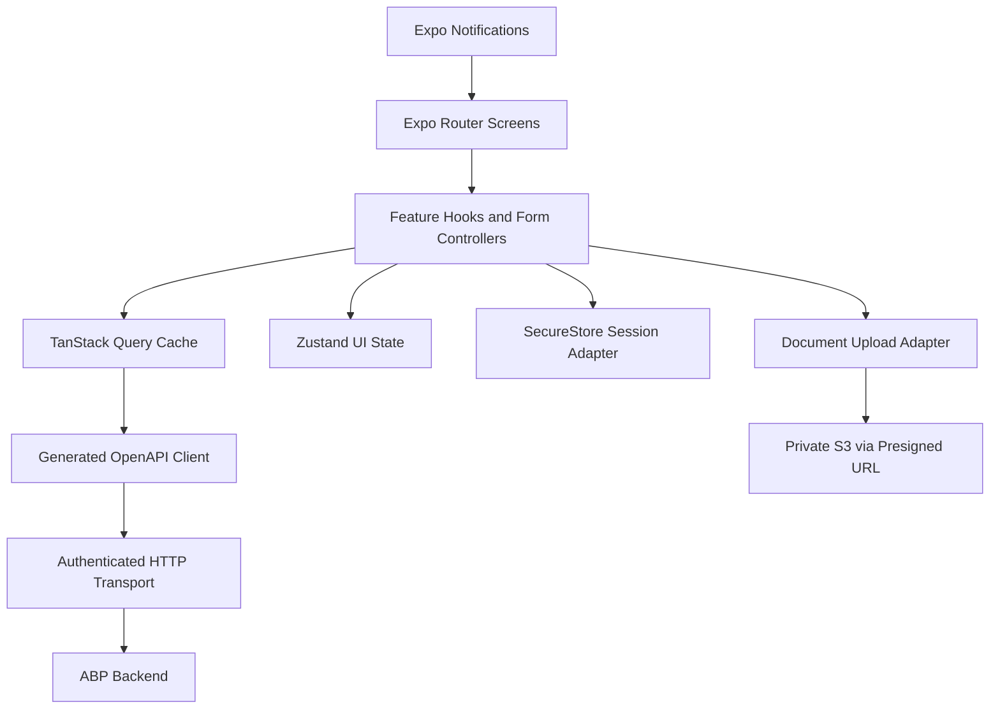

# Kepnora — Mobile App Architecture and Premium UI System

**Intended path:** `docs/architecture/mobile-app-architecture.md`  
**Version:** 1.0-draft · **Date:** 2026-10-29  
**Status:** Phase 1 implementation design; visual direction proposed, not approved production UI  
**Stack:** React Native · Expo · TypeScript · Expo Router · TanStack Query · Zustand · React Hook Form · Zod · SecureStore  
**Related:** `../architecture-overview.md`, `../database-overview.md`, `../mvp-build-order.md`, `api-design.md`, `authentication-authorization.md`, `tenant-isolation.md`, `file-storage.md`, `background-jobs-and-outbox.md`, `architecture-decision-records.md`

---

## 1. Purpose

Define an implementation-ready mobile architecture for Kepnora's **Phase 1 personal asset and maintenance management app**. The UI direction is a premium, calm, high-clarity interface informed by the previously explored Apple Home / Airbnb-style mockups: generous whitespace, confident typography, clean imagery, quiet cards and minimal navigation friction. These references describe a **design direction**, not a mandate to copy proprietary brand UI.

The app must allow users to manage assets and maintenance across one or more workspaces, while treating the backend as the authority for identity, membership, permissions, maintenance status, storage and notifications.

## 2. Product boundaries

**Phase 1:** sign in, onboarding, workspace selection, properties, global/custom asset types, asset inventory, maintenance rules, due list, completion/history, manual odometer readings, photos/receipts/manuals/warranties, dashboard, search, notification settings and profile.

**Phase 2:** provider discovery, local search, provider profiles and quotes/contact. **Phase 3:** booking and payments. Provider and booking screens in earlier UI mockups are *future concepts*, not Phase 1 routes, API contracts or beta acceptance criteria.

## 3. Non-negotiable architecture rules

1. One Kepnora workspace maps to one ABP tenant; the server validates active membership and operation permission.
2. `ICurrentTenant` does not prove authorization; mobile workspace selection never grants access.
3. The same global user may belong to multiple workspaces, subject to the M0 identity POC.
4. All workspace-owned query keys, state and file operations are partitioned by workspace.
5. Assets may have `PropertyId = null`; onboarding must not force a property.
6. Custom asset fields use published versioned schemas; server validation is authoritative.
7. Occurrence lifecycle is `Open`, `Completed`, `Skipped`, `Cancelled`; `Upcoming`, `Due`, `Overdue` are derived display states.
8. Mileage is manually recorded, not inferred from time or location.
9. Documents remain private; mobile receives short-lived presigned S3 URLs after authorization.
10. Expo push delivery is best effort; the app refreshes current state after notification navigation.
11. TypeScript types come from the **running ABP host's OpenAPI**, not guessed routes.
12. Phase 2/3 functionality must not silently enter Phase 1 navigation.

## 4. Layered mobile architecture



**Screens** compose visual components. **Feature hooks** coordinate use cases. **Query hooks** own server-state fetches and mutations. **Zustand** stores transient UI-only state. **Transport** handles tokens and typed errors. **Adapters** isolate Expo platform APIs. Avoid importing AWS SDK into mobile business logic.

## 5. Proposed repository structure

```text
mobile/
  app/
    _layout.tsx
    (public)/
      welcome.tsx
      sign-in.tsx
      auth-callback.tsx
    (protected)/
      _layout.tsx
      onboarding.tsx
      workspace-picker.tsx
      (tabs)/
        _layout.tsx
        index.tsx                # Home
        assets.tsx
        maintenance.tsx
        documents.tsx
        settings.tsx
      assets/
        new.tsx
        [assetId].tsx
        [assetId]/edit.tsx
        [assetId]/maintenance.tsx
        [assetId]/documents.tsx
      properties/
        index.tsx
        new.tsx
        [propertyId].tsx
      maintenance/
        [occurrenceId].tsx
        rules/new.tsx
        history.tsx
      documents/
        [documentId].tsx
      search.tsx
      notifications.tsx
      workspace/members.tsx
  src/
    api/
      generated/              # generated from real OpenAPI
      client.ts
      errors.ts
    auth/
      session.ts
      oauth.ts
      secure-storage.ts
    workspace/
      workspace-context.ts
      workspace-query-keys.ts
    features/
      dashboard/
      assets/
      asset-types/
      properties/
      maintenance/
      documents/
      notifications/
      settings/
      search/
    components/
      primitives/
      patterns/
      feedback/
    design/
      tokens.ts
      typography.ts
      theme.ts
    platform/
      file-upload.ts
      push.ts
      deep-links.ts
    tests/
  assets/
  app.config.ts
  package.json
```

This is a **proposed** Expo Router tree; verify actual route groups, linking and SDK package versions before implementation. Route grouping must not be mistaken for backend authorization.

## 6. State ownership matrix

| State | Owner | Persistence | Rule |
|---|---|---|---|
| Access/refresh credentials | Auth adapter | SecureStore | Never in plain AsyncStorage |
| Current authenticated subject | Session context | In-memory + validated refresh | Do not trust stale claims for membership |
| Selected workspace ID | Workspace context | Non-secret preference optional | Server revalidates on use |
| Assets/properties/maintenance | TanStack Query | Memory by default | Workspace-partitioned keys |
| Form draft | React Hook Form | Component lifetime | Reset on asset/workspace change |
| Filters/sort | Route params or local UI | Optional preference | Never authorizes data |
| Modal/sheet visibility | Component/Zustand | In-memory | Avoid global business state |
| Upload progress | Upload adapter | In-memory | Origin workspace bound |
| Notification token | Push adapter + backend | Secure platform registration | Rotate/revoke safely |
| Due/overdue status | Server response | Query cache | Do not persist lifecycle changes locally |

## 7. Dependency policy

Pin Expo SDK, React Native, React, Expo Router, TanStack Query, Zustand, React Hook Form, Zod and native modules together. Verify compatibility using a clean install, iOS simulator, Android emulator and at least one physical device. Do not present library APIs as stable across versions without a compiled proof. Use lockfiles and CI.

## 8. Navigation information architecture

```text
Unauthenticated
  Welcome → Sign in → OIDC callback
Authenticated
  Workspace picker / onboarding
  └─ Main tabs
     ├─ Home
     ├─ Assets
     ├─ Maintenance
     ├─ Documents
     └─ Settings

Secondary stacks
  Asset detail → Edit / Rules / History / Documents
  Property detail → Asset list
  Search → Asset / Property / Maintenance result
  Notifications → Authorized occurrence detail
  Settings → Workspace / Members / Preferences
```

Keep five primary tabs maximum in the initial concept; validate tab count through usability tests. Search may be a global action rather than a sixth tab. Documents may instead be accessed from Assets if research shows a dedicated tab is underused; treat this as a product decision.

## 9. Authentication and route guards

Use Authorization Code with PKCE via an Expo-compatible browser/auth-session integration. The global identity design (ABP Identity/OpenIddict vs external OIDC) is **not finalized**; M0 must prove one user can access two ABP tenants with distinct roles. A protected route guard is for UX only. Every API request still requires server-side membership and permission checks.

Session lifecycle:

1. Launch and read credentials from SecureStore.
2. Validate/refresh through the selected OIDC client.
3. Load authorized workspaces from backend.
4. Restore previously selected workspace only if still active.
5. Enter protected navigation.
6. On 401, refresh once according to a single-flight policy; avoid infinite loops.
7. On revoked membership/403, clear that workspace's cached data and return to picker.
8. On logout, revoke tokens when supported, clear SecureStore and reset all tenant caches.

## 10. Workspace switching as a security boundary

A workspace switch is a **state transition**, not a cosmetic dropdown:

```text
User chooses Y while X active
  → prevent new X-scoped mutations
  → cancel or isolate pending X queries/uploads
  → verify Y membership with backend
  → update selected workspace context
  → reset tenant-specific Zustand state and form drafts
  → render Y skeleton/empty state
  → fetch Y data using Y-keyed queries
```

Requests started in X must carry the **captured origin workspace ID**, not read a mutable global workspace ID at completion time. Never let an X response populate Y cache. Pending uploads should be cancelled or continue explicitly bound to X, with clear UX.

## 11. Workspace-scoped query keys

```typescript
export const workspaceKeys = {
  all: (workspaceId: string) => ['workspace', workspaceId] as const,
  assets: (workspaceId: string, filters: AssetFilters) =>
    ['workspace', workspaceId, 'assets', filters] as const,
  asset: (workspaceId: string, assetId: string) =>
    ['workspace', workspaceId, 'asset', assetId] as const,
  maintenance: (workspaceId: string, filters: MaintenanceFilters) =>
    ['workspace', workspaceId, 'maintenance', filters] as const,
  documents: (workspaceId: string, assetId: string) =>
    ['workspace', workspaceId, 'asset', assetId, 'documents'] as const,
};
```

Types `AssetFilters` and `MaintenanceFilters` are illustrative app-level types. Serialize filters consistently and avoid using mutable objects that change query identity unpredictably. Query invalidation after a mutation must target the **origin workspace**, not whichever workspace is currently selected.

## 12. Generated API client

The backend `api-design.md` proposes `/api/v1/workspaces/{workspaceId}/...`, but these are **not guaranteed ABP-generated routes**. After M0, generate a TypeScript client from the real OpenAPI document. Place generated files under `src/api/generated` and do not hand-edit them. Wrap generated operations with feature-level functions that pass the validated workspace ID and map errors.

```typescript
export async function loadAsset(
  client: KepnoraApiClient,
  workspaceId: string,
  assetId: string,
  signal?: AbortSignal,
) {
  // Call the generated method selected from the actual OpenAPI schema.
  return client.assets.getById({ workspaceId, assetId, signal });
}
```

`KepnoraApiClient` and `client.assets.getById` are illustrative placeholders, not asserted generated method names. Use the real generator's types and cancellation contract.

## 13. Error handling policy

| HTTP/result | UI treatment | Security |
|---|---|---|
| 401 | Attempt controlled refresh; then sign-in | Clear invalid session |
| 403 | Access removed / permission denied | No private resource details |
| 404 | Not found / unavailable | Do not reveal other tenant's existence |
| 409 | Conflict screen or refresh prompt | Do not silently overwrite |
| 400/422 | Field-level validation | Server remains authoritative |
| 413 | File too large | Do not retry unchanged payload |
| 429 | Explain wait/retry | Avoid aggressive loops |
| 500/network | Retry with backoff | Do not claim mutation succeeded |

ABP's actual exception envelope and HTTP mappings must be inspected after the host is compiled. Show a correlation ID for unexpected errors if the backend provides one.

## 14. Retry and mutation policy

GET queries may retry transient failures with bounded backoff. Do **not** automatically replay non-idempotent POST operations unless the API supports an idempotency key or a deterministic unique constraint. Maintenance completion and upload finalization are explicitly designed to be idempotent. For a timeout after mutation, first reconcile current server state instead of displaying a false failure or blindly creating another record.

## 15. Offline behavior

Phase 1 supports **graceful offline read/error UX**, not a full offline-first synchronization engine. Previously cached data may be displayed only with an obvious stale/offline indicator and correct workspace isolation. Disable or queue nothing that can cause duplicate service records unless a formal durable offline command protocol is approved.

Avoid promising offline photo upload, background sync or automatic merge in the MVP. Provide retry when connectivity returns. Secure storage of sensitive cached documents requires a separate policy.

## 16. Design direction: premium, calm, trustworthy

The preferred direction is a **premium utility app**: visually quiet, confident and human, rather than a dense enterprise dashboard. The reference mockups explored an Apple Home / Airbnb-like mood. Do not copy those products' layouts, icons, illustrations or proprietary components exactly.

**Principles:** strong hierarchy, one clear primary action per screen, generous spacing, readable numbers, contextual asset photography, restrained color, subtle separators, consistent cards, accessible tap targets and useful empty states.

**Avoid:** excessive gradients, glass effects that reduce legibility, unexplained icon-only actions, tiny text, decorative status badges on every row, and a dashboard with too many competing metrics.

## 17. Proposed design tokens

| Token | Light | Dark | Usage |
|---|---|---|---|
| Background | `#F7F8FA` | `#111418` | App canvas |
| Surface | `#FFFFFF` | `#1B2026` | Cards/sheets |
| Primary text | `#17202A` | `#F5F7FA` | Titles/content |
| Secondary text | `#66717F` | `#A6B0BB` | Metadata |
| Accent | `#3568D4` | `#80A6FF` | Primary action |
| Success | `#24856B` | `#56C6A4` | Completed |
| Warning | `#B7751E` | `#E8B75B` | Due |
| Danger | `#C34C4C` | `#FF8585` | Overdue/destructive |
| Border | `#E7EAF0` | `#303842` | Subtle separation |

These are **proposed starting tokens**, not an approved brand palette. Validate contrast ratios in real components, including text on colored status surfaces. Support system dark mode, dynamic type and reduced motion.

## 18. Spacing, typography and shape

Use a 4-point spacing system with common steps 4/8/12/16/20/24/32. Suggested screen horizontal inset 20–24 points. Cards may use 16–20-point radii and 16–20-point internal padding; maintain consistent density across screen sizes. Large page titles 28–34 points; section headings 18–22; body 15–17; metadata 12–14 with accessible scaling. Exact typography must be validated on iOS and Android, not assumed from image mockups.

Touch targets should generally be at least 44×44 points on iOS and 48×48 dp on Android where feasible. Keep labels visible alongside ambiguous icons. Do not rely on color alone for Due/Overdue states.

## 19. Reusable UI primitives

```text
KScreen, KHeader, KText, KCard, KButton, KIconButton
KTextField, KSelectField, KDateField, KNumberField
KAssetAvatar, KPropertyHero, KStatusPill, KMetricTile
KListRow, KSectionHeader, KEmptyState, KErrorState
KSkeleton, KBottomSheet, KConfirmDialog, KToast
KOfflineBanner, KPermissionNotice, KUploadProgress
```

Components should accept theme tokens and accessibility props, not hardcoded brand colors in each screen. A `KStatusPill` is appropriate for meaningful maintenance status, not decoration.

## 20. Screen composition rules

Each screen should provide: title/context, one obvious next action, content ordered by urgency, loading/empty/error states, keyboard/safe-area handling, and accessible navigation. Keep large actions reachable without forcing users to search through menus. Forms use progressive disclosure for advanced fields.

## 21. Onboarding journey

```text
Welcome → Sign in → Verify session → Workspace setup
  → Name workspace (default suggested)
  → Optional property setup [Skip]
  → Add first asset or explore dashboard
```

Workspace provisioning is idempotent; do not show success until the backend confirms the ABP tenant and Owner membership are ready. If provisioning fails midway, show a recoverable state rather than creating a second workspace on every retry.

## 22. Phase 1 screen inventory

| Screen | Primary action | Backend source | Important states |
|---|---|---|---|
| Welcome | Sign in | OIDC | New/returning |
| Workspace picker | Select workspace | Membership list | None/revoked/multiple |
| Onboarding | Create workspace | Provisioning service | Pending/retry |
| Home | View urgent maintenance | Dashboard | Loading/empty/offline |
| Assets list | Add asset | Asset list | Filters/pagination |
| Asset detail | Add maintenance | Asset detail | Archived/missing |
| Asset create/edit | Save asset | Type schema + asset API | Validation/conflict |
| Properties | Add property | Property API | No property |
| Maintenance list | Complete or review | Occurrence API | Upcoming/Due/Overdue |
| Maintenance rule | Save schedule | Rule API | Time/mileage |
| Maintenance completion | Complete service | Completion API | Idempotent retry |
| Service history | Review record | History API | Empty/archived |
| Documents | Add document | Metadata API | Upload/failed/empty |
| Document detail | View/download | Presigned GET | Expired URL/revoked |
| Search | Open result | Search API | No results |
| Notifications | Open reminder | Preferences + occurrence | Stale reminder |
| Settings | Edit preferences | Profile/workspace API | Revoked workspace |
| Members | Invite/manage | Membership API | Owner-only |

## 23. Home dashboard layout

Proposed vertical hierarchy:

1. Compact greeting and current workspace switcher.
2. A hero summary of assets and maintenance needing attention.
3. One prominent **Add Asset** or **Review Maintenance** CTA depending on onboarding state.
4. Horizontal asset previews with contextual imagery.
5. Upcoming maintenance rows with clear due date and urgency.
6. Recent activity and documents as secondary sections.

The dashboard must not calculate Due/Overdue independently from the server. Empty first-run state should encourage adding an asset without inventing alerts.

## 24. Assets list and detail

Asset list supports name, type, optional property, thumbnail, search and filter. Default sort should be explicit and stable; pagination comes from backend. The detail screen prioritizes asset identity, next maintenance, key custom fields, service history and documents. An asset can be a standalone vehicle with no property.

Archived assets remain accessible according to the approved retention policy but are not silently mixed into active inventory. Cross-tenant deep links must fail safely.

## 25. Dynamic asset creation form

The app requests the selected published `AssetTypeVersion` schema. It renders supported fields and validates locally with Zod where feasible, while submitting the original schema version ID and values for server validation. Never silently upgrade a user's submitted schema version mid-edit.

Field examples: make/model/year for vehicle; serial number and warranty date for appliance. These are **examples**, not hardcoded fields for every asset. Preserve unknown optional fields only if the backend schema policy allows them.

## 26. Properties and grouping

Properties are optional organizational entities. A user can add a home, rental or other property, then associate assets. Do not force a default property. On property archive, preserve asset history and follow the backend's approved archive/reassignment policy.

## 27. Maintenance list UX

Use segmented views or filters for **Due**, **Upcoming**, **Overdue** and **History** as display concepts. These are not persisted occurrence lifecycle states. Show date/mileage context and rule type, not only a colored dot. A mileage rule with no reading should show **Mileage needed** or equivalent unknown state, not a fabricated due date.

## 28. Maintenance rule editor

Capture asset, rule name, interval type, anchor policy and schedule inputs. Time-based rules require timezone-aware dates; mileage rules require explicit manual readings. Month-end and DST behavior are backend decisions pending ADR-012. The form should explain the schedule in plain language using a server preview if available, rather than implement a competing recurrence engine.

## 29. Maintenance completion flow

```text
Occurrence detail → Complete
  → Service date + optional cost + notes
  → Optional receipt attachment after completion
  → Submit with idempotency key and expected version
  → Backend commits history + lifecycle + outbox atomically
  → Refresh occurrence, asset and dashboard queries
```

On a timeout, reconcile the occurrence before retrying. Two concurrent submissions must never create two service records. Do not optimistically mark Completed as a permanent fact until confirmed.

## 30. Manual mileage readings

The user can enter odometer readings with timestamp and value. Validate units and plausible values locally but defer correction policy and authoritative validation to backend. No GPS-derived or time-estimated mileage. If a user edits a reading, show how this may affect maintenance due calculations after the server recomputes them.

## 31. Documents and photo attachments

Use a picker compatible with the pinned Expo SDK. The user chooses an asset, category and file; app requests an upload intent; app PUTs bytes to S3; app calls finalize; only then is the document shown as uploaded. Show progress, retry, expiry and workspace-switch handling. Do not persist presigned URLs or use arbitrary S3 keys.

Document detail requests a fresh authorized download URL. Previously issued URLs can remain valid until expiry after membership revocation, so keep TTL short. File previews should avoid unsafe inline rendering of untrusted content.

## 32. Search experience

Global search in Phase 1 covers assets, properties and maintenance according to approved API filters. It does **not** search local service providers yet. Use debouncing and cancel stale queries, display categories and match context, and ensure results are tenant-scoped. Do not filter a global unscoped result list on the client.

## 33. Notification integration

Register Expo push tokens only after platform permission and backend session are ready. Device registration belongs to the global user, while reminder preferences/deliveries are tenant-scoped. On tap, navigate to the referenced occurrence **after** verifying current workspace membership and fetching fresh state. A reminder may be stale because work was completed on another device.

## 34. Settings and account

Settings should expose profile, workspace selection, membership management (Owner only), notification preferences, timezone and sign out. Account deletion and data retention policy remain open decisions. Avoid UI controls for operations the backend does not yet support.

## 35. Accessibility

- Support dynamic text size and screen readers.
- Label icons and inputs with accessible names/hints.
- Maintain minimum tap targets and adequate color contrast.
- Do not encode status solely by color.
- Support keyboard focus and error announcements.
- Honor reduced-motion preference for transitions.
- Test screen reader order in complex cards and bottom sheets.
- Test small screens, landscape behavior where supported and Android back navigation.

## 36. Localization and units

Use a localization layer from the start even if Phase 1 ships in English only. Avoid concatenating translatable sentences. Format dates, numbers, currency and distance by locale and user preference. Maintenance timestamps are stored/processed under approved server timezone rules; display the effective local timezone explicitly when ambiguity matters.

## 37. Performance and image handling

Use paginated lists, virtualized list components, stable item keys and measured memoization. Keep asset thumbnails appropriately sized. Avoid decoding many full-resolution photos in one screen. Measure cold start, tab switch, asset list scroll, dashboard response and image upload on real mid-range devices. Do not promise a fixed latency before baseline tests.

## 38. Error and empty-state language

Prefer direct messages: “No assets yet”, “Add your first asset”, “You no longer have access to this workspace”, “Upload interrupted—try again”, “This maintenance record was already completed”. Avoid exposing stack traces, object keys, tokens, internal ABP errors or another tenant's resource names.

## 39. Analytics and privacy

Track screen performance and aggregate feature adoption only with an approved privacy policy. Never send access tokens, presigned S3 URLs, receipts, serial numbers, full addresses or private notes to analytics. Correlation IDs may help diagnose API failures, but must be handled according to retention policy.

## 40. Testing pyramid

**Unit:** form schema rendering, query key generation, formatting, error mapping, session state machine.  
**Component:** dashboard states, asset form validation, maintenance completion conflict, document progress.  
**Integration:** generated client + test backend, SecureStore adapter, workspace switch.  
**End-to-end:** login, two workspaces, add asset, schedule maintenance, complete, attach receipt, open reminder, logout.  
**Device:** iOS/Android notifications, file picker, deep links, keyboard, accessibility and background/resume.

## 41. Security test matrix

| ID | Scenario | Expected |
|---|---|---|
| MOB-001 | User A Owner X, Member Y | Correct role in each workspace |
| MOB-002 | Switch X→Y during asset fetch | No X data in Y UI |
| MOB-003 | Switch workspace during upload | Upload bound to origin or cancelled |
| MOB-004 | Remove membership while app active | Protected requests denied; cache cleared |
| MOB-005 | Deep link to unauthorized asset | Safe access denied |
| MOB-006 | Expired access token | Controlled refresh or sign-in |
| MOB-007 | Invalid refresh token | Clear session |
| MOB-008 | Logout | Tokens and tenant caches removed |
| MOB-009 | Tamper workspace route ID | Server denies |
| MOB-010 | Asset with null PropertyId | Creation and detail work |
| MOB-011 | Custom type schema version changes | Form handles immutable version |
| MOB-012 | Overdue display | Not persisted as lifecycle |
| MOB-013 | No mileage reading | Unknown state shown |
| MOB-014 | Duplicate completion submit | One history record |
| MOB-015 | Upload PUT success, finalize failure | Not shown as completed |
| MOB-016 | Presigned URL expires | New authorized intent/download |
| MOB-017 | Notification references completed occurrence | Fresh state shown |
| MOB-018 | Offline during mutation | No false success |
| MOB-019 | Android back from modal | No accidental mutation |
| MOB-020 | Dynamic type / screen reader | Accessible content and actions |

## 42. Delivery milestones

| Build stage | Dependencies | Mobile output | Exit proof |
|---|---|---|---|
| M0 | ABP/OIDC POC | Expo shell, navigation, login spike | Device auth callback works |
| M1 | Workspace/membership API | Onboarding, picker, guards | X/Y switch and revocation tests |
| M2 | Properties/type API | Property screens, type selector | Versioned schema form |
| M3 | Assets API | List/detail/create/edit/archive | Standalone asset test |
| M4 | Maintenance API | Due list, rules, completion/history | Idempotent completion flow |
| M5 | S3 document API | Picker, upload, finalize, download | Interrupted upload recovery |
| M6 | Push/worker API | Registration, settings, deep links | Revocation/suppression tests |
| M7 | Dashboard/search API | Premium home, search, settings | Tenant-safe cache + performance |
| M8 | All | Beta builds, accessibility, hardening | iOS/Android release checklist |

## 43. Definition of Done

- [ ] Expo SDK and native dependencies pinned and verified.
- [ ] Real OpenAPI-generated client integrated.
- [ ] Global identity and multi-workspace POC passed.
- [ ] SecureStore session and logout work on devices.
- [ ] Workspace switching never leaks cached tenant data.
- [ ] Every screen has loading, empty, validation, error and retry states.
- [ ] Asset creation supports nullable PropertyId and versioned custom fields.
- [ ] Maintenance lifecycle and due display states remain separate.
- [ ] Completion uses idempotency/concurrency safeguards.
- [ ] S3 uploads are finalized before showing success.
- [ ] Notifications revalidate current server state.
- [ ] Accessibility, dynamic type and dark mode checked.
- [ ] Phase 2/3 screens are not accidentally shipped as Phase 1 functionality.
- [ ] MOB-001 through MOB-020 and critical API security tests pass.

## 44. Open decisions

1. Exact ABP identity/OIDC provider and mobile auth SDK integration.
2. Expo SDK and generated client tool/version.
3. Five-tab navigation vs Documents under Asset details.
4. Approved brand palette, typography and dark mode treatment.
5. Asset photo thumbnails and caching policy.
6. Offline read-cache retention and sensitive local-data policy.
7. Rule preview UX and final recurrence timezone/grace rules.
8. Push permission onboarding moment and reminder copy.
9. Account deletion, privacy analytics and document retention.
10. Whether Phase 2 provider search receives a dedicated tab later.

## 45. Final implementation principle

**Build a premium-feeling interface on top of verified contracts and tenant-safe state.** Kepnora's mobile polish should make assets, maintenance and documents effortless to use without hiding authorization, sync or retry complexity behind misleading success states.


## Appendix A.1 — Home dashboard implementation slice

**Milestone:** M7. **Visible UI:** Workspace-aware greeting, assets count, due maintenance, recent items. **Actions:** Fetch aggregated DTO, navigate to asset/occurrence, refresh on focus. **Edge cases:** First-run, loading, partial error, stale offline, revoked workspace.

**Implementation checklist:**

1. Define DTO and generated API client contract from running ABP OpenAPI.
2. Add workspace-keyed TanStack Query hook, including cancellation and typed errors.
3. Build accessible loading, empty, success, validation and failure components.
4. Wire mutation invalidation only to the originating workspace and affected entities.
5. Add server-side permission denial and revoked-membership integration tests.
6. Verify Android and iOS navigation, keyboard/safe-area behavior and accessibility.
7. Capture a reproducible demo and known limitations before milestone exit.

**Security invariant:** No component may treat the selected workspace ID or a cached DTO as authorization. The backend validates active membership, named permission and resource ownership on every protected request.


## Appendix A.2 — Asset inventory implementation slice

**Milestone:** M3. **Visible UI:** Searchable paginated asset cards with optional property grouping. **Actions:** Add, filter, sort, open, archive, restore per policy. **Edge cases:** Empty, 1000+ assets, duplicate names, cross-tenant deep link.

**Implementation checklist:**

1. Define DTO and generated API client contract from running ABP OpenAPI.
2. Add workspace-keyed TanStack Query hook, including cancellation and typed errors.
3. Build accessible loading, empty, success, validation and failure components.
4. Wire mutation invalidation only to the originating workspace and affected entities.
5. Add server-side permission denial and revoked-membership integration tests.
6. Verify Android and iOS navigation, keyboard/safe-area behavior and accessibility.
7. Capture a reproducible demo and known limitations before milestone exit.

**Security invariant:** No component may treat the selected workspace ID or a cached DTO as authorization. The backend validates active membership, named permission and resource ownership on every protected request.


## Appendix A.3 — Asset detail implementation slice

**Milestone:** M3. **Visible UI:** Photo, type, custom fields, next maintenance, documents. **Actions:** Edit, add rule, attach receipt, archive. **Edge cases:** Archived, missing thumbnail, stale schema, permission revoked.

**Implementation checklist:**

1. Define DTO and generated API client contract from running ABP OpenAPI.
2. Add workspace-keyed TanStack Query hook, including cancellation and typed errors.
3. Build accessible loading, empty, success, validation and failure components.
4. Wire mutation invalidation only to the originating workspace and affected entities.
5. Add server-side permission denial and revoked-membership integration tests.
6. Verify Android and iOS navigation, keyboard/safe-area behavior and accessibility.
7. Capture a reproducible demo and known limitations before milestone exit.

**Security invariant:** No component may treat the selected workspace ID or a cached DTO as authorization. The backend validates active membership, named permission and resource ownership on every protected request.


## Appendix A.4 — Property management implementation slice

**Milestone:** M2. **Visible UI:** Property list, property detail, associated assets. **Actions:** Create/edit/archive, associate assets. **Edge cases:** No property, archived property, tenant mismatch.

**Implementation checklist:**

1. Define DTO and generated API client contract from running ABP OpenAPI.
2. Add workspace-keyed TanStack Query hook, including cancellation and typed errors.
3. Build accessible loading, empty, success, validation and failure components.
4. Wire mutation invalidation only to the originating workspace and affected entities.
5. Add server-side permission denial and revoked-membership integration tests.
6. Verify Android and iOS navigation, keyboard/safe-area behavior and accessibility.
7. Capture a reproducible demo and known limitations before milestone exit.

**Security invariant:** No component may treat the selected workspace ID or a cached DTO as authorization. The backend validates active membership, named permission and resource ownership on every protected request.


## Appendix A.5 — Maintenance overview implementation slice

**Milestone:** M4. **Visible UI:** Derived Due/Overdue/Upcoming filters and dates. **Actions:** Open occurrence, complete, skip/cancel if permitted. **Edge cases:** Unknown mileage, DST boundary, completed on other device.

**Implementation checklist:**

1. Define DTO and generated API client contract from running ABP OpenAPI.
2. Add workspace-keyed TanStack Query hook, including cancellation and typed errors.
3. Build accessible loading, empty, success, validation and failure components.
4. Wire mutation invalidation only to the originating workspace and affected entities.
5. Add server-side permission denial and revoked-membership integration tests.
6. Verify Android and iOS navigation, keyboard/safe-area behavior and accessibility.
7. Capture a reproducible demo and known limitations before milestone exit.

**Security invariant:** No component may treat the selected workspace ID or a cached DTO as authorization. The backend validates active membership, named permission and resource ownership on every protected request.


## Appendix A.6 — Maintenance rule editor implementation slice

**Milestone:** M4. **Visible UI:** Time or mileage rule, anchor and schedule preview. **Actions:** Create/edit rule, read server preview. **Edge cases:** Invalid interval, month-end, correction, rule version conflict.

**Implementation checklist:**

1. Define DTO and generated API client contract from running ABP OpenAPI.
2. Add workspace-keyed TanStack Query hook, including cancellation and typed errors.
3. Build accessible loading, empty, success, validation and failure components.
4. Wire mutation invalidation only to the originating workspace and affected entities.
5. Add server-side permission denial and revoked-membership integration tests.
6. Verify Android and iOS navigation, keyboard/safe-area behavior and accessibility.
7. Capture a reproducible demo and known limitations before milestone exit.

**Security invariant:** No component may treat the selected workspace ID or a cached DTO as authorization. The backend validates active membership, named permission and resource ownership on every protected request.


## Appendix A.7 — Service completion implementation slice

**Milestone:** M4. **Visible UI:** Date, cost, notes, idempotent submit. **Actions:** Complete occurrence and refresh history. **Edge cases:** Timeout, double submit, concurrent completion.

**Implementation checklist:**

1. Define DTO and generated API client contract from running ABP OpenAPI.
2. Add workspace-keyed TanStack Query hook, including cancellation and typed errors.
3. Build accessible loading, empty, success, validation and failure components.
4. Wire mutation invalidation only to the originating workspace and affected entities.
5. Add server-side permission denial and revoked-membership integration tests.
6. Verify Android and iOS navigation, keyboard/safe-area behavior and accessibility.
7. Capture a reproducible demo and known limitations before milestone exit.

**Security invariant:** No component may treat the selected workspace ID or a cached DTO as authorization. The backend validates active membership, named permission and resource ownership on every protected request.


## Appendix A.8 — Documents implementation slice

**Milestone:** M5. **Visible UI:** Categories, file rows, progress and safe preview. **Actions:** Request intent, PUT S3, finalize, authorized download. **Edge cases:** Expired URL, offline, HEAD mismatch, workspace switch.

**Implementation checklist:**

1. Define DTO and generated API client contract from running ABP OpenAPI.
2. Add workspace-keyed TanStack Query hook, including cancellation and typed errors.
3. Build accessible loading, empty, success, validation and failure components.
4. Wire mutation invalidation only to the originating workspace and affected entities.
5. Add server-side permission denial and revoked-membership integration tests.
6. Verify Android and iOS navigation, keyboard/safe-area behavior and accessibility.
7. Capture a reproducible demo and known limitations before milestone exit.

**Security invariant:** No component may treat the selected workspace ID or a cached DTO as authorization. The backend validates active membership, named permission and resource ownership on every protected request.


## Appendix A.9 — Notifications implementation slice

**Milestone:** M6. **Visible UI:** Permission prompt, device registration, reminder preferences. **Actions:** Register/revoke token, open deep link. **Edge cases:** Denied OS permission, stale reminder, revoked membership.

**Implementation checklist:**

1. Define DTO and generated API client contract from running ABP OpenAPI.
2. Add workspace-keyed TanStack Query hook, including cancellation and typed errors.
3. Build accessible loading, empty, success, validation and failure components.
4. Wire mutation invalidation only to the originating workspace and affected entities.
5. Add server-side permission denial and revoked-membership integration tests.
6. Verify Android and iOS navigation, keyboard/safe-area behavior and accessibility.
7. Capture a reproducible demo and known limitations before milestone exit.

**Security invariant:** No component may treat the selected workspace ID or a cached DTO as authorization. The backend validates active membership, named permission and resource ownership on every protected request.


## Appendix A.10 — Search implementation slice

**Milestone:** M7. **Visible UI:** Asset/property/maintenance scoped results. **Actions:** Debounce, paginate, open authorized result. **Edge cases:** No matches, rapid query changes, offline.

**Implementation checklist:**

1. Define DTO and generated API client contract from running ABP OpenAPI.
2. Add workspace-keyed TanStack Query hook, including cancellation and typed errors.
3. Build accessible loading, empty, success, validation and failure components.
4. Wire mutation invalidation only to the originating workspace and affected entities.
5. Add server-side permission denial and revoked-membership integration tests.
6. Verify Android and iOS navigation, keyboard/safe-area behavior and accessibility.
7. Capture a reproducible demo and known limitations before milestone exit.

**Security invariant:** No component may treat the selected workspace ID or a cached DTO as authorization. The backend validates active membership, named permission and resource ownership on every protected request.


## Appendix A.11 — Settings implementation slice

**Milestone:** M7. **Visible UI:** Profile, workspace, timezone, notifications. **Actions:** Change preferences, logout, membership management. **Edge cases:** Owner vs Member, last owner, session expired.

**Implementation checklist:**

1. Define DTO and generated API client contract from running ABP OpenAPI.
2. Add workspace-keyed TanStack Query hook, including cancellation and typed errors.
3. Build accessible loading, empty, success, validation and failure components.
4. Wire mutation invalidation only to the originating workspace and affected entities.
5. Add server-side permission denial and revoked-membership integration tests.
6. Verify Android and iOS navigation, keyboard/safe-area behavior and accessibility.
7. Capture a reproducible demo and known limitations before milestone exit.

**Security invariant:** No component may treat the selected workspace ID or a cached DTO as authorization. The backend validates active membership, named permission and resource ownership on every protected request.


## Appendix B — Premium UI review rubric

| Criterion | Review question | Fail condition |
|---|---|---|
| Clarity | Is the next action obvious in five seconds? | Several equally loud CTAs |
| Hierarchy | Is urgent maintenance distinguishable from background metadata? | All cards look identical |
| Trust | Does the UI reflect confirmed backend state? | Optimistic false success |
| Accessibility | Can screen readers and dynamic type use the flow? | Icon-only unlabeled actions |
| Restraint | Are color and badges used for meaning? | Decorative warning colors |
| Performance | Does scrolling remain smooth on mid-range devices? | Full-size images in list rows |
| Tenant safety | Does a switch remove prior workspace context? | X data visible in Y |
| Completeness | Are empty/error/offline states designed? | Blank screens or silent failures |
| Consistency | Are spacing and typography tokenized? | Screen-specific arbitrary values |
| Scope | Is this a Phase 1 feature? | Provider booking in MVP navigation |

## Appendix C — Example TypeScript workspace mutation wrapper

```typescript
// Illustrative only; generated client method names depend on real OpenAPI.
export async function performWorkspaceMutation<T>(
  originWorkspaceId: string,
  mutation: (workspaceId: string) => Promise<T>,
  invalidate: (workspaceId: string) => Promise<void>,
): Promise<T> {
  const result = await mutation(originWorkspaceId);
  await invalidate(originWorkspaceId);
  return result;
}
```

Capture `originWorkspaceId` before the mutation starts. Never use a mutable `activeWorkspaceId` after `await` to determine which cache to invalidate.

## Appendix D — Future Phase 2 navigation extension

When Phase 2 provider discovery is approved, add a **Find Services** entry from the asset detail and maintenance recommendation context. The search UI may show providers from a compliant external places API and/or Kepnora's own provider registry. The user searches **inside the Kepnora app**; the data source is an implementation detail. External provider data must follow the source's licensing and caching rules. Do not introduce provider booking or payments until Phase 3.
