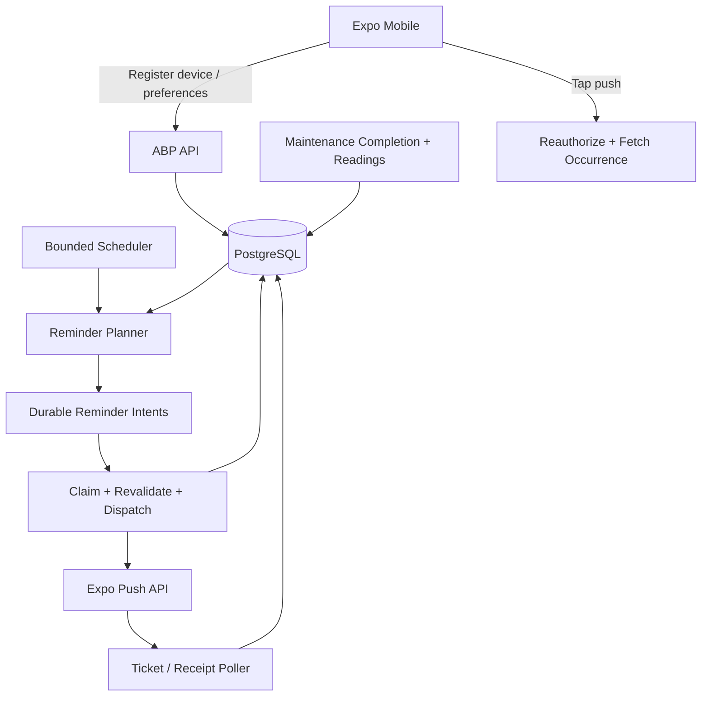

# Kepnora — Notification Engine Architecture

**Target:** `docs/architecture/notification-engine.md`  
**Version:** 1.0-draft · **Date:** 2026-10-29  
**Phase:** MVP M6, dependent on M0 identity and M4 maintenance  
**Status:** Proposed implementation contract; package APIs, database schema and product policy require verification.

**Related:** `docs/features/notification-reminders.md`, `docs/features/maintenance-management.md`, `docs/architecture/maintenance-scheduling-engine.md`, `docs/architecture/background-jobs-and-outbox.md`, `docs/architecture/tenant-isolation.md`, `docs/architecture/authentication-authorization.md`, `docs/api/api-contracts-master.md`, `docs/testing/test-strategy.md`.

> **Critical:** A reminder is derived from an actual eligible maintenance occurrence. Expo Push is a best-effort delivery channel, not the system of record. No worker may infer mileage, bypass tenant membership, or promise exactly-once delivery.

---
## 1. Architecture goal

Provide correct, timely, tenant-safe maintenance reminders with durable scheduling, device registration, preference evaluation, Expo Push dispatch, receipts, retries and operational recovery. Preserve the difference between *reminder eligibility*, *delivery attempt*, *Expo acceptance*, and *device display*.

Do not implement a separate general marketing-notification platform in Phase 1. The mobile dashboard and occurrence detail are authoritative even when push fails.


## 2. Phase boundaries

| Phase | Supported notification scope |
|---|---|
| Phase 1 | Time-based upcoming/due/overdue reminders; mileage threshold on actual reading; per-workspace push preferences; Expo device registration; deep links; retries |
| Phase 2 | Provider discovery events only with separate product approval |
| Phase 3 | Booking, appointments and payment-related messages |

Email, SMS, campaigns, AI-generated reminders, automatic odometer capture and booking messages are out of MVP scope.


## 3. Non-negotiable invariants

1. One workspace maps to one ABP tenant; use ABP Tenant Management as authoritative registry.
2. Global users may belong to multiple workspaces only after M0 identity proof.
3. Membership and named permissions are checked independently of `ICurrentTenant`.
4. Occurrences persist only `Open`, `Completed`, `Skipped`, `Cancelled`.
5. `Upcoming`, `Due`, `Overdue` and mileage `Unknown` are derived, not lifecycle states.
6. Mileage is based solely on valid actual readings; never estimated or extrapolated.
7. No reminder for an ineligible/non-Open occurrence.
8. User preference is scoped to `(TenantId, UserId)`; device registration belongs to global user.
9. Every planned logical reminder has a deterministic deduplication identity.
10. Every dispatch revalidates current membership, preference and occurrence state.
11. Provider calls happen outside database transactions.
12. Expo acceptance does not prove handset delivery.
13. At-least-once attempts may duplicate device presentation after ambiguous timeouts.
14. Push payloads never contain private documents, presigned URLs or secrets.
15. One selected outbox provider per event stream; do not stack ABP and custom outboxes.


## 4. System topology



The planner and dispatcher may share one Worker executable but should have separate logical handlers, metrics and concurrency limits. The exact durable storage/provider is an ADR decision.


## 5. Core domain vocabulary

| Term | Meaning |
|---|---|
| Occurrence | Maintenance obligation stored in PostgreSQL |
| Eligibility | Whether a reminder is allowed *now* under current facts |
| Candidate | Occurrence + intended recipient + policy window |
| Intent | Durable logical reminder to attempt |
| Attempt | One outbound Expo request or bounded retry |
| Ticket | Expo response to accepted push request; not device delivery |
| Receipt | Later Expo provider outcome, where supported |
| Suppression | A candidate/intent not sent due to current state |
| Deduplication key | Stable identity for one logical reminder window |
| Dead letter | Permanently paused intent after bounded failures |

Use these terms consistently in code, metrics, API and incident runbooks.


## 6. Event and trigger catalog

| Trigger | Candidate condition | Timing |
|---|---|---|
| Upcoming time | Open occurrence, due date within approved lead window | Scheduled planner |
| Due time | Open occurrence, due on local current date | Scheduled planner |
| Overdue time | Open occurrence, due date before local current date | Scheduled planner, capped cadence |
| Mileage reached | New actual reading reaches/exceeds due mileage | Event-driven after reading commit |
| Mileage overdue | Actual reading exceeds threshold | Same factual reading; no time extrapolation |
| Completion/skip/cancel | Existing pending intents may become invalid | Revalidate/suppress; no default push |
| Membership removed | Pending recipient intents invalid | Revalidate/suppress |
| Preference disabled | Pending intents invalid | Revalidate/suppress |

A mileage reading below threshold must not produce a due alert. No-reading is unknown, not zero.


## 7. Notification type and channel contract

Proposed types: `MaintenanceUpcoming`, `MaintenanceDue`, `MaintenanceOverdue`, `MileageThresholdReached`. Delivery channel: `Push` only for MVP.

Do not persist a duplicate maintenance lifecycle status. Store notification type separately from occurrence state. The exact enum/string names and table columns must be reconciled with canonical database overview and selected outbox provider.


## 8. Canonical schema verification gate

Existing notification feature material describes `PushDevices`, `NotificationPreferences`, `ReminderDeliveries` and `OutboxMessages` as **logical/proposed entities**, not guaranteed migrations. Another API draft uses `DeviceRegistrations`. Before coding, compare canonical database DDL and ADRs, choose one naming convention and avoid parallel device/outbox tables.

The minimum required capabilities are: globally owned device tokens; per-workspace preferences; durable logical intents/attempts; provider tickets/receipts or an equivalent status record; retry/lease metadata; and correlation IDs. Implement only the missing persistence after checking ABP infrastructure.


## 9. Identity and recipient selection

Recipient is a global user with **active** membership in the occurrence's workspace and a permission/policy allowing maintenance reminders. For each tenant, resolve recipients from trusted membership records; never infer recipients from token strings or caller-provided user IDs.

A user may receive notifications from two workspaces on one device. The intent must retain the intended tenant, occurrence and recipient. Notification tap always rechecks membership in that tenant.


## 10. Global device registration

Register an Expo push token against the authenticated global user, not a tenant. Suggested fields: global user ID, opaque device ID, encrypted token, deterministic token hash for dedupe, platform, app environment, last seen, active/revoked timestamps.

Only the current global user can add/remove their devices. Treat token as sensitive operational data, **not** an authentication credential. Production/staging tokens must not be mixed. Support rotation, reinstall and invalid-token deactivation.


## 11. Device registration API

Proposed (verify against generated OpenAPI):

```http
POST /api/v1/me/devices
Authorization: Bearer <access_token>
Content-Type: application/json
```
```json
{
  "deviceId": "install-opaque-id",
  "expoPushToken": "ExponentPushToken[example-placeholder]",
  "platform": "ios",
  "appEnvironment": "production"
}
```

Response must never echo a stored encrypted token or disclose other users' devices. Rate-limit registrations and verify input length/shape. `DELETE /api/v1/me/devices/{deviceId}` deactivates only the caller's device.


## 12. Operating system permission flow

1. Explain reminder value in context, without blocking asset creation.
2. Ask OS notification permission at a suitable moment.
3. If granted, obtain Expo token and register via authenticated API.
4. If denied, keep in-app maintenance visible; show how to enable in device settings.
5. On token refresh, update registration; on logout, apply approved unregister policy.

`pushEnabled=true` in server preferences is **not** evidence that OS permission is granted or that Expo delivered anything.


## 13. Per-workspace preferences

Canonical preferences are keyed `(TenantId, UserId)`. The feature spec includes push enabled, lead days, and optional quiet hours; exact columns and defaults require DDL verification.

Proposed API:
```text
GET /api/v1/workspaces/{workspaceId}/me/notification-preferences
PUT /api/v1/workspaces/{workspaceId}/me/notification-preferences
```

Only the authenticated user's preferences are editable. A user can enable notifications for workspace A and disable them for workspace B. Preferences are checked at planning **and** dispatch.


## 14. Preference policy and defaults

Define defaults in a versioned product policy, not scattered hardcoded constants. Open decisions: reminder lead days, whether due-day reminder is separate from upcoming, overdue cadence, daily cap, quiet hours, timezone precedence, and whether members receive all assets or only assigned assets.

Until approved, examples in this document are **illustrative**; do not assume 7 days or 9 AM is a committed business rule.


## 15. Time-based eligibility algorithm

For each open time-based occurrence with `DueOn`:
1. Resolve effective timezone according to approved precedence (rule, property, workspace fallback).
2. Compute current **local calendar date** from injected clock.
3. Calculate day distance using dates, not elapsed 24-hour durations.
4. Determine candidate category according to approved lead/due/overdue policy.
5. Check per-recipient preference and policy window.
6. Build deterministic key; insert intent idempotently.

Do not mutate occurrence lifecycle status to `Due` or `Overdue`. The due classification is a derived read result.


## 16. Time zone and DST semantics

Use IANA timezone IDs and explicit `DateOnly`/calendar semantics for due dates. A due date is not automatically midnight UTC. Quiet hours may cross midnight; evaluate them in the **recipient/policy timezone** chosen by ADR.

Test DST spring-forward, fall-back, timezone changes, month-end and leap day. Use injected `TimeProvider` or equivalent testable clock. Never assume server local timezone.


## 17. Mileage eligibility algorithm

Use the latest **accepted observed** mileage reading for the asset, subject to correction/out-of-order policy. For an `Open` mileage occurrence with `DueMileage`, candidate is eligible when actual reading meets or exceeds threshold.

```text
if latestObservedMileage is null: Unknown → no threshold push
else if latestObservedMileage >= dueMileage: Eligible
else: Not eligible
```

No daily mileage accrual, linear extrapolation, GPS inference or invented due date. A single reading may cross multiple open thresholds; cap and dedupe notifications to avoid spam, while leaving authoritative occurrences unchanged.


## 18. Out-of-order and corrected odometer readings

A late historical reading must not incorrectly replace a newer valid observation. The canonical mileage correction policy is an open decision: chronological timestamp, correction flag, reset/rollover and monotonicity rules.

Notification planner must use the same authoritative latest-reading query as maintenance dashboard. On correction, reevaluate pending intents; do not retract a push already delivered, and do not claim delivery guarantees.


## 19. Recipient expansion and deduplication

Plan per `(TenantId, OccurrenceId, RecipientGlobalUserId, NotificationType, PolicyWindowVersion)`. If one user has multiple devices, one logical user intent may expand into device-specific attempts.

Keep recipient-level and device-level keys separate: user intent dedupes policy notifications; attempt key dedupes per-device retry bookkeeping. Unique DB constraints must match the selected schema and provider semantics.


## 20. Deduplication key format

Illustrative canonical key material:

```text
v1|tenant:{tenantId}|occ:{occurrenceId}|user:{userId}|kind:{kind}|window:{windowKey}
```

Hash to a bounded stable key before storage if appropriate. `windowKey` might be local due date, policy lead offset, or observed-reading threshold crossing; define exact semantics in ADR. Never use `DateTime.UtcNow` alone as dedupe identity or a new GUID per planner run.


## 21. Planner transaction

In one short PostgreSQL transaction or approved UoW:
- Load candidate occurrence/recipient facts under trusted tenant scope.
- Validate current eligibility.
- Insert durable intent with unique dedupe key (`ON CONFLICT DO NOTHING` or equivalent).
- Commit.

No Expo call inside this transaction. If the worker crashes after commit, the intent remains eligible for dispatch. If two planners race, unique constraints prevent duplicate logical intent.


## 22. Bounded planning and catch-up

Scan tenant work in bounded pages, with stable cursor and indexed predicates. Resume after restart; cap lookback/catch-up to avoid months of obsolete overdue reminders. A backlog may be coalesced according to product policy, not blindly sent in a burst.

Scheduler may be single-leader or multi-worker with database claims and uniqueness. Never rely on an uncoordinated in-memory timer in each API replica.


## 23. Outbox selection

Choose **one** outbox mechanism per stream: ABP-supported distributed-event outbox **or** custom PostgreSQL `OutboxMessages`. Verify pinned ABP version and provider before implementing. Do not publish one reminder through both mechanisms.

An event such as `MaintenanceOccurrenceChanged` should carry trusted tenant/occurrence identifiers, not raw user-supplied payloads. Event handlers query current state before planning.


## 24. Dispatcher claim and lease

Use a durable claim with lease/visibility timeout and attempt count. Multiple worker replicas must not concurrently own the same device attempt in the normal case. PostgreSQL `FOR UPDATE SKIP LOCKED` can be used when compatible with chosen schema/provider, but do not assume it is the ABP implementation.

Expired lease enables replay after crash. Because provider send may have succeeded before local commit, duplicate device display is still possible; design bounded retry and stable logical dedupe.


## 25. Dispatch revalidation

Before every provider call, recheck:
1. Trusted tenant and occurrence identifiers.
2. Occurrence exists and remains `Open`.
3. Rule/asset still valid and eligible.
4. Recipient's membership remains `Active`.
5. User's per-workspace push preference remains enabled.
6. Device registration is active, valid and environment-matched.
7. Quiet hours and cadence allow send **now**.
8. Intent is not suppressed, expired or already terminal.

If any check fails, persist a suppression reason and stop without calling Expo.


## 26. Suppression reasons

Proposed reason codes: `OccurrenceClosed`, `RuleDisabled`, `MembershipInactive`, `PushDisabled`, `DeviceRevoked`, `NoValidDevice`, `QuietHoursDeferred`, `IntentExpired`, `PolicyChanged`, `DuplicateWindow`.

These are **notification processing outcomes**, not maintenance lifecycle statuses. Decide which codes are terminal versus deferrable and whether they need database columns or an existing event/audit payload.


## 27. Quiet hours and deferral

If a candidate becomes eligible during quiet hours, defer until the next allowed local time **only while still relevant**. Revalidate on wake-up. Do not blindly send stale upcoming alerts after the due date or a completed occurrence.

Cross-midnight example: quiet 22:00–07:00 in approved timezone; at 23:00, next permitted time is 07:00 on the next local date. Handle DST nonexistent/repeated times with a documented resolution rule.


## 28. Expo Push request boundary

Use a typed `IExpoPushGateway` adapter with `HttpClientFactory`, bounded timeout, cancellation, limited batch size and rate limiting. Never hardcode provider API endpoints/limits without checking current Expo documentation at implementation time.

Payload contains generic title/body, an opaque notification/deep-link reference, workspace ID and occurrence ID only when allowed. Avoid private descriptions, addresses, VIN, serial numbers, S3 links and document contents.


## 29. Safe push payload example

```json
{
  "to": "ExponentPushToken[example-placeholder]",
  "title": "Maintenance reminder",
  "body": "An item in your workspace needs attention.",
  "data": {
    "kind": "maintenanceOccurrence",
    "workspaceId": "5a8f2c6b-4e1d-4a6e-90b3-2f18f71a2f30",
    "occurrenceId": "28d7b2e3-08b0-4c37-b20d-40cf1aa9ef13"
  }
}
```

Illustrative only; provider request schema, token format and Expo SDK versions must be verified. IDs in a payload are routing hints, **not authorization**.


## 30. Provider tickets and receipts

Separate these states:
- **Attempted:** HTTP request made or in progress.
- **Accepted:** Expo returned a ticket indicating accepted for further processing.
- **Rejected:** Expo/provider refused request.
- **Receipt success/error:** Later provider processing result when available.
- **Displayed/read:** Not established by Expo acceptance or receipt alone.

Record provider ticket ID when returned and poll receipts according to provider-supported retention windows. Never label a reminder `DeliveredToDevice` without an actual supported confirmation mechanism.


## 31. Error taxonomy and retry policy

| Error | Handling |
|---|---|
| Network timeout / transient 5xx | Retry with exponential backoff + jitter |
| Rate limit / 429 | Honor retry guidance and global throttling |
| Invalid/unregistered token | Deactivate token; terminal for that device |
| Malformed payload | Terminal; alert developer/operator |
| Invalid provider credentials | Stop batch, alert; do not spin retries |
| Occurrence completed | Suppress, no provider call |
| Membership revoked | Suppress, no provider call |
| Quiet hours | Defer with next allowed time |
| Unknown ambiguous timeout | Retry bounded; possible duplicate device display |

Exact attempt count, delay and dead-letter threshold are configuration decisions; test with fake provider and clock.


## 32. Dead letters and replay

After configured retry limit, mark intent/attempt dead-letter with safe failure category, timestamp and correlation ID. Operators can inspect and replay after remediation, subject to **full current eligibility revalidation**. Never replay all old reminders after an outage without expiration and cadence checks.

Administrative replay must be audited and not accessible to ordinary workspace members.


## 33. Rate limiting and fan-out

Bound per-worker concurrency, batch size, user/day policy and provider throughput. One user with five devices may receive five device attempts; cap as product policy requires. Avoid a push storm when a single odometer reading crosses many service thresholds or when workers recover from downtime.

Use global and tenant-aware fairness to prevent a large workspace monopolizing all worker capacity.


## 34. Deep-link authorization

On tap, mobile opens an authenticated route for workspace and occurrence. If not signed in, complete login first; then revalidate current workspace membership and occurrence read permission through API. If item is completed/archived, show current state. If membership removed, show neutral unavailable screen.

Never render notification payload as trusted domain data; fetch current occurrence from server. Workspace switch must clear stale TanStack Query cache and in-flight responses.


## 35. Mobile foreground and background behavior

Handle foreground notification presentation, background tap and cold-start tap using Expo SDK mechanisms validated for pinned version. Avoid duplicate navigation from both initial response and listener callbacks by tracking handled notification IDs.

Registration retries should not create duplicate device records. On logout, remove local credentials securely and apply approved device token deactivation policy. Respect OS settings and battery/network limitations.


## 36. In-app reminder truth

The dashboard and maintenance list calculate urgency from current occurrences and actual readings, independently of push. Push failure must not hide an overdue item. Push receipt success must not mark maintenance completed.

Optionally show last notification activity in future versions, but do not create an unapproved user-visible inbox table in Phase 1.


## 37. Data retention and privacy

Retain enough intent/attempt metadata for debugging and dedupe, but minimize personal data. Encrypt push tokens at rest; store hashes for uniqueness as appropriate. Redact tokens, signed URLs, private notes and full push payloads from logs.

Define retention for expired tokens, provider tickets, failed attempts, audit and privacy deletion. Deleting a device must not delete maintenance history or other users' preferences.


## 38. Service interfaces

```csharp
public interface IReminderEligibilityEvaluator
{
    Task<ReminderEligibility> EvaluateAsync(
        Guid tenantId, Guid occurrenceId, Guid recipientUserId,
        DateTimeOffset now, CancellationToken ct);
}

public interface IReminderPlanner
{
    Task<int> PlanBatchAsync(Guid tenantId, int maxItems, CancellationToken ct);
}

public interface IExpoPushGateway
{
    Task<PushGatewayResult> SendAsync(
        PushGatewayRequest request, CancellationToken ct);
}
```

Conceptual contracts only; concrete return types and ABP DI registration follow the pinned implementation. Do not mix DB transactions into the Expo adapter.


## 39. Suggested source folders

```text
Kepnora.Domain/Notifications/
  ReminderPolicy.cs
  ReminderDeduplicationKey.cs
  ReminderEligibility.cs
Kepnora.Application/Notifications/
  DeviceRegistrationAppService.cs
  NotificationPreferencesAppService.cs
  ReminderPlanner.cs
Kepnora.Worker/Notifications/
  ReminderPlanningJob.cs
  PushDispatchJob.cs
  ExpoReceiptJob.cs
Kepnora.Infrastructure/Notifications/  # or adapter project chosen by ABP layout
  ExpoPushGateway.cs
Kepnora.EntityFrameworkCore/EntityConfigurations/
  Notification*.cs
```

Names and physical project are proposed. Match canonical ABP project structure; do not create `Infrastructure` merely because it appears in this example.


## 40. Transaction boundaries

| Operation | Database transaction | External call |
|---|---|---|
| Complete maintenance | Occurrence + history + outbox atomic | None |
| Add mileage | Actual reading + eligible event atomic where applicable | None |
| Plan reminder | Durable intent unique insert | None |
| Claim attempt | Lease/state update | None |
| Send push | No DB transaction held open | Expo API |
| Persist result | Ticket/attempt update | None |
| Poll receipts | Store receipt outcomes | Expo API outside transaction |

Do not keep a DB transaction open across HTTP requests to Expo.


## 41. Failure timeline and replay safety

```text
T0 planner inserts intent and commits
T1 worker claims attempt
T2 worker calls Expo
T3 Expo accepts request
T4 worker crashes before recording ticket
T5 lease expires; worker retries
```

The user may see two pushes. This is unavoidable without end-to-end exactly-once guarantees from the provider/device. Dedupe logical planning, minimize ambiguous retry, and state the limitation clearly in operations docs.


## 42. Observability

Emit safe structured fields: `correlationId`, `tenantId`, `intentId`, `attemptId`, `notificationKind`, `suppressionReason`, `providerErrorCode`, `durationMs`, `retryCount`. Avoid raw device token or full private message body.

Metrics: planner lag, intents created, suppressed by reason, pending age, worker lease expirations, provider acceptance/rejection, receipt errors, invalid tokens, dead letters, push preference opt-outs and rate-limit events.


## 43. Alerting and SLO proposals

| Symptom | Operator action |
|---|---|
| Planner lag rising | Inspect scheduler, DB indexes and worker health |
| Pending intent age rising | Inspect dispatcher concurrency/provider availability |
| Invalid token spike | Verify mobile app version and token rotation |
| Expo 401/403 | Check provider credentials; pause futile retries |
| Expo 429 | Lower concurrency and honor retry-after |
| Dead letters increasing | Classify error and replay only eligible intents |
| Cross-tenant recipient anomaly | Security incident; contain and audit |

Set numerical thresholds after load testing; no invented SLO or fixed cadence is approved yet.


## 44. Performance and capacity

Use tenant-scoped indexed queries, keyset/bounded pagination and batch inserts with unique dedupe constraints. Avoid one SQL query per device when expanding large recipient sets; also avoid loading all tenants or all device tokens into one process.

Load test: thousands of open occurrences, multiple memberships per user, multi-device fan-out, large outage backlog, Expo rate limits, and mixed timezone distributions.


## 45. Unit tests — eligibility

| ID | Scenario | Expected |
|---|---|---|
| NOT-U01 | Open time occurrence before lead window | Not eligible |
| NOT-U02 | Open time occurrence at lead boundary | Policy-correct candidate |
| NOT-U03 | Due today local timezone | Due candidate |
| NOT-U04 | Due yesterday | Overdue policy |
| NOT-U05 | Completed occurrence | Suppressed |
| NOT-U06 | Skipped occurrence | Suppressed |
| NOT-U07 | Cancelled occurrence | Suppressed |
| NOT-U08 | No mileage reading | Unknown, no push |
| NOT-U09 | Reading below due mileage | Not eligible |
| NOT-U10 | Reading exactly due mileage | Eligible |
| NOT-U11 | Reading above due mileage | Eligible once/window |
| NOT-U12 | Late historical mileage | Uses authoritative latest |
| NOT-U13 | Quiet hours cross midnight | Deferred |
| NOT-U14 | DST spring forward | Correct local policy |
| NOT-U15 | DST fall back | No duplicate window |
| NOT-U16 | Push disabled | Suppressed |
| NOT-U17 | Inactive membership | Suppressed |
| NOT-U18 | Multiple devices | One user intent, per-device attempts |
| NOT-U19 | Same window repeated | Same dedupe key |
| NOT-U20 | Different workspace | Different dedupe key |


## 46. Integration tests — durability and security

| ID | Scenario | Expected |
|---|---|---|
| NOT-I01 | Two planners race | One logical intent |
| NOT-I02 | Two workers claim same attempt | One active lease |
| NOT-I03 | Worker crashes after claim | Lease recovery |
| NOT-I04 | Crash after Expo acceptance | Bounded replay, possible duplicate documented |
| NOT-I05 | Completion after planning | Suppressed before send |
| NOT-I06 | Membership revoked after planning | Suppressed |
| NOT-I07 | Preference disabled after planning | Suppressed |
| NOT-I08 | Device revoked after planning | Suppressed |
| NOT-I09 | Tenant A then B job | No tenant context leak |
| NOT-I10 | Foreign occurrence ID | No cross-tenant data |
| NOT-I11 | Global user in two tenants | Independent preferences |
| NOT-I12 | Invalid Expo token | Deactivated |
| NOT-I13 | Expo rate limit | Backoff |
| NOT-I14 | Permanent provider auth error | Alert and stop futile retries |
| NOT-I15 | Dead-letter replay | Revalidate current eligibility |
| NOT-I16 | Provider ticket accepted | Not marked device-delivered |
| NOT-I17 | Receipt error | Correct attempt outcome |
| NOT-I18 | Push tap after membership revoked | Neutral denial |
| NOT-I19 | Production/staging token mix | Rejected |
| NOT-I20 | Logs and traces | No raw tokens/private content |


## 47. Mobile end-to-end tests

| ID | Scenario | Expected |
|---|---|---|
| NOT-E01 | User denies OS permission | Maintenance remains usable |
| NOT-E02 | User grants permission | Token registration succeeds |
| NOT-E03 | Token rotates | Old registration handled safely |
| NOT-E04 | User switches workspace | Preference and cache isolated |
| NOT-E05 | Notification tapped cold start | Login then authorized navigation |
| NOT-E06 | Notification tapped foreground | No duplicate navigation |
| NOT-E07 | Occurrence already completed | Current state shown |
| NOT-E08 | User no longer member | No private detail |
| NOT-E09 | Offline tap | Safe retry and no stale data leak |
| NOT-E10 | Logout then tap old notification | Reauthentication required |


## 48. Operational runbook

**Push failures:** Inspect provider errors, task egress and credentials; pause invalid retries; leave maintenance dashboard authoritative.

**Backlog after downtime:** Check oldest pending age, expiration policy, recipient validity and overdue cadence. Resume in bounded batches; suppress obsolete alerts.

**Security suspicion:** Stop affected dispatcher, preserve audit logs, validate membership resolver and tenant context, rotate credentials if needed.

**Duplicate complaints:** Correlate dedupe key, intent, attempt and provider ticket. Distinguish planner duplicate from ambiguous provider retry; do not claim provider guarantees unavailable.


## 49. Implementation milestones

| Milestone | Work |
|---|---|
| M0 | ABP global identity, chosen outbox provider, tenant-safe worker POC |
| M1 | Membership and permission services |
| M4 | Maintenance events, actual mileage and deterministic occurrences |
| M5 | Worker reliability foundation and telemetry |
| M6 | Devices, preferences, planner, dispatcher, receipts, deep links |
| M7 | Dashboard/search reflects authoritative maintenance state |
| M8 | Load, chaos, privacy, multi-tenant security and beta validation |


## 50. Open ADR decisions

1. Canonical notification table names/columns versus ABP infrastructure.
2. ABP outbox versus custom outbox and worker lease implementation.
3. Timezone precedence for rule, property and workspace.
4. Default lead offsets and overdue cadence/caps.
5. Quiet-hours timezone, DST resolution and next-send policy.
6. Which workspace members receive which asset reminders.
7. Multi-device fan-out policy and per-user/day caps.
8. Mileage corrections, out-of-order readings and reset handling.
9. Intent expiration and outage catch-up window.
10. Expo ticket/receipt retention and invalid-token lifecycle.
11. Global device registration storage/encryption and token hashing.
12. Notification payload localization and privacy wording.
13. Deep-link route shape and minimum mobile version.
14. Provider batch size, concurrency, retry count and backoff.
15. Whether the app needs a persisted in-app notification inbox (not MVP by default).

No ADR may weaken tenant authorization or infer mileage.


## 51. Definition of Done

- [ ] ABP/global identity and outbox provider decisions closed.
- [ ] Notification persistence matches canonical schema without duplicates.
- [ ] Global device registration and per-workspace preferences implemented.
- [ ] All reminder types derived from actual Open occurrences.
- [ ] Mileage alerts require actual accepted readings.
- [ ] Timezone, DST, quiet hours and cadence rules approved and tested.
- [ ] Stable dedupe keys and unique constraints prevent duplicate planning.
- [ ] Planner/dispatcher survive restarts and multi-worker concurrency.
- [ ] Dispatcher rechecks occurrence, membership, preference and device.
- [ ] Expo acceptance is not reported as handset delivery.
- [ ] Retry, dead-letter, receipts and invalid-token handling observable.
- [ ] Push payloads and logs do not leak private data.
- [ ] Deep links reauthorize and fetch current state.
- [ ] NOT-U01–20, NOT-I01–20 and NOT-E01–10 pass or have tracked exceptions.
- [ ] M6 release gate and M8 resilience review passed.


## 52. Final principle

**The maintenance record is truth; the reminder is a revocable, best-effort signal.** A correct engine can skip or suppress a stale notification without changing the underlying maintenance obligation. Design for retries, tenant safety and honest delivery semantics from the beginning.

