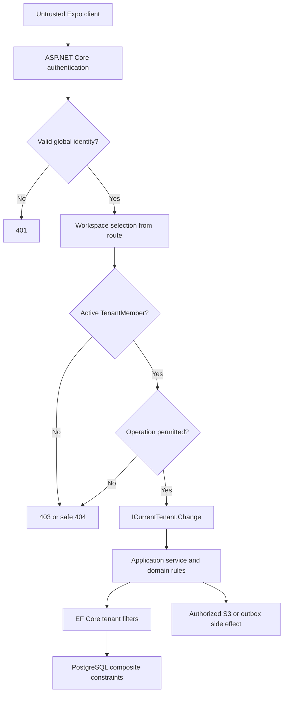

# Kepnora — Tenant Isolation and Authorization

**Document:** `docs/architecture/tenant-isolation.md`  
**Version:** 1.0 — ABP-aligned design draft  
**Scope:** Phase 1 MVP · ASP.NET Core/.NET 10 · ABP Framework · EF Core · PostgreSQL · Expo/React Native · S3 · workers  
**Related:** `../architecture-overview.md`, `../database-overview.md`, `../mvp-build-order.md`  
**Gate:** ABP Identity/OpenIddict multi-workspace POC must pass before implementation is considered approved.

> **Security invariant:** A valid login identifies a person. It does not authorize access to a Kepnora workspace. A workspace is one ABP tenant; a user must hold an active membership and the required operation permission.

---

## 1. Scope and authority

This document specifies the isolation and authorization boundary for all Phase 1 workflows: onboarding, properties, assets, versioned asset types, maintenance, service history, documents, notifications, dashboard, search, settings and background processing.

The implementation must protect against authenticated users who alter workspace identifiers, guess resource UUIDs, replay mobile requests, change their own local state, race operations or exploit stale caches. UUID unpredictability is not an access-control strategy.

**Not covered:** public sharing, provider marketplace, payment accounts, enterprise SSO, customer-managed encryption keys and a finalized PostgreSQL RLS deployment.

## 2. Canonical terminology

| Term | Definition | Authority |
|---|---|---|
| Workspace | User-facing organization of assets | One ABP Tenant Management tenant |
| ABP tenant | Authoritative workspace registry | Installed ABP Tenant Management module |
| Global user | Stable login subject across workspaces | Identity POC outcome |
| Tenant member | `(TenantId, UserId)` relationship, status and role | Kepnora `TenantMembers` |
| Owner | Active member with workspace administration rights | Membership + permission evaluator |
| Member | Active member with restricted rights | Membership + permission evaluator |
| Current tenant | Ambient ABP data scope | `ICurrentTenant`; **not** proof of membership |
| Tenant-owned row | Domain data belonging to exactly one workspace | Required `TenantId` and domain constraints |
| Global template | Read-only shared asset type | `AssetTypeDefinitions.TenantId = NULL` |
| Service principal | Trusted internal job/process identity | Explicit backend authority, never mobile claims |

**Do not create a second custom `Tenants` table.** Do not assume that ABP's tenant-local identity model automatically supports one global login across multiple tenants.

## 3. Architecture decisions and POC gates

### 3.1 Decisions already established

1. One workspace equals one ABP tenant ID.
2. A single global user can join multiple workspaces.
3. Membership and operation permission must be checked independently of tenant context.
4. Domain rows require a non-null workspace tenant ID.
5. Property association is optional for assets; tenant ownership is not.
6. Background workers and S3 operations are subject to the same ownership rules.
7. A denied resource lookup must not leak the existence of another tenant's data.

### 3.2 Decisions pending verification

| Question | Required proof | Blocking milestone |
|---|---|---|
| ABP Identity vs external OIDC | One login joins X and Y without duplicated accounts | M0 |
| Actual ABP tenant table/PK | Inspect generated migrations for pinned ABP version | M0 |
| Host/global user key and FK | Same subject maps to all memberships | M0 |
| ABP permission integration | Owner X and Member Y remain distinct | M0/M1 |
| Tenant resolver | Spoofed header/route cannot override authorization | M0/M1 |
| Membership cache | Revocation effective within defined bound | M1 |
| PostgreSQL RLS | Security benefit vs ABP UoW/pooling complexity | ADR, optional |
| Service principal model | Worker can process tenant without impersonating user | M0/M6 |

A POC is a testable deliverable, not an assumption documented as fact.

## 4. Trust boundary



The client may request a workspace. Only the server decides whether that request is authorized. The ambient tenant scope must be established **after** authorization or by a trusted resolver whose result is still independently validated.

## 5. Threat model

| ID | Attack | Required control |
|---|---|---|
| TH-01 | Change route workspace X to Y | Active membership check |
| TH-02 | Use X route with Y asset UUID | Tenant-scoped resource lookup |
| TH-03 | Create X asset with Y property | Composite tenant FK |
| TH-04 | Use Y custom asset type in X | Type visibility check |
| TH-05 | Complete Y occurrence from X | Scoped rule/occurrence/asset validation |
| TH-06 | Finalize another tenant's upload intent | Scoped intent and object validation |
| TH-07 | Replay a completion request | Idempotency + concurrency |
| TH-08 | Use access token after removal | Membership recheck/revocation bound |
| TH-09 | Forge TenantId in JSON body | Ignore/reject untrusted TenantId |
| TH-10 | Search without tenant predicate | Scoped repository + integration tests |
| TH-11 | Worker processes mismatched tenant ID | Trusted job payload + scoped lookup |
| TH-12 | Switch workspace during pending mobile request | Workspace-keyed cache and cancellation |
| TH-13 | Reuse stale presigned S3 URL | Short TTL, private bucket, limited scope |
| TH-14 | Member changes own role | Owner-only membership operation |
| TH-15 | Tenant filter disabled in administrative code | Explicit narrow audited bypass |
| TH-16 | Exception reveals private asset name | Safe error mapping/redaction |
| TH-17 | Guess UUID from notifications/deep link | Fresh authorization on navigation |
| TH-18 | Last Owner removed concurrently | Transactional last-owner invariant |

## 6. Identity vs workspace membership

The identity provider authenticates the global user. The membership store answers whether that user belongs to a given ABP tenant and which workspace role applies.

```text
GlobalUser(U)
    ├── TenantMember(Tenant X, U, Owner, Active)
    └── TenantMember(Tenant Y, U, Member, Active)

ABP Tenant X != ABP Tenant Y
```

**Do not** use a tenant ID supplied in an access token as the sole authorization source. Token claims may be stale after membership removal. A tenant-specific claim can be a hint, not the membership authority.

### 6.1 Membership table

The database overview defines `TenantMembers` with composite key `(TenantId, UserId)`, role, status, timestamps and concurrency version. The FK to global user identity is **pending the identity POC**. ABP Tenant Management remains the only tenant registry.

### 6.2 Membership lifecycle

- `Invited` is not permission to access domain data.
- `Active` may authorize actions after role/permission evaluation.
- `Removed` denies all future protected workspace operations.
- Last active Owner cannot be removed or demoted without a defined transfer.
- Rejoining requires an auditable transition and fresh authorization.
- A deleted/deactivated global identity invalidates memberships.

## 7. Permission matrix

This is the proposed Phase 1 default, subject to final product approval.

| Operation | Owner | Member | Non-member |
|---|---:|---:|---:|
| View workspace assets/properties | Yes | Yes | No |
| Create/update/archive asset | Yes | Yes | No |
| Create/update property | Yes | Yes | No |
| Manage maintenance rules | Yes | Yes | No |
| Complete maintenance | Yes | Yes | No |
| Upload/download authorized documents | Yes | Yes | No |
| Manage own notification preferences | Yes | Yes | No |
| View dashboard/search | Yes | Yes | No |
| Rename workspace | Yes | No | No |
| Manage memberships | Yes | No | No |
| Remove last Owner | No | No | No |
| Modify global asset template | No | No | No |

For implementation, map operations to named permission definitions; do not rely on string comparison of `Role` scattered across controllers. ABP permission grants may be tenant-specific, but membership remains an additional mandatory gate.

## 8. Route contract and tenant resolution

Proposed explicit API shape:

```http
GET /api/workspaces/{workspaceId}/assets
GET /api/workspaces/{workspaceId}/assets/{assetId}
POST /api/workspaces/{workspaceId}/assets
POST /api/workspaces/{workspaceId}/maintenance/occurrences/{id}/complete
POST /api/workspaces/{workspaceId}/documents/upload-intents
```

These routes are **proposals**, not claims about ABP auto-controller generated routes. Final endpoints must be confirmed by running the host and generating OpenAPI.

The server takes `workspaceId` from the validated route. If the body includes `TenantId`, reject it or ignore it by documented policy. Never allow body `TenantId` to override the route. If ABP's default tenant resolver also reads headers, ensure route resolution and authorized tenant context cannot diverge.

## 9. Authorization pipeline

1. Authenticate the global user and validate token signature, issuer, audience and expiry.
2. Parse workspace ID from the route.
3. Load active membership using a trusted host/global-safe repository.
4. Check the named operation permission within that workspace.
5. Establish `ICurrentTenant.Change(workspaceId)` in a scoped `using`.
6. Resolve domain resources by `(TenantId, Id)` and validate related resources.
7. Execute a single ABP Unit of Work for atomic changes.
8. Emit audit/outbox events and return a safe response.
9. Restore ambient tenant scope on exit, including exceptions.

Do not globally disable `IMultiTenant` filters as a shortcut for membership lookup. Membership lookup is a special global boundary, not permission to query all domain rows.

## 10. Illustrative C# authorization boundary

```csharp
public interface IWorkspaceAccessService
{
    Task RequireAsync(
        Guid workspaceId,
        Guid globalUserId,
        string permissionName,
        CancellationToken cancellationToken = default);
}

public sealed class WorkspaceAccessService : IWorkspaceAccessService
{
    private readonly ITenantMembershipReader _memberships;
    private readonly IWorkspacePermissionEvaluator _permissions;

    public WorkspaceAccessService(
        ITenantMembershipReader memberships,
        IWorkspacePermissionEvaluator permissions)
    {
        _memberships = memberships;
        _permissions = permissions;
    }

    public async Task RequireAsync(
        Guid workspaceId,
        Guid globalUserId,
        string permissionName,
        CancellationToken cancellationToken = default)
    {
        var membership = await _memberships.FindActiveAsync(
            workspaceId, globalUserId, cancellationToken);

        if (membership is null)
        {
            throw new AbpAuthorizationException(
                "Active workspace membership is required.");
        }

        if (!await _permissions.IsGrantedAsync(
                workspaceId, globalUserId, permissionName, cancellationToken))
        {
            throw new AbpAuthorizationException(
                "The requested workspace operation is not permitted.");
        }
    }
}
```

**Compilation note:** interfaces and the permission evaluator are proposed Kepnora abstractions; they are not claimed to be ABP built-ins. Verify the exception type, authorization hooks and current-user identifier mapping against the pinned ABP version.

### 10.1 Scoped application operation

```csharp
public async Task<AssetDto> GetAssetAsync(
    Guid workspaceId,
    Guid assetId,
    CancellationToken ct)
{
    var userId = _globalUserContext.RequireUserId();

    await _workspaceAccess.RequireAsync(
        workspaceId, userId, KepnoraPermissions.Assets.Read, ct);

    using (_currentTenant.Change(workspaceId))
    {
        var asset = await _assetRepository.FirstOrDefaultAsync(
            x => x.TenantId == workspaceId && x.Id == assetId,
            cancellationToken: ct);

        if (asset is null)
        {
            throw new EntityNotFoundException(typeof(Asset), assetId);
        }

        return ObjectMapper.Map<Asset, AssetDto>(asset);
    }
}
```

The exact ABP repository overload and current-user API depend on the selected package version. The invariant is **authorization before tenant-scoped resource lookup**, with an explicit tenant predicate as defense in depth.

## 11. `ICurrentTenant` and `IMultiTenant`

ABP's `IMultiTenant` enables framework data filtering. `ICurrentTenant.Change` changes ambient tenant context for the current async flow. Neither proves the caller has access.

```csharp
using (_currentTenant.Change(workspaceId))
{
    // The membership/permission check has already succeeded.
    await _assetRepository.InsertAsync(asset);
}
```

For workspace-owned rows, require `TenantId != null` in domain validation and EF mapping even though the `IMultiTenant` interface uses nullable `Guid?` to represent host data.

**Common failure:** a developer resolves the tenant from an untrusted header and immediately calls `Change` without membership authorization. This turns a data-scoping tool into an authorization bypass.

## 12. Tenant-owned entity conventions

```csharp
public class Asset : FullAuditedAggregateRoot<Guid>, IMultiTenant
{
    public Guid? TenantId { get; private set; }
    public Guid? PropertyId { get; private set; }
    public string Name { get; private set; } = default!;

    protected Asset() { }

    public Asset(Guid id, Guid tenantId, string name, Guid? propertyId)
        : base(id)
    {
        TenantId = tenantId;
        Name = Check.NotNullOrWhiteSpace(name, nameof(name), 200);
        PropertyId = propertyId;
    }
}
```

`Guid? TenantId` is required by the ABP interface, but domain construction forbids null. Enforce `NOT NULL` in the database and test EF mappings. Do not make `PropertyId` required.

## 13. PostgreSQL relational isolation

A plain foreign key on `PropertyId` prevents nonexistent references but does not by itself prevent linking to a property owned by another tenant. Use a composite tenant key.

```sql
ALTER TABLE "Properties"
    ADD CONSTRAINT "UQ_Properties_TenantId_Id"
        UNIQUE ("TenantId", "Id");

ALTER TABLE "Assets"
    ADD CONSTRAINT "FK_Assets_Properties"
        FOREIGN KEY ("TenantId", "PropertyId")
        REFERENCES "Properties" ("TenantId", "Id");
```

This example assumes the constraints do not already exist. The database overview already includes them in proposed DDL; do **not** apply duplicate `ALTER TABLE` statements.

### 13.1 Asset type visibility

A global type has `TenantId IS NULL`; a custom type has the current tenant ID. The type-version FK alone does not enforce this visibility policy. The application service must validate:

```csharp
if (type.TenantId is not null && type.TenantId != workspaceId)
{
    throw new BusinessException("Kepnora:AssetTypeNotAvailable");
}
```

### 13.2 Other composite tenant relationships

- `MaintenanceRules(TenantId, AssetId)` → `Assets(TenantId, Id)`
- `MaintenanceOccurrences(TenantId, RuleId)` → `MaintenanceRules(TenantId, Id)`
- `MaintenanceRecords(TenantId, AssetId)` → `Assets(TenantId, Id)`
- `Documents(TenantId, AssetId)` → `Assets(TenantId, Id)`
- `ReminderDeliveries(TenantId, OccurrenceId)` → `MaintenanceOccurrences(TenantId, Id)`

Verify both sides of multi-hop relationships. For example, a maintenance record's asset must equal its occurrence's rule asset, not merely share a tenant.

## 14. EF Core query scoping

```csharp
var assets = await _assetRepository
    .Where(x => x.TenantId == workspaceId && !x.IsDeleted)
    .OrderBy(x => x.Name)
    .Take(pageSize)
    .ToListAsync(ct);
```

This illustrates the query shape, not an assertion that every ABP repository exposes the exact shown extension methods. Prefer supported ABP async executers/query APIs in compiled code.

Rules:

- Always use validated tenant context.
- Keep tenant predicates on security-sensitive queries as defense in depth.
- Do not call `IgnoreQueryFilters()` on request paths.
- Parameterize raw SQL; never concatenate tenant IDs.
- Audit bulk update/delete paths that may bypass normal aggregate rules.
- Do not return a global result set and filter it in memory.
- For host-level reporting, use a separate explicitly authorized design.

## 15. PostgreSQL Row-Level Security (optional)

RLS may provide an additional database enforcement layer, but it is **not enabled by ABP automatically**. Using RLS requires a reliable transaction-scoped tenant setting, careful connection-pooling hygiene and verified behavior for workers and migrations.

```sql
-- Illustration only; NOT a deployable RLS policy.
-- The tenant setting, DB roles and connection lifecycle
-- must be proven before any policy is installed.
SELECT current_setting('app.tenant_id', TRUE);
```

RLS adoption requires an ADR, integration tests and operational runbooks. Do not deploy an incomplete policy that accidentally blocks migrations or allows a privileged connection to bypass controls.

## 16. Resource ownership patterns

### 16.1 Asset read

Authorize membership, then query `TenantId = workspaceId AND Id = assetId`. Return a safe 404 for a missing or inaccessible asset according to the agreed error policy.

### 16.2 Asset creation

Authorize write; validate property belongs to workspace if present; validate asset type is global or tenant-owned; validate immutable version and JSONB fields; create asset with server-derived `TenantId`; commit.

### 16.3 Asset update

Authorize write; load current asset in workspace; verify concurrency token; validate any new property/type; update without changing `TenantId`; commit.

### 16.4 Property archive

Authorize property write; archive the property while preserving associated assets and history. Define whether the UI should prompt to reassign assets; do not silently hard-delete.

## 17. Maintenance security

Maintenance involves a graph: Asset → Rule → Occurrence → Record. Every node must belong to the same tenant.

```text
POST /workspaces/X/maintenance/occurrences/O/complete
  1. Authenticate U
  2. Verify U is active in X
  3. Verify U has maintenance completion permission
  4. Load O with TenantId = X
  5. Load Rule with TenantId = X and RuleId = O.RuleId
  6. Load Asset with TenantId = X and AssetId = Rule.AssetId
  7. Ensure O is Open and version matches
  8. Insert one service record
  9. Transition O to Completed
 10. Update completion-anchored rule state if needed
 11. Add outbox event; commit once
```

Only `Open`, `Completed`, `Skipped`, `Cancelled` are persisted lifecycle states. `Upcoming`, `Due`, `Overdue` are derived read statuses, never authorization bypasses or persisted lifecycle values.

A duplicate completion must not create a second record. The database should enforce uniqueness on the non-null `OccurrenceId`, and the command should use an idempotency key or deterministic conflict.

## 18. Documents and private S3

The application server issues presigned URLs only after verifying membership, permission and asset ownership. Never accept an arbitrary client-supplied object key.

**Upload flow:**

1. Client requests intent for an authorized asset.
2. Server generates an opaque S3 key containing trusted tenant/asset identifiers.
3. Server persists pending intent with content type, size and expiry.
4. Server returns short-lived presigned PUT.
5. Client uploads directly to private S3.
6. Server validates object metadata/size and intent ownership.
7. Server finalizes intent and document metadata atomically.
8. Cleanup worker reconciles expired intents and orphaned objects.

**Download flow:** Reauthorize membership and document ownership for every new presigned GET. A previously issued presigned URL remains usable until expiry, even after membership revocation; keep TTL short and document this residual risk.

### 18.1 Cross-tenant S3 tests

- X member requests presign for Y asset → denied.
- X member finalizes Y intent → denied.
- Client changes object key → denied.
- Expired intent is finalized → denied.
- Removed member requests download → denied.
- Public ACL/bucket policy test → no public object access.

## 19. Notifications and devices

Device registrations are user-global, but reminder deliveries and preferences are tenant-scoped. A global device must not cause one workspace's reminder data to leak to another.

At dispatch:

1. Load trusted tenant ID and occurrence.
2. Confirm occurrence remains Open.
3. Confirm recipient is an active tenant member.
4. Confirm notification permission/preference and quiet hours.
5. Resolve active user-global devices.
6. Send only minimal notification text; avoid private document content.
7. Record delivery result and retry metadata.

Push providers are external. A crash after sending but before recording success may cause duplicate presentation. Do not claim exactly-once push delivery.

## 20. Background worker authority

Workers are not interactive users and should not fabricate a human `UserId` to pass membership checks. They operate under a separate, explicit service authority with tenant-scoped domain rules.

```csharp
public async Task ProcessRuleAsync(
    Guid trustedTenantId,
    Guid ruleId,
    CancellationToken ct)
{
    using (_currentTenant.Change(trustedTenantId))
    {
        var rule = await _ruleRepository.FirstOrDefaultAsync(
            x => x.TenantId == trustedTenantId && x.Id == ruleId,
            cancellationToken: ct);

        if (rule is null)
        {
            return; // Or dead-letter an invalid job with a safe reason.
        }

        await _occurrenceGenerator.GenerateAsync(rule, ct);
    }
}
```

**Critical:** the tenant ID must originate from trusted persisted job data, not a caller-controlled request body passed directly to a worker. Ensure scopes are restored after each job and failures. Use unique schedule keys and retry-safe operations.

## 21. Dashboard, search and reports

Every aggregate, full-text search, autocomplete and dashboard count must use the validated tenant boundary. The UI must not perform global queries and then filter results locally.

```sql
SELECT
    COUNT(*) AS "ActiveAssetCount"
FROM "Assets" AS A
WHERE A."TenantId" = @TenantId
  AND A."IsArchived" = FALSE;
```

`@TenantId` is a documentation placeholder; actual Npgsql binding syntax depends on the API used.

Derived maintenance counts must apply the same rule-local timezone and grace logic as the maintenance engine. An inaccurate dashboard is a product defect even if it does not leak tenant data.

## 22. React Native workspace switching

- Store access/refresh tokens using Expo SecureStore.
- Keep selected workspace ID as app state, not as proof of access.
- Prefix TanStack Query keys with workspace ID: `['workspace', id, 'assets', filters]`.
- Cancel in-flight requests on switch where possible.
- Invalidate or isolate cached tenant data and Zustand slices.
- Recheck membership when opening deep links and after app resume.
- Clear sensitive workspace state on logout and revocation.
- Never show X's cached asset details while Y is selected.

```typescript
export const assetQueryKey = (
  workspaceId: string,
  filters: AssetFilters
) => ['workspace', workspaceId, 'assets', filters] as const;
```

Server authorization remains mandatory even when mobile state handling is correct.

## 23. Error semantics and information leakage

| Scenario | Suggested status | Privacy requirement |
|---|---|---|
| No/expired token | 401 | No user data |
| Authenticated but not workspace member | 403 | No tenant metadata |
| Asset absent or belongs to another tenant | 404 | No existence confirmation |
| Member lacks operation permission | 403 | No sensitive details |
| Stale concurrency token | 409 | No other user's private changes |
| Invalid asset type/schema | 400/422 | Safe validation details |
| Unexpected failure | 500 | Correlation ID, no stack trace |

ABP's default exception mapping may differ. The final mapping must be tested and documented from the running API. Avoid including private resource names in denial messages.

## 24. Audit events

Capture security-relevant events with correlation ID, actor global user ID (or service principal), tenant ID, operation, resource ID and result. Avoid raw tokens, private document contents and presigned URLs.

Suggested event categories:

- Workspace membership created, revoked or role changed.
- Workspace selection denied.
- Cross-tenant resource access denied.
- Asset archived/restored.
- Maintenance occurrence completed/skipped/cancelled.
- Upload intent issued/finalized/rejected.
- Notification preference changed.
- Worker job rejected due to tenant mismatch.
- Administrative data-filter bypass (if ever permitted).

Retention and PII policies must be approved before launch.

## 25. Test harness

Use a real PostgreSQL instance for relational constraint and ABP filter tests; EF Core InMemory cannot prove PostgreSQL FK/index behavior.

Seed:

```text
User A = Owner X, Member Y
User B = Owner Y
User C = no membership X or Y

Property PX belongs X
Property PY belongs Y

Asset AX belongs X, PropertyId = PX
Asset AY belongs Y, PropertyId = PY
Asset AS belongs X, PropertyId = NULL

Rule RX -> Asset AX
Occurrence OX -> Rule RX
Document DX -> Asset AX
```

The same global User A must log in once and access X/Y with different permissions; that scenario is the M0 POC gate.

## 26. Integration test catalog

| ID | Scenario | Expected |
|---|---|---|
| TEN-001 | Anonymous lists X assets | 401 |
| TEN-002 | User C lists X assets | 403 |
| TEN-003 | User A reads X assets | Allowed |
| TEN-004 | User A reads Y assets | Allowed as Member |
| TEN-005 | User A manages Y members | 403 |
| TEN-006 | User B requests X asset UUID | Safe 404 |
| TEN-007 | X asset references PY | DB FK rejects |
| TEN-008 | X standalone asset uses null PropertyId | Succeeds |
| TEN-009 | X asset references Y custom type | Rejected |
| TEN-010 | Member modifies global template | Rejected |
| TEN-011 | Duplicate maintenance completion | One record |
| TEN-012 | X request completes Y occurrence | Rejected |
| TEN-013 | Occurrence `Overdue` persisted | Check rejects |
| TEN-014 | X finalizes Y upload intent | Rejected |
| TEN-015 | Client supplies arbitrary S3 key | Rejected |
| TEN-016 | Revoked member requests S3 download | Rejected |
| TEN-017 | Revoked member pending reminder | Suppressed |
| TEN-018 | Worker X processes Y rule ID | Rejected |
| TEN-019 | Worker X then Y sequentially | No context leakage |
| TEN-020 | Tenant switch during pending fetch | No stale X data in Y |
| TEN-021 | Deep link to Y asset for X-only user | Rejected |
| TEN-022 | Concurrent last-owner removals | At least one rejected |
| TEN-023 | SQL query without tenant predicate | Security review/test fails |
| TEN-024 | Two ABP tenants share one global identity | POC passes |
| TEN-025 | Permission revocation with stale token | Denied within policy |
| TEN-026 | Search with Y's serial number in X | No result |
| TEN-027 | Dashboard aggregate on X | Excludes Y |
| TEN-028 | Tenant header differs from route | Rejected |
| TEN-029 | Error for guessed Y asset | No private metadata |
| TEN-030 | Audit log after denied access | Correlation and tenant recorded safely |

## 27. Test implementation guidance

- Run API tests with a real auth test issuer or validated test authentication scheme.
- Never disable authorization middleware for integration tests.
- Run the exact ABP data filters and Unit of Work middleware used in production.
- Use disposable PostgreSQL and apply actual migrations.
- Add negative tests for raw SQL, batch updates, jobs and document finalize.
- Assert both HTTP response and database side effects.
- Test token revocation, cache expiration and concurrent membership updates.
- Add regression tests for each discovered cross-tenant bug.

## 28. Performance and caching

Membership lookups can be cached only if revocation latency is bounded and documented. A cached active membership is not acceptable forever. Consider short TTL with explicit invalidation and tests for a revoked user immediately retrying access.

Index membership by `(UserId, TenantId)` for workspace listing and by `(TenantId, UserId)` for authorization. Tenant-scoped tables generally need composite indexes starting with `TenantId` for common queries. Validate plans using `EXPLAIN (ANALYZE, BUFFERS)`.

Do not cache tenant-owned DTOs under global cache keys. Cache keys must include workspace ID and any role/permission version that affects visibility.

## 29. Operational incident response

If cross-tenant data is exposed:

1. Disable the affected endpoint/worker or block the affected access path.
2. Preserve audit logs, request correlation IDs and relevant deployment versions.
3. Determine which tenants/resources were affected.
4. Patch authorization and add a reproducing integration test.
5. Review other endpoints using the same repository/helper pattern.
6. Follow approved incident notification and retention procedures.
7. Re-enable only after verification against two-tenant fixtures.

Do not globally disable tenant filters for production troubleshooting.

## 30. Secure coding checklist

- [ ] Global identity was validated.
- [ ] Workspace ID came from a documented route/resolver.
- [ ] Active membership was checked.
- [ ] Operation permission was checked.
- [ ] `ICurrentTenant` was set only within an authorized scope.
- [ ] Domain query constrained by TenantId.
- [ ] Related entity belongs to same tenant or is approved global.
- [ ] Client cannot override TenantId.
- [ ] Mutation uses concurrency/idempotency controls.
- [ ] Error contains no cross-tenant metadata.
- [ ] S3/outbox/worker operations preserve ownership.
- [ ] Mobile cache keys include workspace.
- [ ] Negative cross-tenant test exists.

## 31. Implementation order

1. **M0:** Compile ABP and prove global identity with two ABP tenants.
2. **M0:** Inspect actual ABP tenant/identity migrations and permission behavior.
3. **M1:** Implement `TenantMembers`, workspace provisioning and membership service.
4. **M1:** Implement tenant resolver and authorization integration.
5. **M2/M3:** Add composite tenant FKs and asset/property/type validation.
6. **M4:** Protect maintenance graph and idempotent completion.
7. **M5:** Protect upload intent/finalize/download and S3 cleanup.
8. **M6:** Establish worker authority, recipient validation and push suppression.
9. **M7:** Verify dashboard/search and mobile cache isolation.
10. **M8:** Run full security suite, restore tests and incident rehearsal.

## 32. Exit criteria

This document is ready for implementation only when the ABP POC and open identity decisions are resolved. Phase 1 security is ready for beta only when:

- A single global identity accesses two ABP tenants without accidental role sharing.
- Every protected endpoint checks active membership and permission.
- Cross-tenant entity links are rejected by constraints or equivalent tested invariants.
- Tenant filters cannot be bypassed through standard API/worker paths.
- Document access and notifications revalidate current membership.
- Mobile workspace switching cannot display stale data.
- All `TEN-*` tests pass and operational incident handling is documented.

## 33. Final rule

**ABP tenant context is a data scope, not an authorization grant.** Kepnora must establish the right to access a workspace first, then apply tenant-scoped persistence and domain invariants. This rule applies equally to interactive APIs, mobile cache, PostgreSQL, S3 and background jobs.
