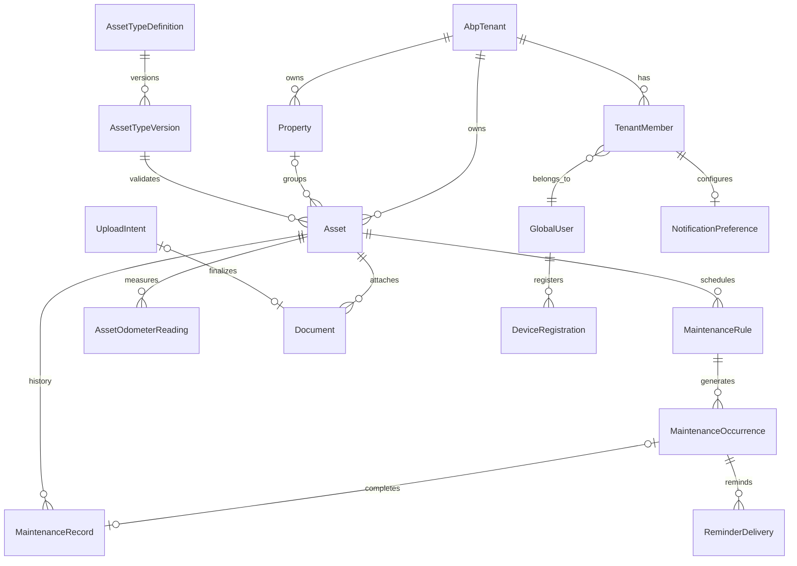

# Kepnora Database Overview

**Version:** 1.0-draft  
**Status:** Proposed implementation specification; ABP Identity and multi-workspace POC outstanding  
**Database:** PostgreSQL, EF Core, ABP Framework  
**SQL convention:** T-SQL-style formatting and PascalCase identifiers using PostgreSQL-compatible syntax  
**Related:** `README.md`, `kepnora-project-context.md`, `architecture-overview.md`

---

## 1. Purpose

This document is the authoritative **proposed** persistence design for Kepnora Phase 1. It defines tenant ownership, entities, relationships, lifecycle invariants, indexes, migration practices, concurrency and failure recovery. It deliberately distinguishes *approved product invariants* from *implementation choices pending ABP proof of concept*.

It is not a claim that ABP migrations have been generated or the database deployed. The SQL examples target PostgreSQL, not SQL Server. PostgreSQL requires double quotes to preserve PascalCase identifiers.

## 2. Database Design Goals

1. Enforce isolation between workspaces through ABP tenant context, application authorization and relational constraints.
2. Support a **global login subject with memberships in multiple workspaces**, subject to an ABP Identity/OpenIddict proof of concept.
3. Keep `Asset.PropertyId` nullable for cars, electronics and other standalone assets.
4. Preserve versioned custom asset schemas and validate JSONB fields.
5. Generate maintenance occurrences deterministically and record completion without duplicate history.
6. Store document metadata in PostgreSQL while keeping binaries in private S3.
7. Deliver reminders through a durable outbox and retryable workers.
8. Avoid losing business history during archive, schema evolution or failed background processing.
9. Support efficient dashboard/search queries within one tenant.
10. Keep schema evolution reproducible through EF Core migrations and verified ABP package versions.

## 3. Database Areas

```text
ABP Platform
  Tenant Management / Identity / Permission Management / Audit Logging
Kepnora Workspace
  Membership / Workspace Metadata / Invitations (deferred)
Asset Catalog
  Properties / Asset Type Definitions / Asset Type Versions / Assets
Maintenance
  Rules / Occurrences / Service Records / Odometer Readings
Documents
  Upload Intents / Document Metadata / S3 Object References
Notifications
  User Devices / Tenant Preferences / Reminder Deliveries
Operations
  Outbox / Worker Checkpoints / Idempotency Keys
```

## 4. High-Level Entity Map



**Diagram note:** `AbpTenant` and `GlobalUser` are conceptual nodes. The actual ABP tenant entity/table and global identity key depend on the pinned ABP version and identity architecture. Do **not** generate migrations from the diagram alone.

## 5. Canonical ABP Tenant Mapping

### 5.1 One workspace, one ABP tenant

- The ABP Tenant Management entity is the authoritative workspace registry.
- Every workspace-owned Kepnora entity stores the **same** `TenantId` as the ABP tenant.
- There must be **no parallel custom `Tenants` table**.
- Workspace display preferences may be stored as an ABP extension or a 1:1 `WorkspaceProfiles` table keyed by the ABP tenant ID.
- `ICurrentTenant` supplies the data scope, **not** proof that the caller belongs to the workspace.
- Application authorization checks active membership and tenant-sensitive permissions before domain access.

### 5.2 Global user identity is a design gate

The product requires one person to join multiple workspaces. ABP's standard tenant-local identity/roles must **not** be assumed to support this automatically.

Two alternatives remain open:

| Option | Description | Required proof |
|---|---|---|
| A | Host/global ABP Identity user with OpenIddict | Same login can access two ABP tenants; tenant-specific permissions do not leak |
| B | External OIDC user with stable global subject | Claims mapping, token validation, revocation and ABP permission integration work |

**No executable FK from `TenantMembers.UserId` is defined until the identity POC selects an authoritative global user table/key.** The membership SQL below is intentionally incomplete in this one respect.

### 5.3 ABP schema ownership

ABP platform tables and migrations belong to the installed ABP modules. Their exact names and columns must be inspected from generated migrations; this document does not redefine them. Do not manually recreate `AbpTenants`, identity, permission or audit tables with handwritten DDL.

### 5.4 Tenant ownership invariants

- `TenantId` is required for all workspace-owned Kepnora rows, even though ABP `IMultiTenant.TenantId` is nullable at the interface level to allow host-owned rows.
- `TenantId` cannot change after creation.
- Global asset templates may have `TenantId = NULL`; they are not workspace assets.
- User-global device registrations are keyed by global user, not tenant.
- Tenant membership is a host-level lookup but does not grant access to tenant domain data by itself.

## 6. SQL Naming and Type Conventions

| Concern | Convention |
|---|---|
| Tables | `"TenantMembers"`, `"MaintenanceOccurrences"` |
| Columns | `"TenantId"`, `"CreatedAt"`, `"ScheduleKey"` |
| Primary keys | `"PK_TableName"` |
| Foreign keys | `"FK_Child_Parent"` |
| Unique constraints | `"UQ_TableName_Columns"` |
| Check constraints | `"CK_TableName_Rule"` |
| Indexes | `"IX_TableName_Columns"` |
| UUID | `UUID` |
| UTC timestamp | `TIMESTAMPTZ` |
| Amount | `NUMERIC(18, 2)` |
| Text with bounded domain | `VARCHAR(n)` |
| Dynamic validated payload | `JSONB` |
| Concurrency | `BIGINT` version or application-managed token |

All examples use uppercase SQL keywords, explicit named constraints and four-space indentation. Do not substitute SQL Server-only `UNIQUEIDENTIFIER`, `DATETIME2`, `IDENTITY`, `GETUTCDATE()` or `TOP`.

## 7. Shared Entity Fields

Kepnora tenant-owned entities should consistently expose:

```csharp
public interface IKepnoraTenantEntity : IMultiTenant
{
    Guid Id { get; }
    // TenantId is nullable on IMultiTenant; domain invariants require non-null.
}
```

Suggested auditing: ABP `FullAuditedAggregateRoot<Guid>` for mutable user-facing aggregates, or more targeted interfaces when immutable history/outbox semantics require it. ABP audit/soft-delete conventions should not be copied into immutable ledger tables without analysis.

The SQL below includes essential business columns and selected timestamps. ABP auditing columns are represented conceptually; the final migration must reconcile actual ABP base-class mappings.

## 8. Workspace Membership

### 8.1 Logical model

`TenantMembers` is the authoritative application membership registry. It is **not** a second tenant registry.

```sql
CREATE TABLE "TenantMembers"
(
    "TenantId" UUID NOT NULL,
    "UserId" UUID NOT NULL,
    "Role" VARCHAR(20) NOT NULL,
    "Status" VARCHAR(20) NOT NULL,
    "JoinedAt" TIMESTAMPTZ NOT NULL DEFAULT CURRENT_TIMESTAMP,
    "RemovedAt" TIMESTAMPTZ NULL,
    "Version" BIGINT NOT NULL DEFAULT 1,

    CONSTRAINT "PK_TenantMembers"
        PRIMARY KEY ("TenantId", "UserId"),

    CONSTRAINT "CK_TenantMembers_Role"
        CHECK ("Role" IN ('Owner', 'Member')),

    CONSTRAINT "CK_TenantMembers_Status"
        CHECK ("Status" IN ('Active', 'Invited', 'Removed')),

    CONSTRAINT "CK_TenantMembers_Removal"
        CHECK (
            ("Status" = 'Removed' AND "RemovedAt" IS NOT NULL)
            OR ("Status" <> 'Removed' AND "RemovedAt" IS NULL)
        )
);

CREATE INDEX "IX_TenantMembers_UserId_Active"
    ON "TenantMembers" ("UserId", "TenantId")
    WHERE "Status" = 'Active';
```

**Migration gate:** add a foreign key to the actual ABP tenant table only after verifying its generated physical schema. Add a user FK only after global identity is decided. Do not silently omit these FKs from the production migration.

### 8.2 Membership rules

- An active membership is required for workspace reads and writes.
- Owners manage members and workspace metadata; Member permissions are explicitly assigned, not inferred from a JWT role.
- Prevent removal/demotion of the last active Owner in a transaction.
- A removed membership must fail on the next authorized request, regardless of stale mobile state.
- Membership authorization is performed using a deliberately host/global-safe repository and must not require broad disabling of tenant filters for domain data.
- Rejoining may reactivate a row or create an audit event; choose one policy before implementation.

## 9. Workspace Profile

Workspace metadata may live in an ABP tenant extension or a dedicated 1:1 table. **Choose one**, do not duplicate fields in both.

```sql
CREATE TABLE "WorkspaceProfiles"
(
    "TenantId" UUID NOT NULL,
    "DisplayName" VARCHAR(160) NOT NULL,
    "DefaultTimeZoneId" VARCHAR(100) NOT NULL DEFAULT 'UTC',
    "CreatedAt" TIMESTAMPTZ NOT NULL DEFAULT CURRENT_TIMESTAMP,
    "UpdatedAt" TIMESTAMPTZ NULL,

    CONSTRAINT "PK_WorkspaceProfiles"
        PRIMARY KEY ("TenantId")
);
```

An FK to the actual ABP tenant table is mandatory in the final migration. Workspace timezone is a default only; properties and rules may require more specific timezone behavior.

## 10. Properties

A property is an optional organizational location for assets. A tenant can own many properties.

```sql
CREATE TABLE "Properties"
(
    "Id" UUID NOT NULL,
    "TenantId" UUID NOT NULL,
    "Name" VARCHAR(160) NOT NULL,
    "PropertyType" VARCHAR(30) NOT NULL,
    "AddressLine1" VARCHAR(200) NULL,
    "AddressLine2" VARCHAR(200) NULL,
    "City" VARCHAR(120) NULL,
    "Region" VARCHAR(120) NULL,
    "PostalCode" VARCHAR(30) NULL,
    "CountryCode" VARCHAR(2) NULL,
    "TimeZoneId" VARCHAR(100) NULL,
    "IsArchived" BOOLEAN NOT NULL DEFAULT FALSE,
    "CreatedAt" TIMESTAMPTZ NOT NULL DEFAULT CURRENT_TIMESTAMP,
    "Version" BIGINT NOT NULL DEFAULT 1,

    CONSTRAINT "PK_Properties"
        PRIMARY KEY ("Id"),

    CONSTRAINT "UQ_Properties_TenantId_Id"
        UNIQUE ("TenantId", "Id"),

    CONSTRAINT "CK_Properties_Type"
        CHECK ("PropertyType" IN ('Home', 'Rental', 'Commercial', 'Other'))
);

CREATE INDEX "IX_Properties_TenantId_Active"
    ON "Properties" ("TenantId", "Name")
    WHERE "IsArchived" = FALSE;
```

**Deletion policy:** archive by default. A property with assets cannot be hard-deleted without an explicit reassignment/removal workflow. Archiving a property does not automatically archive its assets or history.

## 11. Asset Type Definitions and Schema Versions

Global templates and tenant-defined types share a logical catalog but have different authorization rules.

```sql
CREATE TABLE "AssetTypeDefinitions"
(
    "Id" UUID NOT NULL,
    "TenantId" UUID NULL,
    "Code" VARCHAR(100) NOT NULL,
    "DisplayName" VARCHAR(160) NOT NULL,
    "IsActive" BOOLEAN NOT NULL DEFAULT TRUE,
    "CreatedAt" TIMESTAMPTZ NOT NULL DEFAULT CURRENT_TIMESTAMP,

    CONSTRAINT "PK_AssetTypeDefinitions"
        PRIMARY KEY ("Id"),

    CONSTRAINT "UQ_AssetTypeDefinitions_TenantId_Id"
        UNIQUE ("TenantId", "Id")
);

CREATE UNIQUE INDEX "UX_AssetTypeDefinitions_GlobalCode"
    ON "AssetTypeDefinitions" ("Code")
    WHERE "TenantId" IS NULL;

CREATE UNIQUE INDEX "UX_AssetTypeDefinitions_TenantCode"
    ON "AssetTypeDefinitions" ("TenantId", "Code")
    WHERE "TenantId" IS NOT NULL;

CREATE TABLE "AssetTypeVersions"
(
    "Id" UUID NOT NULL,
    "AssetTypeDefinitionId" UUID NOT NULL,
    "VersionNumber" INTEGER NOT NULL,
    "SchemaJson" JSONB NOT NULL,
    "PublishedAt" TIMESTAMPTZ NOT NULL DEFAULT CURRENT_TIMESTAMP,

    CONSTRAINT "PK_AssetTypeVersions"
        PRIMARY KEY ("Id"),

    CONSTRAINT "UQ_AssetTypeVersions_Definition_Version"
        UNIQUE ("AssetTypeDefinitionId", "VersionNumber"),

    CONSTRAINT "UQ_AssetTypeVersions_Definition_Id"
        UNIQUE ("AssetTypeDefinitionId", "Id"),

    CONSTRAINT "FK_AssetTypeVersions_Definition"
        FOREIGN KEY ("AssetTypeDefinitionId")
        REFERENCES "AssetTypeDefinitions" ("Id"),

    CONSTRAINT "CK_AssetTypeVersions_SchemaObject"
        CHECK (jsonb_typeof("SchemaJson") = 'object')
);
```

Published schema versions are immutable. JSONB shape checks are **not** a substitute for full server-side schema validation (field type, requiredness, allowed values, length, reserved names, version compatibility). A tenant may read global templates but must not edit them.

## 12. Assets

```sql
CREATE TABLE "Assets"
(
    "Id" UUID NOT NULL,
    "TenantId" UUID NOT NULL,
    "PropertyId" UUID NULL,
    "AssetTypeDefinitionId" UUID NOT NULL,
    "AssetTypeVersionId" UUID NOT NULL,
    "Name" VARCHAR(200) NOT NULL,
    "Manufacturer" VARCHAR(160) NULL,
    "Model" VARCHAR(160) NULL,
    "SerialNumber" VARCHAR(160) NULL,
    "PurchasedOn" DATE NULL,
    "PurchasePrice" NUMERIC(18, 2) NULL,
    "CurrencyCode" VARCHAR(3) NULL,
    "CustomFields" JSONB NOT NULL DEFAULT '{}'::JSONB,
    "IsArchived" BOOLEAN NOT NULL DEFAULT FALSE,
    "CreatedAt" TIMESTAMPTZ NOT NULL DEFAULT CURRENT_TIMESTAMP,
    "UpdatedAt" TIMESTAMPTZ NULL,
    "Version" BIGINT NOT NULL DEFAULT 1,

    CONSTRAINT "PK_Assets"
        PRIMARY KEY ("Id"),

    CONSTRAINT "UQ_Assets_TenantId_Id"
        UNIQUE ("TenantId", "Id"),

    CONSTRAINT "FK_Assets_Properties"
        FOREIGN KEY ("TenantId", "PropertyId")
        REFERENCES "Properties" ("TenantId", "Id"),

    CONSTRAINT "FK_Assets_AssetTypeVersion"
        FOREIGN KEY ("AssetTypeDefinitionId", "AssetTypeVersionId")
        REFERENCES "AssetTypeVersions" ("AssetTypeDefinitionId", "Id"),

    CONSTRAINT "CK_Assets_CustomFieldsObject"
        CHECK (jsonb_typeof("CustomFields") = 'object'),

    CONSTRAINT "CK_Assets_PurchasePrice"
        CHECK ("PurchasePrice" IS NULL OR "PurchasePrice" >= 0)
);

CREATE INDEX "IX_Assets_TenantId_PropertyId"
    ON "Assets" ("TenantId", "PropertyId", "Name")
    WHERE "IsArchived" = FALSE;

CREATE INDEX "IX_Assets_TenantId_Name"
    ON "Assets" ("TenantId", "Name")
    WHERE "IsArchived" = FALSE;
```

**Cross-tenant type validation:** the FK above proves version-to-definition consistency, but not that a tenant is allowed to use a particular type. Application logic must verify that the definition is global or belongs to the current tenant. This can also be enforced through a more elaborate relational design; do not claim the current FK alone closes that gap.

**Standalone asset:** `PropertyId = NULL` is valid and expected.

## 13. Maintenance Rules

Rules express time- or mileage-based scheduling intent. Do not store a misleading derived due status on the rule.

```sql
CREATE TABLE "MaintenanceRules"
(
    "Id" UUID NOT NULL,
    "TenantId" UUID NOT NULL,
    "AssetId" UUID NOT NULL,
    "Title" VARCHAR(200) NOT NULL,
    "ScheduleType" VARCHAR(20) NOT NULL,
    "AnchorPolicy" VARCHAR(20) NOT NULL,
    "IntervalDays" INTEGER NULL,
    "IntervalMonths" INTEGER NULL,
    "IntervalMiles" INTEGER NULL,
    "StartOn" DATE NULL,
    "StartMileage" INTEGER NULL,
    "TimeZoneId" VARCHAR(100) NULL,
    "IsEnabled" BOOLEAN NOT NULL DEFAULT TRUE,
    "LastCompletedOn" DATE NULL,
    "LastCompletedMileage" INTEGER NULL,
    "CreatedAt" TIMESTAMPTZ NOT NULL DEFAULT CURRENT_TIMESTAMP,
    "Version" BIGINT NOT NULL DEFAULT 1,

    CONSTRAINT "PK_MaintenanceRules"
        PRIMARY KEY ("Id"),

    CONSTRAINT "UQ_MaintenanceRules_TenantId_Id"
        UNIQUE ("TenantId", "Id"),

    CONSTRAINT "FK_MaintenanceRules_Assets"
        FOREIGN KEY ("TenantId", "AssetId")
        REFERENCES "Assets" ("TenantId", "Id"),

    CONSTRAINT "CK_MaintenanceRules_ScheduleType"
        CHECK ("ScheduleType" IN ('Time', 'Mileage')),

    CONSTRAINT "CK_MaintenanceRules_AnchorPolicy"
        CHECK ("AnchorPolicy" IN ('Scheduled', 'Completion')),

    CONSTRAINT "CK_MaintenanceRules_TimeInterval"
        CHECK (
            "ScheduleType" <> 'Time'
            OR (
                (("IntervalDays" IS NOT NULL)::INTEGER
                 + ("IntervalMonths" IS NOT NULL)::INTEGER) = 1
                AND COALESCE("IntervalDays", "IntervalMonths") > 0
            )
        ),

    CONSTRAINT "CK_MaintenanceRules_MileageInterval"
        CHECK (
            "ScheduleType" <> 'Mileage'
            OR ("IntervalMiles" IS NOT NULL AND "IntervalMiles" > 0)
        )
);

CREATE INDEX "IX_MaintenanceRules_TenantId_AssetId"
    ON "MaintenanceRules" ("TenantId", "AssetId")
    WHERE "IsEnabled" = TRUE;
```

**Explicit limitation:** hybrid time-or-mileage rules are not defined by this Phase 1 schema. If required, add a policy and migration before implementation rather than silently treating them as `Time`.

## 14. Maintenance Occurrences

An occurrence represents one deterministic scheduled obligation. Its persisted lifecycle is **only** `Open`, `Completed`, `Skipped`, `Cancelled`.

```sql
CREATE TABLE "MaintenanceOccurrences"
(
    "Id" UUID NOT NULL,
    "TenantId" UUID NOT NULL,
    "RuleId" UUID NOT NULL,
    "ScheduleKey" VARCHAR(120) NOT NULL,
    "DueOn" DATE NULL,
    "DueMileage" INTEGER NULL,
    "LifecycleStatus" VARCHAR(20) NOT NULL DEFAULT 'Open',
    "CompletedAt" TIMESTAMPTZ NULL,
    "CreatedAt" TIMESTAMPTZ NOT NULL DEFAULT CURRENT_TIMESTAMP,
    "Version" BIGINT NOT NULL DEFAULT 1,

    CONSTRAINT "PK_MaintenanceOccurrences"
        PRIMARY KEY ("Id"),

    CONSTRAINT "UQ_MaintenanceOccurrences_TenantId_Id"
        UNIQUE ("TenantId", "Id"),

    CONSTRAINT "UQ_MaintenanceOccurrences_Rule_ScheduleKey"
        UNIQUE ("TenantId", "RuleId", "ScheduleKey"),

    CONSTRAINT "FK_MaintenanceOccurrences_Rules"
        FOREIGN KEY ("TenantId", "RuleId")
        REFERENCES "MaintenanceRules" ("TenantId", "Id"),

    CONSTRAINT "CK_MaintenanceOccurrences_LifecycleStatus"
        CHECK ("LifecycleStatus" IN ('Open', 'Completed', 'Skipped', 'Cancelled'))
);

CREATE INDEX "IX_MaintenanceOccurrences_Tenant_Status_Due"
    ON "MaintenanceOccurrences" ("TenantId", "LifecycleStatus", "DueOn")
    WHERE "LifecycleStatus" = 'Open';
```

**Never persist `Upcoming`, `Due`, `Overdue` as lifecycle values.** Those are derived presentation states computed from the current date/time, rule policy, grace period and/or mileage reading.

### 14.1 Schedule key

`ScheduleKey` is deterministic and stable for one rule generation version, e.g. `TIME:2026-11-30` or `MILE:25000`. A scheduled-anchored monthly rule should not drift after month-end clamping. Completion-anchored rules calculate from actual completion; their next occurrence generation must be transactionally coordinated.

### 14.2 Rule edits

Rule edits require an explicit policy for existing open occurrences: preserve, cancel/recreate or versioned regeneration. Do not silently rewrite completed history. Add a rule revision if needed for deterministic reprocessing.

## 15. Maintenance Service History

Service history records what actually happened, including ad hoc work not tied to a scheduled occurrence.

```sql
CREATE TABLE "MaintenanceRecords"
(
    "Id" UUID NOT NULL,
    "TenantId" UUID NOT NULL,
    "AssetId" UUID NOT NULL,
    "OccurrenceId" UUID NULL,
    "PerformedOn" DATE NOT NULL,
    "Description" VARCHAR(1000) NULL,
    "Cost" NUMERIC(18, 2) NULL,
    "CurrencyCode" VARCHAR(3) NULL,
    "OdometerMileage" INTEGER NULL,
    "CreatedByUserId" UUID NOT NULL,
    "CreatedAt" TIMESTAMPTZ NOT NULL DEFAULT CURRENT_TIMESTAMP,

    CONSTRAINT "PK_MaintenanceRecords"
        PRIMARY KEY ("Id"),

    CONSTRAINT "UQ_MaintenanceRecords_TenantId_Id"
        UNIQUE ("TenantId", "Id"),

    CONSTRAINT "FK_MaintenanceRecords_Assets"
        FOREIGN KEY ("TenantId", "AssetId")
        REFERENCES "Assets" ("TenantId", "Id"),

    CONSTRAINT "FK_MaintenanceRecords_Occurrences"
        FOREIGN KEY ("TenantId", "OccurrenceId")
        REFERENCES "MaintenanceOccurrences" ("TenantId", "Id"),

    CONSTRAINT "CK_MaintenanceRecords_Cost"
        CHECK ("Cost" IS NULL OR "Cost" >= 0)
);

CREATE UNIQUE INDEX "UX_MaintenanceRecords_Occurrence"
    ON "MaintenanceRecords" ("TenantId", "OccurrenceId")
    WHERE "OccurrenceId" IS NOT NULL;
```

The occurrence FK alone does **not** ensure the record's `AssetId` equals the rule's asset. Enforce that in the domain transaction or introduce a composite relational invariant. This is a mandatory integration test.

### 15.1 Completion transaction

1. Authorize workspace membership and maintenance permission.
2. Load occurrence and parent rule/asset within the tenant scope.
3. Verify `LifecycleStatus = 'Open'` and expected version.
4. Insert exactly one maintenance record.
5. Transition occurrence to `Completed`, update completion metadata.
6. Update completion-anchored rule state if applicable.
7. Add outbox event and commit **one Unit of Work**.
8. On retry, return the prior result for the same idempotency key or a stable conflict; never create duplicate records.

## 16. Odometer Readings

```sql
CREATE TABLE "AssetOdometerReadings"
(
    "Id" UUID NOT NULL,
    "TenantId" UUID NOT NULL,
    "AssetId" UUID NOT NULL,
    "Mileage" INTEGER NOT NULL,
    "RecordedAt" TIMESTAMPTZ NOT NULL,
    "Source" VARCHAR(30) NOT NULL DEFAULT 'Manual',

    CONSTRAINT "PK_AssetOdometerReadings"
        PRIMARY KEY ("Id"),

    CONSTRAINT "FK_AssetOdometerReadings_Assets"
        FOREIGN KEY ("TenantId", "AssetId")
        REFERENCES "Assets" ("TenantId", "Id"),

    CONSTRAINT "CK_AssetOdometerReadings_Mileage"
        CHECK ("Mileage" >= 0)
);

CREATE INDEX "IX_AssetOdometerReadings_Asset_RecordedAt"
    ON "AssetOdometerReadings" ("TenantId", "AssetId", "RecordedAt" DESC);
```

A mileage due calculation must not invent readings. Define handling for odometer resets, corrections, late-arriving readings and unit conversions before production. If no valid reading exists, mileage due status is **Unknown**, not automatically Due.

## 17. Upload Intents and Documents

Files are stored privately in S3. PostgreSQL stores intent state, metadata, ownership and storage keys.

```sql
CREATE TABLE "UploadIntents"
(
    "Id" UUID NOT NULL,
    "TenantId" UUID NOT NULL,
    "AssetId" UUID NOT NULL,
    "RequestedByUserId" UUID NOT NULL,
    "ObjectKey" VARCHAR(700) NOT NULL,
    "ExpectedContentType" VARCHAR(150) NOT NULL,
    "ExpectedSizeBytes" BIGINT NOT NULL,
    "Status" VARCHAR(20) NOT NULL DEFAULT 'Pending',
    "ExpiresAt" TIMESTAMPTZ NOT NULL,
    "CreatedAt" TIMESTAMPTZ NOT NULL DEFAULT CURRENT_TIMESTAMP,

    CONSTRAINT "PK_UploadIntents"
        PRIMARY KEY ("Id"),

    CONSTRAINT "UQ_UploadIntents_TenantId_Id"
        UNIQUE ("TenantId", "Id"),

    CONSTRAINT "UQ_UploadIntents_ObjectKey"
        UNIQUE ("ObjectKey"),

    CONSTRAINT "FK_UploadIntents_Assets"
        FOREIGN KEY ("TenantId", "AssetId")
        REFERENCES "Assets" ("TenantId", "Id"),

    CONSTRAINT "CK_UploadIntents_Status"
        CHECK ("Status" IN ('Pending', 'Finalized', 'Expired', 'Rejected')),

    CONSTRAINT "CK_UploadIntents_Size"
        CHECK ("ExpectedSizeBytes" > 0)
);

CREATE TABLE "Documents"
(
    "Id" UUID NOT NULL,
    "TenantId" UUID NOT NULL,
    "AssetId" UUID NOT NULL,
    "UploadIntentId" UUID NOT NULL,
    "Category" VARCHAR(30) NOT NULL,
    "FileName" VARCHAR(260) NOT NULL,
    "ContentType" VARCHAR(150) NOT NULL,
    "SizeBytes" BIGINT NOT NULL,
    "ObjectKey" VARCHAR(700) NOT NULL,
    "CreatedAt" TIMESTAMPTZ NOT NULL DEFAULT CURRENT_TIMESTAMP,
    "IsArchived" BOOLEAN NOT NULL DEFAULT FALSE,

    CONSTRAINT "PK_Documents"
        PRIMARY KEY ("Id"),

    CONSTRAINT "FK_Documents_Assets"
        FOREIGN KEY ("TenantId", "AssetId")
        REFERENCES "Assets" ("TenantId", "Id"),

    CONSTRAINT "FK_Documents_UploadIntents"
        FOREIGN KEY ("TenantId", "UploadIntentId")
        REFERENCES "UploadIntents" ("TenantId", "Id"),

    CONSTRAINT "UQ_Documents_UploadIntent"
        UNIQUE ("UploadIntentId"),

    CONSTRAINT "UQ_Documents_ObjectKey"
        UNIQUE ("ObjectKey")
);
```

### 17.1 Upload state machine

`Pending` → S3 PUT → server HEAD/metadata validation → `Finalized` and Document creation in one database transaction. Expired or rejected intents must be cleaned by a retryable worker; S3 and PostgreSQL do not share a distributed transaction.

### 17.2 S3 key format

Proposed: `tenants/{tenantId}/assets/{assetId}/documents/{documentId}/{opaqueName}`. The key is **not** an authorization mechanism; every presign request must verify active membership and ownership. Do not expose public bucket ACLs.

## 18. Device Registrations and Notification Preferences

Device registration belongs to the **global user** because a device can be used across workspaces. Preferences belong to a `(TenantId, UserId)` membership.

```sql
CREATE TABLE "DeviceRegistrations"
(
    "Id" UUID NOT NULL,
    "UserId" UUID NOT NULL,
    "PushTokenHash" VARCHAR(128) NOT NULL,
    "EncryptedPushToken" BYTEA NOT NULL,
    "Platform" VARCHAR(20) NOT NULL,
    "IsActive" BOOLEAN NOT NULL DEFAULT TRUE,
    "LastSeenAt" TIMESTAMPTZ NOT NULL,

    CONSTRAINT "PK_DeviceRegistrations"
        PRIMARY KEY ("Id"),

    CONSTRAINT "UQ_DeviceRegistrations_PushTokenHash"
        UNIQUE ("PushTokenHash"),

    CONSTRAINT "CK_DeviceRegistrations_Platform"
        CHECK ("Platform" IN ('iOS', 'Android'))
);

CREATE TABLE "NotificationPreferences"
(
    "TenantId" UUID NOT NULL,
    "UserId" UUID NOT NULL,
    "PushEnabled" BOOLEAN NOT NULL DEFAULT TRUE,
    "ReminderDaysBefore" INTEGER NOT NULL DEFAULT 7,
    "QuietHoursStart" TIME NULL,
    "QuietHoursEnd" TIME NULL,
    "UpdatedAt" TIMESTAMPTZ NOT NULL DEFAULT CURRENT_TIMESTAMP,

    CONSTRAINT "PK_NotificationPreferences"
        PRIMARY KEY ("TenantId", "UserId"),

    CONSTRAINT "FK_NotificationPreferences_Membership"
        FOREIGN KEY ("TenantId", "UserId")
        REFERENCES "TenantMembers" ("TenantId", "UserId"),

    CONSTRAINT "CK_NotificationPreferences_DaysBefore"
        CHECK ("ReminderDaysBefore" BETWEEN 0 AND 365)
);
```

The encryption/key rotation and device-token retention policy require a security ADR. Do not log raw push tokens. Notification timezone must be resolved consistently with the user's preference and rule/property policy.

## 19. Reminder Deliveries

```sql
CREATE TABLE "ReminderDeliveries"
(
    "Id" UUID NOT NULL,
    "TenantId" UUID NOT NULL,
    "OccurrenceId" UUID NOT NULL,
    "UserId" UUID NOT NULL,
    "ReminderKind" VARCHAR(30) NOT NULL,
    "ScheduledFor" TIMESTAMPTZ NOT NULL,
    "Status" VARCHAR(20) NOT NULL DEFAULT 'Pending',
    "AttemptCount" INTEGER NOT NULL DEFAULT 0,
    "LastErrorCode" VARCHAR(100) NULL,
    "SentAt" TIMESTAMPTZ NULL,

    CONSTRAINT "PK_ReminderDeliveries"
        PRIMARY KEY ("Id"),

    CONSTRAINT "FK_ReminderDeliveries_Occurrences"
        FOREIGN KEY ("TenantId", "OccurrenceId")
        REFERENCES "MaintenanceOccurrences" ("TenantId", "Id"),

    CONSTRAINT "FK_ReminderDeliveries_Membership"
        FOREIGN KEY ("TenantId", "UserId")
        REFERENCES "TenantMembers" ("TenantId", "UserId"),

    CONSTRAINT "UQ_ReminderDeliveries_Dedup"
        UNIQUE ("TenantId", "OccurrenceId", "UserId", "ReminderKind", "ScheduledFor"),

    CONSTRAINT "CK_ReminderDeliveries_Status"
        CHECK ("Status" IN ('Pending', 'Processing', 'Sent', 'Failed', 'Suppressed'))
);

CREATE INDEX "IX_ReminderDeliveries_Pending"
    ON "ReminderDeliveries" ("ScheduledFor")
    WHERE "Status" IN ('Pending', 'Failed');
```

Re-check membership, preferences and occurrence state **at dispatch time**. A sent push cannot be retracted. External delivery is best-effort/at-least-once; exactly-once device presentation is not guaranteed.

## 20. Outbox and Idempotency

```sql
CREATE TABLE "OutboxMessages"
(
    "Id" UUID NOT NULL,
    "TenantId" UUID NULL,
    "EventType" VARCHAR(200) NOT NULL,
    "AggregateId" UUID NULL,
    "Payload" JSONB NOT NULL,
    "OccurredAt" TIMESTAMPTZ NOT NULL,
    "AvailableAt" TIMESTAMPTZ NOT NULL,
    "ProcessedAt" TIMESTAMPTZ NULL,
    "AttemptCount" INTEGER NOT NULL DEFAULT 0,
    "LastErrorCode" VARCHAR(100) NULL,

    CONSTRAINT "PK_OutboxMessages"
        PRIMARY KEY ("Id"),

    CONSTRAINT "CK_OutboxMessages_Payload"
        CHECK (jsonb_typeof("Payload") = 'object')
);

CREATE INDEX "IX_OutboxMessages_Available"
    ON "OutboxMessages" ("AvailableAt")
    WHERE "ProcessedAt" IS NULL;

CREATE TABLE "IdempotencyKeys"
(
    "TenantId" UUID NOT NULL,
    "UserId" UUID NOT NULL,
    "Operation" VARCHAR(100) NOT NULL,
    "Key" VARCHAR(120) NOT NULL,
    "RequestHash" VARCHAR(128) NOT NULL,
    "ResultReference" UUID NULL,
    "ExpiresAt" TIMESTAMPTZ NOT NULL,

    CONSTRAINT "PK_IdempotencyKeys"
        PRIMARY KEY ("TenantId", "UserId", "Operation", "Key")
);
```

ABP may provide its own outbox/inbox facilities depending on installed packages. **Choose either ABP's supported distributed-event outbox or this custom implementation; do not run both for the same event.** The schema above is an alternative design, not an instruction to duplicate ABP infrastructure.

### 20.1 Worker claiming

Use transactionally safe claiming such as PostgreSQL `FOR UPDATE SKIP LOCKED` with a lease/retry policy. Handle crashes after external push succeeds but before marking the row Sent. Deduplication prevents many duplicates but cannot promise exactly-once delivery.

## 21. EF Core and ABP Mapping

ABP uses module-aware DbContexts and Unit of Work conventions. Choose whether Kepnora uses a consolidated application DbContext or module-specific contexts; migrations must have a single clear owner for each entity.

```csharp
public class KepnoraDbContext : AbpDbContext<KepnoraDbContext>
{
    public DbSet<Asset> Assets => Set<Asset>();
    public DbSet<Property> Properties => Set<Property>();
    public DbSet<MaintenanceRule> MaintenanceRules => Set<MaintenanceRule>();

    public KepnoraDbContext(
        DbContextOptions<KepnoraDbContext> options) : base(options) { }

    protected override void OnModelCreating(ModelBuilder builder)
    {
        base.OnModelCreating(builder);

        builder.Entity<Asset>(entity =>
        {
            entity.ToTable("Assets");
            entity.HasKey(x => x.Id);
            entity.Property(x => x.TenantId).IsRequired();
            entity.Property(x => x.Name).HasMaxLength(200).IsRequired();

            entity.HasIndex(x => new { x.TenantId, x.Id }).IsUnique();

            entity.HasOne<Property>()
                .WithMany()
                .HasForeignKey(x => new { x.TenantId, x.PropertyId })
                .HasPrincipalKey(x => new { x.TenantId, x.Id });
        });
    }
}
```

**Illustrative, not compiled:** the exact base class, module configuration, entity interfaces, nullable TenantId handling and model configuration must be verified against the pinned ABP version. If `IMultiTenant.TenantId` is `Guid?`, mapping a required column and composite FK may require explicit property configuration and domain guards. Avoid copying this sample without running migrations and integration tests.

### 21.1 Tenant filtering

- ABP `IDataFilter<IMultiTenant>` is a defense layer, not authorization.
- Do not globally disable filters to implement multi-workspace search.
- Query membership in a deliberately host-safe service; then set `ICurrentTenant.Change(validatedTenantId)` for the domain operation.
- Validate resource TenantId explicitly where object-level authorization is required.
- Test `IgnoreQueryFilters()`, raw SQL, bulk updates and worker contexts.
- Evaluate PostgreSQL Row-Level Security as an additional hardening layer, not an assumed ABP default.

### 21.2 Concurrency

ABP's concurrency stamp mechanism may be used for aggregates, but its behavior must be mapped to the database and DTO contracts. The `Version BIGINT` columns in examples are an alternative, not a second mandatory mechanism. **Choose one concurrency token strategy per aggregate** and return a stable conflict response for stale writes.

## 22. Persistence and Transaction Strategy

| Operation | Atomic database boundary | External side effect |
|---|---|---|
| Create asset | Asset + validated schema version | None |
| Complete maintenance | Record + occurrence + rule + outbox | Worker later |
| Finalize document | Intent + document metadata | S3 HEAD occurred before commit |
| Register device | Device token upsert | None |
| Plan reminders | Delivery rows + dedup keys | Worker later |
| Dispatch reminder | Claim + result update | External push, not atomic |
| Create workspace | ABP tenant + membership (may span modules) | Compensation/retry required |

Do not assume creating an ABP tenant and membership is atomic across independently managed transaction boundaries. Define a provisioning state machine and reconciliation job if a single Unit of Work cannot cover both.

## 23. Query Patterns

### 23.1 Tenant asset list

```sql
SELECT
    A."Id",
    A."Name",
    A."PropertyId",
    A."IsArchived"
FROM "Assets" AS A
WHERE A."TenantId" = @TenantId
  AND A."IsArchived" = FALSE
ORDER BY
    A."Name",
    A."Id"
LIMIT @PageSize;
```

`@TenantId` denotes a parameter placeholder in documentation; use the parameter syntax generated by Npgsql/EF Core in real code. Prefer keyset pagination for large collections.

### 23.2 Due and overdue

```sql
SELECT
    O."Id",
    O."RuleId",
    O."DueOn",
    CASE
        WHEN O."DueOn" < @Today THEN 'Overdue'
        WHEN O."DueOn" = @Today THEN 'Due'
        ELSE 'Upcoming'
    END AS "DisplayStatus"
FROM "MaintenanceOccurrences" AS O
WHERE O."TenantId" = @TenantId
  AND O."LifecycleStatus" = 'Open'
  AND O."DueOn" IS NOT NULL;
```

This is a **simplified time-based example**. Production calculation must apply rule timezone, grace policy, mileage-based rules and any due-window definitions. `@Today` is the rule-local date, not necessarily UTC today.

### 23.3 Search

Use tenant-scoped normalized search fields and PostgreSQL trigram/full-text indexes only after measuring representative queries. Never run a global search query then filter results by tenant in memory.

### 23.4 Dashboard

Prefer a bounded set of tenant-scoped aggregate queries and measure plans with `EXPLAIN (ANALYZE, BUFFERS)` on realistic data. Avoid loading all assets/occurrences into memory to calculate dashboard counts.

## 24. Index and Performance Strategy

- Leading `TenantId` on most workspace-owned read paths.
- Composite indexes matching tenant + parent FK + sort order.
- Partial indexes for active assets, open occurrences and pending outbox/reminders.
- Unique constraints for schedule keys and idempotent document finalization.
- Use GIN JSONB indexes only for fields that are actually queried.
- Inspect index write amplification for maintenance and notification tables.
- Test with tenants of different sizes to prevent cross-tenant query regressions.
- Use PostgreSQL `EXPLAIN (ANALYZE, BUFFERS)` to compare before/after plans.
- Consider partitioning only when production scale justifies the operational cost.

## 25. Soft Delete, Archive and Retention

| Data | Default policy | Reason |
|---|---|---|
| Property | Archive | Preserve associated assets and history |
| Asset | Archive | Preserve maintenance records and documents |
| Asset type version | Immutable | Existing assets remain interpretable |
| Maintenance record | Append/correct with audit | Historical integrity |
| Maintenance occurrence | Lifecycle transition | Deterministic schedule history |
| Upload intent | Expire and cleanup | Prevent orphaned S3 objects |
| Document | Archive, retention policy pending | Avoid accidental loss |
| Device token | Revoke/rotate/delete | Minimize sensitive token retention |
| Outbox | Retain then purge after policy | Recovery and diagnostics |
| Audit logs | ABP retention policy | Compliance and investigation |

ABP soft-delete filters should be applied only to entities that semantically support soft deletion. A correction to a maintenance record should preserve an audit trail, not rewrite history invisibly.

## 26. Security Considerations

1. Tenant membership must be verified independently of ABP tenant resolution.
2. Database credentials use least privilege; migration credentials are separate from runtime credentials where practical.
3. S3 objects are private and authorized via database ownership.
4. Avoid storing sensitive document contents in logs or outbox payloads.
5. Encrypt push tokens at rest and redact them from diagnostics.
6. Protect raw SQL from injection through parameterization.
7. Use composite tenant FKs to prevent cross-tenant relationships.
8. Treat global asset templates as read-only for tenant members.
9. Test admin and worker bypass paths explicitly.
10. Document account deletion and retention before launch.

## 27. Migration Plan and Dependency Order

1. Pin ABP edition/version, .NET 10, EF Core and Npgsql; scaffold and compile.
2. Verify generated ABP tenant/identity schema and choose global identity model.
3. Create `TenantMembers` and `WorkspaceProfiles`, including verified ABP/global-user FKs.
4. Create `Properties`, `AssetTypeDefinitions`, `AssetTypeVersions`, `Assets`.
5. Create maintenance rules, occurrences, records and odometer readings.
6. Create upload intents and documents.
7. Create devices, preferences, reminder deliveries.
8. Choose ABP outbox or custom outbox, then add idempotency.
9. Add indexes and verify constraints against generated migration SQL.
10. Run tenant isolation, rollback, concurrency and restore tests.

**No migration should create a second tenant registry.** The sample DDL is a design reference; generated migrations are the production artifact.

## 28. Mandatory Integration Tests

| ID | Test | Expected |
|---|---|---|
| DB-001 | Global user joins X and Y | Both memberships valid; no duplicate login identity |
| DB-002 | User requests tenant Z | Authorization denied |
| DB-003 | Asset X references Property Y | Database FK rejects |
| DB-004 | Asset has null PropertyId | Insert succeeds |
| DB-005 | Tenant edits global type | Authorization denied |
| DB-006 | Asset uses another tenant's type | Domain validation rejects |
| DB-007 | Duplicate occurrence schedule key | Unique constraint rejects |
| DB-008 | Persist `Overdue` lifecycle | Check constraint rejects |
| DB-009 | Complete occurrence twice | One history record; deterministic retry/conflict |
| DB-010 | History asset differs from occurrence rule | Domain transaction rejects |
| DB-011 | Mileage rule without reading | Display status Unknown |
| DB-012 | Upload finalized twice | One Document row |
| DB-013 | Upload belongs to another tenant | Finalize denied |
| DB-014 | Membership revoked before push | Reminder suppressed |
| DB-015 | Worker crashes after external send | Safe retry; duplicate possibility documented |
| DB-016 | Tenant context reused between jobs | No leakage |
| DB-017 | Archive property with assets | Assets/history preserved |
| DB-018 | Roll back migration | Schema and data recovery verified |
| DB-019 | ABP host identity and two workspaces | End-to-end POC passes |
| DB-020 | Raw SQL bypass attempt | Security test detects/rejects unsafe access |
| DB-021 | Last Owner removal | Rejected atomically |
| DB-022 | Two concurrent completions | One commit, one conflict |
| DB-023 | Published type version modified | Rejected |
| DB-024 | Month-end recurring schedule | No date drift |
| DB-025 | Query plan regression | Performance baseline recorded |

## 29. Operational Runbooks

### 29.1 Outbox backlog

Check oldest unprocessed message, error codes, worker health and queue claiming. Retry only idempotent handlers. Do not manually mark messages processed without recording the reason and compensating actions.

### 29.2 S3 orphan objects

List expired intents, compare object metadata and document finalization state, then delete only objects proven unreferenced. Run cleanup under least-privilege credentials and retain audit logs.

### 29.3 Tenant data incident

Disable affected tenant access, preserve audit evidence, identify request/worker path and run cross-tenant integrity checks. Do not globally disable tenant filters as a debugging shortcut in production.

### 29.4 Migration failure

Stop writes, preserve backups, inspect generated migration state and use tested rollback/forward-fix procedures. Do not edit already-applied migration files in place.

## 30. Open Architecture Decisions

| Decision | Why it matters | Required evidence |
|---|---|---|
| ABP version/edition | Runtime and package compatibility | Compiled .NET 10 POC |
| Global identity | Multi-workspace access | Same user across two tenants |
| Permission provider | Owner/Member semantics | Cross-tenant authorization tests |
| Tenant route/resolver | Safe workspace switching | Spoofed tenant tests |
| Concurrency token | EF/ABP consistency | Concurrent update tests |
| Outbox provider | Avoid duplicate infrastructure | Crash-recovery tests |
| Rule timezone/DST | Correct due dates | DST and travel tests |
| Hybrid recurrence | Data model and UX | Product decision |
| Deletion/retention | Legal and operational behavior | Approved policy |
| PostgreSQL RLS | Additional isolation layer | POC and migration cost |

## 31. Final Database Principles

**ABP owns tenant management; Kepnora owns domain data and membership semantics.** Every workspace-owned entity is scoped to the ABP tenant ID, every request must prove membership, and every cross-entity reference must preserve tenant ownership. Asset locations are optional. Maintenance history is durable and occurrence lifecycle is never confused with derived due status. External side effects are retried through explicit state machines rather than assumed transactional.

The next step is to implement and test the ABP identity/multi-workspace POC, then turn this proposed schema into compiled EF Core migrations. Until that gate passes, examples that depend on global user keys or physical ABP table names remain intentionally provisional.
