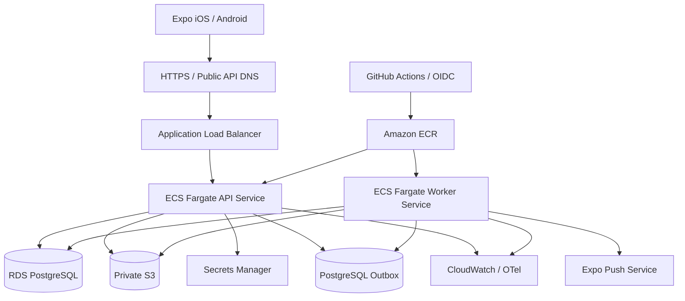
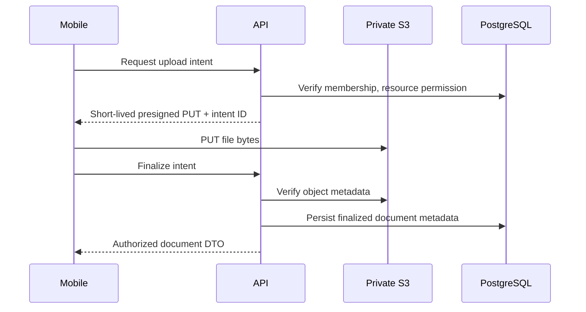

# Kepnora — AWS Deployment & Operations Guide

**Intended path:** `docs/deployment/deployment-guide.md`  
**Version:** 1.0-draft · **Date:** 2026-10-29  
**Scope:** Phase 1 infrastructure, deployment, security, observability and recovery  
**Status:** Reference deployment blueprint. Specific AWS hosting services and sizes are **proposals**, not approved architecture decisions.

**Related Kepnora documents:** `docs/architecture/architecture-decision-records.md`, `docs/architecture/background-jobs-and-outbox.md`, `docs/architecture/file-storage.md`, `docs/architecture/authentication-authorization.md`, `docs/architecture/tenant-isolation.md`, `docs/architecture/api-design.md`, `docs/testing/test-strategy.md`, `docs/mvp-build-order.md`.

---

**Deployment principle:** A modular monolith can be deployed as a single versioned application image with independently scaled API and background-worker processes. Keep PostgreSQL as the system of record, S3 private, credentials managed outside code, and every worker operation tenant-safe.

## 1. Deployment goals

- Run ASP.NET Core/.NET 10 + pinned ABP Framework on a reproducible AWS deployment.
- Operate PostgreSQL with encryption, backups, restricted network access and migrations.
- Store user binaries in private S3 with short-lived presigned URLs and explicit finalization.
- Process maintenance generation, outbox and Expo Push reliably after crashes and restarts.
- Separate development, staging and production identities, secrets, data and resources.
- Support safe rollout, rollback, incident response, logging and restore verification.
- Maintain a practical cost profile for a small Phase 1 product.

**Do not claim** that ABP/.NET 10 compatibility, a particular AWS compute platform, database sizing, queue provider or production budget is confirmed before the M0 proof of concept and an infrastructure ADR.


## 2. Approved architecture vs deployment proposals

| Area | Kepnora design direction | Proposed AWS realization |
|---|---|---|
| Backend | .NET 10 + ASP.NET Core + ABP modular monolith | Container image on Amazon ECS Fargate |
| Database | EF Core + PostgreSQL | Amazon RDS for PostgreSQL |
| Files | Private AWS S3 | Dedicated private S3 bucket per environment |
| Mobile | React Native + Expo | EAS Build/Submit and store releases |
| Notifications | Expo Push | Outbox-backed dispatcher calling Expo |
| Background jobs | Durable workers/outbox; provider open | Separate ECS worker service, or vetted ABP job provider |
| Container registry | Not pinned | Amazon ECR |
| Secrets | Secure runtime configuration | AWS Secrets Manager / SSM Parameter Store |
| Logs/metrics | Structured logs and audit | CloudWatch + optional OpenTelemetry collector |
| Edge/API | Authenticated HTTPS endpoint | ALB + ACM + Route 53 |
| IaC | Reproducible infrastructure | Terraform or AWS CDK (choose one) |

**Decision gate:** ECS Fargate is a recommended starting point, **not** an existing Kepnora commitment. An alternative such as App Runner may be considered if worker/process and network requirements are satisfied. Record the choice in an ADR.


## 3. High-level topology



Keep RDS private. Mobile clients upload directly to private S3 **only** using short-lived, scoped presigned PUT URLs authorized by the API. Never place AWS access keys in the mobile bundle.


## 4. Environment strategy

| Environment | Purpose | Data policy |
|---|---|---|
| Local | Developer laptop, test containers | Synthetic only |
| Development | Shared integration | Synthetic / disposable |
| Staging | Release candidate, production-like | Synthetic or properly de-identified |
| Production | Real users | Protected customer data |

Prefer separate AWS accounts for production and non-production where practical. At minimum separate IAM roles, RDS databases, S3 buckets, ECR image promotion configuration, Expo project/environment and secrets. Do not allow staging to dispatch real-user reminders or send push notifications to production devices.


## 5. Repository and deployment artifacts

Recommended layout, subject to existing project folder structure:

```text
src/
  Kepnora.HttpApi.Host/
  Kepnora.Worker/
  Kepnora.Domain/
  Kepnora.Application/
  Kepnora.EntityFrameworkCore/
test/
  Kepnora.Domain.Tests/
  Kepnora.Integration.Tests/
  Kepnora.Api.Tests/
deploy/
  docker/
    Dockerfile
  infra/
    environments/
      dev/
      staging/
      prod/
  scripts/
    migrate.sh
    smoke-test.sh
docs/
  deployment/
    deployment-guide.md
```

The actual assembly names and repository layout must follow `docs/foder-structure.md` / canonical folder structure; this is an illustrative deployment-oriented subset.


## 6. Networking and VPC design

Use a VPC with public subnets for an internet-facing ALB and private subnets for ECS services and RDS. RDS security group accepts PostgreSQL traffic **only** from the API/worker security groups. API/worker outbound access must reach required AWS APIs and Expo Push endpoints through approved NAT or VPC endpoints as applicable.

Do not make RDS publicly accessible to simplify development. For operator database access use a reviewed SSM Session Manager/bastion/VPN approach, audited and time-bounded. Avoid long-lived inbound SSH rules.


## 7. IAM and workload identity

Create distinct task roles for API and worker. API role: narrowly scoped S3 upload/download verification, read necessary secrets, emit telemetry. Worker role: process outbox, read/write only approved S3 cleanup objects, send external push using secret credentials where required. Deployment role: ECR/ECS updates and infrastructure changes, but no routine customer-data access.

Use AWS IAM roles for ECS tasks, never static access keys in environment files or source. Grant `s3:GetObject`, `s3:PutObject`, `s3:DeleteObject` only to approved bucket/prefix paths. Avoid `s3:*`, `rds:*` or `secretsmanager:*` wildcard permissions.


## 8. AWS account bootstrap checklist

- [ ] AWS account(s), organization and MFA for privileged humans.
- [ ] Budget alarms and cost allocation tags.
- [ ] CloudTrail and baseline security logging enabled.
- [ ] IAM Identity Center or equivalent workforce identity.
- [ ] Region selected based on user latency, compliance and availability.
- [ ] IaC state backend protected, encrypted and locked.
- [ ] GitHub Actions OIDC trust restricted by repository, environment and branch.
- [ ] Separate non-production and production secret namespaces.
- [ ] Domain, DNS and TLS ownership verified.
- [ ] Operational access documented with least privilege.


## 9. Container build — multi-stage Dockerfile

```dockerfile
# Illustrative; pin approved .NET 10 patch and base image digest in production.
FROM mcr.microsoft.com/dotnet/sdk:10.0 AS build
WORKDIR /src
COPY . .
RUN dotnet restore ./src/Kepnora.HttpApi.Host/Kepnora.HttpApi.Host.csproj
RUN dotnet publish ./src/Kepnora.HttpApi.Host/Kepnora.HttpApi.Host.csproj \
    -c Release -o /app/publish --no-restore

FROM mcr.microsoft.com/dotnet/aspnet:10.0
WORKDIR /app
COPY --from=build /app/publish .
ENV ASPNETCORE_URLS=http://+:8080
EXPOSE 8080
USER $APP_UID
ENTRYPOINT ["dotnet", "Kepnora.HttpApi.Host.dll"]
```

This example presumes an app project/assembly name that must be checked against the actual repository. Review restore caching, rootless filesystem permissions, globalization libraries, health checks and package vulnerability scanning. Build worker from its own entrypoint if the solution has a separate worker host.


## 10. Image integrity and registry

Push immutable image tags (commit SHA) to ECR and record digest in the release manifest. Avoid deploying `latest` to production. Run dependency, secret and container vulnerability scans; enforce severity policy with documented exceptions. Generate SBOM and preserve provenance when CI supports it.

Promote **the same image digest** from staging to production rather than rebuilding different binaries from the same commit.


## 11. ASP.NET Core hosting and health endpoints

Expose a **liveness** endpoint (process alive) and **readiness** endpoint (safe to serve requests). Readiness may validate required configuration and short database connectivity, but should avoid expensive queries or depending on Expo availability. Use graceful shutdown on SIGTERM so ALB drains connections.

Example conceptual routes:

```text
GET /health/live
GET /health/ready
```

These paths are proposed, not existing ABP endpoints. Do not include secrets, tenant IDs or database connection strings in health responses. Rate-limit or restrict detailed diagnostic endpoints.


## 12. ECS services and task configuration

Run API and worker as distinct ECS services/tasks if operational needs justify it. API is behind ALB, with at least two tasks across Availability Zones for production availability **if budget allows**. Worker is not publicly exposed; start with one logical scheduler and rely on database idempotency if scaling horizontally.

Set CPU/memory, minimum tasks, auto scaling, rolling deployment, deployment circuit breaker and stop timeout based on load tests. Avoid claiming an exact task size or cost without a measured workload and current AWS prices.


## 13. Worker execution model

Choose one durable background job/outbox mechanism for each event stream. The architecture ADR explicitly warns against stacking an ABP-supported outbox and a custom outbox for the same stream. A worker may share the application image with a different command or use a separate executable.

Every worker batch must:
1. Claim bounded work safely.
2. Establish trusted tenant context.
3. Verify membership/notification eligibility where applicable.
4. Execute idempotent handler.
5. Persist progress/retry state.
6. Clear tenant context before next job.
7. Emit correlation IDs and metrics.

Do not reuse tenant-scoped DbContexts across different tenant jobs.


## 14. PostgreSQL / RDS provisioning

Use a supported PostgreSQL engine version compatible with the pinned EF Core/Npgsql/ABP packages. Select storage and instance size from measured needs. Enable encryption at rest, automated backups, deletion protection in production and private networking. Consider Multi-AZ for production according to recovery targets and budget.

Do not allow application tasks to connect as the RDS master/admin account. Use separate migration and runtime database roles. Test schema migrations against the exact engine major version used in production.


## 15. Database role separation

| Role | Typical privileges |
|---|---|
| Database administrator | Infrastructure-only emergency operations |
| Migration role | Schema DDL during controlled deployment |
| API runtime role | Required DML on approved schemas |
| Worker runtime role | Required DML/outbox access |
| Read-only diagnostic role | Restricted support and monitoring |

Where ABP modules require special privileges or schemas, grant explicitly. Never embed migration credentials in normal ECS API task definitions.


## 16. Connection strings and pooling

Store DB credentials in Secrets Manager (or approved IAM database authentication if supported). Require TLS to RDS and verify certificate policy. Configure Npgsql connection pooling based on ECS task count, worker concurrency and RDS `max_connections`. Total potential connections = sum of all service pool maxima; don't size each pool independently.

Set command timeouts intentionally. Long maintenance jobs must use bounded batches, not hold an open transaction for thousands of assets. Avoid unreviewed PgBouncer insertion until ABP/EF Core session behavior is tested.


## 17. EF Core and ABP migrations

ABP modules own their platform schema; EF Core migrations own Kepnora domain schema. Build a repeatable migration process with a **single authorized migrator** per environment. Never run competing migrations from every API replica at startup.

Recommended sequence:
1. Verify staging backup/restore point.
2. Apply reviewed migrations through one deployment job.
3. Verify migration history and required indexes/constraints.
4. Deploy compatible API/worker images.
5. Run tenant-isolation smoke tests.

For breaking changes use expand → migrate/backfill → contract across releases. Rollback of application binaries does **not** guarantee schema rollback; plan forward fixes and backups.


## 18. Migration deployment example

```bash
# Illustrative CI/deployment flow; adapt to the actual solution.
set -euo pipefail
dotnet test ./Kepnora.sln --configuration Release
# Build and publish immutable container image.
# Run exactly one migration task using a migration-only IAM/DB role.
# Verify migration history and schema invariants.
# Update ECS service task definitions to approved image digest.
# Wait for readiness and execute smoke tests.
```

Do not use `dotnet ef database update` from developer laptops against production as the normal process. Use reviewed migration bundles or a dedicated migrator entrypoint, pinned to the release artifact.


## 19. Tenant data integrity in production

Maintain composite tenant-aware FKs and explicit tenant predicates as defined in `docs/database-overview.md`. `ICurrentTenant` scopes ABP operations but is not authorization. Every API request verifies active `TenantMembers` and named permission.

For worker jobs, record trusted `TenantId` with the job/outbox record and reestablish it deliberately. Test switching between tenant A and B in one worker process. Do not claim PostgreSQL Row-Level Security is enabled unless separately implemented and validated with connection pooling and migration roles.


## 20. S3 bucket and object security

Use one private bucket per environment or another explicitly reviewed isolation strategy. Block all public access, disable ACLs where appropriate, enable default encryption, versioning if retention policy calls for it, bucket access logging/CloudTrail data events as budget allows, and lifecycle rules for orphaned upload intents.

Object keys should be opaque and server-generated, tenant-scoped by prefix where useful, never derived from untrusted raw filenames. Avoid user-controlled keys in presigned requests. Limit content type, file size and object lifetime according to the file-storage specification.


## 21. Presigned upload and finalize flow



An S3 PUT success does **not** mean a document is attached. S3 and PostgreSQL cannot commit atomically; plan cleanup for expired intents/orphans. Download requires a fresh permission check and short-lived presigned GET. Previously issued URLs remain usable until expiry even if membership changes.


## 22. S3 CORS and client restrictions

Allow only necessary methods and headers for direct uploads; review Expo native HTTP behavior separately from browser CORS assumptions. Presigned PUT constraints should bind expected object key and required headers. Reject unsupported MIME types, oversized objects and mismatched checksums according to approved policy.

Never return permanent public S3 URLs, raw AWS credentials or bucket-wide read access to the app.


## 23. Secrets and configuration taxonomy

| Configuration | Store |
|---|---|
| Database password | Secrets Manager |
| OpenIddict/identity signing credentials | Secure managed key/certificate store |
| Expo access credential if required | Secrets Manager |
| S3 bucket name | Environment config (not secret) |
| AWS region | Environment config |
| Allowed origins / API base URL | Environment config |
| Runtime feature flags | Approved config store |
| Mobile public API URL | Expo public build config |
| Mobile AWS keys or DB connection string | **Never** |

Do not commit `.env.production`, private certificates, tokens or production connection strings. Set rotation and emergency revocation procedures for secrets.


## 24. Authentication and TLS

Terminate external HTTPS at ALB with ACM-managed certificate. Use a trusted reverse-proxy configuration so ASP.NET Core processes forwarded headers safely; restrict known proxies/networks. Do not accept arbitrary `X-Forwarded-*` headers from the public internet.

Pin OIDC Authorization Code + PKCE, token audience/issuer validation, signing key lifecycle, refresh token storage and global-user membership checks according to the authentication ADR. A valid JWT alone does not grant access to a workspace.


## 25. Mobile build and environment selection

Use Expo EAS Build with separate development/staging/production profiles, distinct app identifiers or schemes as needed, and environment-specific API URLs. Treat Expo `EXPO_PUBLIC_*` values as public; never put secrets there.

Version app releases and OTA updates under an approved compatibility policy. Backend API changes must preserve older mobile clients or enforce a safe minimum-version strategy. Test deep links and push notifications against the correct environment.


## 26. Expo Push operational integration

The API/worker registers and rotates global-user device tokens, while notification preferences are per `(TenantId, UserId)`. The dispatcher rechecks membership, preference and occurrence eligibility before sending. Expo acceptance is **not** proof of final delivery.

Handle provider receipts, permanent invalid-token errors, exponential retry, quiet hours, rate limits and dead letters according to the notification spec. Keep private maintenance descriptions out of lock-screen payloads by default.


## 27. Transactional outbox and retry semantics

Write domain state and outbox intent in the same PostgreSQL transaction when supported by the chosen outbox implementation. Dispatch asynchronously with idempotent handlers. Design for **at-least-once** execution and external API ambiguity; never promise exactly-once push delivery.

Use stable logical deduplication keys such as tenant + occurrence + channel + policy version, with database uniqueness where appropriate. Recheck pending reminders before sending, because maintenance may have been completed after the event was enqueued.


## 28. Scheduler and maintenance occurrence generation

A scheduler should scan enabled rules in bounded tenant-safe batches, compute deterministic `ScheduleKey`, and insert with unique `(TenantId, RuleId, ScheduleKey)` protection. Completion-anchored rules generate from actual completion, not guessed dates/mileage.

Do not launch one independent in-memory scheduler in every API replica without a lease/locking strategy. Use a single elected scheduler or concurrency-safe claims and unique constraints. Define catch-up caps to prevent huge backlog generation after downtime.


## 29. CI/CD pipeline stages

```mermaid
flowchart LR
    PR[Pull Request] --> Lint[Format + Static Checks]
    Lint --> Tests[Unit + PostgreSQL Integration]
    Tests --> Security[Dependency + Image Scan]
    Security --> Build[Build Immutable Image]
    Build --> Staging[Deploy Staging]
    Staging --> Smoke[Smoke + E2E]
    Smoke --> Approval[Production Approval]
    Approval --> Migrate[Controlled Migration]
    Migrate --> Prod[Deploy Production]
    Prod --> Verify[Readiness + Canary Checks]
```



Use GitHub Actions with OIDC for AWS access, not long-lived repository AWS keys. Protect production environment with approval and least-privilege role. Cache dependencies carefully without reusing untrusted PR secrets.


## 30. GitHub Actions skeleton

```yaml
name: kepnora-ci
on:
  pull_request:
  push:
    branches: [main]
permissions:
  contents: read
jobs:
  test:
    runs-on: ubuntu-latest
    steps:
      - uses: actions/checkout@v4
      - uses: actions/setup-dotnet@v4
        with:
          dotnet-version: '10.0.x'
      - run: dotnet restore
      - run: dotnet test --no-restore --configuration Release
  # Production deploy is a separate protected workflow:
  # OIDC → build/push digest → staging → approval → migration → ECS.
```

This is an intentionally minimal **illustration**. Pin action versions to reviewed SHAs, start PostgreSQL test service/Testcontainers as required, and add SAST, image scanning and environment-specific deployment workflows before production.


## 31. Release promotion and compatibility

Tag releases with semantic version or build number and record Git commit, image digest, migration version, Expo app compatibility and feature flags. Stage rollout: development → staging → production approval → monitored rollout.

API and worker should be deployed in a compatibility-safe order. For migrations that change outbox schema or message contracts, support old and new workers during rolling deploy or pause dispatch under a controlled procedure.


## 32. Rollback strategy

Prefer rolling back to the previous known-good image digest when schema remains backward compatible. If schema has advanced, perform a forward fix or execute an explicitly tested restore plan; do not blindly reverse destructive migrations.

Document rollback triggers (e.g., elevated 5xx, authorization failures, outbox backlog, database connection exhaustion), ownership, timing and verification. Mobile releases cannot be rolled back like ECS images; design API compatibility accordingly.


## 33. Monitoring and telemetry

Emit structured logs with correlation IDs, tenant ID where safe, operation name, duration, outcome and error category. Redact tokens, passwords, presigned URLs, serial numbers, private descriptions and document contents.

Monitor:
- ALB/API 4xx/5xx, p95 latency, readiness failures.
- ECS CPU/memory, restarts, task deployment failures.
- RDS CPU, free storage, connections, slow queries, backup status.
- Outbox backlog age, retry/dead-letter counts, worker heartbeat.
- Maintenance generation lag and duplicate conflicts.
- Expo push errors and invalid-token counts.
- S3 orphan intents and finalize failures.
- Membership/permission denials and cross-tenant regression indicators.

Metrics should not expose raw private content as labels.


## 34. Alerting and incident severity

| Alert | Typical response |
|---|---|
| API unavailable | Page operator; inspect ALB/ECS/RDS |
| RDS near storage/connection limits | Investigate capacity and query patterns |
| Outbox backlog growing | Inspect worker health, retries and poison messages |
| Push provider failures | Check provider errors; keep in-app state authoritative |
| Failed backup | Restore protection priority |
| Cross-tenant access suspected | Security incident; contain, audit, rotate as needed |
| S3 public access drift | Immediate containment |
| High error rate after deploy | Stop rollout/rollback if compatible |

Choose alert thresholds after load testing; do not hardcode invented SLOs.


## 35. Backup and recovery objectives

Set explicit RPO/RTO with product ownership before launch. Enable RDS automated backups and point-in-time recovery where supported. Keep a documented retention policy and verify backups are usable by restoring into an isolated environment. S3 versioning/retention policies should match document deletion and privacy requirements.

**Backups are not verified until restore tests succeed.** Test application startup against restored DB, referential integrity, sample authorized reads and reconciliation with S3 objects. Never restore production data into a shared dev environment without protection.


## 36. Disaster recovery runbook

1. Declare incident and freeze deployments.
2. Identify affected environment and preserve audit evidence.
3. Assess whether RDS, ECS, secrets, DNS or S3 is impacted.
4. Restore RDS to approved recovery point in an isolated/controlled target.
5. Reapply infrastructure and secrets through IaC/managed systems.
6. Validate schema, ABP identity, tenant memberships and outbox state.
7. Reconcile S3 document metadata and pending upload intents.
8. Restart workers with idempotent recovery and bounded catch-up.
9. Run cross-tenant authorization and end-to-end smoke tests.
10. Resume traffic, monitor and document data-loss window.

Never resume a worker on an uncertain outbox state without validating deduplication safeguards.


## 37. Security hardening checklist

- [ ] TLS only, ACM certificates renewed and monitored.
- [ ] RDS private, encrypted and runtime credentials least-privileged.
- [ ] S3 Block Public Access and scoped task-role permissions.
- [ ] No static AWS keys in source, mobile bundle or GitHub secrets when OIDC works.
- [ ] ABP global identity and membership POC completed.
- [ ] Tenant-aware composite FKs and cross-tenant tests pass.
- [ ] Container runs non-root and is scanned.
- [ ] Dependency vulnerabilities reviewed.
- [ ] Rate limits and request body size limits applied.
- [ ] CORS restricted to actual browser origins where relevant.
- [ ] Logs redact private fields, tokens and URLs.
- [ ] Audit retention and incident access controlled.
- [ ] Database migrations run under separate privileged role.
- [ ] Presigned URLs short-lived and object metadata verified before finalize.
- [ ] Push payloads do not expose sensitive details.


## 38. Performance and load testing

Test representative tenant mixes rather than a single huge tenant: small personal workspaces, medium multi-member workspaces and a few larger asset inventories. Exercise asset list/search, dashboard, maintenance completion, file finalize, reminder planning and workspace switching.

Measure p50/p95 latency, DB query count, pool usage, task memory and worker throughput. Use `EXPLAIN (ANALYZE, BUFFERS)` for PostgreSQL hotspots. Set SLOs and ECS/RDS sizing from measured data, not assumptions.


## 39. Cost controls

Main recurring cost drivers: ECS task-hours, RDS instance/storage/backups, ALB, NAT gateway/data transfer, CloudWatch logs, S3 requests/storage and third-party push/build services. Small workloads can still incur meaningful fixed costs from ALB/NAT/RDS.

Use AWS Budgets, resource tags, log retention limits and non-production shutdown where safe. Revisit whether separate always-on worker tasks are needed at launch; maintain durability and scheduling correctness if optimizing cost. Do not state fixed monthly estimates without current region-specific prices.


## 40. Production deployment runbook

**Preflight**
1. Approved release commit/image digest and passing CI.
2. Staging smoke/E2E, tenant isolation and restore confidence.
3. Migration reviewed, expand/contract compatibility verified.
4. Backup status healthy and rollback owner identified.
5. Secrets, certificates, quotas and IAM roles valid.

**Deploy**
6. Apply infrastructure change through reviewed IaC.
7. Run exactly one migration task.
8. Update ECS task definition to immutable image digest.
9. Wait for readiness, monitor ALB/ECS/RDS and worker lag.
10. Run authenticated smoke tests for two workspaces.

**Post-deploy**
11. Verify asset create/read, maintenance completion, S3 intent/finalize and push job enqueue.
12. Check no cross-tenant leaks or unexpected reminder sends.
13. Record release manifest, migration version and monitoring links.


## 41. Smoke tests — safe synthetic fixtures

| ID | Check |
|---|---|
| DP-001 | `/health/live` and `/health/ready` succeed |
| DP-002 | OIDC login validates issuer/audience |
| DP-003 | User Owner X / Member Y gets correct role |
| DP-004 | Non-member cannot access X |
| DP-005 | Create standalone asset (`PropertyId=NULL`) |
| DP-006 | Cross-tenant asset ID denied |
| DP-007 | Maintenance completion creates one history row |
| DP-008 | Duplicate completion rejected/idempotent |
| DP-009 | S3 upload intent + PUT + finalize |
| DP-010 | Unfinalized S3 object not listed |
| DP-011 | Reminder outbox event persisted |
| DP-012 | Worker retries safely without duplicate occurrence |
| DP-013 | Workspace switch clears previous data |
| DP-014 | Search results tenant-scoped |
| DP-015 | No secrets/private URLs in logs |

Use synthetic data and non-production notification targets. Production smoke tests must avoid sending real reminders or creating irreversible customer data.


## 42. Infrastructure validation tests

| ID | Test | Expected |
|---|---|---|
| DP-016 | RDS public connectivity | Blocked |
| DP-017 | API task uses runtime DB role | No DDL permission |
| DP-018 | Migration role access | Deployment-only |
| DP-019 | S3 anonymous GET | Denied |
| DP-020 | S3 wrong-prefix task access | Denied |
| DP-021 | Expired presigned PUT | Denied |
| DP-022 | Wrong object metadata on finalize | Rejected |
| DP-023 | ECS task killed during job | Safe replay |
| DP-024 | Two workers same outbox item | One logical effect |
| DP-025 | RDS failover/restart | API/worker recover |
| DP-026 | Secret rotated | Tasks reconnect after rollout |
| DP-027 | API image rollback | Compatible with schema |
| DP-028 | DB restore drill | Meets approved RPO/RTO |
| DP-029 | Alert fires on worker backlog | Operator notified |
| DP-030 | CloudWatch retention | Matches policy |
| DP-031 | GitHub OIDC from untrusted branch | Denied prod role |
| DP-032 | Staging cannot read prod secrets | Denied |
| DP-033 | App token expired | Safe refresh/sign-in |
| DP-034 | Member removed after push queued | Dispatch suppresses |
| DP-035 | Tenant A job then B job | No tenant context leak |


## 43. M0–M8 infrastructure rollout

| Milestone | Deployment responsibility |
|---|---|
| M0 | ABP/.NET 10 compatibility, global identity POC, hosting/outbox ADR |
| M1 | Auth, tenant membership, HTTPS API and dev/staging DB |
| M2–M3 | Schema migrations, asset/property APIs and tenant security |
| M4 | Maintenance worker and deterministic occurrence generation |
| M5 | Private S3, presigned finalize, orphan cleanup |
| M6 | Expo Push dispatch, device registration, preferences and retry |
| M7 | Dashboard/search performance, settings and observability |
| M8 | Production security review, restore drill, CI gates, incident runbooks and beta release |

Do not rush production infrastructure before the M0 identity and background job architecture gates are closed.


## 44. Open architecture decisions

1. AWS region and production account isolation.
2. ECS Fargate versus alternate compute platform.
3. Single shared image versus separate API/worker images.
4. ABP job/outbox provider; avoid duplicate infrastructure.
5. PostgreSQL version, RDS size, Multi-AZ and RPO/RTO.
6. IaC framework and protected state backend.
7. Exact ABP module migration runner.
8. Identity signing-key/certificate custody.
9. S3 encryption/key management, versioning and lifecycle.
10. NAT versus VPC endpoints for service egress.
11. Production log/trace retention and privacy.
12. SLOs, alert thresholds and on-call ownership.
13. Mobile minimum API version and OTA compatibility.
14. Database credential rotation strategy.
15. Push quiet-hours and delivery failure semantics.
16. Tenant provisioning transaction/reconciliation model.
17. Environment-specific custom domain and DNS strategy.
18. Budget guardrails and scaling thresholds.

Document selected values in ADRs and IaC; do not let deployment scripts silently make irreversible product/security decisions.


## 45. Definition of Done

- [ ] M0 validates pinned .NET/ABP identity and runtime compatibility.
- [ ] All AWS infrastructure is reproducible from reviewed IaC.
- [ ] Production RDS is private, encrypted, backed up and restore-tested.
- [ ] API/worker use least-privilege task roles and secret stores.
- [ ] Schema migrations are controlled and non-concurrent.
- [ ] API serves HTTPS and has meaningful readiness/liveness checks.
- [ ] Tenant membership and permissions are enforced at every boundary.
- [ ] S3 is private; upload intent/PUT/finalize works end to end.
- [ ] Workers are tenant-safe, bounded, durable and idempotent.
- [ ] Push dispatch revalidates current eligibility.
- [ ] CI builds/tests/scans and deploys immutable image digests.
- [ ] Staging is validated before production approval.
- [ ] Rollback and disaster recovery runbooks are rehearsed.
- [ ] Logs, metrics and alerts are operational without exposing private data.
- [ ] DP-001 through DP-035 pass or have tracked exceptions.
- [ ] Open deployment decisions are resolved and documented.


## 46. Final principle

**Infrastructure should make correct behavior repeatable.** Deploy Kepnora as a secure, observable modular monolith first; scale components only when measurements justify it. Private data, tenant authorization, durable maintenance scheduling and verifiable recovery take priority over infrastructure complexity.

