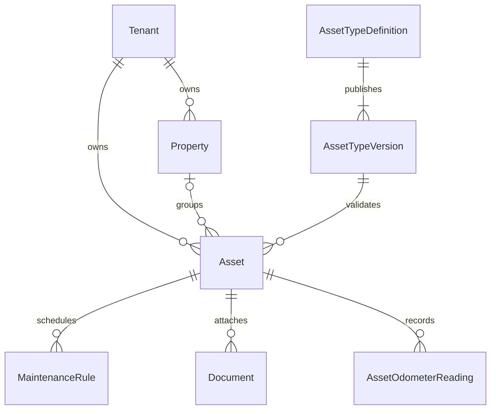
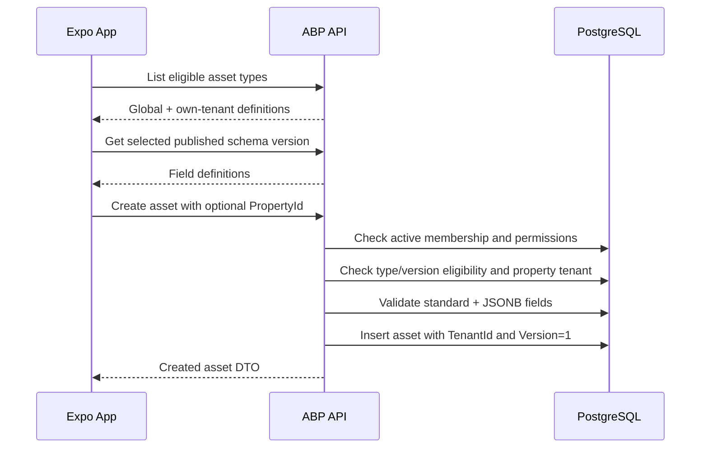

# Kepnora — Asset Management Feature Specification

**Intended path:** `docs/features/asset-management.md`  
**Version:** 1.0-draft · **Date:** 2026-10-29  
**Scope:** Phase 1 MVP · **Status:** Proposed implementation contract, not an assertion of existing endpoints

**References:** `docs/database-overview.md` §§10–13, `docs/architecture/api-design.md`, `docs/architecture/tenant-isolation.md`, `docs/architecture/authentication-authorization.md`, `docs/architecture/mobile-app-architecture.md`, `docs/ui/design-system.md`, `docs/ui/screen-specifications.md`, `docs/mvp-build-order.md`.

---

## 1. Objective

Allow a workspace member to register and manage real-world assets such as cars, appliances, HVAC systems, electronics and home equipment. Each asset has a versioned asset type, standard fields and optionally custom fields. Properties organize assets but **are never mandatory**. The asset record is the anchor for maintenance schedules, mileage readings, service history and private documents.

## 2. Phase boundaries

| Phase | Features |
|---|---|
| Phase 1 | Global and tenant-defined asset types; versioned schemas; property association; asset CRUD/archive; search/filter; custom fields; maintenance/document entry points |
| Phase 2 | Provider discovery related to asset categories |
| Phase 3 | Booking, appointments and payments |

Do not add provider or booking foreign keys to the Phase 1 asset model merely to support future mockups.

## 3. Non-negotiable invariants

- One workspace maps to one ABP tenant in the authoritative ABP Tenant Management registry.
- A global identity may belong to multiple workspaces, but the M0 proof of concept must validate the chosen ABP Identity/OpenIddict approach.
- A valid `ICurrentTenant` scope is **not** proof of active workspace membership.
- `Assets.TenantId` is required; `Assets.PropertyId` is nullable.
- An asset's optional property must belong to the **same tenant**.
- Asset types are either **global** (`AssetTypeDefinitions.TenantId IS NULL`) or owned by the active tenant.
- Published `AssetTypeVersions` are immutable; each asset pins a definition and version.
- The database FK linking asset type definition/version does **not** prove tenant eligibility; application validation is required.
- `Assets.CustomFields` and `AssetTypeVersions.SchemaJson` must be JSON objects and must also pass semantic validation.
- Archive is the default removal behavior; preserve dependent maintenance history and document relationships.
- No maintenance mileage may be inferred from time, and no client-calculated due status becomes a persisted lifecycle state.

## 4. Actors and permissions

| Actor | Read | Create | Edit | Archive | Manage tenant types |
|---|---|---|---|---|---|
| Workspace owner | Yes | Yes | Yes | Yes | Yes |
| Authorized member | Permission-based | Permission-based | Permission-based | Permission-based | Permission-based |
| Non-member | No | No | No | No | No |
| Global catalog maintainer | Global template operations via administrative boundary | — | — | — | Global only |

Actual permission names and ABP role grants are **to be pinned** in the authorization specification. UI visibility is not an authorization boundary.

## 5. Domain model overview



`Tenant` is conceptual here: use ABP Tenant Management rather than creating a second application tenant registry.

## 6. Authoritative PostgreSQL shape

The existing database overview specifies these columns:

```sql
CREATE TABLE "Assets"
(
    "Id" UUID NOT NULL,
    "TenantId" UUID NOT NULL,
    "PropertyId" UUID NULL,
    "AssetTypeDefinitionId" UUID NOT NULL,
    "AssetTypeVersionId" UUID NOT NULL,
    "Name" VARCHAR(200) NOT NULL,
    "Manufacturer" VARCHAR(160) NULL,
    "Model" VARCHAR(160) NULL,
    "SerialNumber" VARCHAR(160) NULL,
    "PurchasedOn" DATE NULL,
    "PurchasePrice" NUMERIC(18, 2) NULL,
    "CurrencyCode" VARCHAR(3) NULL,
    "CustomFields" JSONB NOT NULL DEFAULT '{}'::JSONB,
    "IsArchived" BOOLEAN NOT NULL DEFAULT FALSE,
    "CreatedAt" TIMESTAMPTZ NOT NULL DEFAULT CURRENT_TIMESTAMP,
    "UpdatedAt" TIMESTAMPTZ NULL,
    "Version" BIGINT NOT NULL DEFAULT 1,

    CONSTRAINT "PK_Assets" PRIMARY KEY ("Id"),
    CONSTRAINT "UQ_Assets_TenantId_Id" UNIQUE ("TenantId", "Id"),
    CONSTRAINT "FK_Assets_Properties"
        FOREIGN KEY ("TenantId", "PropertyId")
        REFERENCES "Properties" ("TenantId", "Id"),
    CONSTRAINT "FK_Assets_AssetTypeVersion"
        FOREIGN KEY ("AssetTypeDefinitionId", "AssetTypeVersionId")
        REFERENCES "AssetTypeVersions" ("AssetTypeDefinitionId", "Id"),
    CONSTRAINT "CK_Assets_CustomFieldsObject"
        CHECK (jsonb_typeof("CustomFields") = 'object'),
    CONSTRAINT "CK_Assets_PurchasePrice"
        CHECK ("PurchasePrice" IS NULL OR "PurchasePrice" >= 0)
);
```

This is an excerpt of the **proposed** schema, not a migration to apply again. Review actual migrations for the canonical indexes and constraints. PostgreSQL quoted PascalCase identifiers are intentional.

## 7. Asset type definitions

`AssetTypeDefinitions` fields: `Id`, nullable `TenantId`, `Code`, `DisplayName`, `IsActive`, `CreatedAt`. Global codes are unique among global definitions; tenant codes are unique within their tenant. A workspace can use a global type or one of its own active types, but cannot use another tenant's custom type.

Examples of **illustrative** global codes: `vehicle`, `hvac`, `appliance`, `electronics`, `other`. These are examples only; do not assume seed data has been approved.

## 8. Asset type schema versions

`AssetTypeVersions` fields: `Id`, `AssetTypeDefinitionId`, `VersionNumber`, `SchemaJson`, `PublishedAt`. Version numbers are unique per definition. Published versions are immutable and older assets remain pinned to their original versions.

Publishing a new version must not mutate prior versions or silently rewrite existing assets. An explicit migration workflow, if ever introduced, requires compatibility validation, audit and user consent where needed.

## 9. Proposed custom-field schema dialect

The schema below is **Kepnora-specific proposal**, not a claim that it is full JSON Schema or already supported by ABP.

```json
{
  "schemaVersion": 1,
  "fields": [
    {
      "key": "vin",
      "label": "VIN",
      "type": "string",
      "required": false,
      "maxLength": 17
    },
    {
      "key": "modelYear",
      "label": "Model year",
      "type": "integer",
      "required": false,
      "min": 1886,
      "max": 2100
    },
    {
      "key": "fuelType",
      "label": "Fuel type",
      "type": "select",
      "required": false,
      "options": ["Gasoline", "Diesel", "Hybrid", "Electric"]
    }
  ]
}
```

Choose **either** a constrained custom dialect **or** an established JSON Schema subset before implementing. Do not implement a loosely defined hybrid that is impossible to validate consistently on mobile and server.

## 10. Custom field types and behavior

| Type | Mobile widget | Server checks |
|---|---|---|
| string | Text input | Length, normalization, optional pattern |
| integer | Numeric input | Integer parse, min/max |
| decimal | Decimal input | Precision/range; invariant transport |
| boolean | Switch | Strict boolean |
| date | Date picker | ISO date and valid range |
| select | Single selection | Value in published options |
| multiSelect | Multiple selection | Array, uniqueness, allowed options |

Additional types (nested objects, file, geo coordinates, rich text) are **out of MVP** unless approved and modeled. A file is a separate `Document`, not a base64 blob inside JSONB.

## 11. Schema validation pipeline

1. Load active definition and the **specific published version**.
2. Verify global-or-own-tenant eligibility.
3. Verify schema object and supported dialect version.
4. Reject duplicate or reserved field keys.
5. Check every custom field's type and constraints.
6. Check required fields, enums, bounds and string lengths.
7. Reject unknown keys by default (or document an explicit forward-compatibility policy).
8. Canonicalize stored JSON values without losing intended precision.
9. Persist the validated object and pinned version in one transaction.

Do not trust client-side Zod validation as sufficient.

## 12. Reserved field names

Prohibit custom keys that collide with standard fields or internal metadata: `id`, `tenantId`, `propertyId`, `name`, `manufacturer`, `model`, `serialNumber`, `assetTypeDefinitionId`, `assetTypeVersionId`, `isArchived`, `version`, `createdAt`, `updatedAt`. Decide case-insensitive normalization and unicode key rules in the schema publisher. Document all reserved names in a shared contract.

## 13. Standard asset fields

| Field | Required | Rule |
|---|---|---|
| Name | Yes | Trimmed, nonblank, max 200 chars |
| Asset type definition | Yes | Active global or active current-tenant type |
| Asset type version | Yes | Published version of chosen definition |
| Property | No | Null or property belonging to same tenant |
| Manufacturer | No | Max 160 chars |
| Model | No | Max 160 chars |
| Serial number | No | Max 160 chars; do not enforce global uniqueness |
| Purchased on | No | Valid date; future-date policy to decide |
| Purchase price | No | Nonnegative decimal, NUMERIC(18,2) |
| Currency code | Conditional | Three-letter code when price exists; policy to decide |
| Custom fields | Yes | JSON object; may be `{}` |
| Archived | Server-managed | Default false |
| Version | Server-managed | Optimistic concurrency token |

## 14. Property association rules

A property groups assets such as a home, rental or building. A car, phone or tool can exist without a property. Create, list, search and maintain standalone assets without forcing the user to create a fake “Default Property.”

Changing `PropertyId` from one property to another is allowed only within the current tenant. Setting it to null must also be allowed unless a separately approved asset-specific business rule applies. Archiving a property must not implicitly archive its assets.

## 15. Asset lifecycle

```text
Create → Active → Edit → Active
                └── Archive → Archived
```

`IsArchived` is the canonical field in the proposed database. Restoration is **not** assumed supported until a policy and endpoint are approved. Hard deletion requires a separate retention/dependency design.

## 16. Asset creation flow



Client must not send authoritative `TenantId`. Server determines it from the authorized workspace context.

## 17. Proposed create request

```json
{
  "name": "Family SUV",
  "propertyId": null,
  "assetTypeDefinitionId": "65ac4eaa-64e0-4b68-86a6-c0b3c9f6b7e1",
  "assetTypeVersionId": "ecdd5d9e-b1fd-4bb9-9108-85726e834c2b",
  "manufacturer": "Toyota",
  "model": "Highlander",
  "serialNumber": null,
  "purchasedOn": "2024-06-01",
  "purchasePrice": 35000.00,
  "currencyCode": "USD",
  "customFields": {
    "vin": "EXAMPLEVIN1234567",
    "modelYear": 2024,
    "fuelType": "Hybrid"
  }
}
```

Identifiers and values are fictional. Example VIN is illustrative and must not be treated as a validated real VIN. Do not include `tenantId`, `isArchived` or `version` as caller-controlled create fields.

## 18. Proposed asset response

```json
{
  "id": "6f195c3b-19f5-4e4d-a832-04e456ee93fb",
  "propertyId": null,
  "assetTypeDefinitionId": "65ac4eaa-64e0-4b68-86a6-c0b3c9f6b7e1",
  "assetTypeVersionId": "ecdd5d9e-b1fd-4bb9-9108-85726e834c2b",
  "name": "Family SUV",
  "manufacturer": "Toyota",
  "model": "Highlander",
  "serialNumber": null,
  "purchasedOn": "2024-06-01",
  "purchasePrice": 35000.00,
  "currencyCode": "USD",
  "customFields": {
    "vin": "EXAMPLEVIN1234567",
    "modelYear": 2024,
    "fuelType": "Hybrid"
  },
  "isArchived": false,
  "version": 1
}
```

This is a proposed DTO, not a generated OpenAPI response.

## 19. Proposed API operation inventory

| Operation | Purpose | Permission |
|---|---|---|
| `ListAssetTypes` | Global + current-tenant types | Asset read |
| `GetAssetTypeVersion` | Published schema | Asset read |
| `CreateTenantAssetType` | Draft definition/version | Manage types |
| `PublishAssetTypeVersion` | Immutable publication | Manage types |
| `ListAssets` | Filtered/paginated assets | Asset read |
| `GetAsset` | One tenant-scoped asset | Asset read |
| `CreateAsset` | New asset | Asset create |
| `UpdateAsset` | Edit with concurrency | Asset edit |
| `ArchiveAsset` | Logical archive | Asset archive |
| `ListAssetsByProperty` | Property-filtered assets | Asset read |

The exact HTTP routes must be generated/verified from the actual ABP host OpenAPI. Do not assume ABP automatic controller naming.

## 20. Example C# DTOs

```csharp
public sealed record CreateAssetInput(
    string Name,
    Guid? PropertyId,
    Guid AssetTypeDefinitionId,
    Guid AssetTypeVersionId,
    string? Manufacturer,
    string? Model,
    string? SerialNumber,
    DateOnly? PurchasedOn,
    decimal? PurchasePrice,
    string? CurrencyCode,
    JsonElement CustomFields);

public sealed record UpdateAssetInput(
    string Name,
    Guid? PropertyId,
    string? Manufacturer,
    string? Model,
    string? SerialNumber,
    DateOnly? PurchasedOn,
    decimal? PurchasePrice,
    string? CurrencyCode,
    JsonElement CustomFields,
    long ExpectedVersion);
```

Changing type/version on update is deliberately omitted until a safe type-migration workflow exists. Align serializer behavior with the pinned .NET/ABP version.

## 21. Application service boundaries

```csharp
public interface IAssetAppService
{
    Task<AssetDto> CreateAsync(
        Guid workspaceId,
        CreateAssetInput input,
        CancellationToken ct);

    Task<AssetDto> UpdateAsync(
        Guid workspaceId,
        Guid assetId,
        UpdateAssetInput input,
        CancellationToken ct);

    Task<AssetDto> GetAsync(
        Guid workspaceId,
        Guid assetId,
        CancellationToken ct);

    Task ArchiveAsync(
        Guid workspaceId,
        Guid assetId,
        long expectedVersion,
        CancellationToken ct);
}
```

These are Kepnora proposal interfaces, **not** ABP framework APIs. Separate AppService authorization from domain invariant enforcement and repository persistence.

## 22. Server-side authorization algorithm

```text
Authenticate global user
  ↓
Resolve requested workspace against ABP Tenant Management
  ↓
Verify active TenantMembers membership
  ↓
Verify named operation permission
  ↓
Enter tenant scope
  ↓
Load asset/property by (TenantId, Id)
  ↓
Validate global/own-tenant asset type and pinned version
  ↓
Apply domain rules, save, audit
```

Never trust a `TenantId` field in JSON or a tenant header without membership validation.

## 23. Tenant-safe queries

```csharp
// Illustrative EF Core predicate; repository and UoW integration are omitted.
var asset = await db.Assets
    .SingleOrDefaultAsync(
        x => x.TenantId == workspaceId
          && x.Id == assetId
          && !x.IsArchived,
        ct);
```

ABP data filters can help, but explicit ownership checks remain important for sensitive reads and mutation paths. For an unauthorized or foreign asset ID, return a neutral not-found response according to the API concealment policy.

## 24. Type eligibility algorithm

```csharp
bool IsTypeEligible(Guid tenantId, Guid? definitionTenantId)
    => definitionTenantId is null || definitionTenantId == tenantId;
```

This is only the **tenant-eligibility predicate**. Also validate definition active status, version ownership, publication, field schema, caller permission and any additional catalog policy. The existing asset type FK does not enforce this predicate.

## 25. Optimistic concurrency

`Assets.Version BIGINT` starts at 1. Every successful edit/archive increments it atomically. Reject stale writes with an agreed conflict response (typically HTTP 409). Do not silently overwrite another device's edits.

Illustrative SQL:

```sql
UPDATE "Assets"
SET "Name" = @Name,
    "UpdatedAt" = CURRENT_TIMESTAMP,
    "Version" = "Version" + 1
WHERE "TenantId" = @TenantId
  AND "Id" = @Id
  AND "Version" = @ExpectedVersion
  AND "IsArchived" = FALSE
RETURNING "Id", "Version";
```

If zero rows return, distinguish missing/archived/conflict without leaking another tenant's data. EF Core concurrency tokens may be used instead of raw SQL.

## 26. Asset listing and pagination

Recommended filters: search text, type definition, property including explicit `null`, archived state (authorized admin view only), sort and pagination. Default excludes archived assets. Use stable sort with `Id` tie-breaker; never depend on unordered database results.

Proposed query:

```text
ListAssets(
  workspaceId,
  search?,
  assetTypeDefinitionId?,
  propertyFilter? = Any | NoProperty | SpecificProperty,
  sort = NameAsc,
  skip = 0,
  take = 20)
```

`propertyFilter` must distinguish **not filtering** from **filtering for null**. Do not overload `propertyId = null` for both.

## 27. Search implementation

Use PostgreSQL indexes and query plans based on observed usage. MVP can search normalized name/manufacturer/model and optionally serial number with appropriate privacy controls. JSONB custom-field search should be explicitly designed, indexed and bounded rather than assuming arbitrary schema keys are cheap to search.

Measure using `EXPLAIN (ANALYZE, BUFFERS)` on representative tenant sizes. Avoid `ILIKE '%term%'` at scale without considering `pg_trgm` and appropriate indexes.

## 28. Asset detail view

Premium image-first card where a photo exists; otherwise a neutral type icon. Display name, type, optional property, manufacturer/model, custom fields, maintenance overview, recent service history and document preview. Every child collection must be tenant-scoped.

Do not invent the next due date, odometer or photo. If no property exists, omit the property row or show “Not linked to a property,” never an error.

## 29. Create/edit form behavior

1. Select type.
2. Load its pinned published schema.
3. Show standard fields and schema-driven custom fields.
4. Offer optional property selection with “No property.”
5. Validate local form and show field errors.
6. Submit once and await server confirmation.
7. On success, navigate to detail and invalidate list caches.
8. On error, preserve draft and explain correction/retry.

If the type changes before saving, reset or explicitly migrate incompatible custom fields; never silently submit fields for the previous schema.

## 30. React Native schema-driven form

```ts
type FieldDefinition =
  | { key: string; label: string; type: 'string'; required: boolean; maxLength?: number }
  | { key: string; label: string; type: 'integer'; required: boolean; min?: number; max?: number }
  | { key: string; label: string; type: 'boolean'; required: boolean }
  | { key: string; label: string; type: 'select'; required: boolean; options: string[] };

type AssetFormValues = {
  name: string;
  propertyId: string | null;
  assetTypeDefinitionId: string;
  assetTypeVersionId: string;
  customFields: Record<string, unknown>;
};
```

The client types must ultimately derive from the approved schema dialect and generated OpenAPI contracts. Avoid duplicating inconsistent validation logic across mobile and backend.

## 31. TanStack Query keys

```ts
export const assetKeys = {
  list: (workspaceId: string, filters: unknown) =>
    ['workspaces', workspaceId, 'assets', 'list', filters] as const,
  detail: (workspaceId: string, assetId: string) =>
    ['workspaces', workspaceId, 'assets', assetId] as const,
  types: (workspaceId: string) =>
    ['workspaces', workspaceId, 'asset-types'] as const,
};
```

All tenant-owned keys must include workspace ID. On switch, cancel or isolate pending mutations and prevent previous workspace data from flashing. Do not cache S3 presigned URLs in these keys.

## 32. Document and photo integration

Asset creation should not require S3 upload to succeed. First create the asset; then request an authorized document upload intent for that asset, PUT bytes directly to private S3, and finalize. Only a finalized document appears in the asset library. Photo display depends on actual stored documents and any approved thumbnail pipeline.

## 33. Maintenance integration

A maintenance rule references `AssetId` and belongs to the same tenant. A maintenance occurrence's lifecycle is persisted as `Open`, `Completed`, `Skipped` or `Cancelled`. `Upcoming`, `Due` and `Overdue` are derived display states. Asset archive must follow an explicit rule for future occurrences; never delete history silently.

## 34. Mileage integration

`AssetOdometerReadings` contains observed readings for appropriate assets. A missing reading is unknown, not zero. No automatic mileage projection is allowed. The app should not show mileage fields for types where they do not apply unless schema/business policy explicitly enables them.

## 35. Archive behavior

Archive must confirm consequences, require permission and concurrency version, set `IsArchived = TRUE`, and keep documents/history referentially intact. Whether active future maintenance occurrences are cancelled, paused or retained is an **open business decision** requiring an ADR. Do not implement cascading deletes.

## 36. Failure matrix

| Failure | Expected result |
|---|---|
| Missing active membership | Deny |
| Foreign tenant asset ID | Neutral not found |
| Foreign tenant property ID | Reject |
| Foreign tenant type | Reject |
| Type version not belonging to definition | Reject |
| Unsupported custom field | Field validation error |
| Required custom field missing | Field validation error |
| Stale `ExpectedVersion` | Conflict; reload |
| DB unavailable | Retryable error; preserve form |
| Asset archived during edit | Conflict or safe unavailable |
| File upload fails after asset create | Asset remains; retry document |
| Workspace switched during save | Cancel/isolate; never mutate new tenant |

## 37. Security threat model

| Threat | Control |
|---|---|
| IDOR via asset ID | `(TenantId, Id)` lookup + membership |
| Fake tenant header | Verify membership independently |
| Tenant-owned type used by another tenant | Explicit eligibility validation |
| Schema injection/unknown keys | Supported dialect + server validation |
| Mass assignment | Explicit DTO; server-managed fields |
| Duplicate submits | Pending guard/idempotency policy |
| Lost updates | Optimistic concurrency |
| Sensitive serial numbers in logs | Redaction/limited telemetry |
| Cross-workspace cached asset | Workspace-partitioned query keys |
| Unauthorized document access | Separate document authorization |

## 38. Audit and telemetry

Record asset created/updated/archived events with tenant, actor, asset ID, correlation ID, timestamp and relevant changed-field metadata. Avoid logging entire `CustomFields` values, serial numbers, purchase details or presigned URLs by default. ABP auditing integration and retention must be verified for the pinned version.

## 39. Performance expectations

- Paginate lists; never fetch all tenant assets for the Home dashboard.
- Index by tenant and active state as already proposed.
- Profile property-filtered and type-filtered queries.
- Avoid loading maintenance history and document metadata in every list card.
- Use separate detail/summary endpoints when necessary.
- Cache immutable published type versions carefully, scoped by global/tenant eligibility.
- Test tenants with different asset counts; don't invent latency SLAs before profiling.

## 40. Example global asset type seed strategy

Seed global definitions and first published versions through a controlled migration/initializer. Use deterministic identifiers or safe idempotent lookup, versioned seed changes and explicit publish semantics. Never modify a published `SchemaJson` row in place during deployment. Tenant-specific definitions must never be seeded into a global scope accidentally.

## 41. Schema evolution example

Version 1 has `vin` and `modelYear`; version 2 adds optional `fuelType`. Existing assets remain pinned to version 1 and remain readable/editable according to version 1. New assets can select version 2 if it is the active published version. Do not automatically add `fuelType` to old asset JSON or change their `AssetTypeVersionId` without an approved migration operation.

## 42. Integration tests — tenant and type

| ID | Scenario | Expected |
|---|---|---|
| AM-001 | Anonymous create | 401 |
| AM-002 | Non-member create | Denied |
| AM-003 | Member creates standalone car | `PropertyId = NULL` |
| AM-004 | Member creates appliance with own property | Success |
| AM-005 | Property belongs to another tenant | Rejected |
| AM-006 | Global active type | Allowed |
| AM-007 | Current tenant custom type | Allowed |
| AM-008 | Other tenant custom type | Rejected |
| AM-009 | Definition/version mismatch | Rejected |
| AM-010 | Inactive definition | Rejected |
| AM-011 | Published version changed in DB | Prohibited |
| AM-012 | Missing required custom field | Rejected |
| AM-013 | Unknown custom field | Rejected by default |
| AM-014 | Wrong field type | Rejected |
| AM-015 | Invalid select value | Rejected |
| AM-016 | Custom fields array instead of object | Rejected |
| AM-017 | Negative purchase price | Rejected |
| AM-018 | Long name | Rejected |
| AM-019 | Two simultaneous edits same version | One conflict |
| AM-020 | Archive with stale version | Conflict |

## 43. Integration tests — lifecycle and UI

| ID | Scenario | Expected |
|---|---|---|
| AM-021 | List tenant X | No Y assets |
| AM-022 | Detail ID from Y in X | Safe not found |
| AM-023 | Property filter `NoProperty` | Only standalone assets |
| AM-024 | Property filter `Any` | All permitted active assets |
| AM-025 | Pagination and stable tie-break | No missing/duplicate rows |
| AM-026 | Edit property to null | Success |
| AM-027 | Move property within tenant | Success |
| AM-028 | Archive property with assets | Assets retained |
| AM-029 | Archive asset | History retained |
| AM-030 | Upload document after asset creation | Finalize required |
| AM-031 | Upload failure | Asset remains |
| AM-032 | Missing odometer | No estimated value |
| AM-033 | Due occurrence | Display status computed |
| AM-034 | Workspace switch during form | No cross-tenant mutation |
| AM-035 | Logout with cached detail | Protected data cleared |
| AM-036 | Old asset pinned to old schema version | Still readable |
| AM-037 | Invalid deep link | Safe error |
| AM-038 | Role revoked before edit | Denied |
| AM-039 | Concurrent archive and edit | Conflict-safe |
| AM-040 | Search by name | Tenant-scoped results |

Use real PostgreSQL for composite FK and concurrency tests, and a running ABP host for identity/permission integration. Mock-only tests do not prove isolation.

## 44. Milestone implementation plan

**M0:** Prove global identity and workspace membership with the chosen ABP stack; confirm permission infrastructure.

**M2:** Implement properties, global/tenant type definitions, immutable schema versions, validation and publish flow.

**M3:** Implement asset entities/migrations, create/edit/archive AppServices, DTOs, listing/search, mobile list/detail/forms and concurrency.

**M4:** Integrate rules, occurrences, history and observed mileage.

**M5:** Integrate S3-backed document upload and viewer.

**M7:** Integrate dashboard summaries, search and settings.

**M8:** Cross-tenant security, recovery, accessibility, device QA and beta hardening.

## 45. Open decisions before implementation

1. Final global asset type catalog and seed schemas.
2. Custom schema dialect versus constrained JSON Schema.
3. Maximum number of custom fields and nested data policy.
4. Whether published versions can be deactivated for new assets.
5. Currency/purchase-date validation and localization rules.
6. Serial-number privacy and optional uniqueness policy.
7. Whether asset type changes are permitted after creation.
8. Asset archive effects on open maintenance occurrences.
9. Asset restore and permanent deletion/retention policies.
10. Photo thumbnails and cover-photo selection model.
11. Exact ABP permission names and OpenAPI DTO routes.
12. Search/index strategy for selected custom JSONB fields.

Each decision must be documented in the owning architecture/ADR before coding the dependent behavior.

## 46. Definition of Done

- [ ] Tenant membership and permissions are enforced server-side.
- [ ] Standalone assets work without any property.
- [ ] Global and tenant-specific type eligibility is validated.
- [ ] Published type versions are immutable and assets pin versions.
- [ ] JSONB fields are validated against their pinned schema.
- [ ] Client cannot mass-assign tenant or server-managed fields.
- [ ] Asset list/detail/edit/archive are tenant-safe.
- [ ] Concurrency prevents silent lost updates.
- [ ] Archived assets retain linked historical data.
- [ ] Maintenance and mileage never invent readings or statuses.
- [ ] Document upload is finalized before appearing as attached.
- [ ] Workspace switching cannot leak cached asset data.
- [ ] Tests AM-001 through AM-040 pass.
- [ ] UI matches shared premium design system and accessibility rules.
- [ ] Actual API routes/DTOs are verified in generated OpenAPI.

## 47. Final principle

**An asset is a tenant-owned, schema-versioned record with an optional property.** All related maintenance, documents and history must preserve that identity and ownership. Make asset creation simple without weakening authorization, data validation or historical correctness.
