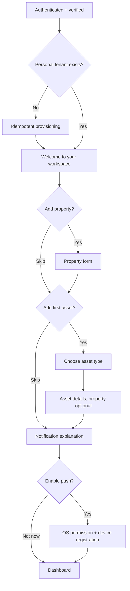
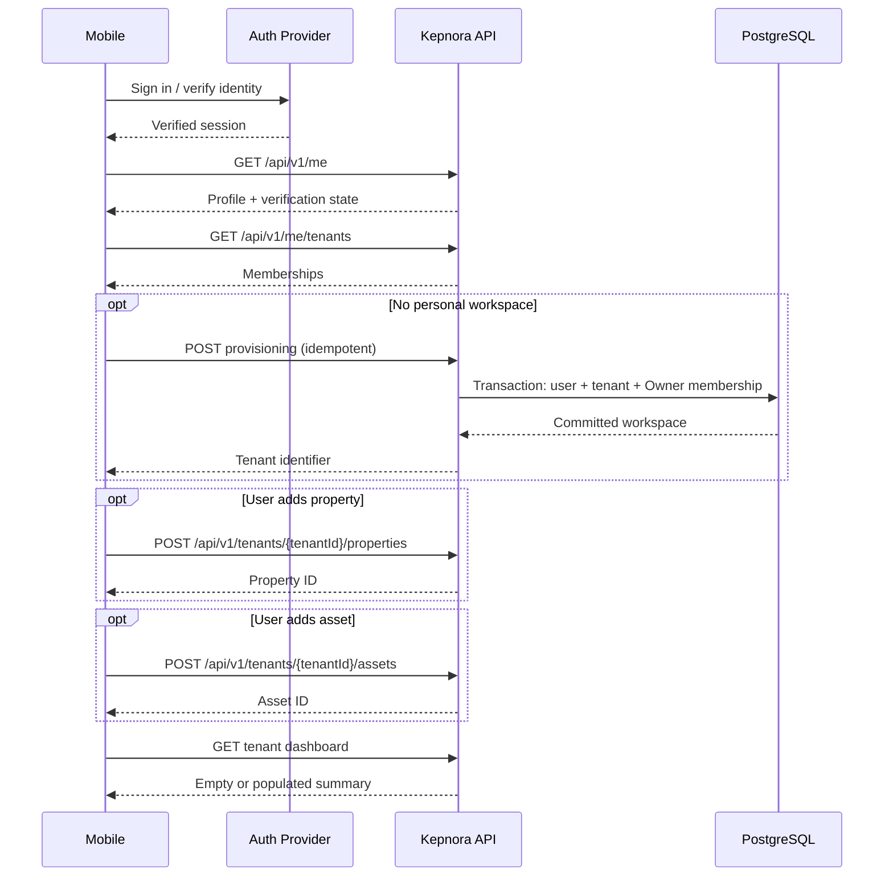

# Kepnora — Authentication & Onboarding Feature Specification

**Target:** `docs/features/authentication-onboarding.md`  
**Version:** 1.0-draft · **Date:** 2026-10-29  
**Scope:** Phase 1 MVP (M0–M3) · React Native / Expo, ASP.NET Core / ABP Framework  
**Status:** Proposed product workflows; **global identity and ABP tenant integration blocked on M0 POC**.

> **Security invariant:** Authentication establishes a global identity; active workspace membership and operation permissions authorize tenant access. `ICurrentTenant` is not authorization. A workspace is one ABP Tenant. No parallel Tenants registry.

## Document map

This feature specification consolidates the first-run onboarding workflow and the product-facing authentication/session experience. The authoritative security architecture remains `docs/architecture/authentication-authorization.md`. The original onboarding source has been retained in the detailed workflow section below, with additional end-to-end implementation and acceptance guidance.

---

# Part A — First-run onboarding workflows

## 1. Outcome and scope

Onboarding takes a verified identity from first launch to a usable personal workspace. The user may optionally create a property, optionally create a first asset and optionally opt into push notifications. **Property and asset creation must be skippable.** A renter or car owner must be able to add a standalone asset with `PropertyId = null`. Do not equate a completed onboarding wizard with a completed inventory.

**Primary success path:** welcome → authentication → email verification → idempotent personal tenant provisioning → workspace-ready state → optional property → optional asset → dashboard. A returning verified user with an existing tenant must not be forced through first-run screens again.

**Traceability:** `product/mvp-scope.md` (FR identity/onboarding), `mvp-build-order.md` (M1–M3), `database-overview.md` (users/tenants/properties/assets), `architecture/tenant-isolation.md` (membership checks), `features/authentication.md` (session state).

## 2. Design principles

1. Ask only for data necessary to deliver the first useful outcome.
2. Provision a tenant on the server, not by trusting a mobile-generated tenant ID.
3. Every optional step has a visible Skip action with a clear destination.
4. No property is required for vehicle, electronics or standalone appliance assets.
5. Do not request notification permission on app launch; explain value first.
6. Save each committed step independently; app termination must not discard successful server writes.
7. Persist onboarding progress server-side if it must synchronize across devices; local hints are not authoritative.
8. Reuse the normal property and asset create endpoints; avoid an insecure onboarding-only write path.
9. Use tenant-scoped API calls and verify membership before any resource write.
10. Dashboard works in a genuine empty state with a clear Add Asset action.

## 3. Entry conditions and routing

| Identity | Tenant state | Onboarding state | Destination |
|---|---|---|---|
| Anonymous | None | N/A | Welcome / sign in |
| Authenticated unverified | None | N/A | Verify email |
| Verified | No personal tenant | N/A | Provisioning/retry |
| Verified | One active tenant | Not started | First-run intro |
| Verified | One active tenant | Partial | Resume last optional step or dashboard |
| Verified | One active tenant | Complete | Dashboard |
| Verified | Multiple tenants | Any | Tenant picker before data screens |
| Authenticated | Membership revoked | Any | Tenant selection / access unavailable |

The onboarding state is a UX progress marker, not authorization. Membership remains authoritative. If no dedicated onboarding DB table is approved, derive the initial flow from server profile state and keep a bounded local step marker; do not invent an unreviewed migration.

## 4. Step flow



The flow may be shortened if a user arrives from an Add Asset deep link. Always validate the destination after authentication; never blindly follow untrusted redirect parameters.

## 5. Screen inventory

| Screen | Goal | Primary action | Secondary action | Backend dependency |
|---|---|---|---|---|
| Intro | Explain asset + maintenance value | Get started | Skip intro | Identity + tenant ready |
| Workspace setup | Show provisioning progress | Continue | Retry on error | `/me/tenants` + provisioning |
| Property prompt | Offer organization by location | Add property | Skip | Tenant membership |
| Property form | Capture minimal location | Save property | Back / Skip | `POST /properties` |
| Asset prompt | Show first inventory item value | Add asset | Skip | Asset type catalog |
| Asset type picker | Choose global or tenant type | Continue | Back | `GET /asset-types` |
| Asset form | Save name/type and optional property | Save asset | Skip | `POST /assets` |
| Notifications primer | Explain reminder value | Enable reminders | Not now | Preferences/device API |
| Finish | Confirm workspace usable | Go to dashboard | Add another asset | Dashboard |

## 6. Property step

Minimum input: `displayName` (required); `type`, address fields and timezone according to the approved property API contract. Suggest the device timezone but allow correction. Never assume device location is the property address. A tenant may have multiple properties. If the user skips, do not create an empty placeholder property.

```json
{
  "displayName": "Home",
  "type": "Residential",
  "timeZoneId": "America/Chicago",
  "address": { "line1": null, "city": null, "region": null, "postalCode": null, "country": "US" }
}
```

The `type` vocabulary and address shape are **illustrative** until the property API is finalized; the generated client and server contract are authoritative. On success, store the returned property ID only in active-tenant UI state. If validation fails, keep entered form values. If a timeout occurs after server commit, refetch before retrying to avoid duplicates.

## 7. Asset step

Minimum input: asset type and user-visible name. Optional: property, brand, model, serial number, purchase/install dates, warranty end and photo. Asset types may be global templates or tenant-defined; the picker must show only global types and the active tenant's definitions. For custom type fields, render from the server's immutable schema version and submit a versioned JSON payload. Never assume every asset is a house appliance.

```json
{
  "name": "Family car",
  "propertyId": null,
  "assetTypeDefinitionId": "<server-issued-uuid>",
  "assetTypeVersion": 1,
  "customAttributes": {},
  "notes": null
}
```

`<server-issued-uuid>` is a placeholder, not a valid UUID. Use the final asset API's exact field names and version semantics. A failed photo upload must not silently erase a successfully created asset; show a separate photo retry state.

## 8. Notification opt-in

Show a value explanation such as “Get reminders before maintenance is due.” If the user taps Enable, request OS permission using Expo Notifications, then register the device token with the authenticated user and active tenant's preference policy. If permission is denied or token registration fails, the dashboard and due list remain fully functional. Allow later enablement in Settings. Do not repeatedly nag after a denial. Push is best-effort, not a delivery guarantee.

## 9. API interaction sequence



The provisioning endpoint name is pending the identity ADR. Do not generate it as a production route without approving its OpenAPI contract.

## 10. Mobile state and cache policy

Use React Hook Form + Zod for input, TanStack Query for server state and Zustand only for transient wizard navigation or drafts. Every tenant-scoped query key includes tenant ID. Cancel outstanding requests on tenant switch and reset navigation to prevent showing another tenant's previous data. Persist only non-sensitive draft fields if necessary and clear them on logout or account switch.

```ts
type OnboardingStep =
  | 'intro' | 'propertyPrompt' | 'propertyForm'
  | 'assetPrompt' | 'assetType' | 'assetForm'
  | 'notifications' | 'finished';

type OnboardingDraft = {
  step: OnboardingStep;
  selectedPropertyId?: string;
  selectedAssetTypeId?: string;
};
```

This draft is a UI convenience; a resumed session must re-fetch actual server resources and membership before trusting its IDs.

## 11. Resilience and recovery

| Failure | User experience | Required behavior |
|---|---|---|
| Provisioning API timeout | “Still setting up” + Retry | Retry same idempotency key; re-read membership |
| Duplicate callback | No duplicate workspace | Unique mapping + transactional upsert |
| Offline before property save | Keep form draft | No claim of server success |
| Property save succeeded but response lost | Retry with care | Refetch / idempotent create |
| Asset type catalog unavailable | Retry or skip | Do not invent local server IDs |
| Asset custom schema changed | Explain stale form | Reload latest definition/version |
| Notification permission denied | Continue to dashboard | No blocking modal |
| Push token registration fails | Nonblocking warning | Retry via settings or controlled background attempt |
| Tenant membership revoked | Access unavailable | Clear tenant caches and route away |
| App killed mid-flow | Resume or dashboard | Derive committed state from server |

## 12. Empty dashboard handoff

A newly provisioned workspace with zero assets is valid. Show “Add your first asset” and a secondary “Add property” option. Do not display fabricated maintenance counts or sample assets as real data. When the first asset exists but no maintenance rule exists, offer “Create a maintenance reminder.” If the user skipped notifications, show the due list normally and allow opt-in later.

## 13. Analytics and measurement

Instrument privacy-safe step completion: `onboarding.started`, `onboarding.property.skipped`, `onboarding.property.created`, `onboarding.asset.skipped`, `onboarding.asset.created`, `onboarding.notifications.accepted`, `onboarding.completed`. Record tenant/user pseudonymous IDs only as allowed by privacy policy. Track completion rates and time-to-first-asset without storing addresses, serial numbers, token values or free-text notes.

## 14. Accessibility and localization

Provide labeled text fields, clear progress indication, focus management after errors, sufficient touch targets, accessible skip buttons and support for dynamic type. Never convey validation solely by color. Timezone is a canonical IANA ID; do not derive the property timezone from a phone locale without confirmation. Copy must explain that a property is optional.

## 15. Acceptance scenarios

| ID | Given | When | Then |
|---|---|---|---|
| ONB-AC-01 | Verified new user | Provision workspace twice | Exactly one personal tenant and Owner membership exist |
| ONB-AC-02 | User skips property | Adds vehicle | Asset saves with `PropertyId = null` |
| ONB-AC-03 | User skips property and asset | Finishes | Empty dashboard is usable |
| ONB-AC-04 | User creates property | Adds appliance | Asset references same-tenant property |
| ONB-AC-05 | User supplies another tenant's property ID | Saves asset | Request is denied safely |
| ONB-AC-06 | User selects tenant-only asset type from other tenant | Saves | Request is denied safely |
| ONB-AC-07 | App killed after property commit | Restarts | Property persists and is not duplicated |
| ONB-AC-08 | Push permission denied | Completes wizard | Dashboard works and preference reflects opt-out |
| ONB-AC-09 | Membership revoked | Resumes wizard | Tenant content not shown |
| ONB-AC-10 | Two tenants in session | Switches tenant | Query cache and draft references do not leak |
| ONB-AC-11 | Asset schema version stale | Submits | Server rejects and app offers reload |
| ONB-AC-12 | API temporarily offline | Retries | No false success and no duplicate creation |
| ONB-AC-13 | Returning user completed onboarding | Logs in | Dashboard, not wizard, appears |
| ONB-AC-14 | New user has no property | Creates mileage rule later | Vehicle workflow remains supported |
| ONB-AC-15 | Screen reader enabled | Navigates wizard | All fields/actions accessible |

## 16. Release checklist and dependencies

- [ ] Authentication provider and provisioning endpoint ADRs approved.
- [ ] Tenant membership enforced on property/asset writes.
- [ ] OpenAPI property, asset type and asset request/response contracts finalized.
- [ ] Personal workspace provisioning idempotent under retries and concurrent callbacks.
- [ ] Property and asset optionality verified on both iOS and Android.
- [ ] No cross-tenant IDs survive tenant switch, logout or account change.
- [ ] Empty dashboard and notification denial paths implemented.
- [ ] All 15 acceptance scenarios automated where feasible.
- [ ] UX copy, error states, accessibility and analytics privacy reviewed.

## 17. Open decisions

| Decision | Owner | Why it matters |
|---|---|---|
| Persist onboarding progress server-side? | Product + backend | Cross-device resumption and schema change |
| Intro screen length and copy | Product/design | Completion rate and accessibility |
| Property address model and type vocabulary | API/database | Form and OpenAPI consistency |
| Default asset type templates | Product | Picker completeness |
| Notification primer timing | Product/mobile | Consent and conversion |
| Social sign-in launch scope | Identity/security | Alternate first-run paths |


---

# Authentication and session experience

## 1. Identity architecture gate (M0)

The app requires **one global user subject** that can be Owner of Workspace A and Member of Workspace B. Before implementing login and onboarding, create a small running POC on the selected/pinned .NET 10 + ABP version that proves:

1. A user signs in once through OIDC Authorization Code + PKCE.
2. The same stable subject has memberships in two distinct ABP tenants.
3. Tenant-specific permission evaluation honors Owner in A and Member in B.
4. Revoking membership in B denies B API calls even while the access token remains valid.
5. Host/global user identity and ABP tenant-local user stores do not conflict.
6. The selected tenant resolution strategy works with the real generated endpoints.
7. Refresh token rotation, logout and session restoration work on iOS and Android.

Candidate solutions include ABP Identity/OpenIddict with global identity bridging or an external OIDC provider. Neither is declared the final implementation until the POC and ADR are approved. Do not invent a second tenant registry or duplicate ABP identity tables.

## 2. Authentication screen states

| Screen | User intent | Key states |
|---|---|---|
| Welcome | Understand value and continue | Signed out, restored session, network unavailable |
| Sign in | Authenticate via system browser/OIDC | In progress, cancelled, failed, success |
| Register | Create identity through selected IdP | Invalid details, duplicate account, email verification |
| Verify email | Confirm ownership | Pending, resend cooldown, expired link, verified |
| Session recovery | Resume safely | Refreshing, revoked, offline, reauth required |
| Workspace picker | Select active tenant | One, many, none, revoked, invitation pending |
| Provision workspace | Create first workspace | Pending, ambiguous timeout, already exists, retry |
| Sign out | Revoke/clear local session | Confirmation, network failure, cleared local state |

The exact hosted login/registration UI is provider-dependent. Do not claim that all of these are custom React Native screens; where the IdP hosts them, mobile should launch the system browser securely.

## 3. Token and secure storage policy

Use OIDC Authorization Code + PKCE with a registered redirect URI and validated state/nonce as required by the selected provider. Store access/refresh credentials only in secure platform-backed storage (for example Expo SecureStore where appropriate), not AsyncStorage, URL parameters, analytics, crash reports or unencrypted persisted Zustand state.

Refresh tokens are never sent to Kepnora domain APIs. Protect concurrent refresh with single-flight behavior. On invalid_grant, revoked session, issuer mismatch or unrecoverable token errors, clear sensitive local state and require reauthentication. On temporary network failures, do not silently log out; show recoverable offline state.

## 4. Global identity versus workspace membership

```text
Global identity (OIDC subject)
    ├── TenantMembers: Workspace A — Owner — Active
    └── TenantMembers: Workspace B — Member — Active

Workspace A resources: TenantId = A
Workspace B resources: TenantId = B
```

The selected workspace ID is UI context, not a grant. Every protected API call resolves global subject, validates active `TenantMembers` record, evaluates named permission, then executes in the authorized tenant scope. Do not infer tenant authority from token validity alone.

## 5. Workspace switch and cache isolation

On switching A → B: (1) freeze tenant-owned interactions, (2) cancel in-flight tenant queries, (3) update active workspace selection, (4) clear or safely partition tenant caches and feature state, (5) reset navigation to a valid B route, (6) fetch B permissions and data. Any late response from A must be ignored and never rendered in B. Logout clears sensitive caches for **all** workspaces.

All TanStack Query keys for tenant-owned resources must include the active workspace ID. Client-side filtering of a shared global cache is insufficient. A stale deep link to A must recheck membership rather than reusing the previous session's cached permission.

## 6. Proposed mobile routing

```text
app/
  _layout.tsx                 # root auth/workspace guard
  (public)/welcome.tsx
  (public)/auth-callback.tsx  # provider-dependent callback handling
  (onboarding)/index.tsx
  (onboarding)/property.tsx
  (onboarding)/asset.tsx
  (onboarding)/notifications.tsx
  workspace/select.tsx
  (app)/(tabs)/index.tsx
  (app)/(tabs)/assets.tsx
  (app)/(tabs)/settings.tsx
```

Route names are proposals and must match `docs/implementation/mobile-project-structure.md` after implementation. Do not render protected content while identity, workspace membership or permissions are unresolved.

## 7. API integration and contract boundaries

| Intent | Proposed contract owner | Notes |
|---|---|---|
| Sign in / token refresh / revoke | Selected OIDC identity provider | Use discovery document; not an invented Kepnora endpoint |
| List workspaces | `GET /api/v1/me/workspaces` | Proposed facade, reconcile with OpenAPI |
| Provision first workspace | Workspace application service | Must be idempotent and server-authorized |
| Select workspace | Mobile local state | No server-side tenant grant implied |
| Read membership/permissions | Workspace application service / ABP permissions | Explicit active membership checks |
| Create property | Property application service | Optional onboarding step |
| Create asset | Asset application service | `propertyId: null` supported |
| Register push token | Device registration service | Ask OS permission at contextual step |

ABP conventional controller routes are not asserted. OpenAPI generated from the running configured backend is authoritative for the mobile TypeScript client.

## 8. Idempotent workspace provisioning

Provisioning can time out after a successful server commit. Retrying must return the same workspace rather than create duplicates. Use a durable idempotency key or unique personal-workspace ownership invariant with transactional lookup, consistent with the chosen database schema. The ABP Tenant Management module remains authoritative for the tenant registry. Provision membership and default permissions atomically where feasible; otherwise design a recoverable saga with explicit reconciliation.

**Important:** The user must never be granted Owner by simply submitting `role: "Owner"` in a client request. Server provisioning creates the initial Owner membership after verifying the global subject and workspace ownership.

## 9. Invitation and joining flows

If invitation acceptance is included in Phase 1, use a single-use, expiring, hashed token or approved identity-provider flow; validate the intended email/subject and membership status server-side. Do not leak whether a workspace exists to unauthorized users. Re-accepting an already used invitation should be safe and idempotent. If invitations are deferred, keep the UI and APIs hidden rather than presenting nonfunctional controls.

## 10. Device and session lifecycle

- **Cold start:** load secure credentials, attempt refresh as needed, fetch workspace memberships, then route.
- **Background → foreground:** refresh expired credentials and revalidate current membership within approved bounds.
- **Second device:** independent secure session; workspace membership remains global server state.
- **Password change / revocation:** follow IdP session revocation and bounded authorization recheck.
- **Offline start:** do not claim verified membership when only stale cached data exists; allow only approved read-only cached experience.
- **Sign out:** clear tokens, workspace selection, sensitive query caches, pending deep links and upload state.

## 11. Security error mapping

| Situation | UX response | Server expectation |
|---|---|---|
| No/expired access token | Reauthenticate or refresh | 401 |
| Active identity, no membership | Select another workspace / access removed | 403 or neutral 404 |
| Insufficient operation permission | Explain unavailable action | 403 |
| Cross-tenant resource ID | Generic unavailable message | Neutral 404 |
| Duplicate provisioning retry | Resume existing workspace | Idempotent success |
| Expired invitation | Request new invitation | Safe validation response |
| Identity service outage | Retry later | No partial unauthorized tenant access |
| Network timeout after create | Refresh state before retry | No duplicate workspace |

Use API master error envelope and avoid raw exception messages or tenant existence leaks.

## 12. Observability and privacy

Log correlation IDs, global subject internal surrogate, tenant ID (where safe), flow step, permission decision and duration. Never log credentials, OAuth authorization codes, PKCE verifier, refresh tokens, invitation secrets, personal email verification links, private S3 URLs or full PII payloads. Capture aggregate conversion from sign-in → workspace ready → first asset without exposing user inventory.

## 13. Additional authentication test matrix

| ID | Scenario | Expected |
|---|---|---|
| AUTH-01 | First login with no workspace | Idempotent provisioning |
| AUTH-02 | Retry after ambiguous provisioning timeout | Exactly one personal workspace |
| AUTH-03 | One subject, two ABP tenants | Same identity; separate memberships |
| AUTH-04 | Owner in A, Member in B | B permissions remain restricted |
| AUTH-05 | Valid token, revoked B membership | B request denied |
| AUTH-06 | Workspace switch during A fetch | No A content in B |
| AUTH-07 | Deep link to revoked workspace | Denied and safely redirected |
| AUTH-08 | Refresh token invalid | Clear session and reauthenticate |
| AUTH-09 | Temporary offline refresh | Recoverable; no forced logout |
| AUTH-10 | Login cancellation | Return to signed-out state |
| AUTH-11 | Logout with queued requests | All tenant caches cleared |
| AUTH-12 | Unverified email | No unauthorized provisioning |
| AUTH-13 | Invitation replay | No duplicate membership |
| AUTH-14 | Malicious tenant ID in route | Denied |
| AUTH-15 | Property step skipped | Standalone asset still possible |
| AUTH-16 | Asset step skipped | Dashboard usable |
| AUTH-17 | Push permission declined | Onboarding completes |
| AUTH-18 | Two devices, same user | Independent sessions; shared membership |
| AUTH-19 | Cold start after membership removal | Access removed |
| AUTH-20 | Token/PKCE secret in logs | Never present |

## 14. Release gates and definition of done

- [ ] M0 global identity/ABP integration POC passed on pinned dependencies.
- [ ] Approved ADR records identity provider, tenant resolver and permission model.
- [ ] OIDC Authorization Code + PKCE uses system browser and secure redirect handling.
- [ ] Secure token storage, rotation, recovery and logout tested on iOS/Android.
- [ ] Server validates membership and named permission for every workspace operation.
- [ ] Workspace provisioning is idempotent, tenant-authoritative and audited.
- [ ] Returning users skip unnecessary first-run steps.
- [ ] Property and first asset steps are skippable; standalone assets work.
- [ ] Notification permission is contextual and optional.
- [ ] Tenant query caches are isolated and cleared on switch/logout.
- [ ] Generated OpenAPI TypeScript client matches backend contracts.
- [ ] Authentication/onboarding tests run against real PostgreSQL where relevant.
- [ ] Loading, empty, permission denied, offline and error screens are accessible.

## 15. Open product and technical decisions

1. Which OIDC provider and ABP identity integration passes M0?
2. Is email verification mandatory before workspace provisioning?
3. Is personal workspace provisioning automatic or user-confirmed?
4. Are invitations in Phase 1 or deferred?
5. Which ABP permission definitions map to Owner/Member?
6. Is onboarding progress persisted server-side or derived from data?
7. What are the revocation and membership revalidation bounds?
8. How are multiple device sessions displayed/revoked?
9. What is the authoritative deep-link scheme and callback configuration?
10. What exact API routes are emitted by the running ABP host?

**Final invariant:** The mobile app may select a workspace, but only the backend can authorize access to it. First-run onboarding must never require a property or a first asset.
