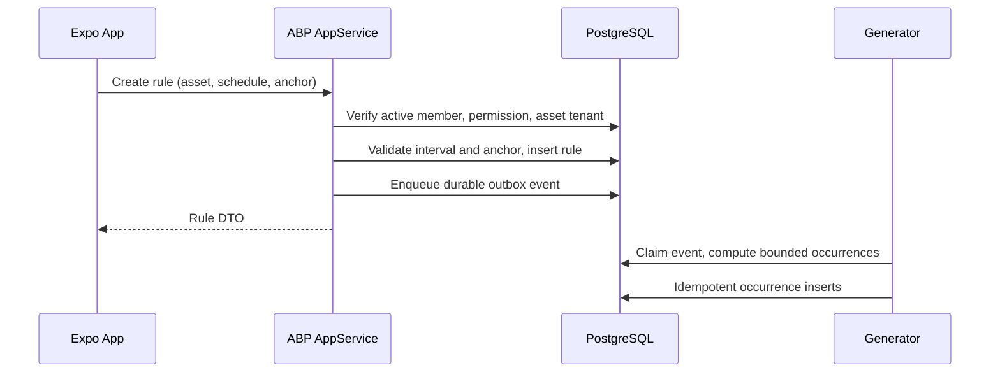
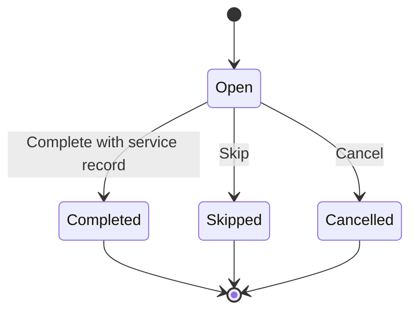
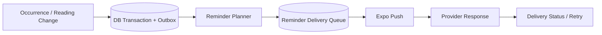

# Kepnora — Maintenance Management Feature Specification

**Intended path:** `docs/features/maintenance-management.md`  
**Version:** 1.0-draft · **Date:** 2026-10-29  
**Scope:** Phase 1 MVP · **Status:** Implementation-oriented design, not a claim of completed APIs.

**References:** `docs/database-overview.md` §§13–16, `docs/architecture/background-jobs-and-outbox.md`, `docs/architecture/tenant-isolation.md`, `docs/architecture/api-design.md`, `docs/features/asset-management.md`, `docs/ui/screen-specifications.md`, `docs/mvp-build-order.md`.

---

**Foundational rule:** Maintenance occurrences persist **only** `Open`, `Completed`, `Skipped`, or `Cancelled`. `Upcoming`, `Due`, and `Overdue` are **computed display states**, not database lifecycle statuses. Missing odometer data is **Unknown**, never estimated.

## 1. Purpose

Provide a predictable, auditable maintenance lifecycle for standalone assets and property-linked assets. The module supports time-based and mileage-based maintenance rules, deterministic occurrence generation, completing/skipping/cancelling work, service history, observed mileage and reminder scheduling. The backend—not the React Native client—is authoritative for recurrence, status, permissions and historical records.


## 2. Scope and phase boundaries

| Phase | Capabilities |
|---|---|
| Phase 1 | Rules, occurrences, due summaries, actual mileage readings, completion, ad hoc service records, reminder integration |
| Phase 2 | Contextual discovery of nearby service providers; **no booking guarantee** |
| Phase 3 | Booking, appointments and payments |

Phase 1 has **no hybrid time-or-mileage rule** in the canonical database schema. Do not silently model a hybrid rule as `Time`. Do not add provider booking fields to occurrences in MVP.


## 3. Canonical domain entities

| Entity | Canonical table | Responsibility |
|---|---|---|
| Rule | `MaintenanceRules` | Scheduling intent, anchor and interval |
| Occurrence | `MaintenanceOccurrences` | One deterministic obligation and lifecycle |
| Service history | `MaintenanceRecords` | Actual completed work, scheduled or ad hoc |
| Reading | `AssetOdometerReadings` | Observed, timestamped mileage |
| Reminder | `ReminderDeliveries` and outbox architecture | Dispatch tracking and retry |
| Asset | `Assets` | Same-tenant parent; `PropertyId` may be null |

Use the established schema, not duplicate rule/occurrence/history tables.


## 4. Non-negotiable invariants

1. One workspace maps to one authoritative ABP Tenant.
2. Every maintenance row is tenant-owned and its asset/rule references remain within that tenant.
3. Global identity may span workspaces only after M0 validates the selected ABP approach.
4. `ICurrentTenant` alone never proves active membership; check membership and named permission.
5. An asset without a property can have full maintenance history.
6. Time rules use `IntervalDays` **or** `IntervalMonths`, not both.
7. Mileage rules require positive `IntervalMiles`.
8. `AnchorPolicy` is `Scheduled` or `Completion`.
9. Occurrence uniqueness is `(TenantId, RuleId, ScheduleKey)`.
10. One scheduled occurrence can have **at most one** `MaintenanceRecord`.
11. History is never silently rewritten when rule settings change.
12. Mileage is observed; no interpolation, guessed reading or time-based mileage projection.
13. Reminder delivery is at-least-once in the failure model; no exactly-once promise.
14. Status and recurrence calculations use a clearly defined clock/timezone policy.
15. External push success is not part of the PostgreSQL transaction.


## 5. Database — MaintenanceRules

Canonical columns:

```sql
"Id" UUID,
"TenantId" UUID,
"AssetId" UUID,
"Title" VARCHAR(200),
"ScheduleType" VARCHAR(20),   -- Time | Mileage
"AnchorPolicy" VARCHAR(20),   -- Scheduled | Completion
"IntervalDays" INTEGER NULL,
"IntervalMonths" INTEGER NULL,
"IntervalMiles" INTEGER NULL,
"StartOn" DATE NULL,
"StartMileage" INTEGER NULL,
"TimeZoneId" VARCHAR(100) NULL,
"IsEnabled" BOOLEAN,
"LastCompletedOn" DATE NULL,
"LastCompletedMileage" INTEGER NULL,
"CreatedAt" TIMESTAMPTZ,
"Version" BIGINT
```

The canonical schema enforces time interval selection and positive mileage interval through CHECK constraints. Domain validation must additionally enforce valid anchor values, required start data under the selected policy, compatible null fields and supported timezones. Do not treat a successful DB CHECK as full business validation.


## 6. Database — MaintenanceOccurrences

Canonical columns: `Id`, `TenantId`, `RuleId`, `ScheduleKey`, nullable `DueOn`, nullable `DueMileage`, `LifecycleStatus`, nullable `CompletedAt`, `CreatedAt`, `Version`.

```sql
CONSTRAINT "UQ_MaintenanceOccurrences_Rule_ScheduleKey"
    UNIQUE ("TenantId", "RuleId", "ScheduleKey");

CONSTRAINT "CK_MaintenanceOccurrences_LifecycleStatus"
    CHECK ("LifecycleStatus" IN
        ('Open', 'Completed', 'Skipped', 'Cancelled'));
```

For a Time rule, an occurrence normally has `DueOn`; for Mileage, it normally has `DueMileage`. This semantic consistency is an application invariant unless additional DB constraints are approved.


## 7. Database — MaintenanceRecords

Canonical columns: `Id`, `TenantId`, `AssetId`, nullable `OccurrenceId`, `PerformedOn`, nullable `Description`, nullable `Cost`, nullable `CurrencyCode`, nullable `OdometerMileage`, `CreatedByUserId`, `CreatedAt`.

```sql
CREATE UNIQUE INDEX "UX_MaintenanceRecords_Occurrence"
    ON "MaintenanceRecords" ("TenantId", "OccurrenceId")
    WHERE "OccurrenceId" IS NOT NULL;
```

`OccurrenceId = NULL` supports **ad hoc** service work. The occurrence FK by itself does not prove the history record's `AssetId` matches the parent rule's `AssetId`; enforce this in the completion transaction and test it.


## 8. Database — AssetOdometerReadings

Canonical columns: `Id`, `TenantId`, `AssetId`, `Mileage`, `RecordedAt`, `Source` (default `Manual`). DB check ensures mileage is nonnegative. Query readings by `(TenantId, AssetId)` ordered by recorded timestamp, with deterministic tie-breaking.

A late-entered reading may have an earlier `RecordedAt` than a previously entered one. Therefore “latest” means latest valid observation by event time under the chosen correction policy, not necessarily the newest database insert.


## 9. Rule taxonomy

| ScheduleType | AnchorPolicy | Example | Required scheduling data |
|---|---|---|---|
| Time | Scheduled | Every 30 days from a fixed start | `StartOn`, `IntervalDays=30` |
| Time | Completion | 6 months after actual service | Initial anchor policy + `IntervalMonths=6` |
| Mileage | Scheduled | Every 5,000 miles from baseline | `StartMileage`, `IntervalMiles=5000` |
| Mileage | Completion | 5,000 miles after last service reading | Initial anchor + completed mileage |

The precise first-occurrence and missing-completion-anchor policy must be approved before implementation. Completion-anchored rules must not produce an unbounded series of hypothetical future occurrences.


## 10. Scheduled time recurrence — days

For a scheduled-anchored daily interval `N > 0`, with initial `StartOn = D0`, the nth due date can be represented as `D(n) = D0 + n × N days` under a defined first-occurrence convention. Use integer sequence indices and a bounded generation horizon; do not advance indefinitely in a `while` loop without a cap.

**Example** (illustrative, assuming first occurrence at start date): `StartOn=2026-11-01`, `IntervalDays=30` yields `2026-11-01`, `2026-12-01`, `2026-12-31`. The product must decide whether `StartOn` itself is due or the first due date is `StartOn + interval`.


## 11. Scheduled time recurrence — months

Month-based recurrence must not drift after clamping. Example: anchor January 31, monthly recurrence could produce February 28, March 31, April 30 under **anchor-day preservation**. Computing each next date from the previous clamped date would instead drift to the 28th; avoid that unless expressly approved.

```csharp
static DateOnly ScheduledMonthlyDue(
    DateOnly anchor,
    int occurrenceIndex,
    int intervalMonths)
{
    var monthStart = new DateOnly(anchor.Year, anchor.Month, 1)
        .AddMonths(checked(occurrenceIndex * intervalMonths));

    var day = Math.Min(
        anchor.Day,
        DateTime.DaysInMonth(monthStart.Year, monthStart.Month));

    return new DateOnly(monthStart.Year, monthStart.Month, day);
}
```

Illustrative algorithm only; define index zero/one semantics, overflow behavior and leap-day policy in tests.


## 12. Completion-anchored time recurrence

For `AnchorPolicy=Completion`, calculate the next due date from the **actual performed date** of the last completed service, not the prior scheduled due date. If a service was due November 1 but performed November 10, a 30-day completion-anchored next due date is December 10 (assuming interval starts on completion).

Create the next occurrence within the same authorized completion workflow or through an idempotent outbox-driven generator, with a stable schedule key. A crash between history insert and rule state update must not produce two next occurrences.


## 13. Mileage recurrence

For a scheduled-anchored mileage interval `M`, baseline `B`, and agreed first-index convention, due thresholds are `B + n × M`. Example: baseline 20,000 miles and interval 5,000 produces 25,000, 30,000, 35,000 if the first due is one interval after baseline.

For completion anchoring, the next threshold derives from actual `OdometerMileage` recorded for the completed service. If no reading is supplied, define whether the completion can proceed and whether next generation is blocked until a valid anchor is available. Never substitute an estimated reading.


## 14. Mileage unknown and observation semantics

| Condition | Display |
|---|---|
| No valid reading | **Unknown** |
| Valid latest reading below threshold | Upcoming / Not yet due |
| Valid latest reading reaches threshold | Due |
| Reading exceeds threshold | Due; optionally “past due by X miles” |
| Reading corrected/invalidated | Recompute from valid readings |

Mileage-only rules cannot reliably distinguish **Overdue by elapsed days** without an additional approved policy. If the UI uses an “Overdue” badge for mileage, define an explicit threshold/grace interpretation; do not imply a calendar deadline that is not present.


## 15. Time-based display urgency

Compute urgency for `LifecycleStatus=Open` using a single workspace-local calendar date and configured grace window.

```text
if lifecycle != Open:
    show lifecycle label (Completed, Skipped, Cancelled)
else if DueOn > today + upcomingWindow:
    show scheduled date / future
else if DueOn > today:
    Upcoming
else if DueOn == today:
    Due
else if DueOn < today:
    Overdue (or Due within approved grace policy)
```

The product must define whether all future items are `Upcoming` or only those inside a preview window. This does not change persisted lifecycle.


## 16. Timezone and DST

`DueOn` is a date without time. Interpret it in the rule's `TimeZoneId` if set, otherwise in the approved workspace timezone policy. Store event timestamps in UTC (`TIMESTAMPTZ`) and convert to local calendar dates only at display/scheduling boundaries. Do not assume the device timezone equals the workspace timezone.

For reminders scheduled at a local hour, daylight-saving gaps/overlaps need a deterministic policy (shift to next valid time, or pick first/second occurrence). Pin the timezone library and policy before beta.


## 17. ScheduleKey format

Canonical examples: `TIME:2026-11-30`, `MILE:25000`. Key must be deterministic and stable for one rule generation version. Do not use random GUIDs or the current timestamp as a schedule key.

```csharp
static string TimeKey(DateOnly due) =>
    $"TIME:{due:yyyy-MM-dd}";

static string MileageKey(int dueMileage) =>
    $"MILE:{dueMileage}";
```

**Collision caveat:** A completion-anchored rule may produce the same due date/threshold after corrections or repeated completion. Decide whether key includes a rule revision or sequence identifier; do not change key formats casually after production data exists.


## 18. Occurrence generation algorithm

```text
For each eligible enabled rule in a bounded tenant-scoped batch:
    Revalidate tenant and asset status
    Load rule and relevant last completion/reading
    Compute due targets within approved horizon
    For each target:
        Derive deterministic ScheduleKey
        INSERT ... ON CONFLICT (TenantId, RuleId, ScheduleKey) DO NOTHING
    Record generation checkpoint and metrics
```

For completion-anchored rules, generate only the next valid obligation based on an actual completion anchor. For scheduled-anchored rules, limit the look-ahead horizon and maximum batch count. Never create millions of historical occurrences when importing an old rule.


## 19. PostgreSQL idempotent insert

```sql
INSERT INTO "MaintenanceOccurrences"
(
    "Id", "TenantId", "RuleId", "ScheduleKey",
    "DueOn", "DueMileage", "LifecycleStatus",
    "CreatedAt", "Version"
)
VALUES
(
    @Id, @TenantId, @RuleId, @ScheduleKey,
    @DueOn, @DueMileage, 'Open',
    CURRENT_TIMESTAMP, 1
)
ON CONFLICT ("TenantId", "RuleId", "ScheduleKey")
DO NOTHING;
```

Use actual EF Core/ABP unit-of-work integration or a reviewed SQL repository. A unique index is the final concurrency safeguard; a pre-insert existence check alone is insufficient.


## 20. Generation horizons and backfill

Choose bounded horizons, e.g. generate only the next few scheduled obligations or a limited time window, **after** product review. A horizon is not a persisted due state. On rule creation with a historical `StartOn`, decide whether to backfill missed occurrences, create only the next relevant occurrence, or ask the user. Never silently create a huge backlog.

A worker must be safe to rerun after deployment, restart or concurrent execution. Track metrics for generated, duplicate, invalid and deferred rules.


## 21. Rule create flow



Rule creation succeeds when the rule transaction commits. The UI may show a brief “Schedule being prepared” state if occurrences are generated asynchronously.


## 22. Rule editing and revisions

The canonical `MaintenanceRules.Version` supports optimistic concurrency but **is not** a separate immutable rule-revision table. Choose a rule edit policy before coding:

- Preserve already-open occurrences and apply edits only to future generation.
- Cancel/recreate selected open occurrences with explicit audit and notification invalidation.
- Introduce explicit rule revisions and key namespace via migration.

Do not rewrite completed history or silently change a previously promised due date. If editing recurrence invalidates reminders, reconcile pending reminder deliveries safely.


## 23. Rule enable/disable

`IsEnabled=FALSE` stops future generation. Whether it also cancels already-open occurrences or pending reminders is an open business policy. Disabling must not delete service history. Re-enabling must be idempotent and avoid generating duplicates from old schedule keys.


## 24. Occurrence lifecycle state machine



These are the only persisted states. Reopen/correction is not part of the baseline model; any correction flow requires an explicit audit policy and potentially schema changes.


## 25. Complete occurrence — transaction

1. Authenticate global user and verify active membership in workspace.
2. Verify permission to complete maintenance on this asset.
3. Load occurrence, rule and asset by tenant-scoped identifiers.
4. Lock occurrence or enforce expected `Version`; require `Open`.
5. Validate performed date, optional cost/currency, optional actual mileage and description.
6. Confirm `MaintenanceRecords.AssetId` equals the rule's asset.
7. Insert one `MaintenanceRecord` with `OccurrenceId`.
8. Set occurrence `LifecycleStatus='Completed'` and `CompletedAt`.
9. Update rule `LastCompletedOn` and `LastCompletedMileage` as appropriate.
10. Record outbox event for next occurrence/reminder reconciliation.
11. Commit one PostgreSQL Unit of Work.
12. Return the authoritative result.

The unique index on `(TenantId, OccurrenceId)` prevents duplicate scheduled service records even if requests race.


## 26. Completion example request

```json
{
  "performedOn": "2026-11-12",
  "description": "Oil and filter replaced",
  "cost": 89.95,
  "currencyCode": "USD",
  "odometerMileage": 30520,
  "expectedVersion": 1,
  "clientRequestId": "ea9e4c6e-348d-4495-96b0-33a50a04f2d0"
}
```

This is a **proposed** API contract. `clientRequestId` requires an idempotency persistence strategy that is not currently in the canonical maintenance table definitions; do not claim durable request-key deduplication exists without a migration or separate idempotency store.


## 27. Concurrency and idempotency

Two devices can attempt to complete the same occurrence. The first authorized transaction commits the history record and lifecycle change. The second receives a stable conflict or an idempotent replay of the prior result when the server can prove it is the same request. Never insert a second service record.

For retry-after-timeout, an explicit idempotency-key store is recommended if returning the same response is required. Otherwise, rely on the unique history constraint plus a clear conflict/reload behavior. Completion-anchored generation must be transactionally coordinated with completion and/or outbox processing.


## 28. Skip and cancel semantics

`Skipped` means work was deliberately not performed for this occurrence; `Cancelled` means the obligation was withdrawn or invalidated. Both transitions require permission and expected version. Neither creates a completed service record. Whether a skip advances a scheduled/completion anchor is a **product decision**; do not assume a skipped oil change counts as a completed oil change.

The UI must explain consequences and require confirmation. Both operations invalidate pending reminder eligibility.


## 29. Ad hoc service history

Users may record work that was performed without a scheduled occurrence by creating `MaintenanceRecords` with `OccurrenceId=NULL`. It must still belong to an authorized asset in the same tenant. Whether an ad hoc service resets an existing completion-anchored rule is an explicit user choice/policy, **not** an automatic side effect.


## 30. Odometer reading submission

```json
{
  "mileage": 30420,
  "recordedAt": "2026-11-10T16:30:00Z",
  "source": "Manual"
}
```

Validate nonnegative integer, plausible unit, timestamp and current tenant asset. Do not automatically reject every lower reading: a correction, replacement odometer or late historical entry may be legitimate. Define a policy for correction, reset, source and audit before beta.


## 31. Mileage unit policy

The canonical database stores `Mileage` and `IntervalMiles` as **miles**. If the mobile app supports kilometers, convert explicitly at the API boundary using a documented rounding rule; never silently relabel kilometers as miles. Preserve original user-entered units only if a schema extension is approved. For MVP, a miles-only UI is simplest and aligns with the current schema.


## 32. Reminder planning

Reminders should be derived from **open** occurrences, active rules, valid notification preferences and a known timezone/odometer state. Time reminders may be scheduled relative to `DueOn`; mileage reminders can trigger when a newly observed reading crosses a threshold. Do not invent a future calendar reminder date for a mileage rule without a valid observed reading.

Persist reminder intent/delivery according to the outbox architecture, and deduplicate by an approved logical key such as tenant + occurrence + channel + reminder policy version.


## 33. Push dispatch and external side effects



Expo Push acceptance does not prove user-visible delivery. Use bounded retries, exponential backoff, permanent error handling, invalid token cleanup, dead-letter monitoring and a worker restart recovery plan. Avoid sensitive asset data in lock-screen payloads.


## 34. Reminder invalidation

When occurrence is completed, skipped or cancelled, or rule is disabled/edited, pending reminder work must recheck current eligibility **at dispatch time**. A queued reminder should not be sent solely because it was valid when originally planned. If a push was already delivered, it cannot be recalled; notification deep links must still authorize the current resource.


## 35. Proposed API operation inventory

| Operation | Input | Output |
|---|---|---|
| `ListMaintenanceRules` | workspace, asset, filters | Paginated rules |
| `CreateMaintenanceRule` | asset, schedule and anchor | Rule DTO |
| `UpdateMaintenanceRule` | rule, expected version | Rule DTO |
| `SetMaintenanceRuleEnabled` | rule, enabled, version | Rule DTO |
| `ListMaintenanceOccurrences` | status/date/asset filters | Paginated occurrences |
| `GetMaintenanceOccurrence` | occurrence ID | Detail DTO |
| `CompleteMaintenanceOccurrence` | performed date, details, version | Completion/history DTO |
| `SkipMaintenanceOccurrence` | reason if supported, version | Updated occurrence |
| `CancelMaintenanceOccurrence` | reason if supported, version | Updated occurrence |
| `ListMaintenanceRecords` | asset and date filters | History |
| `CreateAdHocMaintenanceRecord` | asset, performed details | History DTO |
| `ListOdometerReadings` | asset | Readings |
| `AddOdometerReading` | asset, actual reading | Reading DTO |
| `GetMaintenanceSummary` | workspace | Due summary |

These are **operation names**, not verified ABP routes. Confirm exact URLs, permission names and DTO shapes in generated OpenAPI.


## 36. C# application contracts

```csharp
public enum MaintenanceScheduleType { Time, Mileage }
public enum MaintenanceAnchorPolicy { Scheduled, Completion }
public enum MaintenanceLifecycleStatus
{
    Open, Completed, Skipped, Cancelled
}

public sealed record CreateMaintenanceRuleInput(
    Guid AssetId,
    string Title,
    MaintenanceScheduleType ScheduleType,
    MaintenanceAnchorPolicy AnchorPolicy,
    int? IntervalDays,
    int? IntervalMonths,
    int? IntervalMiles,
    DateOnly? StartOn,
    int? StartMileage,
    string? TimeZoneId);

public sealed record CompleteOccurrenceInput(
    DateOnly PerformedOn,
    string? Description,
    decimal? Cost,
    string? CurrencyCode,
    int? OdometerMileage,
    long ExpectedVersion,
    Guid? ClientRequestId);
```

These are Kepnora examples, not framework-provided types. Pin enum serialization, cancellation tokens, authorization attributes and ABP version during implementation.


## 37. Server-side query security

```csharp
var occurrence = await db.MaintenanceOccurrences
    .SingleOrDefaultAsync(
        x => x.TenantId == workspaceId
          && x.Id == occurrenceId,
        cancellationToken);
```

The application must first verify membership and permission, then follow the occurrence's rule and asset within the same tenant. A foreign ID should produce a neutral not-found result; never disclose another workspace's maintenance title, due date or asset name.


## 38. Mobile maintenance overview

Use a premium but functional list: prominent next-due summary, segmented urgency filters, asset context, readable dates/mileage thresholds, and clear Complete/Details actions. Distinguish lifecycle and urgency in labels and accessibility announcements. An empty state should direct users to create a maintenance rule on an asset, not to Phase 3 booking.


## 39. Mobile rule editor

Fields depend on schedule type:

- **Time:** interval unit (days/months), positive interval, anchor policy, start date/timezone.
- **Mileage:** interval in miles, baseline observed mileage, anchor policy.
- **Common:** asset, title, enabled state and explanatory preview.

Do not display a combined “every 6 months or 5,000 miles” selector while the schema lacks hybrid support. Preview must use the same recurrence rules as backend; mark any client preview as provisional until saved.


## 40. Mobile occurrence detail and completion

Occurrence detail displays the asset, rule, due date or due mileage, actual last reading where available, computed urgency and persisted lifecycle. Completion form asks performed date, optional cost/description and actual odometer only when applicable. Receipt upload is a separate authorized S3 flow after or alongside completion, not a reason to claim a document exists before finalization.


## 41. React Native query keys

```ts
export const maintenanceKeys = {
  rules: (workspaceId: string, assetId: string) =>
    ['workspaces', workspaceId, 'assets', assetId, 'rules'] as const,
  occurrences: (workspaceId: string, filters: unknown) =>
    ['workspaces', workspaceId, 'maintenance', 'occurrences', filters] as const,
  occurrence: (workspaceId: string, id: string) =>
    ['workspaces', workspaceId, 'maintenance', 'occurrence', id] as const,
  history: (workspaceId: string, assetId: string) =>
    ['workspaces', workspaceId, 'assets', assetId, 'history'] as const,
};
```

Workspace switching must cancel/isolate pending mutations and remove previous-tenant visible data. Do not optimistically mark completion before the server commits.


## 42. Error and offline behavior

| Scenario | UX |
|---|---|
| 401/session expired | Supported refresh, otherwise sign-in |
| 403/revoked membership | Deny and exit protected context |
| 404/foreign occurrence | Neutral unavailable message |
| 409/stale version | Reload and explain concurrent change |
| 422/invalid recurrence | Field-level error |
| Network offline | Read cached authorized data only if policy allows; disable false completion |
| Worker delay | Rule saved; generation pending indicator if needed |
| No mileage reading | Explicit Unknown |
| Push failure | In-app maintenance state remains authoritative |
| Receipt upload fails | Completion result remains independent; retry attachment |


## 43. Observability and auditing

Measure rule creation/validation failures, generation duration, duplicate-key conflicts, overdue open occurrences, completion conflicts, service history inserts, missing mileage anchors, reminder queue backlog, push failures and worker restarts. Audit actor, tenant, rule/occurrence ID, old/new lifecycle, performed date and correlation ID. Avoid logging private descriptions, receipt contents or presigned URLs by default.


## 44. Background worker safety

Process tenants in bounded, explicitly scoped batches. Never reuse a stale `ICurrentTenant` context between tenants. Claim work with leases or database-safe concurrency, derive deterministic schedule keys, rely on uniqueness, and retry only transient errors. Workers must tolerate partial progress and restarts without creating duplicate occurrences or notifications.


## 45. Data integrity edge cases

| Edge case | Required decision/test |
|---|---|
| Monthly anchor Jan 31 | No month-end drift |
| Leap day | Stable recurrence policy |
| Timezone changed | Explicit recalculation policy |
| Rule edited after occurrence created | Preserve/cancel/revision policy |
| Late mileage reading | Deterministic latest-valid reading |
| Odometer reset | Correction/reset policy |
| Completion without mileage | Whether next completion-anchored mileage due can be generated |
| Duplicate completion | One history row |
| Ad hoc record for existing rule | No automatic anchor reset without policy |
| Asset archived | Future occurrence and reminder policy |
| Skipped occurrence | Anchor advancement policy |
| Outbox retry | No duplicate logical reminder |
| Member revoked during request | Recheck authorization at mutation |
| Workspace switch | No cross-tenant data leak |


## 46. Test catalog — recurrence

| ID | Test | Expected |
|---|---|---|
| MM-001 | Daily interval 30 | Correct bounded dates |
| MM-002 | Monthly Jan 31 | No drift after February |
| MM-003 | Leap-year anchor | Defined leap policy |
| MM-004 | Invalid time interval | Rejected |
| MM-005 | Both day and month interval | Rejected |
| MM-006 | Mileage interval zero | Rejected |
| MM-007 | Hybrid schedule request | Rejected in Phase 1 |
| MM-008 | Scheduled mileage thresholds | Correct sequence |
| MM-009 | Completion anchor uses actual performed date | Correct next due |
| MM-010 | No completion mileage | Unknown/deferred by policy |
| MM-011 | Repeat generation same rule | No duplicate occurrence |
| MM-012 | Two generators concurrently | Unique constraint holds |
| MM-013 | Historical start date | Bounded backfill |
| MM-014 | Rule disabled | No new generation |
| MM-015 | Rule edited | Approved open-occurrence policy |
| MM-016 | Different tenant same key | Independent occurrences |
| MM-017 | Missing timezone | Approved fallback |
| MM-018 | DST boundary | Deterministic reminder time |
| MM-019 | Rule revision | Completed history preserved |
| MM-020 | Worker crash/retry | No duplicate logical work |


## 47. Test catalog — completion and history

| ID | Test | Expected |
|---|---|---|
| MM-021 | Complete Open occurrence | One history record |
| MM-022 | Complete Completed occurrence | Conflict/idempotent replay |
| MM-023 | Two simultaneous completes | Exactly one history row |
| MM-024 | Foreign tenant occurrence | Denied/neutral not found |
| MM-025 | History asset mismatch | Rejected |
| MM-026 | Stale expected version | Conflict |
| MM-027 | Negative cost | Rejected |
| MM-028 | Ad hoc service record | Null OccurrenceId |
| MM-029 | Skip Open occurrence | Skipped, no completion record |
| MM-030 | Cancel Open occurrence | Cancelled, no completion record |
| MM-031 | Skip already completed | Rejected |
| MM-032 | Completion updates anchor | Atomic with history |
| MM-033 | DB rollback | No partial completion |
| MM-034 | Receipt upload fails | No fake attached document |
| MM-035 | Asset with PropertyId null | Full maintenance works |
| MM-036 | Asset archived | Approved history preservation |
| MM-037 | Role revoked | Mutation denied |
| MM-038 | Retry after timeout | No duplicate history |
| MM-039 | Rule edit while completing | Consistent concurrency policy |
| MM-040 | Service history list | Tenant-scoped pagination |


## 48. Test catalog — mileage, reminders and mobile

| ID | Test | Expected |
|---|---|---|
| MM-041 | No reading | Unknown, not zero |
| MM-042 | Reading below threshold | Not due |
| MM-043 | Reading at threshold | Due |
| MM-044 | Reading above threshold | Due/past threshold |
| MM-045 | Negative reading | Rejected |
| MM-046 | Late historical reading | Correct ordering/policy |
| MM-047 | Odometer correction | Approved correction flow |
| MM-048 | Kilometers entered | Explicit conversion or reject |
| MM-049 | Completed occurrence queued reminder | Suppressed at dispatch |
| MM-050 | Disabled rule queued reminder | Suppressed at dispatch |
| MM-051 | Expo transient failure | Retry with backoff |
| MM-052 | Expo permanent token error | Token handled safely |
| MM-053 | Push tap after member removal | Access denied |
| MM-054 | Workspace switch while completing | No cross-tenant mutation |
| MM-055 | Offline complete tap | No false success |
| MM-056 | Dashboard overdue count | Computed from Open only |
| MM-057 | Screen reader urgency | Accessible, non-color-only |
| MM-058 | Duplicate reminder planning | One logical reminder |
| MM-059 | Worker tenant X then Y | No context leakage |
| MM-060 | Restart during outbox processing | Safe retry |


## 49. Implementation milestones

| Milestone | Deliverables |
|---|---|
| M0 | Prove global identity + membership with pinned ABP stack |
| M1–M3 | Auth/workspace, asset and type foundations |
| M4 | Maintenance rules, deterministic generation, occurrences, completion, ad hoc history, mileage |
| M5 | Receipt/document attachments via private S3 |
| M6 | Durable reminder planning, push, outbox retry and monitoring |
| M7 | Dashboard/search summaries and preferences |
| M8 | Security, race, recovery, device accessibility and beta testing |

Do not build a second outbox if the chosen ABP implementation already provides an appropriate durable outbox; validate provider capabilities in M0.


## 50. Open decisions before coding

1. First-occurrence convention: due at `StartOn`/`StartMileage` or after one interval.
2. Scheduled month-end and leap-day policy.
3. Completion anchor when no prior completion exists.
4. Completion without odometer for mileage-based rule.
5. Exact rule edit/revision policy and schedule-key evolution.
6. Skip semantics for future recurrence.
7. Asset archive effects on open occurrences and reminders.
8. Due/overdue grace periods and upcoming window.
9. Workspace/rule timezone precedence and DST behavior.
10. Odometer reset/correction and kilometer support.
11. Ad hoc service interaction with recurrence.
12. Reminder offsets, channels, quiet hours and deduplication.
13. API idempotency-key storage and error contract.
14. Rule generation look-ahead horizon/backfill cap.
15. Exact ABP job provider/outbox integration.
16. Exact permission names and generated OpenAPI routes.

Record each selected policy in the owning ADR and acceptance tests. The current canonical database does not define all these choices.


## 51. Definition of Done

- [ ] Time and mileage rules validate against canonical schema.
- [ ] Scheduled and completion anchoring are deterministic.
- [ ] Monthly recurrence does not drift unintentionally.
- [ ] Generation is bounded, retryable and idempotent.
- [ ] Only Open/Completed/Skipped/Cancelled persist.
- [ ] Due/Overdue are derived from policy and actual observations.
- [ ] Missing mileage is Unknown; no inferred mileage.
- [ ] Completion writes one history record and updates state atomically.
- [ ] Ad hoc history is supported without a fake occurrence.
- [ ] Same-tenant asset/rule/history invariants are enforced.
- [ ] All actions verify membership and permission.
- [ ] Reminders recheck eligibility before dispatch.
- [ ] Push failures do not corrupt maintenance state.
- [ ] Workspace switch cannot expose another tenant's data.
- [ ] MM-001 through MM-060 are automated or tracked with explicit QA evidence.
- [ ] Open decisions are resolved before dependent features ship.


## 52. Final engineering principle

**The database records what was scheduled and what actually happened; the application computes what is due now.** Keep recurrence deterministic, mileage factual, completion atomic and reminders recoverable. Never weaken workspace isolation to make scheduling appear simpler.

