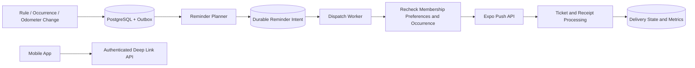
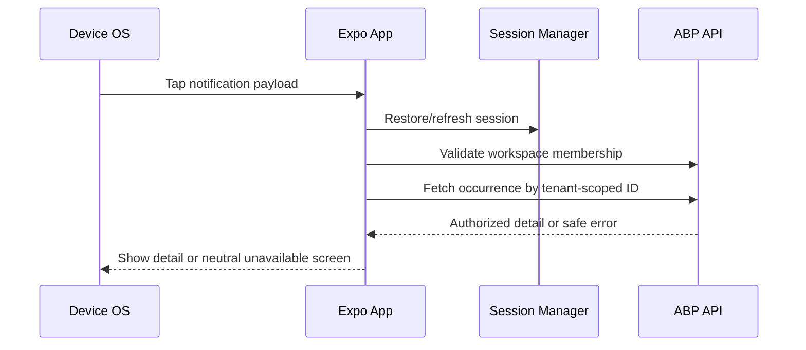

# Kepnora — Notification & Reminder Feature Specification

**Intended repository path:** `docs/features/notification-reminders.md`  
**Version:** 1.0-draft · **Date:** 2026-10-29  
**Phase:** MVP (M6), following maintenance M4 and storage M5  
**Status:** Implementation proposal; verify table names, columns, ABP APIs, Expo SDK and push provider behavior before migration or coding.

**Related specs:** `docs/features/maintenance-management.md`, `docs/architecture/background-jobs-and-outbox.md`, `docs/architecture/authentication-authorization.md`, `docs/architecture/tenant-isolation.md`, `docs/architecture/api-design.md`, `docs/architecture/mobile-app-architecture.md`, `docs/ui/screen-specifications.md`, `docs/database-overview.md`.

---

## Core architecture decision

A maintenance rule or actual odometer reading establishes **whether a reminder is eligible**. PostgreSQL stores the authoritative work state and durable delivery intent. A background worker attempts delivery to Expo Push. Expo accepting a message is **not** proof that the device displayed it. Every notification tap must reauthorize the current user and workspace.

**Important schema note:** The available project database overview does not establish the concrete notification table definitions. `PushDevices`, `NotificationPreferences`, `ReminderDeliveries`, and `OutboxMessages` below are **proposed logical entities**, not verified existing migrations. Do not create parallel tables if the selected ABP infrastructure already provides equivalent durable outbox support.
## 1. Goals

Provide timely, relevant reminders for asset maintenance without duplicate spam, unauthorized cross-workspace exposure or false delivery claims. Support mobile push registration, user preferences, durable planning, dispatch, retries, audit, monitoring and safe deep links. A reliable MVP favors predictable semantics and debuggability over advanced campaign features.


## 2. Phase boundaries

| Phase | Included |
|---|---|
| Phase 1 | Maintenance due reminders, observed mileage threshold alerts, Expo device registration, preferences, retry and basic notification navigation |
| Phase 2 | Provider discovery-related informational notifications only after explicit design approval |
| Phase 3 | Booking, appointment, payment and provider workflow notifications |

Do not send booking confirmations in Phase 1. Marketing campaigns, email/SMS delivery and notification personalization by AI are out of scope unless explicitly approved.


## 3. Foundational invariants

1. One workspace is one ABP tenant, and tenant membership must be verified independently of `ICurrentTenant`.
2. The user has one global identity and may join multiple workspaces, subject to the M0 identity POC.
3. Maintenance occurrences persist only `Open`, `Completed`, `Skipped`, `Cancelled`.
4. `Upcoming`, `Due`, `Overdue` are computed, not stored occurrence lifecycle values.
5. Missing odometer mileage is unknown; no time-based mileage estimates.
6. No provider-specific or booking notification in MVP.
7. Every delivery intent has a stable logical deduplication key.
8. Delivery workers recheck current eligibility before sending.
9. A push token is not a user authorization credential.
10. A push notification is a hint; the API remains the source of truth.
11. Database transactions cannot atomically commit with Expo Push.
12. At-least-once dispatch may produce duplicates after ambiguous failures; no exactly-once guarantee.
13. A device can be registered for multiple workspaces only under explicit policy, and every notification is scoped to its intended workspace.
14. Do not put presigned S3 URLs, private notes, receipts or secrets in push payloads.
15. User opt-out and OS notification permission are distinct states.


## 4. Notification types

| Event | Trigger | Target | MVP policy |
|---|---|---|---|
| Time maintenance upcoming | Open occurrence reaches approved lead date | Occurrence detail | Configurable/approved lead offsets |
| Time maintenance due | Open occurrence due today in rule timezone | Occurrence detail | Once per logical policy window |
| Time maintenance overdue | Open occurrence past due | Occurrence detail | Cadence and cap must be defined |
| Mileage threshold reached | New valid observed reading meets/exceeds open mileage threshold | Occurrence detail | Event-driven, not calendar projection |
| Maintenance completion | User action | None by default | No redundant push to acting user in MVP |
| Document upload completed | User action | None by default | In-app confirmation, not push |

Do not claim the overdue cadence, quiet hours or lead offsets are finalized until the product chooses them.


## 5. High-level data flow



A planner may be triggered by a durable event and periodic reconciliation. A dispatcher must not trust the eligibility decision made hours earlier.


## 6. Actors and authorization

| Actor | Allowed operations |
|---|---|
| Authenticated user | Register own device; view/update own preferences; view authorized reminders |
| Workspace member | Receive reminders only for resources accessible under approved workspace policy |
| Workspace owner | Configure workspace defaults only if an admin settings feature is implemented |
| Dispatch worker | Read bounded tenant-scoped delivery intents under service authority |
| Non-member/revoked user | No new tenant reminder access or newly issued deep-link access |

Whether reminders go to all members, asset owners or opted-in workspace members is an **open recipient policy**. The current asset schema does not establish an asset-owner assignment field; do not invent one.


## 7. Device registration model

Proposed `PushDevices` logical fields: `Id`, `GlobalUserId`, `InstallationId`, `ExpoPushToken`, `Platform`, `AppEnvironment`, `Enabled`, `LastSeenAt`, `CreatedAt`, `UpdatedAt`, optional `InvalidatedAt`. Token must be handled as sensitive operational data and protected at rest where appropriate.

A global device registration should not be duplicated per tenant unless there is a clear requirement. Recipient resolution joins **global user device(s)** to **active workspace membership** at planning/dispatch. The installation ID is an app-generated opaque identifier, not a stable hardware identifier and not an authentication factor.


## 8. Device registration lifecycle

```text
App installed → OS permission decision → Obtain Expo token
   → Authenticated register/update → Active
   → Token rotation or reinstall → Replace/disable stale token
   → Logout → Apply chosen device binding policy
   → Provider reports invalid token → Disable token
```

Never trust a client-provided `GlobalUserId`; derive it from the authenticated session. On account switching, update the binding explicitly and prevent the prior account from receiving notifications on the shared installation. Logout token removal vs disabling is an open policy.


## 9. Notification preference model

Proposed logical `NotificationPreferences` fields: `GlobalUserId`, optional `TenantId`, `MaintenancePushEnabled`, `UpcomingEnabled`, `DueEnabled`, `OverdueEnabled`, `MileageEnabled`, `QuietHoursStart`, `QuietHoursEnd`, `TimeZoneId`, `UpdatedAt`, `Version`.

Decide whether preferences are global, workspace-specific or layered. A recommended MVP default is **per-user per-workspace preferences**, with an explicit global opt-out if product needs it. Missing preference rows should resolve to documented defaults, never ad hoc values in each worker.


## 10. OS permission vs application preference

| OS permission | App preference | Action |
|---|---|---|
| Granted | Enabled | Eligible, subject to membership and occurrence |
| Granted | Disabled | Do not send |
| Denied | Enabled | Do not assume delivery; show guidance to enable in OS |
| Unknown/not requested | Enabled | Request permission at contextually appropriate time |

The backend may not know real-time OS permission. The app should report relevant changes but cannot claim provider delivery solely from permission status.


## 11. Reminder delivery model

Proposed logical `ReminderDeliveries` fields: `Id`, `TenantId`, `OccurrenceId`, `GlobalUserId`, `PushDeviceId`, `LogicalKey`, `Channel`, `ScheduledFor`, `Status`, `AttemptCount`, `NextAttemptAt`, `LastAttemptAt`, `ProviderTicketId`, `ProviderReceiptStatus`, `LastErrorCode`, `CreatedAt`, `UpdatedAt`.

Recommended statuses for the **delivery pipeline** (not maintenance lifecycle): `Pending`, `Claimed`, `Accepted`, `DeliveredReported`, `RetryableFailure`, `PermanentFailure`, `Suppressed`, `Expired`. Distinguish “provider accepted” from “provider receipt reported delivered.” Expo receipt semantics must be validated against current documentation and SDK; a receipt does not guarantee a human read the message.


## 12. Outbox integration

Write domain changes and outbox records in the **same PostgreSQL Unit of Work**. After commit, worker processes event and plans delivery. Confirm whether ABP distributed event bus/outbox facilities in the pinned version meet durability requirements before introducing a custom `OutboxMessages` table.

Avoid doing an Expo HTTP call inside the user-facing completion transaction. Avoid generating reminders by scanning all tenants on every API request.


## 13. Logical deduplication key

Suggested key material:

```text
TenantId | OccurrenceId | GlobalUserId | NotificationKind | PolicyVersion | WindowKey
```

For one notification to multiple installations, create one logical recipient reminder and device-specific dispatch attempts, or include device ID in delivery uniqueness. Choose one model and enforce it with a unique database constraint. Do not use random IDs as the sole deduplication mechanism.


## 14. Planning for time-based maintenance

For an Open occurrence with `DueOn`, convert the current instant to the approved rule/workspace timezone, then evaluate lead offsets and due/overdue policy. The planner must be idempotent across repeated daily scans and DST transitions. Do not schedule future reminders for a completed, skipped or cancelled occurrence.

Example (illustrative only): a rule due November 30 could be eligible for a reminder 7 days before and on due day. The **actual** offsets are an open product decision.


## 15. Planning for mileage-based maintenance

A mileage reminder is eligible only when a valid actual odometer reading reaches the occurrence's `DueMileage`. If no reading exists, no mileage threshold push should be scheduled. A new reading can trigger planning immediately; periodic reconciliation can recover missed events.

If a reading is corrected downward after planning, the dispatcher must recheck the authoritative reading and suppress a no-longer-eligible reminder. A reading that is late-entered or corrected requires an explicit history policy.


## 16. Timezones and daylight saving

`DueOn` is a date, not a UTC instant. Resolve local reminder hour from the rule timezone if defined, otherwise the approved workspace/user fallback. Decide DST gap/overlap policy, quiet hours, and how a user traveling across timezones affects reminders. Use IANA timezone identifiers where supported and validate conversion on .NET and mobile.


## 17. Quiet hours and scheduling policy

If quiet hours are included, define whether a due reminder is delayed to the next allowed window, skipped, or delivered silently. Never silently send a push in a user's configured quiet window. For urgent safety notifications, a separate explicit policy would be required; normal maintenance is not assumed urgent.

Quiet hours crossing midnight and timezone changes must be tested.


## 18. Recipient selection

```text
For each eligible occurrence:
  Load tenant and asset under tenant scope
  Resolve active workspace members under approved recipient policy
  Filter by per-user workspace preferences
  Resolve active installations and environment-matching tokens
  Create unique logical reminder/delivery intents
```

Recipient membership must be revalidated at **dispatch**, because invitations, removals and role changes can occur after planning.


## 19. Dispatch eligibility recheck

Immediately before an external send, confirm:

- Occurrence still exists in same tenant and `LifecycleStatus = Open`.
- Rule is enabled, and asset is not excluded by archive policy.
- Time or mileage condition remains eligible.
- Intended user has active membership and read permission.
- Preference is still enabled.
- Device token is active and matches the current user/environment.
- Logical reminder has not been suppressed/expired.

If any condition fails, mark `Suppressed` with a safe reason code; do not send.


## 20. Worker claiming and concurrency

Use database leases/claim transitions or `FOR UPDATE SKIP LOCKED` in bounded batches. A worker must not hold a DB transaction open during the Expo HTTP request. Claim with a lease, commit, call provider, then record outcome. Expired leases are retried. This creates an unavoidable ambiguous-send window; retries may duplicate pushes. Minimize with deduplication, short leases and provider-aware processing, but do not claim exactly-once delivery.


## 21. Illustrative PostgreSQL claim pattern

```sql
-- Illustration only: proposed table/column names require migration approval.
WITH candidates AS (
    SELECT "Id"
    FROM "ReminderDeliveries"
    WHERE "Status" IN ('Pending', 'RetryableFailure')
      AND "NextAttemptAt" <= CURRENT_TIMESTAMP
    ORDER BY "NextAttemptAt", "Id"
    FOR UPDATE SKIP LOCKED
    LIMIT @BatchSize
)
UPDATE "ReminderDeliveries" AS d
SET "Status" = 'Claimed',
    "LastAttemptAt" = CURRENT_TIMESTAMP
FROM candidates AS c
WHERE d."Id" = c."Id"
RETURNING d.*;
```

Add a claim expiration/owner mechanism to recover crashed workers. This excerpt is not production-complete without it.


## 22. Expo push request and response

Use Expo Push API with tokens issued for the configured Expo project/environment. Send small payloads, bounded batches and correct provider headers. Persist ticket IDs and process receipts where supported. Handle rate limits and transient errors with backoff and jitter; handle invalid device tokens as permanent.

Expo SDK and Push API behavior evolve; verify current API documentation during M6 rather than copying stale code.


## 23. Payload privacy contract

```json
{
  "to": "ExponentPushToken[illustrative]",
  "title": "Maintenance reminder",
  "body": "An item needs attention in Kepnora.",
  "data": {
    "kind": "maintenanceOccurrence",
    "workspaceId": "aaaaaaaa-aaaa-aaaa-aaaa-aaaaaaaaaaaa",
    "occurrenceId": "bbbbbbbb-bbbb-bbbb-bbbb-bbbbbbbbbbbb"
  }
}
```

This is an illustrative payload. IDs are locators, **not** authorization. Avoid serial numbers, full asset notes, document filenames, costs and private URLs in notification body/data; lock screens may expose notifications to bystanders.


## 24. Deep-link navigation



Do not switch to a workspace merely because a push payload says to. Require explicit authorized workspace resolution, and ensure the old workspace's cache is not shown while switching.


## 25. Device registration API proposals

| Operation | Proposed method | Purpose |
|---|---|---|
| `RegisterPushDevice` | POST | Bind authenticated user to installation/token |
| `RefreshPushDevice` | PUT | Rotate token/update platform metadata |
| `DisablePushDevice` | POST | Disable on logout/token invalidation |
| `ListMyPushDevices` | GET | Optional user-facing device management |

Exact URLs and DTOs must be verified from generated OpenAPI, not inferred from ABP conventions.


## 26. Preferences API proposals

| Operation | Purpose |
|---|---|
| `GetMyNotificationPreferences(workspaceId)` | Resolve effective preferences |
| `UpdateMyNotificationPreferences(workspaceId, expectedVersion, input)` | Update with concurrency protection |
| `GetNotificationPermissionHelp` | Static/mobile UI guidance, not necessarily a server endpoint |

Do not allow a caller to edit another user's preferences by supplying an arbitrary user ID.


## 27. Inbox API decision

The screen specification includes a notification inbox, but the canonical database excerpt does not establish an inbox persistence model. Choose between (A) a Phase 1 persisted inbox with its own tenant-scoped notification records, or (B) push-only reminders and a maintenance list as the authoritative in-app view. If choosing B, remove/hide a standalone inbox until implemented; do not fake historical notifications from transient device push data.


## 28. C# application interfaces

```csharp
public sealed record RegisterPushDeviceInput(
    string InstallationId,
    string ExpoPushToken,
    string Platform,
    string AppEnvironment);

public interface IPushDeviceAppService
{
    Task RegisterAsync(RegisterPushDeviceInput input, CancellationToken ct);
    Task DisableAsync(string installationId, CancellationToken ct);
}

public interface IReminderPlanner
{
    Task PlanForOccurrenceAsync(
        Guid tenantId, Guid occurrenceId, CancellationToken ct);
}

public interface IReminderDispatcher
{
    Task<int> DispatchBatchAsync(int batchSize, CancellationToken ct);
}
```

These are proposed Kepnora interfaces, not built-in ABP services. User identity and tenant membership are resolved on the server.


## 29. TypeScript registration example

```ts
export type PushRegistration = {
  installationId: string;
  expoPushToken: string;
  platform: 'ios' | 'android';
  appEnvironment: 'development' | 'preview' | 'production';
};

export async function syncPushRegistration(
  api: { registerPushDevice(input: PushRegistration): Promise<void> },
  input: PushRegistration,
) {
  // Caller must have completed authentication and OS/token acquisition.
  await api.registerPushDevice(input);
}
```

Use the Expo SDK's current notification permission and token APIs. Do not assume a token can be obtained on all simulators or without platform-specific configuration.


## 30. Mobile permission UX

Ask permission after explaining the benefit in context (for example, after a user creates their first maintenance rule), not automatically at first app launch. If denied, allow maintenance usage normally and show a Settings link to enable OS notifications. The toggle must reflect application preferences and must not falsely imply OS permission was granted.


## 31. Mobile preferences screen

Use a premium minimal settings layout: master maintenance reminders toggle, optional categories (upcoming, due, overdue, mileage), timezone/quiet hours only if implemented, device permission status and help text. Save preferences after server success; on 409 conflict reload. Separate account-global and workspace-specific settings clearly.


## 32. Mobile navigation and cache

Partition query keys by `workspaceId` and global identity. Clear or isolate tenant-specific notifications when switching workspaces. A notification tapped while signed out should wait until successful login and membership verification. Do not persist raw push payloads containing private context in ordinary analytics or logs.


## 33. Retry classification

| Failure | Action |
|---|---|
| Network timeout / 5xx | Retry with bounded exponential backoff and jitter |
| Provider 429 | Honor rate-limit guidance; throttle |
| Invalid/expired token | Disable token, permanent failure for that device |
| Payload validation error | Permanent failure; alert developers |
| Missing occurrence / completed occurrence | Suppress |
| Revoked membership / opt-out | Suppress |
| DB outage after send | Ambiguous outcome; recover, may duplicate |
| Receipt not yet available | Retry receipt lookup within policy |

Keep provider error codes separate from safe user-facing error messages.


## 34. Dead-letter and reconciliation

After a bounded number of attempts or deadline, move unresolved delivery to a terminal failure/dead-letter view with reason and correlation ID. A periodic reconciliation worker should detect stale claims, stuck Pending deliveries, missing receipts and orphaned logical intents. Do not automatically replay permanent invalid-token errors.


## 35. Token rotation and account switching

A push token may rotate across app upgrades, reinstall or environment changes. Treat registration as an idempotent upsert scoped to authenticated user + installation/environment. On user account switching, disable or rebind prior registration according to a documented policy. Test that a shared family device does not continue receiving reminders for a signed-out user.


## 36. Tenant isolation for workers

Workers must use a trusted tenant identifier from durable records and enter a scoped tenant context. Query `(TenantId, OccurrenceId)` and `(TenantId, AssetId)` explicitly. When moving from tenant X to Y, dispose the prior scope and never reuse a tenant-local cache or DbContext across boundaries. ABP data filters help but are not a substitute for tenant-safe FK and recipient validation.


## 37. Reminder suppression scenarios

Suppress when occurrence is completed, skipped or cancelled; rule is disabled; asset archived under the approved policy; membership revoked; user opts out; device invalidated; logical window expired; mileage correction moves below threshold; or an authorized rule edit invalidates the target. Record a reason code, but do not leak private details in worker logs.


## 38. Maintenance state interactions

Completion is authoritative in the maintenance transaction. It should emit a durable event for reminder reconciliation. Skipping/cancelling likewise invalidates future eligibility. Reminder worker delays must not make a completed task appear Open or prevent a user from completing maintenance. The dashboard computes Due/Overdue from current occurrence state, not from push delivery state.


## 39. Security threat model

| Threat | Defense |
|---|---|
| Forged workspace ID in payload | Fresh membership check on deep link |
| Stolen push token | Token is not an auth credential; bind registration to session |
| Cross-tenant worker context leak | Scoped tenant context and composite FK checks |
| Old device receives former user's push | Logout/account-switch binding policy |
| Presigned URL in push | Forbidden payload field |
| Duplicate provider sends | Logical dedup + retries; acknowledge residual risk |
| Notification spam | Frequency cap, preference checks, rate limits |
| Invalid client-supplied user ID | Server-derived identity |
| Malicious deep link | Validate type and IDs; only allow known routes |
| Token logged in telemetry | Redaction and restricted access |


## 40. Operational telemetry

Measure active registered installations, token invalidation rate, planned/suppressed/accepted/reported deliveries, attempts per logical reminder, provider 429/5xx, time from eligibility to accepted push, queue age, stale claims, receipt backlog, opt-out rates and per-tenant send volume. Correlate by tenant/occurrence/delivery IDs; avoid token or payload content in logs.


## 41. Alerting and runbooks

Alert on sustained dispatch backlog, elevated invalid token rate, high permanent failures, provider outage, worker crashes, and unexpected per-tenant spikes. Runbooks should cover provider outage, leaked push credentials, bad release sending duplicates, DB/outbox divergence, revoked member still receiving pushes, and timezone misconfiguration. Define on-call owner and rollback controls before beta.


## 42. Cost and rate controls

Expo Push pricing and limits may change; validate current terms when deploying. Main operational costs include worker compute, database writes, monitoring and optional future direct APNs/FCM infrastructure. Bound reminder frequency per occurrence/user, use batch dispatch, and avoid scanning all tenants on every request. Never promise a fixed cost without region and workload assumptions.


## 43. Environment and secrets

| Configuration | Purpose |
|---|---|
| Expo project identifier | Token registration and provider targeting |
| Push credentials | Secure server-to-provider authentication |
| App environment | Prevent dev/prod token mixing |
| Dispatch batch size | Provider and worker throughput |
| Retry/backoff policy | Failure handling |
| Receipt polling interval | Status reconciliation |
| Default timezone | Fallback calendar behavior |
| Lead offsets/quiet hours | Approved product policy |
| Retention days | Delivery/audit cleanup |

Store secrets in deployment secret management, not source control. Use separate environments and avoid sending test pushes to production users.


## 44. Acceptance tests — device and preferences

| ID | Scenario | Expected |
|---|---|---|
| NR-001 | Anonymous register | Denied |
| NR-002 | User registers own token | Success |
| NR-003 | Caller supplies foreign user ID | Ignored/rejected |
| NR-004 | Re-register same installation | Idempotent |
| NR-005 | Token rotation | Old token disabled |
| NR-006 | OS permission denied | No false delivery claim |
| NR-007 | App preference off | Suppressed |
| NR-008 | Workspace preference isolation | X setting does not leak to Y |
| NR-009 | Account switch on shared device | Former user no longer targeted |
| NR-010 | Production token in preview env | Rejected/isolated |
| NR-011 | Logout | Registration binding policy applied |
| NR-012 | Concurrent preference updates | Version conflict handled |


## 45. Acceptance tests — planning and dispatch

| ID | Scenario | Expected |
|---|---|---|
| NR-013 | Open time occurrence reaches lead date | One logical intent |
| NR-014 | Same planner event twice | No duplicate logical intent |
| NR-015 | Two planner workers | Unique constraint holds |
| NR-016 | DueOn timezone boundary | Correct local day |
| NR-017 | DST transition | Approved deterministic behavior |
| NR-018 | No mileage reading | No mileage push |
| NR-019 | Reading reaches threshold | Eligible |
| NR-020 | Reading corrected below threshold | Suppressed if unsent |
| NR-021 | Completed before dispatch | Suppressed |
| NR-022 | Skipped/cancelled before dispatch | Suppressed |
| NR-023 | Disabled rule | Suppressed |
| NR-024 | Revoked membership | Suppressed |
| NR-025 | Opt-out after planning | Suppressed |
| NR-026 | Invalid token | Permanent failure + disable |
| NR-027 | Provider 429 | Backoff |
| NR-028 | Provider 5xx | Bounded retry |
| NR-029 | Worker crashes after send | Recovery, duplicate risk documented |
| NR-030 | Stale claim | Lease recovery |
| NR-031 | Receipt pending | Bounded polling |
| NR-032 | Permanent error | Dead-letter, no infinite retry |


## 46. Acceptance tests — deep links and security

| ID | Scenario | Expected |
|---|---|---|
| NR-033 | Push tap signed out | Authenticate then authorize |
| NR-034 | Push tap for foreign workspace | Denied |
| NR-035 | Push tap after membership removed | Neutral unavailable |
| NR-036 | Push tap after occurrence archived | Safe fallback |
| NR-037 | Payload with unexpected route | Rejected |
| NR-038 | X→Y workspace switch | No X cached content |
| NR-039 | Worker processes X then Y | No context leak |
| NR-040 | Logs contain push token | Redaction test fails if leaked |
| NR-041 | Payload includes private receipt URL | Forbidden |
| NR-042 | High-volume trigger | Frequency cap and rate limit |
| NR-043 | Duplicate logical key | Unique DB constraint |
| NR-044 | Inbox unavailable | No fake persisted history |
| NR-045 | Completion during queue wait | Suppression at dispatch |


## 47. M6 implementation order

1. Confirm M0 global identity and workspace membership authorization.
2. Resolve notification entity schemas against the canonical database overview and ABP outbox capabilities.
3. Decide recipient, default preferences, reminder cadence, timezone and quiet-hour policies.
4. Implement Expo project setup and device token registration on iOS/Android.
5. Add preference AppServices and mobile settings UI.
6. Add durable reminder intent creation from maintenance events and reconciliation scans.
7. Add idempotent planner and bounded worker claiming.
8. Implement dispatch eligibility recheck and Expo adapter.
9. Implement ticket/receipt processing, token invalidation and retries.
10. Add safe deep links and optional inbox only if persistence is implemented.
11. Add monitoring, rate controls, dead-letter workflow and runbooks.
12. Execute NR-001–NR-045 plus device testing and failure injection.


## 48. Open decisions

1. Recipients: all members, designated members, or explicit subscription.
2. Global vs per-workspace preferences and opt-out layering.
3. Initial defaults and permission prompt timing.
4. Upcoming lead offsets and overdue cadence/caps.
5. Quiet hours, timezone fallback and DST policy.
6. Notification inbox persisted or deferred.
7. Push token binding on logout and account switch.
8. Delivery state/receipt retention and privacy policy.
9. Outbox implementation and exact notification schema.
10. Whether reminder kinds are configurable by asset type.
11. Mileage correction/reversal behavior.
12. Whether archived assets suppress all pending reminders.
13. How to handle simultaneous devices and device-specific attempts.
14. Exact OpenAPI routes, permission names and error codes.
15. Provider credentials, environment separation and push SDK versions.

Record choices in ADRs and tests before shipping dependent functionality.


## 49. Definition of Done

- [ ] Registration binds token to authenticated global user, not caller-provided user ID.
- [ ] OS permission and app preference are handled separately.
- [ ] Recipient selection verifies active workspace membership.
- [ ] Time/mileage eligibility uses authoritative maintenance state.
- [ ] No mileage is inferred.
- [ ] Planner creates deduplicated durable intents.
- [ ] Dispatcher rechecks eligibility immediately before send.
- [ ] Worker crash/retry does not corrupt maintenance state.
- [ ] Provider accepted vs delivered-reported statuses are distinguished.
- [ ] Invalid tokens are disabled and permanent errors do not retry forever.
- [ ] Push payloads exclude secrets and private document contents.
- [ ] Deep links reauthorize workspace and occurrence.
- [ ] Tenant caches are isolated across workspace switches.
- [ ] Monitoring, dead-letter handling and runbooks exist.
- [ ] NR-001–NR-045 are covered with automated/manual evidence.
- [ ] All open product policies needed for beta are resolved.


## 50. Final principle

**Reminders are derived notifications, not the source of maintenance truth.** The user can complete maintenance even during a push outage. A queued message is always subject to current membership, preference and occurrence state; a push tap never grants access by itself.

