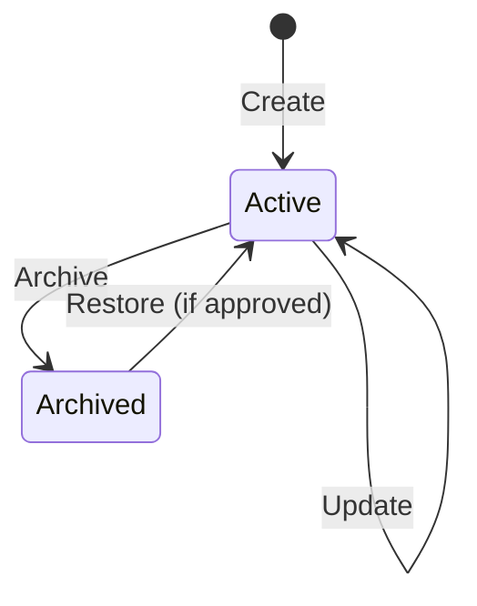

# Kepnora — Property Management Feature Specification

**Target:** `docs/features/property-management.md`  
**Version:** 1.0-draft · **Date:** 2026-10-29  
**Scope:** Phase 1 MVP · **Status:** Implementation-ready product specification with explicitly identified open decisions.

**Canonical references:** `docs/architecture/database-overview.md` (the Kepnora database spec, originally at `docs/database-overview.md`), `docs/architecture/tenant-isolation.md`, `docs/features/asset-management.md`, `docs/api/api-contracts-master.md`, `docs/implementation/backend-project-structure.md`, `docs/implementation/mobile-project-structure.md`, `docs/testing/test-strategy.md`.

> **Invariant:** A property is an **optional organizational location** for assets. An asset may have `PropertyId = NULL` and remain fully usable. Property archive never cascades to archive/delete assets or maintenance history.

---
## 1. Purpose and user outcomes

Property Management lets a workspace organize assets by location: primary home, rental, commercial building or another location. A user can create a property, edit its details, view linked assets and archive it without destroying data.

**Success criteria:** Properties remain tenant-isolated; standalone assets work; the UI handles no-property workspaces; archiving never silently destroys relationships; backend validation matches the PostgreSQL schema.


## 2. MVP scope

| Included | Not included |
|---|---|
| List, create, detail, edit and archive | Real estate listings or valuation |
| Property type and optional address | Map/geocoding autocomplete requirement |
| Optional property timezone | Calendar sync |
| View and filter assets by property | Hierarchical buildings/rooms/floors |
| Move asset between properties / unassign | Automatic bulk reassignment on archive |
| Permission and tenant checks | Cross-workspace property sharing |
| Empty, loading, error, offline states | Automated utility/device integration |

Properties are optional: first-time onboarding **must not force** property creation before the user can add a vehicle or other standalone asset.


## 3. Canonical database contract

The Kepnora PostgreSQL schema defines:

```sql
CREATE TABLE "Properties"
(
    "Id" UUID NOT NULL,
    "TenantId" UUID NOT NULL,
    "Name" VARCHAR(160) NOT NULL,
    "PropertyType" VARCHAR(30) NOT NULL,
    "AddressLine1" VARCHAR(200) NULL,
    "AddressLine2" VARCHAR(200) NULL,
    "City" VARCHAR(120) NULL,
    "Region" VARCHAR(120) NULL,
    "PostalCode" VARCHAR(30) NULL,
    "CountryCode" VARCHAR(2) NULL,
    "TimeZoneId" VARCHAR(100) NULL,
    "IsArchived" BOOLEAN NOT NULL DEFAULT FALSE,
    "CreatedAt" TIMESTAMPTZ NOT NULL DEFAULT CURRENT_TIMESTAMP,
    "Version" BIGINT NOT NULL DEFAULT 1,
    CONSTRAINT "PK_Properties" PRIMARY KEY ("Id"),
    CONSTRAINT "UQ_Properties_TenantId_Id" UNIQUE ("TenantId", "Id"),
    CONSTRAINT "CK_Properties_Type"
      CHECK ("PropertyType" IN ('Home', 'Rental', 'Commercial', 'Other'))
);
CREATE INDEX "IX_Properties_TenantId_Active"
    ON "Properties" ("TenantId", "Name")
    WHERE "IsArchived" = FALSE;
```

This is the canonical current shape. Do **not** add coordinates, photos, rooms, descriptions, or owner IDs as persisted fields without an ADR and migration.


## 4. Field specification

| Field | Required | Validation / behavior |
|---|---|---|
| `Id` | Server | UUID; immutable |
| `TenantId` | Server | ABP TenantId; immutable |
| `Name` | Yes | Trim; nonblank; max 160 chars |
| `PropertyType` | Yes | `Home`, `Rental`, `Commercial`, `Other` |
| `AddressLine1` | No | Max 200 |
| `AddressLine2` | No | Max 200 |
| `City` | No | Max 120 |
| `Region` | No | Max 120 |
| `PostalCode` | No | Max 30 |
| `CountryCode` | No | Two-character ISO country code if supplied |
| `TimeZoneId` | No | Valid approved IANA timezone string, max 100 |
| `IsArchived` | Server/action | Defaults false |
| `CreatedAt` | Server | UTC |
| `Version` | Server | Starts 1, increments on edits |

Do not require US-specific state/ZIP format globally. Decide whether blank optional strings normalize to null; recommended yes.


## 5. Property types

`Home`: owner/household residential location. `Rental`: property managed as a rental. `Commercial`: commercial location. `Other`: location that does not match the first three.

These are classification labels, **not** permissions or billing categories. Type changes should not alter existing assets or maintenance schedules.


## 6. User stories

- As a workspace Owner/Member with manage permission, I can create a property.
- As a member with read permission, I can browse properties and see linked assets.
- As a member, I can create an asset without assigning a property.
- As an authorized editor, I can move an asset to another property in the same workspace.
- As an authorized editor, I can remove an asset's property assignment.
- As an authorized editor, I can archive a property without losing linked assets.
- As a member of workspace A, I cannot access or reference properties in workspace B.
- As a user, I see meaningful loading/empty/offline/validation states.


## 7. Permissions and roles

All operations require a valid global user, active `TenantMembers` membership and named permission for the requested action. `ICurrentTenant` and ABP data filters do not prove authorization.

| Action | Suggested permission |
|---|---|
| List/detail | `Kepnora.Properties.Read` |
| Create/update/archive | `Kepnora.Properties.Manage` |
| List linked assets | `Kepnora.Assets.Read` plus property read |
| Reassign asset | `Kepnora.Assets.Manage` plus property visibility |

Permission names are proposed and must match ABP PermissionDefinitionProvider after M0. Owner/Member grants are a policy decision, not an automatic consequence of their labels.


## 8. Tenant isolation rules

1. Resolve workspace path ID to the authoritative ABP tenant.
2. Validate active membership and named permission.
3. Enter tenant scope and query by `TenantId` **and** `Id`.
4. Reject cross-tenant property references on asset create/update.
5. Preserve tenant-aware composite FK from `Assets(TenantId, PropertyId)` to `Properties(TenantId, Id)` as specified in canonical schema.
6. Treat foreign property IDs as neutral not-found/validation without leaking their existence.
7. Worker jobs must re-establish tenant context per job and never cache a property entity across tenants.


## 9. Property lifecycle



`IsArchived` is the persisted flag; **Restore** is not a committed Phase 1 API unless approved. No separate property lifecycle table is required. Hard delete is out of normal MVP user workflows.


## 10. Create flow

1. User enters Properties tab/list and selects Add Property.
2. Form requires name and type; address and timezone optional.
3. Client validates with Zod for immediate feedback.
4. API independently validates fields and permission.
5. Server inserts tenant-owned property with `Version = 1`.
6. Return created DTO and update property list cache.
7. Navigate to detail or list according to approved UX.

If user loses network after submit, avoid assuming failure; refresh list before retry. Idempotency key is recommended if the API supports durable create idempotency.


## 11. Update flow

Open edit form with current `Version`. On save, submit changed fields plus `expectedVersion` (or `If-Match` if chosen globally). Backend checks membership, permission and version before update. Increment `Version` once on successful edit.

On 409, show a conflict message and allow refresh/reapply changes; never silently overwrite a concurrent edit. Normalize optional strings and ensure all property fields are editable only if allowed by policy.


## 12. Archive flow and linked assets

Archiving changes `Properties.IsArchived = TRUE`; it **does not** archive or delete linked assets, maintenance rules, occurrences, records, odometer readings or documents.

The UI must show a confirmation, including linked asset count where available, explaining that assets remain accessible. An archived property's assets still have the historical `PropertyId` unless a separate explicit reassignment is performed.

**Open decision:** whether active assets remain grouped under an Archived label or display an Archived property badge in asset detail. Either approach must preserve referential integrity.


## 13. No-property and standalone asset flow

The asset create/edit form includes an optional property picker with a visible **No property** choice. `propertyId: null` is valid and must not be converted to an arbitrary default property. Dashboard, search, maintenance and document workflows must work with standalone assets.

A workspace with zero properties should display a helpful empty state and allow users to proceed directly to assets.


## 14. Reassigning assets

When selecting a new property, backend checks that the target is active, belongs to the same tenant and the actor can manage the asset. Clearing assignment sets `PropertyId = NULL`.

Do not perform a bulk reassignment automatically during archive. If bulk reassignment is added later, design bounded, audited, idempotent operations with conflict handling.


## 15. List and filter semantics

**Proposed route:** `GET /api/v1/workspaces/{workspaceId}/properties?includeArchived=false&limit=20&cursor=...`

Default list includes active properties only, sorted by normalized name then ID. Archive filter is explicit. Use tenant-scoped pagination; cap page size (proposed 100). Search by property name and optionally city/address according to privacy/UX policy.

Property list counts must use tenant-filtered assets. Avoid N+1 count queries by projecting aggregates.


## 16. Detail view

Show property name, type, address (only supplied fields), timezone when present, number of associated assets, and linked asset preview. Do not show a fake map marker when no coordinates/geocoding exists.

Provide Edit, Archive and View Assets actions only when authorized. If property is archived, show archived status and avoid implying linked assets are deleted.


## 17. Create/edit screen specifications

**Fields:** Name (required), Type (required select), Address line 1/2, City, Region, Postal Code, Country Code, Timezone (optional). Group optional address fields in a collapsible/clear section for mobile readability.

**States:** pristine, dirty, client validation, server validation, submitting, success, conflict, offline, permission denied. Prevent accidental double submits while preserving safe retry. Keyboard, screen reader labels, tap target sizes and error summaries follow design system.


## 18. List screen specifications

Top: title and Add Property action (when authorized). Body: search/filter, property cards with name, type, optional city/region and asset count. Empty state distinguishes zero properties from filtered-no-results. Loading uses skeletons; error state provides retry. Archived properties are hidden by default but reachable through an explicit filter.


## 19. Property picker for assets

Display active properties within current workspace only, plus `No property`. Search by name for larger workspaces. After workspace switch, clear picker options from prior tenant immediately and cancel/ignore stale requests.

If an asset references an archived property, render its label with Archived indicator but do not offer that property for **new** assignments unless explicitly approved.


## 20. Proposed API endpoints

All paths are **proposed**, not guaranteed ABP conventional-controller routes. Final truth is generated OpenAPI.

| Method | Route | Behavior |
|---|---|---|
| GET | `/api/v1/workspaces/{workspaceId}/properties` | List |
| POST | `/api/v1/workspaces/{workspaceId}/properties` | Create |
| GET | `/api/v1/workspaces/{workspaceId}/properties/{propertyId}` | Detail |
| PATCH | `/api/v1/workspaces/{workspaceId}/properties/{propertyId}` | Edit |
| POST | `/api/v1/workspaces/{workspaceId}/properties/{propertyId}/archive` | Archive |
| GET | `/api/v1/workspaces/{workspaceId}/properties/{propertyId}/assets` | Related assets |

Asset property reassignment is through the asset update contract, not a competing property endpoint.


## 21. Create request example

```json
{
  "name": "Primary Residence",
  "propertyType": "Home",
  "addressLine1": "123 Example Lane",
  "addressLine2": null,
  "city": "Sample City",
  "region": "TX",
  "postalCode": "00000",
  "countryCode": "US",
  "timeZoneId": "America/Chicago"
}
```

`tenantId`, `id`, `isArchived`, `createdAt`, `version` are server-owned and ignored/rejected if supplied by clients. Example address is fictional.


## 22. Response example

```json
{
  "id": "5f5f55e0-bf5e-45e1-b4b8-a6f1153f74a3",
  "name": "Primary Residence",
  "propertyType": "Home",
  "addressLine1": "123 Example Lane",
  "addressLine2": null,
  "city": "Sample City",
  "region": "TX",
  "postalCode": "00000",
  "countryCode": "US",
  "timeZoneId": "America/Chicago",
  "isArchived": false,
  "createdAt": "2026-10-29T18:00:00Z",
  "version": 1,
  "assetCount": 3
}
```

`assetCount` is a computed read projection, **not** a persisted column. Decide whether every endpoint returns it or only list/detail views.


## 23. Update and archive requests

```json
{
  "name": "Main House",
  "propertyType": "Home",
  "timeZoneId": "America/Chicago",
  "expectedVersion": 1
}
```

PATCH semantics (omitted = unchanged, explicit null = clear) must be implemented consistently. For archive:

```json
{
  "expectedVersion": 2
}
```

If API-wide concurrency uses `If-Match`, remove `expectedVersion` from DTOs and document ETag behavior instead. Never support both inconsistently.


## 24. Validation and error responses

| Condition | Expected |
|---|---|
| Blank name | 422 field validation |
| Name >160 chars | 422 |
| Unsupported type | 422 |
| Invalid country code/timezone | 422 |
| Foreign tenant property | 404 neutral |
| Inactive membership | 403/404 per security policy |
| Missing token | 401 |
| Stale version | 409 or 412 per contract |
| Archived property edit | 409 unless explicitly allowed |
| DB outage | 503 or mapped 500 with safe error |
| Rate limit | 429 |

Use the API master error envelope. Do not expose SQL exception details or tenant IDs in user-facing messages.


## 25. Time zone behavior

`TimeZoneId` is optional and uses IANA identifiers. For maintenance tied to a property, timezone precedence must be decided explicitly (e.g., rule timezone → property timezone → workspace default). The property module itself must not reschedule existing maintenance occurrences when timezone changes unless the scheduling engine has an approved recalculation policy.

DST boundaries and timezone edits are regression cases.


## 26. Address behavior and privacy

All address fields are optional; no requirement to geocode or validate physical deliverability. Never expose addresses in unauthenticated search, logs or telemetry. Use user-supplied values only for display/grouping in Phase 1.

Do not infer property location from mobile GPS or account profile. Country-specific field labels can vary in the UI without changing database columns.


## 27. Database constraints and indexes

Canonical schema includes `UQ_Properties_TenantId_Id`, `CK_Properties_Type` and a partial active-name index. The property name is **not globally unique** and no per-tenant unique name constraint is currently defined. Allow duplicate names unless product policy changes.

Composite FKs from `Assets` must ensure property and asset belong to same tenant. Prefer indexes for tenant/name active lists and tenant/property asset filtering. Validate actual query plans before adding indexes.


## 28. ABP domain and application structure

```text
Kepnora.Domain/
  Properties/
    Property.cs
    IPropertyRepository.cs          # only if custom query needed
    PropertyManager.cs              # if invariants justify it
Kepnora.Application.Contracts/
  Properties/
    PropertyDto.cs
    CreatePropertyDto.cs
    UpdatePropertyDto.cs
    GetPropertiesInput.cs
Kepnora.Application/
  Properties/
    PropertyAppService.cs
Kepnora.EntityFrameworkCore/
  EntityConfigurations/
    PropertyConfiguration.cs
```

Names are illustrative. ABP repository interfaces and conventions should be used rather than reinventing generic CRUD infrastructure.


## 29. Application service pseudo-code

```csharp
public async Task<PropertyDto> CreateAsync(
    Guid workspaceId, CreatePropertyDto input, CancellationToken ct)
{
    var userId = await globalUserResolver.RequireUserIdAsync(ct);
    await access.RequirePermissionAsync(
        workspaceId, userId, "Kepnora.Properties.Manage", ct);

    // Tenant context must be established through the approved ABP resolver.
    var property = Property.Create(
        tenantId: workspaceId,
        name: input.Name.Trim(),
        type: input.PropertyType,
        address: MapAddress(input));

    await propertyRepository.InsertAsync(property, autoSave: true, ct);
    return mapper.Map<Property, PropertyDto>(property);
}
```

**Pseudocode, not compile-ready:** repository overload, `Property.Create`, resolver and permission names depend on the pinned ABP template. Validate `workspaceId` membership before setting tenant scope.


## 30. Mobile feature organization

```text
src/features/properties/
  api/
    propertyQueries.ts
    propertyMutations.ts
  components/
    PropertyCard.tsx
    PropertyForm.tsx
    PropertyPicker.tsx
  hooks/
    useProperties.ts
    useProperty.ts
  screens/
    PropertiesScreen.tsx
    PropertyDetailScreen.tsx
    EditPropertyScreen.tsx
  validation/
    propertySchema.ts
```

Keep routing files in Expo Router `app/`, feature logic in `src/features/properties`, API types generated from OpenAPI and server state in TanStack Query.


## 31. TanStack Query cache isolation

All tenant-owned query keys must contain workspace ID, e.g.:

```ts
const propertyKeys = {
  list: (workspaceId: string, filters: PropertyFilters) =>
    ['workspace', workspaceId, 'properties', 'list', filters] as const,
  detail: (workspaceId: string, propertyId: string) =>
    ['workspace', workspaceId, 'properties', 'detail', propertyId] as const,
};
```

On workspace switch, cancel in-flight requests, clear/partition previous workspace data, and guard against stale responses. Zustand stores active workspace/UI state; TanStack Query owns server data.


## 32. Mutation and cache invalidation

After create/update/archive invalidate property list/detail, related asset pickers, asset counts and dashboard aggregates in the active workspace. Reassignment invalidates both source/target property asset counts and asset detail.

Avoid optimistic archive if it could obscure linked assets or fail due to permissions; prefer server confirmation. Retry ambiguous create requests only with durable idempotency or a refresh-first strategy.


## 33. Offline and network behavior

Read-only cached property details may display when offline if cache is tenant-partitioned and the app has a documented sensitive-data policy. Property writes require online connectivity in Phase 1; do not silently queue offline mutations unless conflict/idempotency semantics are designed.

Show a clear offline banner and retry. Never display property/address data from a previous workspace after switching.


## 34. Accessibility and localization

Form controls need labels, required indicators and accessible validation summaries. Property cards should expose name, type and archive state to screen readers. Avoid icon-only archive actions. Address formatting must not assume US-only order.

Use user-facing strings in localization resources. Persist `PropertyType` canonical enum values independent of translated labels.


## 35. Search and dashboard integration

Property counts come from tenant-scoped active rows; archived properties excluded by default. Search returns property name and approved location summary, not sensitive full addresses by default. Asset counts include only authorized tenant-owned assets.

When a property is archived, dashboard asset totals remain unchanged because assets are not automatically archived.


## 36. Maintenance integration

Maintenance belongs to assets, not directly to properties in the current MVP model. Reassigning or archiving a property must not delete or complete maintenance occurrences.

If property timezone is used as fallback, changing property timezone may affect **future derived schedule behavior**; requires an explicit engine policy and regression tests. No automatic mileage changes result from property operations.


## 37. Documents integration

The canonical document ownership model must determine whether documents can attach directly to properties or only to assets/maintenance records. Do not invent a new polymorphic `PropertyId` column on `Documents` without checking the database spec.

If property documents are unsupported in the current schema, property detail must not show an upload button that cannot persist correctly.


## 38. Audit and observability

Audit property create/edit/archive, actor global user ID, tenant ID, property ID, safe changed-field names and result. Do not log full addresses by default. Use correlation IDs to trace mobile request → API → database.

Track 401/403/404/409/422 rates, list latency and failed mutation retries. Audit log retention must follow privacy policy.


## 39. Security and race scenarios

- Workspace A user submits workspace B property ID: deny.
- Revoked member with valid JWT: deny.
- Concurrent updates with same version: one succeeds, other conflicts.
- Asset reassigned while property archived: transaction/validation prevents invalid new assignment.
- Archive while asset create targets property: policy must be deterministic.
- User switches workspace during property fetch: stale response never rendered.
- Malformed address/long text: validated, no injection.
- Attempt to update `TenantId`, `Id`, `CreatedAt`: ignored/rejected.
- Archived property does not cascade to maintenance or history.


## 40. Unit test matrix

| ID | Scenario | Expected |
|---|---|---|
| PROP-U01 | Trim name | Normalized |
| PROP-U02 | Blank name | Invalid |
| PROP-U03 | 160-char name | Valid |
| PROP-U04 | 161-char name | Invalid |
| PROP-U05 | Valid types | Accepted |
| PROP-U06 | Unknown type | Rejected |
| PROP-U07 | Country code length | Validated |
| PROP-U08 | Optional address omitted | Null |
| PROP-U09 | Invalid timezone | Rejected |
| PROP-U10 | Archive active property | Archived |
| PROP-U11 | Archive does not delete assets | Preserved |
| PROP-U12 | No property asset | Allowed |
| PROP-U13 | Update stale version | Conflict |
| PROP-U14 | Archived property picker | Excluded |
| PROP-U15 | Duplicate property names | Allowed by current schema |


## 41. Integration and E2E test matrix

| ID | Scenario | Expected |
|---|---|---|
| PROP-I01 | Create under tenant A | TenantId=A |
| PROP-I02 | List A | No B rows |
| PROP-I03 | Read B ID under A | Neutral denial |
| PROP-I04 | Create asset with B property | FK/application denial |
| PROP-I05 | Create asset with null property | Success |
| PROP-I06 | Archive with linked assets | Assets preserved |
| PROP-I07 | Concurrent update | Version enforced |
| PROP-I08 | Last property archived | Assets remain |
| PROP-I09 | Non-member reads property | Denied |
| PROP-I10 | Member lacks manage permission | Write denied |
| PROP-I11 | Workspace switch while fetch pending | No stale A data |
| PROP-I12 | Property form offline | Safe message |
| PROP-I13 | Property picker active only | Correct |
| PROP-I14 | Asset reassignment across tenant | Denied |
| PROP-I15 | Dashboard after archive | Asset count unchanged |
| PROP-I16 | Search archived property | Excluded by default |
| PROP-I17 | DB migration schema | Matches canonical |
| PROP-I18 | Pagination | Stable/tenant-scoped |
| PROP-I19 | Audit redaction | No raw address |
| PROP-I20 | Update archived property | Defined conflict policy |


## 42. Acceptance criteria

1. A member with proper permission can create, edit and archive properties.
2. Property name/type required; optional address/timezone validated.
3. No property is required to create or maintain an asset.
4. Asset can move between same-tenant active properties or become standalone.
5. Cross-tenant references are denied at app and DB boundaries.
6. Archive preserves assets, maintenance and history.
7. Mobile list, detail, form and picker handle all states.
8. OpenAPI and generated TypeScript client match backend.
9. Real PostgreSQL tests verify constraints and concurrency.
10. Permission and audit tests pass for multiple workspaces.


## 43. Open decisions

1. Restore archived properties in MVP or defer?
2. Can an archived property be edited?
3. Should active assets referencing archived properties display a special group?
4. Is country code validated strictly against ISO-3166-1 alpha-2?
5. Which IANA timezone fallback precedence is authoritative?
6. Can properties have identical names? Current schema permits duplicates.
7. Should list/detail include computed `assetCount`?
8. Do property attachments exist in canonical `Documents` model?
9. Is archive blocked during active asset assignment transactions or handled with explicit checks?
10. Does update use `expectedVersion` or HTTP `If-Match`?
11. Are optional empty strings normalized to null?
12. Is property creation part of onboarding or optional from day one? Recommended optional.

Decisions requiring schema changes must be recorded in ADRs before migration.


## 44. Milestone plan

| Milestone | Work |
|---|---|
| M0 | Confirm ABP identity, tenant resolver, PostgreSQL mappings |
| M1 | Workspace membership/permission infrastructure |
| M2 | Property entity, migration, AppService, mobile list/form/detail |
| M3 | Optional property picker and asset reassignment |
| M4 | Verify maintenance unaffected by property archive |
| M5 | Validate property document ownership only if supported |
| M7 | Dashboard/search counts and archive filters |
| M8 | Cross-tenant, concurrency, performance, offline E2E |


## 45. Definition of Done

- [ ] Canonical `Properties` schema implemented without invented columns.
- [ ] Workspace equals ABP Tenant and active membership is enforced.
- [ ] Property create/list/detail/update/archive work.
- [ ] `PropertyType` accepts only Home/Rental/Commercial/Other.
- [ ] Name and address lengths enforced in API and DB.
- [ ] `Version` conflict behavior tested.
- [ ] Standalone assets work with `PropertyId = NULL`.
- [ ] Same-tenant composite FK prevents foreign property assignment.
- [ ] Archive preserves assets and history.
- [ ] Mobile cache is workspace-partitioned.
- [ ] All list/form states and accessibility tested.
- [ ] OpenAPI and TypeScript client synchronized.
- [ ] PROP-U01–U15 and PROP-I01–I20 pass or have tracked exceptions.
- [ ] Open decisions affecting behavior resolved before release.


## 46. Final implementation principle

**Property is an optional grouping boundary, not an ownership or lifecycle boundary for assets.** Keep tenant isolation and historical integrity intact; let users manage cars, electronics and other standalone assets without inventing a property.

