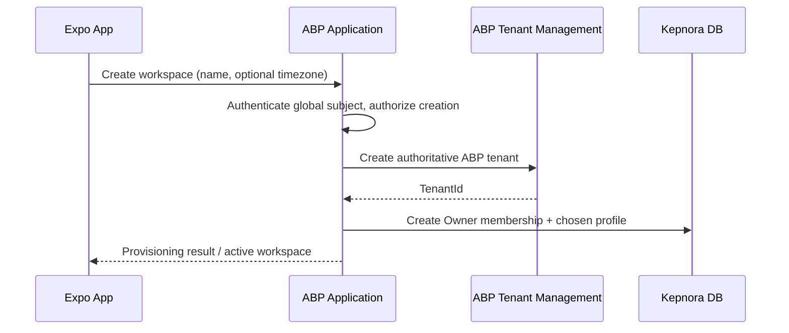

# Kepnora — Workspace & Settings Feature Specification

**Intended path:** `docs/features/workspace-settings.md`  
**Version:** 1.0-draft · **Date:** 2026-10-29  
**Scope:** Phase 1 (M0, M1, M6, M7, M8) · **Status:** Proposed implementation contract

**Source of truth:** `docs/database-overview.md`, `docs/mvp-build-order.md`, `docs/architecture/authentication-authorization.md`, `docs/architecture/tenant-isolation.md`, `docs/architecture/api-design.md`, `docs/architecture/mobile-app-architecture.md`, `docs/ui/screen-specifications.md`, and `docs/features/notification-reminders.md`.

---

**Key distinction:** A Kepnora **workspace is one ABP Tenant**. `TenantMembers` records global-user membership; it is **not** a second tenant registry. A user's global identity is distinct from the role and preferences associated with each workspace. Global identity and multi-tenant role behavior require the M0 proof of concept.

## 1. Goals and scope

Provide secure workspace creation and switching, Owner/Member administration, account profile, workspace display name and timezone, notification preferences, device registration, and safe sign-out. Keep the interface mobile-first, predictable, accessible and consistent with the premium design system.

**Not Phase 1:** paid subscriptions, public provider profiles, service bookings, payment settings, tenant billing, organization hierarchy, arbitrary custom role builder, or unsupported invitations.


## 2. Authoritative model and ownership

| Concept | Owner | Tenant-scoped? |
|---|---|---|
| Global login identity | Chosen global identity/OpenIddict architecture | No |
| Workspace registry | ABP Tenant Management | Authoritative tenant ID |
| Membership | `TenantMembers` | Yes, composite `(TenantId, UserId)` |
| Workspace display preferences | ABP tenant extension **or** `WorkspaceProfiles` | Yes |
| Notification preferences | `NotificationPreferences` | Yes, `(TenantId, UserId)` |
| Push device | `DeviceRegistrations` | Global user |
| Asset/property/maintenance | Feature modules | Yes |
| UI selected workspace | Mobile session/UI state | Must revalidate |

Do not create an independent `Workspaces` or `Tenants` registry. Do not duplicate workspace display name/timezone across an ABP extension and `WorkspaceProfiles`.


## 3. M0 identity gate

Before M1, prove that one authenticated global subject can be an **Owner** in workspace X and a **Member** in workspace Y, using the selected ABP/.NET 10 identity configuration. Verify that changing tenant context cannot grant a role from another workspace. Pin the actual global user table/key and tenant resolver.

The database spec intentionally does **not** define an executable FK from `TenantMembers.UserId` until this decision is made. Production migrations must add the correct FK rather than leaving an unverified placeholder.


## 4. Canonical TenantMembers schema

```sql
CREATE TABLE "TenantMembers"
(
    "TenantId" UUID NOT NULL,
    "UserId" UUID NOT NULL,
    "Role" VARCHAR(20) NOT NULL,
    "Status" VARCHAR(20) NOT NULL,
    "JoinedAt" TIMESTAMPTZ NOT NULL DEFAULT CURRENT_TIMESTAMP,
    "RemovedAt" TIMESTAMPTZ NULL,
    "Version" BIGINT NOT NULL DEFAULT 1,
    CONSTRAINT "PK_TenantMembers" PRIMARY KEY ("TenantId", "UserId"),
    CONSTRAINT "CK_TenantMembers_Role"
        CHECK ("Role" IN ('Owner', 'Member')),
    CONSTRAINT "CK_TenantMembers_Status"
        CHECK ("Status" IN ('Active', 'Invited', 'Removed')),
    CONSTRAINT "CK_TenantMembers_Removal"
        CHECK (
            ("Status" = 'Removed' AND "RemovedAt" IS NOT NULL)
            OR ("Status" <> 'Removed' AND "RemovedAt" IS NULL)
        )
);
```

Canonical schema excerpt. `Invited` is a **status value**, not proof that a complete invitation delivery/acceptance workflow is approved for Phase 1. Add the verified ABP tenant FK and global-user FK after M0.


## 5. Membership semantics

| Status | Meaning | Access |
|---|---|---|
| Active | Current member | Subject to named permission |
| Invited | Invitation pending, if implemented | No ordinary workspace access |
| Removed | Membership revoked | No workspace access |

`Role` is `Owner` or `Member`. A role must be interpreted **inside the selected tenant**, not as a global JWT authority. Active membership is necessary but not sufficient for every operation: verify the named permission too.


## 6. Owner and Member permissions

| Action | Owner | Member |
|---|---|---|
| View workspace and own authorized resources | Yes | Per assigned permission |
| Create/edit assets | Yes | Per assigned permission |
| Complete maintenance | Yes | Per assigned permission |
| View workspace member list | Yes | Only if expressly permitted |
| Add/remove members | Yes | No by default |
| Change member role | Yes, with last-owner guard | No |
| Rename workspace | Yes | No by default |
| Change workspace default timezone | Yes | No by default |
| Change own notification preferences | Yes | Yes |
| Switch among own active workspaces | Yes | Yes |
| Sign out | Yes | Yes |

This is a proposed permission matrix aligned with the M1 acceptance criteria. Pin actual ABP permission names and grants in the authorization document; do not rely on button visibility.


## 7. Last active Owner protection

Never allow a transaction to leave a workspace with zero **active** Owners. This includes demotion, removal, self-removal and concurrent requests from two Owners.

```text
Begin transaction
  → authorize Owner + named management permission
  → lock or otherwise serialize relevant membership rows
  → count active Owners under the same tenant
  → reject if requested change would reduce count to zero
  → update membership role/status and Version
Commit
```

A read-count followed by an unguarded write is vulnerable to races. Use a proven PostgreSQL transaction/locking strategy and concurrency tests.


## 8. Workspace creation flow



Do **not** assume ABP tenant creation and Kepnora membership insert are atomic across independently managed module boundaries. Define a provisioning state machine, compensation and reconciliation worker if a single Unit of Work cannot cover both. Never expose a half-provisioned workspace as usable.


## 9. Workspace provisioning states

Recommended **application workflow states**, not a claim of existing DB columns:

| State | Meaning | Mobile behavior |
|---|---|---|
| Requested | Input accepted | Loading |
| TenantCreated | ABP tenant exists | Continue provisioning |
| MembershipCreated | Owner membership persisted | Continue profile setup |
| Ready | All required resources verified | Navigate Home |
| FailedRecoverable | Temporary failure | Retry/reconcile |
| FailedTerminal | Invalid or irrecoverable | Explain and support recovery |

Store state durably in an approved workflow/outbox mechanism if cross-module creation is not atomic. Repeated create requests need idempotency; do not create duplicate tenants on retry.


## 10. Workspace creation validation

Workspace display name is required, trimmed, nonblank, max 160 characters according to `WorkspaceProfiles.DisplayName`. Name uniqueness across all workspaces is **not** established by the canonical profile table; do not invent a global unique-name requirement. If the ABP tenant registry requires a separate unique technical name, define deterministic slug generation and collision handling.

Default timezone must be a valid supported timezone ID. If omitted, the canonical profile default is `UTC`; the UI may offer a user-friendly selection but must not silently assume device timezone is authoritative.


## 11. Workspace profile storage decision

The database overview offers **two mutually exclusive options**:

1. ABP tenant extension properties for workspace display preferences.
2. One-to-one `WorkspaceProfiles` table keyed by ABP tenant ID.

If option 2 is chosen, canonical columns are `TenantId`, `DisplayName`, `DefaultTimeZoneId`, `CreatedAt`, `UpdatedAt`. Add an FK to the actual ABP tenant table after verifying its generated physical schema. The team must select **one** option before migration work.


## 12. Workspace selection and switching

```text
Global session valid
  → List active memberships for global user
  → Show workspace names + tenant-specific role
  → User selects workspace
  → Revalidate active membership
  → Resolve tenant-scoped authorization context
  → Cancel/isolate old tenant requests
  → Clear old tenant visible state and navigation
  → Fetch new workspace Home
```

Do not retain previous workspace cards during loading or errors. Selecting a workspace is not authorization to read any arbitrary asset ID.


## 13. Workspace switch during in-flight mutations

| In-flight operation | Required behavior |
|---|---|
| Asset edit | Cancel before dispatch or bind to original tenant and suppress wrong-context UI |
| Maintenance completion | Never re-target request to newly selected workspace |
| S3 upload intent/PUT/finalize | Keep original tenant binding or cancel; do not finalize under new tenant |
| Search | Abort and discard old results |
| Dashboard refresh | Discard obsolete response |
| Notification deep link | Revalidate target workspace membership |

A global `selectedWorkspaceId` mutable variable must not be read late inside a mutation after its request was constructed. Capture and validate the original workspace ID.


## 14. Membership revocation

A removed membership must fail on the **next authorized request**, even if a mobile token, query cache or navigation state still claims the workspace is selected. Invalidate or clear sensitive cached workspace content. Existing push notifications and deep links are not authorization grants.

Membership status changes must increment `Version` for optimistic concurrency and produce an auditable event. Define whether rejoining reactivates the existing row or creates a separate audit event; the canonical primary key prevents duplicate `(TenantId, UserId)` rows.


## 15. Member management screens

**Members list:** name/identifier from authorized global profile, role, status, clear Owner/Member labels, loading and empty states, and controls only for permitted operations.

**Role edit:** confirmation, expected membership version, explicit last-owner safeguard, immediate refresh of effective permissions.

**Remove member:** explain loss of access, confirm, perform server transaction, invalidate membership caches and related notification eligibility.

**Invitations:** show invitation actions **only if** a complete Phase 1 backend invitation/acceptance/revocation contract has been approved. `Status='Invited'` alone does not justify a functioning invite button.


## 16. Invitation design — deferred option

If invitations are added, define: invitation identifier, target email/subject matching, expiration, token hashing, acceptance by authenticated global user, resend/revoke, idempotency, rate limiting, audit and ownership of delivery. The canonical `TenantMembers` table lacks token/expiry fields; implement a separate invitation entity/migration or external identity workflow after an ADR.

Do not insert an `Invited` membership tied to a fabricated global user ID. Do not assume an invited email is already a registered user.


## 17. Profile and account settings

Global profile may display authenticated identity information, verified email and account-level sign-out. Editing identity details must use the **selected global identity provider's supported API**; do not promise arbitrary email/password changes through tenant-scoped ABP endpoints.

Suggested Settings sections: Account, Current Workspace, Members (Owner), Notifications, Timezone/Units (as supported), Privacy/Help, Sign Out. Avoid exposing backend tenant IDs or internal claims as primary UI content.


## 18. Timezone semantics

`WorkspaceProfiles.DefaultTimeZoneId` defaults to `UTC` and is a fallback, not a universal override. Properties and maintenance rules may specify their own `TimeZoneId`. Establish a precedence policy, e.g. rule → property → workspace, but this remains an ADR decision.

Store instants as UTC timestamps and due dates as calendar dates. A timezone change must not silently rewrite historical `PerformedOn` dates or scheduled occurrence history. For reminders, explicitly resolve DST gaps/overlaps and quiet hours.


## 19. Units and locale

The canonical database schema stores odometer values and mileage intervals in **miles**. There is no confirmed `UnitPreference` column in `WorkspaceProfiles` or `TenantMembers`. A kilometers toggle is therefore **not an implemented persistent setting** without a storage/contract decision.

For MVP, use miles consistently or define a display-only preference with clear persistence ownership. If km is supported, convert explicitly with a documented rounding rule; do not relabel raw stored miles as km. Locale/date formatting may follow device preferences without altering stored values.


## 20. Canonical notification preferences

```sql
CREATE TABLE "NotificationPreferences"
(
    "TenantId" UUID NOT NULL,
    "UserId" UUID NOT NULL,
    "PushEnabled" BOOLEAN NOT NULL DEFAULT TRUE,
    "ReminderDaysBefore" INTEGER NOT NULL DEFAULT 7,
    "QuietHoursStart" TIME NULL,
    "QuietHoursEnd" TIME NULL,
    "UpdatedAt" TIMESTAMPTZ NOT NULL DEFAULT CURRENT_TIMESTAMP,
    CONSTRAINT "PK_NotificationPreferences"
        PRIMARY KEY ("TenantId", "UserId"),
    CONSTRAINT "FK_NotificationPreferences_Membership"
        FOREIGN KEY ("TenantId", "UserId")
        REFERENCES "TenantMembers" ("TenantId", "UserId"),
    CONSTRAINT "CK_NotificationPreferences_DaysBefore"
        CHECK ("ReminderDaysBefore" BETWEEN 0 AND 365)
);
```

Preferences are **per workspace membership**. Do not interpret `PushEnabled=TRUE` as proof that the OS has granted notification permission or that a push has been delivered.


## 21. Device registration ownership

`DeviceRegistrations` belongs to the global user because one device may serve several workspaces. Canonical fields: `Id`, `UserId`, `PushTokenHash`, encrypted token, platform (`iOS`/`Android`), `IsActive`, `LastSeenAt`.

Never store raw push tokens in logs. Token encryption/key rotation and retention require a security ADR. On sign-out or device revocation, deactivate the appropriate registration without accidentally disabling another user's device or other workspace membership.


## 22. Notification settings interaction

1. Load current workspace's `NotificationPreferences`.
2. Show push enabled state, reminder lead days (0–365) and optional quiet hours.
3. Explain OS permission separately from backend preference.
4. Request OS permission only at an appropriate user action.
5. Save with server validation and show success only after persistence.
6. Invalidate reminder planning where policy requires.
7. On workspace switch, load that workspace's independent preference record.

Quiet hours crossing midnight and timezone precedence must be defined before enabling the feature.


## 23. Proposed API operation inventory

| Operation | Scope | Authorization |
|---|---|---|
| `ListMyWorkspaces` | Global user | Authenticated |
| `CreateWorkspace` | Global user | Creation policy |
| `SelectWorkspace` | Global user → tenant | Active membership |
| `GetWorkspaceProfile` | Tenant | Active membership + read |
| `UpdateWorkspaceProfile` | Tenant | Owner + manage settings |
| `ListWorkspaceMembers` | Tenant | Owner/permission |
| `UpdateMemberRole` | Tenant | Owner + manage members |
| `RemoveMember` | Tenant | Owner + manage members |
| `GetMyProfile` | Global user | Authenticated |
| `GetNotificationPreferences` | Tenant/user | Own membership |
| `UpdateNotificationPreferences` | Tenant/user | Own membership |
| `RegisterPushDevice` | Global user | Authenticated |
| `DeactivatePushDevice` | Global user | Own device |
| `SignOut` | Global session | Authenticated/session flow |

Operation names are **proposed**. Do not invent concrete ABP route names; verify generated OpenAPI and the selected identity provider.


## 24. Proposed workspace DTOs

```csharp
public sealed record WorkspaceListItemDto(
    Guid TenantId,
    string DisplayName,
    string Role,
    string MembershipStatus);

public sealed record CreateWorkspaceInput(
    string DisplayName,
    string? DefaultTimeZoneId,
    Guid? ClientRequestId);

public sealed record UpdateWorkspaceProfileInput(
    string DisplayName,
    string DefaultTimeZoneId,
    long? ExpectedVersion);

public sealed record ChangeMemberRoleInput(
    Guid UserId,
    string Role,
    long ExpectedMembershipVersion);
```

These types are illustrative. `WorkspaceProfiles` currently has no `Version` column, so `ExpectedVersion` is **not supported by the canonical profile schema** unless a migration adds it. Use an alternative concurrency policy if no version is added.


## 25. Proposed notification DTOs

```csharp
public sealed record NotificationPreferencesDto(
    bool PushEnabled,
    int ReminderDaysBefore,
    TimeOnly? QuietHoursStart,
    TimeOnly? QuietHoursEnd);

public sealed record UpdateNotificationPreferencesInput(
    bool PushEnabled,
    int ReminderDaysBefore,
    TimeOnly? QuietHoursStart,
    TimeOnly? QuietHoursEnd);
```

Define JSON time serialization and validation with actual .NET/ABP version. The canonical preferences table does not include a concurrency version; use a documented last-write-wins policy or add a version field if conflicts matter.


## 26. Workspace security algorithm

```text
Authenticate global user
  ↓
Resolve ABP TenantId
  ↓
Load TenantMembers by (TenantId, GlobalUserId) from host-safe repository
  ↓
Require Status = Active
  ↓
Evaluate named permission for this workspace
  ↓
Enter authorized tenant data scope
  ↓
Perform operation using tenant-safe keys
```

Do not globally disable ABP tenant filters to implement membership lookup or cross-workspace search. The membership repository must be deliberately designed for global-safe access without exposing domain tables.


## 27. Role update transaction and concurrency

```sql
UPDATE "TenantMembers"
SET "Role" = @NewRole,
    "Version" = "Version" + 1
WHERE "TenantId" = @TenantId
  AND "UserId" = @UserId
  AND "Status" = 'Active'
  AND "Version" = @ExpectedVersion
RETURNING "Version";
```

**Important:** This SQL alone is insufficient for demoting the last Owner. Execute it only inside a transaction with a proven last-owner serialization strategy and authorization checks. If no row is returned, distinguish conflict/unavailable without leaking another tenant's member data.


## 28. Member removal transaction

1. Authenticate acting user and validate Owner/manage-members permission.
2. Lock target membership and coordinate last-owner check.
3. Require target active or handle idempotent already-removed state per policy.
4. Set `Status='Removed'`, `RemovedAt=UTC now`, increment `Version`.
5. Audit actor, target, workspace and reason category.
6. Commit; revoke effective access on subsequent requests.
7. Invalidate mobile membership list and suppress pending reminders for removed user.
8. Rejoining policy must be explicit; do not silently delete membership history.


## 29. Global session and sign-out

Use the chosen OIDC Authorization Code + PKCE flow. Tokens and sensitive session data belong in appropriate secure storage; do not place refresh tokens in Zustand or ordinary AsyncStorage.

On sign-out, attempt supported provider revocation/logout, clear local secure session, remove tenant-scoped caches and protected navigation history, and deactivate push registration as policy requires. Do not claim server-side token revocation succeeded if the endpoint was unreachable. Back navigation must not reveal previous private screens.


## 30. Deep-link and push behavior

A deep link can identify a workspace and resource, but cannot grant membership. Resolve global session, verify active membership in target workspace, switch safely if authorized, then authorize the target asset/maintenance/document. If the target workspace was removed, show a neutral unavailable message.

Do not include sensitive descriptions, private document URLs or push tokens in deep-link parameters.


## 31. Mobile Settings screen

Proposed premium hierarchy:

```text
Safe area / Settings
Account
  Profile summary
Workspace
  Current workspace selector
  Workspace name and timezone
  Members (Owner only)
Notifications
  Push toggle
  Reminder lead days
  Quiet hours
Preferences
  Date/locale presentation
  Units (only if persisted contract approved)
Support & privacy
Sign out
```

Use compact list rows, clear section headers and accessible controls. Never show a control that pretends to save an unimplemented preference.


## 32. Workspace picker screen

List only active memberships returned by authorized global lookup. Each card shows workspace display name, Owner/Member label and selected state. If no active memberships, show Create Workspace. If membership was revoked while selected, clear protected content and return to picker.

On first login, workspace resolution should be explicit; do not silently create a workspace unless onboarding requirements approve it.


## 33. Create workspace screen

Fields: display name, optional timezone (default UTC if omitted). Show a short explanation that the workspace groups assets and members; properties are optional within a workspace. Validate and submit once. On recoverable provisioning failure, show retry without creating duplicate tenants.

After the backend reports Ready, activate workspace and navigate to Home. Never treat the ABP tenant creation response alone as proof that Owner membership exists.


## 34. Members screen

Display authorized member identity, role and status. Provide Owner actions to change role/remove, with confirmation and error recovery. Do not expose an invitation CTA unless the invitation feature has a real implementation. Handle stale membership version with reload rather than silently overriding.

A member removed from the workspace should lose access on their next request even if the Members screen remains open on another device.


## 35. Notification preferences screen

Use form labels and validation for push enabled, reminder lead days and quiet hours. Show distinct indicators for **OS permission** and **server preference**. If OS permission is denied, explain how to open device settings; do not flip the backend preference without explicit user action.

If reminders are disabled, pending worker deliveries must recheck current preference before dispatch.


## 36. Query caching and workspace isolation

```ts
export const settingsKeys = {
  workspaces: (userId: string) =>
    ['global-user', userId, 'workspaces'] as const,
  profile: (workspaceId: string) =>
    ['workspaces', workspaceId, 'profile'] as const,
  members: (workspaceId: string) =>
    ['workspaces', workspaceId, 'members'] as const,
  notificationPreferences: (workspaceId: string, userId: string) =>
    ['workspaces', workspaceId, 'users', userId, 'notifications'] as const,
};
```

Global identity and device registration may be cached by authenticated user, not by workspace. Tenant preferences must never share a cache key across workspaces. On logout, clear both global and tenant-sensitive caches.


## 37. Validation and error matrix

| Condition | UX/API response |
|---|---|
| Missing authentication | 401/session flow |
| Non-member workspace | Deny; neutral message |
| Member attempts Owner action | 403 |
| Last Owner removal/demotion | Conflict/business rule error |
| Stale membership version | 409 + reload |
| Invalid timezone | Field validation |
| Blank/long workspace name | Field validation |
| Reminder days outside 0–365 | Field validation |
| Device permission denied | Explain OS setting |
| Workspace provisioning partial failure | Durable recovery, not duplicate tenant |
| Workspace switch during upload | Preserve origin or cancel |
| Token revocation unavailable | Clear local session, do not falsely claim remote revocation |
| Offline settings save | No false success |
| Invitation unimplemented | Hide/disable feature, no fake send |


## 38. Privacy and audit requirements

Audit workspace creation, profile changes, role changes, removals, reactivation, device registration changes and preference updates with actor, tenant, correlation ID and timestamp. Redact tokens, identity secrets and private profile fields from logs. Membership audit must remain available according to retention policy even after removal.

Global profile data should be disclosed only to users authorized to view it. Member lists must avoid exposing private identity-provider claims unnecessarily.


## 39. Performance and operational concerns

ListMyWorkspaces should use the active membership index (`UserId`, `TenantId`). Paginate member lists for large workspaces. Avoid fetching all tenant assets merely to show Settings. Use bounded retries for provisioning and notification updates. Monitor orphaned ABP tenants, missing Owner memberships, failed reconciliation and repeated role conflicts. Do not assume eventual consistency is safe without a user-visible provisioning state.


## 40. Test catalog — identity and membership

| ID | Scenario | Expected |
|---|---|---|
| WS-001 | Global user Owner X, Member Y | Correct tenant-specific permissions |
| WS-002 | Non-member requests X | Denied |
| WS-003 | Member attempts manage members | Denied |
| WS-004 | Owner lists members | Authorized |
| WS-005 | Remove last active Owner | Rejected transactionally |
| WS-006 | Demote last active Owner | Rejected transactionally |
| WS-007 | Concurrent Owners remove each other | One transaction rejected |
| WS-008 | Remove Member | Next request denied |
| WS-009 | Removed user holds stale token | Denied |
| WS-010 | Invited status attempts resource read | Denied |
| WS-011 | Stale role update Version | Conflict |
| WS-012 | Cross-tenant member ID | Denied/neutral not found |
| WS-013 | Rejoin after removal | Approved reactivation/audit policy |
| WS-014 | Global role claim says Owner X, request Y | No Owner escalation |
| WS-015 | Membership query without tenant domain filter disable | Correct secure behavior |
| WS-016 | Sign out + back navigation | Protected screens inaccessible |
| WS-017 | Auth session restored | Workspace revalidated |
| WS-018 | Invalid deep link workspace | Safe denial |
| WS-019 | Member removed while app open | Cache cleared on revalidation |
| WS-020 | Same global user on two devices | Consistent effective permissions |


## 41. Test catalog — workspace provisioning and switching

| ID | Scenario | Expected |
|---|---|---|
| WS-021 | Create workspace | ABP tenant + Owner membership + profile |
| WS-022 | Duplicate submit | No duplicate tenant |
| WS-023 | Tenant created, membership fails | Recoverable provisioning state |
| WS-024 | Profile creation fails | Reconciliation, no false Ready |
| WS-025 | Workspace name blank | Rejected |
| WS-026 | Workspace name >160 | Rejected |
| WS-027 | Invalid timezone | Rejected |
| WS-028 | No memberships | Create workspace CTA |
| WS-029 | Switch X→Y | No X data flashes |
| WS-030 | Switch during asset mutation | No retargeting to Y |
| WS-031 | Switch during S3 upload | Origin preserved or cancelled |
| WS-032 | Switch during Search | X results discarded |
| WS-033 | Switch while offline | Safe blocked/approved cached policy |
| WS-034 | Workspace deleted externally | Safe resolution |
| WS-035 | Owner renamed workspace | Updated picker label |
| WS-036 | Workspace default timezone changed | New reads follow approved precedence |
| WS-037 | Archived property exists | Workspace still usable |
| WS-038 | Standalone asset | No property prerequisite |
| WS-039 | ABP tenant FK migration | Validated physical schema |
| WS-040 | Global user FK migration | Validated M0 identity table |


## 42. Test catalog — preferences, devices and accessibility

| ID | Scenario | Expected |
|---|---|---|
| WS-041 | Preference differs in X/Y | Independent values |
| WS-042 | ReminderDaysBefore=0 | Accepted |
| WS-043 | ReminderDaysBefore=365 | Accepted |
| WS-044 | ReminderDaysBefore=366 | Rejected |
| WS-045 | Quiet hours cross midnight | Approved behavior |
| WS-046 | Push enabled, OS denied | Distinct states shown |
| WS-047 | User disables push | Pending reminder rechecked |
| WS-048 | Device token rotates | Safe replacement |
| WS-049 | Raw push token logging | Prohibited |
| WS-050 | Sign out | Secure session/cache cleanup |
| WS-051 | Remote revocation fails | No false success claim |
| WS-052 | Locale date formatting | Display only; no data mutation |
| WS-053 | Kilometers setting without schema | Not falsely persisted |
| WS-054 | VoiceOver/TalkBack | Clear labels and focus |
| WS-055 | Dynamic type 200% | Controls accessible |
| WS-056 | Dark mode | Contrast and semantic status |
| WS-057 | Offline preference update | No false success |
| WS-058 | Member list pagination | Stable and tenant-safe |
| WS-059 | Notification deep link after removal | Denied |
| WS-060 | Two-device concurrent role edit | Conflict-safe |


## 43. Implementation order

**M0:** Identity/ABP proof, global subject key, tenant resolver, membership-aware permission evaluation, FK ownership.

**M1:** Tenant provisioning, `TenantMembers`, Owner/Member matrix, last-owner guard, workspace picker/switch, secure cache boundaries.

**M6:** Global device registration, per-workspace notification preferences, OS permission UX and reminder eligibility integration.

**M7:** Profile, workspace display/timezone settings, Settings screens and preferences.

**M8:** Cross-tenant authorization, race conditions, provisioning recovery, security, accessibility and device beta QA.

Keep invitation workflow deferred unless it receives its own approved contract and milestone.


## 44. Open decisions and ADR checklist

1. Exact ABP edition/version and global identity implementation.
2. Authoritative global user table and foreign key.
3. ABP tenant registry physical schema and FK.
4. Workspace profile storage: ABP extension **or** `WorkspaceProfiles`.
5. Provisioning state persistence and compensation strategy.
6. Idempotency-key storage for CreateWorkspace.
7. Invitation scope, email delivery and acceptance design.
8. Rejoin/reactivation policy and membership audit retention.
9. Last-owner transaction locking strategy.
10. Named permission grants for Member.
11. Workspace timezone precedence, DST and quiet hours.
12. Whether units/locale are persisted and where.
13. Profile editing supported by chosen identity provider.
14. Device token encryption/key rotation/retention.
15. Concurrency strategy for workspace profile and notification preferences.
16. Workspace deletion/deactivation policy.
17. Session revocation/logout provider capabilities.
18. Final OpenAPI routes and DTO names.

Mark unresolved decisions explicitly; do not let AI coding agents silently choose a schema or security policy.


## 45. Definition of Done

- [ ] One global user can be Owner in X and Member in Y.
- [ ] ABP Tenant Management is the only workspace registry.
- [ ] `TenantMembers` enforces active membership and tenant-specific permissions.
- [ ] Last active Owner cannot be removed/demoted, including races.
- [ ] Workspace creation handles partial failure and retries safely.
- [ ] No duplicate workspace metadata storage is introduced.
- [ ] Workspace switching cannot leak prior-tenant content.
- [ ] Removed members fail on their next authorized request.
- [ ] Notification preferences remain per `(TenantId, UserId)`.
- [ ] Push devices remain global-user owned and tokens protected.
- [ ] Timezone and unit behavior follows approved policy.
- [ ] Unsupported invitations or account editing are not faked.
- [ ] Sign-out clears secure session and protected caches.
- [ ] WS-001 through WS-060 have automated tests or recorded QA evidence.
- [ ] Exact routes/permissions are verified against generated OpenAPI.


## 46. Final implementation principle

**Identity is global, membership is tenant-specific, and authorization is checked on every operation.** A polished workspace picker or settings screen must never conceal incomplete provisioning, stale permissions, unsupported preferences or cross-tenant data exposure.

