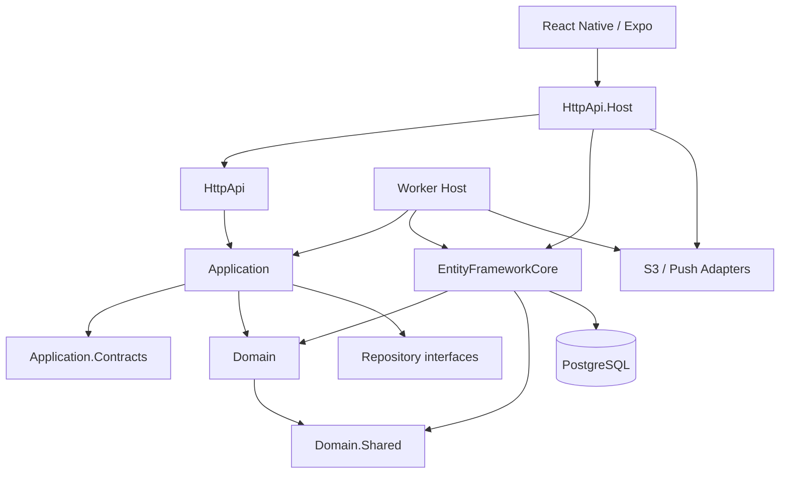

# Kepnora — Backend Project Structure & Implementation Architecture

**Target path:** `docs/implementation/backend-project-structure.md`  
**Version:** 1.0-draft · **Date:** 2026-10-29  
**Status:** Proposed backend blueprint; implementation names are illustrative until M0  
**Stack:** .NET 10, ASP.NET Core, ABP Framework, EF Core, PostgreSQL, AWS private S3, Expo Push

**Source alignment:** `docs/architecture-overview.md`, `docs/mvp-build-order.md`, `docs/architecture/database-overview.md`, `docs/architecture/tenant-isolation.md`, `docs/api/api-contracts-master.md`, `docs/features/*`, `docs/testing/test-strategy.md`, `docs/deployment/deployment-guide.md`. Earlier `docs/implementation/project-structure.md` described `Kepnora.Api`, `Kepnora.Application`, `Kepnora.Domain`, `Kepnora.Infrastructure`, and `Kepnora.Worker`. This document retains those **logical responsibilities** while recommending ABP-aligned physical projects.

> **M0 blocker:** Pin a compatible ABP/.NET 10 package set and prove global user identity with membership in multiple ABP tenants. Do not assume the default tenant-scoped ABP Identity implementation already satisfies this product requirement.

---

## 1. Objectives and non-goals

Build a testable modular monolith, not a collection of premature microservices. Keep domain rules separate from HTTP, EF Core, S3 and Expo. Make tenant security explicit in application services and durable jobs. Support code generation from verified OpenAPI.

**Non-goals for Phase 1:** booking/payments, provider marketplace, custom admin dashboard, distributed saga platform, CQRS infrastructure merely for its own sake, and custom replacement of ABP tenant registry.


## 2. Architecture at a glance



Dependency arrows are conceptual; actual references must be verified against the generated ABP solution. **Domain must not depend on HttpApi, EF Core, AWS SDK or Expo.**


## 3. Repository layout

```text
kepnora/
├── backend/
│   ├── Kepnora.sln
│   ├── Directory.Build.props
│   ├── Directory.Packages.props
│   ├── global.json
│   ├── src/
│   │   ├── Kepnora.Domain.Shared/
│   │   ├── Kepnora.Domain/
│   │   ├── Kepnora.Application.Contracts/
│   │   ├── Kepnora.Application/
│   │   ├── Kepnora.EntityFrameworkCore/
│   │   ├── Kepnora.HttpApi/
│   │   ├── Kepnora.HttpApi.Host/
│   │   ├── Kepnora.Worker/
│   │   └── Kepnora.DbMigrator/
│   └── tests/
│       ├── Kepnora.Domain.Tests/
│       ├── Kepnora.Application.Tests/
│       ├── Kepnora.EntityFrameworkCore.Tests/
│       ├── Kepnora.HttpApi.Tests/
│       ├── Kepnora.Contract.Tests/
│       └── Kepnora.Worker.Tests/
├── apps/mobile/
├── infra/
├── docs/
└── .github/workflows/
```

**Physical names are proposed.** If the pinned ABP template generates a different project set, adapt this layout rather than fighting the template. The previous `Kepnora.Infrastructure` logical responsibility is split into EF Core and adapters when useful; do not maintain duplicate persistence implementations.


## 4. Project responsibility matrix

| Project | Owns | Must not own |
|---|---|---|
| Domain.Shared | Enums, constants, shared error codes | EF mappings, API DTOs |
| Domain | Entities, aggregates, domain services, invariants, repository contracts | HTTP/S3/Expo clients |
| Application.Contracts | App service interfaces, input/output DTOs, permission names | EF entities |
| Application | ABP application services, orchestration, authorization, UoW boundaries | SQL migrations, HTTP controller plumbing |
| EntityFrameworkCore | DbContext, mappings, repositories, migrations | Domain recurrence policy |
| HttpApi | HTTP endpoints and OpenAPI annotations | Business logic |
| HttpApi.Host | Runtime bootstrap, middleware, auth, DI | Feature algorithms |
| Worker | Job hosting, durable dispatch, scheduling | Unscoped cross-tenant data reads |
| DbMigrator | Controlled migrations and initialization | Normal request handling |
| Tests | Unit/integration/contract/security checks | Production secrets |


## 5. Dependency constraints

- `Domain.Shared` is framework-light and contains stable cross-layer types.
- `Domain` depends on `Domain.Shared` and approved ABP domain abstractions.
- `Application.Contracts` depends on `Domain.Shared` plus required ABP contracts, **not** on EF Core.
- `Application` depends on contracts/domain and repository abstractions.
- `EntityFrameworkCore` implements persistence for domain abstractions.
- `HttpApi` delegates to application services.
- `HttpApi.Host` is the composition root.
- `Worker` composes application and persistence services with explicit tenant context.
- `DbMigrator` is deployment-only.

Enforce rules with architecture tests or project-reference validation. Avoid cyclic references and application-service-to-controller calls.


## 6. ABP module boundaries

Each project defines its ABP module class (`[DependsOn(...)]`) following the **actual generated template**. Configure conventional controllers, authorization, EF model contributors, validation, object mapping and distributed events in their appropriate modules.

Do not copy module dependencies from another ABP version without verifying them. Use ABP's native Tenant Management, Permission Management, audit logging and Unit of Work where applicable. Avoid a parallel `Tenants` table.


## 7. Feature module organization

```text
Kepnora.Domain/
  Workspaces/
  Properties/
  AssetTypes/
  Assets/
  Maintenance/
  Documents/
  Notifications/
  Operations/

Kepnora.Application/
  Workspaces/
  Properties/
  AssetTypes/
  Assets/
  Maintenance/
  Documents/
  Notifications/
  Dashboard/
  Search/

Kepnora.EntityFrameworkCore/
  EntityConfigurations/
  Repositories/
  Migrations/
```

Keep each feature's entities, repository abstractions, services and tests discoverable by name. A feature folder is a **logical module**, not a separately deployed microservice.


## 8. Domain entity conventions

Use GUID IDs according to the database contract and ABP conventions chosen in M0. Tenant-owned domain entities implement `IMultiTenant` and have non-null `TenantId` at the persistence boundary. Some ABP interfaces allow nullable tenant IDs for host data; explicitly reject null for Kepnora tenant-owned tables.

Prefer methods such as `Complete(...)`, `Archive(...)`, `PublishVersion(...)` that protect invariants over arbitrary public setters. Add concurrency stamps or numeric versions **only where canonical schema and ADR support them**.


## 9. Tenant and global identity model

One workspace is one ABP Tenant. `TenantMembers` maps the authenticated **global** user subject to tenants with `Owner`/`Member` and `Active`/`Invited`/`Removed` states.

**M0 POC:** Prove the chosen ABP Identity/OpenIddict configuration can resolve the same subject across two tenants, including roles, refresh, logout and membership revocation. If default ABP identity is tenant-local, document the necessary customization before M1. Never infer global membership from `ICurrentTenant` alone.


## 10. Tenant authorization pipeline

```text
Bearer token validated
  → Resolve global user ID
  → Resolve requested ABP TenantId from approved route/resolver
  → Read TenantMembers for (TenantId, UserId) through safe membership service
  → Require Active
  → Check named permission
  → Enter tenant-scoped domain operation
  → Verify all resource and parent TenantIds
```

For non-members, return a neutral denial; avoid leaking whether a foreign asset exists. Tenant filters are **defense in depth**, not the authorization decision.


## 11. Membership service interface

```csharp
public interface IWorkspaceAccessService
{
    Task RequireActiveMemberAsync(
        Guid tenantId, Guid globalUserId, CancellationToken ct);

    Task RequirePermissionAsync(
        Guid tenantId, Guid globalUserId,
        string permissionName, CancellationToken ct);
}
```

This is a conceptual boundary. Implementation must not disable ABP tenant filters globally. Use an audited host-safe membership lookup and ensure the `UserId` maps to the M0-selected global identity store.


## 12. ABP permission definition and grants

Define named permissions for properties, assets, types, maintenance, documents, workspace management, dashboard and search. Owner and Member are **tenant-specific membership roles**, not necessarily ABP's global role claims. Use a documented mapping from membership role to named permissions.

Enforce authorization in application services even if the HttpApi endpoint has `[Authorize]`. Test an Owner in tenant X who is Member in tenant Y and a revoked user holding a valid access token.


## 13. Workspace provisioning service

ABP Tenant Management is the authoritative registry. Create tenant, Owner membership and chosen workspace profile using a single UoW **only if** module transactions truly share the same database transaction. Otherwise use a durable provisioning state, idempotency key and reconciliation/compensation.

Do not return a Ready workspace until membership exists. Reject last active Owner demotion/removal transactionally, including concurrent requests. Invitation delivery is deferred until separately approved.


## 14. Property module

Property is a grouping/location for assets, not a prerequisite. `Asset.PropertyId` remains nullable. Implement create/list/update/archive and ownership checks. If a property is archived, do not silently delete linked assets, maintenance rules, documents or service history.

The dedicated property spec should pin address/timezone DTO fields and archive policy before implementation.


## 15. Asset types and versioned custom fields

Support global templates and tenant-defined asset types. Published schema versions are immutable; assets reference the version used to validate their JSONB custom fields. Never rewrite historic assets when a type's new version is published.

Implement server-side schema validation, allowed field types, required fields and version-aware serialization. Keep schema evolution and compatibility in a domain service, not in controller or mobile-only Zod validation.


## 16. Asset module

Support CRUD/archive, optional property, type-version validation and bounded listing/search. All reads/writes include tenant-scoped authorization. Use application DTOs, never return EF entities directly.

Do not create a custom asset repository abstraction for every trivial query if ABP's repository is sufficient; introduce dedicated read repositories for complex dashboard/search projections.


## 17. Maintenance domain structure

```text
Maintenance/
  MaintenanceRule.cs
  MaintenanceOccurrence.cs
  MaintenanceRecord.cs
  AssetOdometerReading.cs
  Scheduling/
    IScheduleCalculator.cs
    TimeScheduleCalculator.cs
    MileageScheduleCalculator.cs
    ScheduleKeyFactory.cs
  Services/
    MaintenanceCompletionManager.cs
```

Use actual names after aligning with the canonical database. The engine is deterministic and testable with an injected clock, timezone policy and **actual observed mileage only**. Persist occurrence lifecycle `Open`, `Completed`, `Skipped`, `Cancelled`; derive `Upcoming`, `Due`, `Overdue` and unknown mileage display.


## 18. Scheduling invariants

- `Time` and `Mileage` are supported schedule types; do not invent hybrid scheduling.
- Scheduled versus completion anchor must follow approved recurrence policy.
- Unique `(TenantId, RuleId, ScheduleKey)` prevents duplicate generated occurrences.
- No mileage interpolation or projection.
- No observed mileage means unknown, not zero.
- Date/timezone/DST behavior must be tested with a controllable clock.
- Schedule revision behavior and skip anchor policy are open ADR decisions.


## 19. Maintenance completion transaction

```text
Authorize membership + maintenance action
  → Load occurrence, rule, asset under same TenantId
  → Check Open + expected version
  → Insert one MaintenanceRecord
  → Set occurrence Completed
  → Persist actual mileage reading only when supplied/validated
  → Update completion anchor where applicable
  → Persist outbox event in same transaction
  → Commit
```

Enforce unique `(TenantId, OccurrenceId)` for scheduled history. Duplicate concurrent completion must produce one logical effect, even under retries. No network call to Expo or S3 inside this database transaction.


## 20. EF Core DbContext and entity mapping

Use ABP-integrated `KepnoraDbContext` or the generated equivalent. Map canonical PostgreSQL quoted PascalCase table/column identifiers explicitly where needed. Configure tenant-aware composite keys and FKs, check constraints, indexes, delete behaviors and JSONB mapping in `IEntityTypeConfiguration<T>` or ABP model builder extension.

```csharp
builder.Entity<Asset>(b =>
{
    b.ToTable("Assets");
    b.HasKey(x => x.Id);
    b.Property(x => x.TenantId).IsRequired();
    b.HasIndex(x => new { x.TenantId, x.PropertyId });
});
```

This snippet is illustrative, not a complete canonical mapping. `TenantId` must be present on all tenant-owned rows and related FKs must prevent cross-tenant associations.


## 21. Repository and query strategy

Use ABP repositories for standard aggregate access. For dashboard and search, use dedicated tenant-filtered read queries with projection to DTOs, keyset pagination and reviewed PostgreSQL indexes. Avoid loading full entity graphs just to count due items.

Do not expose `IQueryable` outside the persistence/application boundary to controllers. Use cancellation tokens and limit query results. For performance, compare `EXPLAIN (ANALYZE, BUFFERS)` and realistic data volumes.


## 22. Migration ownership

`Kepnora.EntityFrameworkCore` owns application migrations, while ABP modules contribute platform schema through their supported mechanisms. Use one dedicated `Kepnora.DbMigrator` entrypoint and **one migration task per environment**; do not run schema updates concurrently in API replicas.

Separate runtime DB credentials from migration credentials. Use expand/backfill/contract for breaking changes and validate schema against PostgreSQL, not SQL Server.


## 23. Transaction and Unit of Work boundaries

ABP application services may have automatic UoW semantics; verify the pinned ABP version and explicit transaction behavior. Domain entities should not begin database transactions. External calls are made after commit via durable outbox.

Use transaction boundaries around maintenance completion, member role changes, provisioning (when possible) and upload finalize metadata. Prefer short transactions with optimistic concurrency or deliberate row locking for last-owner checks.


## 24. Documents and S3 adapter

```csharp
public interface IPrivateObjectStorage
{
    Task<PresignedUploadResult> CreateUploadAsync(
        UploadRequest request, CancellationToken ct);
    Task<ObjectVerificationResult> VerifyUploadedObjectAsync(
        string objectKey, CancellationToken ct);
    Task<Uri> CreateDownloadUrlAsync(
        string objectKey, TimeSpan lifetime, CancellationToken ct);
}
```

The interface is illustrative. Use private S3, server-generated opaque keys, short-lived presigned URLs, and intent → PUT → verify → finalize. Store document metadata in PostgreSQL; orphan cleanup is a worker concern. Do not return permanent public URLs or log signed URLs.


## 25. Notification module

`DeviceRegistrations` belongs to the global user; `NotificationPreferences` belongs to `(TenantId, UserId)`. Push dispatch must recheck active membership, current preference, rule/occurrence state and device validity before sending.

Expo Push acceptance is not delivery confirmation. Implement bounded retries, invalid-token handling, provider receipts if supported, dead-letter and observability. Avoid leaking private maintenance content in lock-screen notifications.


## 26. Outbox and worker host

Choose **one** outbox implementation (ABP-supported or custom schema), not two for the same event stream. Worker responsibilities include occurrence generation, reminder dispatch, outbox retries, failed provisioning reconciliation and S3 orphan cleanup.

Workers must explicitly establish tenant context per job, dispose scopes between jobs, use bounded batches, honor cancellation and rely on idempotent database constraints. Never run an uncoordinated scheduler in every API replica.


## 27. Worker service composition

```text
Kepnora.Worker/
  Program.cs
  KepnoraWorkerModule.cs
  Jobs/
    GenerateMaintenanceOccurrencesJob.cs
    DispatchReminderJob.cs
    CleanupUploadIntentsJob.cs
    ReconcileWorkspaceProvisioningJob.cs
  Observability/
    WorkerHealthChecks.cs
```

File names are proposed. If the chosen ABP job provider already implements scheduling/retries, adapt these as handlers and avoid duplicating provider infrastructure.


## 28. Application service example

```csharp
public sealed class AssetAppService : ApplicationService
{
    private readonly IRepository<Asset, Guid> _assets;
    private readonly IWorkspaceAccessService _access;

    public AssetAppService(
        IRepository<Asset, Guid> assets,
        IWorkspaceAccessService access)
    {
        _assets = assets;
        _access = access;
    }

    public async Task<AssetDto> GetAsync(
        Guid workspaceId, Guid assetId, CancellationToken ct)
    {
        var userId = /* resolved global subject via M0 identity adapter */;
        await _access.RequirePermissionAsync(
            workspaceId, userId, "Kepnora.Assets.Read", ct);

        var asset = await _assets.FirstOrDefaultAsync(
            x => x.TenantId == workspaceId && x.Id == assetId, ct);

        if (asset is null)
            throw new EntityNotFoundException(typeof(Asset), assetId);

        return ObjectMapper.Map<Asset, AssetDto>(asset);
    }
}
```

**Pseudocode only:** `userId` resolution, repository overloads and ABP exception mapping must be adjusted to the pinned packages. The sample is not intended to compile unchanged.


## 29. Application DTOs and contracts

Keep request/response types in `Application.Contracts`, separate from EF entities. Use `CreateAssetDto`, `AssetDto`, `CompleteOccurrenceDto`, `MaintenanceOccurrenceDto`, `WorkspaceDto`, etc. Align exact names with `api-contracts-master.md` and generated OpenAPI.

Use JSON camelCase externally, explicit nullability and string enums with documented values. Do not invent persisted fields based on DTO examples. Keep error codes stable and mapped to mobile-readable messages.


## 30. HTTP API and host middleware

The HttpApi layer contains thin controllers or ABP conventional controller exposure. The Host configures authentication, authorization, forwarded headers, exception handling, validation, correlation IDs, rate limiting, OpenAPI and health checks.

The approved facade prefix is **proposed** `/api/v1`; verify real ABP-generated routes. Never use middleware alone as the only membership guard; application services and worker entrypoints need authorization-aware boundaries.


## 31. Error handling and observability

Map validation, missing membership, foreign resource, concurrency and dependency errors to the chosen Problem Details or ABP envelope. Redact tokens, S3 signed URLs, raw device tokens and private document contents.

Log correlation ID, safe tenant ID, operation name, duration and outcome. Track worker lag, duplicate conflicts, EF query latency and failed provisioning. Avoid high-cardinality private identifiers in metric labels.


## 32. Dependency injection and adapter boundaries

Register domain services as scoped/transient according to lifetime and state. DbContext/repositories are scoped. AWS SDK clients and `HttpClient` for Expo use managed factories/lifetimes; avoid new HTTP clients per request.

Define interfaces where they isolate external services or make domain tests deterministic. Avoid unnecessary generic repository wrappers, service locators and runtime reflection-driven module discovery.


## 33. Configuration and secrets

Use strongly typed options with startup validation. Keep environment-specific nonsecrets in approved configuration and secrets in AWS Secrets Manager or equivalent. Never commit `.env.production` or expose connection strings in mobile Expo public config.

Options examples: `S3StorageOptions`, `ExpoPushOptions`, `MaintenanceWorkerOptions`, `IdentityOptions`. Validate required region/bucket/issuer/audience and bounded worker batch sizes.


## 34. Testing project strategy

| Test project | Coverage |
|---|---|
| Domain.Tests | Scheduling, statuses, validation, clock/timezone |
| Application.Tests | Authorization, use-case orchestration, DTO mapping |
| EntityFrameworkCore.Tests | Real PostgreSQL, constraints, migrations, concurrency |
| HttpApi.Tests | Auth, OpenAPI, response/errors, cross-tenant |
| Contract.Tests | Snapshot/diff generated OpenAPI and TS client |
| Worker.Tests | Retry, crash, duplicate claims, tenant context |

Use Testcontainers or equivalent real PostgreSQL for DB tests. Mocks are suitable for S3/Expo adapters in unit tests, not for proving FK constraints or transaction races.


## 35. Security test gates

- Global user Owner X / Member Y: correct permissions in each.
- Valid JWT after membership revocation: denied.
- Foreign property/asset/type/occurrence/document ID: denied.
- Concurrent removal of last two Owners: at least one rejected.
- Concurrent completion of same occurrence: one history row.
- Two workers claim same outbox message: one logical effect.
- Upload intent authorized for X cannot finalize in Y.
- Tenant A worker job followed by B: no context leak.
- Workspace switch in mobile does not expose stale tenant cache.
- Global device token cannot be read or revoked by another user.


## 36. Build, formatting and dependency governance

Pin SDK in `global.json`, centrally manage package versions when compatible with ABP template, and commit lockfiles if chosen. Enable nullable reference types and analyzers, treat high-risk warnings as errors and use `.editorconfig`.

CI should restore, build, test, scan dependencies, run PostgreSQL integration tests, compare OpenAPI snapshots and publish immutable images. Do not upgrade ABP, EF Core or Npgsql independently without compatibility tests.


## 37. Suggested implementation sequence

**M0:** Scaffold approved ABP template, verify .NET 10, global identity POC, tenancy resolver, DB migration baseline and OpenAPI.

**M1:** Workspace provisioning, membership, permissions, last-owner guard and secure tenant switching.

**M2:** Properties and asset type definitions/versions.

**M3:** Assets, optional property, custom JSONB validation.

**M4:** Maintenance engine, deterministic occurrences, completion, history, actual mileage.

**M5:** S3 upload intents, finalize, document metadata and cleanup.

**M6:** Global devices, per-workspace notification preferences, durable push worker.

**M7:** Dashboard, search, settings and query tuning.

**M8:** Cross-tenant hardening, concurrency, recovery, load and beta release.


## 38. Common anti-patterns

| Anti-pattern | Preferred approach |
|---|---|
| Duplicate `Tenants` table | ABP Tenant Management |
| JWT role as sole authorization | Active TenantMembers + named permission |
| Controllers query DbContext directly | Thin HTTP → application service |
| Domain calls AWS S3/Expo | Port/adapter via application + worker |
| Migrations at every API startup | Dedicated DbMigrator |
| EF InMemory for FK race proof | Real PostgreSQL |
| Published JSON schema updated in place | Immutable versions |
| `Overdue` persisted as occurrence lifecycle | Derived display status |
| Mileage guessed from elapsed days | Observed readings only |
| Push sent inside DB transaction | Durable outbox |
| One scheduler per API replica | Coordinated worker |
| Parallel custom + ABP outbox | Choose one provider |
| Full tenant filter disabled for convenience | Scoped, audited membership lookup |
| Handwritten TS DTOs diverge | Generate from OpenAPI |


## 39. Open decisions and ADRs

1. Pinned ABP/.NET 10 and supported project template.
2. Global identity user table and tenant membership integration.
3. Actual physical project naming from scaffold.
4. Tenant resolver and workspace route strategy.
5. Permission definitions and Owner/Member mapping.
6. `WorkspaceProfiles` versus ABP tenant extension.
7. Outbox/job provider (ABP versus custom).
8. Repository approach for read projections.
9. Time/mileage recurrence first occurrence and revision semantics.
10. Odometer correction and skip anchor policy.
11. S3 encryption/checksum and upload size policy.
12. Error envelope and concurrency version contract.
13. Schema migration deployment method.
14. App/worker image split and AWS hosting platform.
15. OpenAPI generation and TS client tooling.
16. Identity profile editing and invitations scope.

Close M0-blocking decisions before generating a large codebase.


## 40. Definition of Done

- [ ] ABP/.NET 10 solution scaffolds and builds using pinned packages.
- [ ] Global user can belong to two ABP tenants with distinct roles.
- [ ] ABP Tenant Management is the only workspace registry.
- [ ] Dependencies follow the documented boundaries.
- [ ] All tenant-owned domain entities have non-null tenant ownership.
- [ ] Tenant membership + named permission guard every operation.
- [ ] PostgreSQL migrations match canonical schema and composite FKs.
- [ ] Asset.PropertyId is nullable.
- [ ] Published custom asset type versions are immutable.
- [ ] Maintenance completion is atomic/idempotent and no mileage is inferred.
- [ ] S3 private upload/finalize and orphan cleanup are reliable.
- [ ] One durable outbox provider is selected.
- [ ] Workers preserve tenant isolation and retry safely.
- [ ] OpenAPI is verified and mobile TS client is generated.
- [ ] Real PostgreSQL tests cover races and tenant boundaries.
- [ ] CI/CD, security scanning, health checks and observability are configured.
- [ ] All architecture decisions blocking implementation are recorded.


## 41. Implementation principle

**Build a modular monolith with clear boundaries, not unnecessary infrastructure.** ABP owns platform capabilities; Kepnora owns its product domain. The codebase must make tenant authorization, recurrence correctness, historical integrity and reliable side effects easy to test and difficult to bypass.

