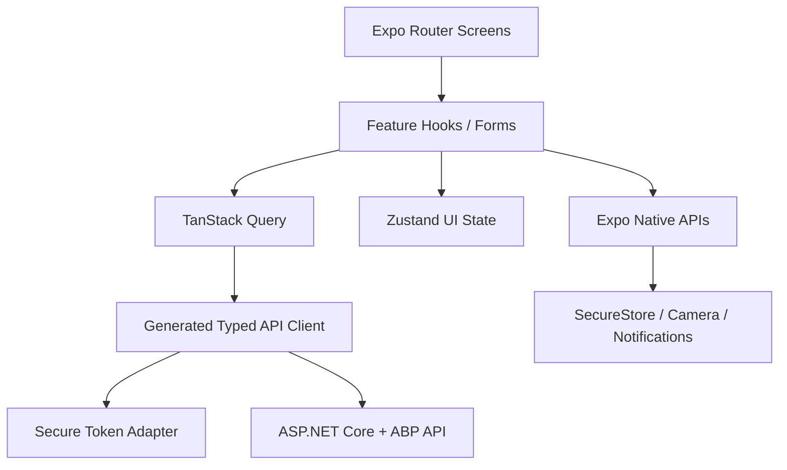

# Kepnora — Mobile Project Structure & Implementation Architecture

**Target:** `docs/implementation/mobile-project-structure.md`  
**Version:** 1.0-draft · **Date:** 2026-10-29  
**Scope:** Phase 1, M0–M8 · **Status:** Proposed implementation blueprint

**Stack:** React Native, Expo, TypeScript, Expo Router, TanStack Query, Zustand, React Hook Form, Zod, Expo SecureStore, Expo Notifications. Version numbers, libraries and generated API bindings must be pinned during M0 and tested against the selected Expo SDK.

**Related specs:** `docs/api/api-contracts-master.md`, `docs/implementation/backend-project-structure.md`, `docs/architecture/mobile-app-architecture.md`, `docs/ui/design-system.md`, `docs/ui/screen-specifications.md`, `docs/features/asset-management.md`, `docs/features/maintenance-management.md`, `docs/features/dashboard-search.md`, `docs/features/workspace-settings.md`, `docs/testing/test-strategy.md`.

**Core invariant:** The selected workspace is a client context, **never authorization**. Every backend operation must validate active `TenantMembers` membership and named permission for the ABP Tenant.

---
## 1. Goals and non-goals

Organize a maintainable, mobile-first app by feature and responsibility. Ensure consistent navigation, typed API integration, tenant-isolated caches, secure global authentication, accessible premium UI, resilient network handling and reliable file uploads.

Out of Phase 1: provider discovery, booking, payments, automatic mileage estimates, public document sharing, unapproved invitation workflow and a separate web admin application.


## 2. Architecture overview



**Server state:** TanStack Query. **Local UI state:** Zustand. **Forms:** React Hook Form + Zod. **Navigation:** Expo Router. **Secrets:** SecureStore. Do not duplicate authoritative server entities in Zustand.


## 3. Proposed repository layout

```text
apps/mobile/
├── app/
│   ├── _layout.tsx
│   ├── (public)/
│   │   ├── sign-in.tsx
│   │   └── auth-callback.tsx
│   ├── (onboarding)/
│   │   ├── index.tsx
│   │   └── create-workspace.tsx
│   └── (app)/
│       ├── _layout.tsx
│       ├── workspace-picker.tsx
│       ├── (tabs)/
│       │   ├── _layout.tsx
│       │   ├── index.tsx
│       │   ├── assets.tsx
│       │   ├── maintenance.tsx
│       │   └── settings.tsx
│       ├── properties/[propertyId].tsx
│       ├── assets/[assetId].tsx
│       ├── assets/new.tsx
│       ├── maintenance/[occurrenceId].tsx
│       ├── documents/[documentId].tsx
│       └── search.tsx
├── src/
│   ├── api/generated/
│   ├── api/http/
│   ├── auth/
│   ├── features/
│   │   ├── onboarding/
│   │   ├── workspaces/
│   │   ├── properties/
│   │   ├── asset-types/
│   │   ├── assets/
│   │   ├── maintenance/
│   │   ├── odometer/
│   │   ├── documents/
│   │   ├── notifications/
│   │   ├── dashboard/
│   │   ├── search/
│   │   └── settings/
│   ├── components/ui/
│   ├── components/layout/
│   ├── design/tokens/
│   ├── hooks/
│   ├── lib/
│   ├── navigation/
│   ├── providers/
│   ├── state/
│   ├── storage/
│   ├── types/
│   └── testing/
├── assets/
├── e2e/
├── app.config.ts
├── eas.json
├── package.json
├── tsconfig.json
└── eslint.config.js
```

This is a proposed layout, not a claim that the current repository already contains these paths. `app/` files stay thin; feature implementation belongs under `src/features`.


## 4. Responsibility boundaries

| Directory | Responsibility | Avoid |
|---|---|---|
| `app/` | Route definitions, layouts, navigation params | Business rules and raw fetch |
| `src/api/generated/` | OpenAPI-generated request/response types | Hand editing |
| `src/api/http/` | Base URL, bearer injection, error mapping | Feature UI state |
| `src/auth/` | OIDC/PKCE, session lifecycle | Plaintext token persistence |
| `src/features/*` | Domain-facing screens, hooks, validation | Cross-feature circular imports |
| `src/components/ui/` | Reusable presentational primitives | Tenant-specific network calls |
| `src/state/` | Selected workspace and ephemeral UI | Authoritative assets/maintenance |
| `src/storage/` | Secure session and approved local persistence | Unencrypted private cache |
| `src/providers/` | Root providers and app lifecycle | Business workflows |
| `e2e/` | Device-level journeys | Production credentials |


## 5. Dependency rules

Feature UI may import generated API types, shared UI, feature hooks and domain-safe helpers. API generated code must not import React components. Shared components must not import specific feature modules. Navigation may use feature screens but feature domain code must not depend on route-group implementation details. Use lint import boundaries to detect cycles.


## 6. Expo Router route groups

Route groups `(public)`, `(onboarding)` and `(app)` are layout/navigation boundaries, not backend security. A signed-in user without an active workspace goes to onboarding or picker. An invalid session returns to public routes. Deep links must wait for session restoration and membership revalidation before displaying protected content.

Use route params for stable IDs only; do not pass serialized assets, tokens or presigned URLs in navigation params.


## 7. Root provider composition

```tsx
export default function RootLayout() {
  return (
    <QueryClientProvider client={queryClient}>
      <ThemeProvider>
        <SessionProvider>
          <WorkspaceProvider>
            <NavigationGate />
          </WorkspaceProvider>
        </SessionProvider>
      </ThemeProvider>
    </QueryClientProvider>
  );
}
```

Illustrative composition; verify Expo Router provider placement and current SDK conventions. Do not block the native splash screen indefinitely on network failures.


## 8. Navigation state machine

```text
BOOTSTRAPPING
  ├─ no usable session → SIGNED_OUT
  └─ valid global session → LOADING_MEMBERSHIPS
      ├─ none → ONBOARDING
      ├─ one + valid remembered selection → ACTIVE_WORKSPACE
      └─ multiple / invalid selection → WORKSPACE_PICKER
ACTIVE_WORKSPACE
  ├─ session invalid → SIGNED_OUT
  ├─ membership revoked → WORKSPACE_PICKER
  └─ user switches → SWITCHING → ACTIVE_WORKSPACE
```

The picker is a client UX choice; the server must still authorize every request. Show neutral failure/retry states for network uncertainty.


## 9. Global identity and OIDC

Use Authorization Code + PKCE via an approved Expo-compatible browser/auth library. Validate state/nonce, callback URI, issuer and token audience through the chosen identity integration. Do not assume ABP default tenant-scoped identity provides one global account across tenants; M0 must prove it.

Keep access/refresh tokens in a secure session adapter using SecureStore or platform-appropriate secure storage. Avoid putting tokens in logs, Zustand, navigation params or analytics.


## 10. Session restoration and refresh

On launch, restore secure credentials and validate/refresh as required. Serialize refresh operations to avoid parallel refresh races; bound retries; if refresh is rejected, clear protected state and require sign-in. Distinguish network timeout from invalid credentials: do not erase a valid offline session solely because the network is unavailable, but never show unvalidated sensitive cached data to a different user.


## 11. HTTP client pipeline

```ts
type RequestContext = {
  workspaceId?: string;
  signal?: AbortSignal;
  correlationId?: string;
};

// The generated client uses a shared transport adapter:
// 1. Resolve current valid access token.
// 2. Attach Authorization and correlation ID.
// 3. Bind workspaceId captured when request was created.
// 4. Apply timeout/abort and map approved API errors.
// 5. Never log secrets, private URLs or request bodies by default.
```

Actual endpoint paths and error envelopes come from generated OpenAPI, not assumptions in the mobile project.


## 12. OpenAPI generated client

Generate TypeScript DTOs/client from the **running configured backend OpenAPI** after M0. Store output under `src/api/generated/`, mark generated, and regenerate in CI. Do not manually edit generated files. Wrap generated operations with small feature-specific adapters only when necessary. CI should detect unexpected schema diffs and breaking changes for installed mobile versions.


## 13. Error normalization

| Error | Mobile behavior |
|---|---|
| 401 | Refresh once if supported; otherwise sign-in |
| 403 | Permission message, remove forbidden action |
| 404 | Neutral unavailable resource screen |
| 409/412 | Show conflict and reload authoritative data |
| 422 | Map field validation to form controls |
| 429 | Show retry guidance; respect Retry-After if provided |
| Timeout/offline | Preserve draft, retry safely |
| 5xx | Non-sensitive retryable error with support correlation ID |

Do not blindly retry non-idempotent POST actions without an approved idempotency key.


## 14. Workspace store design

```ts
type WorkspaceUiState = {
  selectedWorkspaceId: string | null;
  setSelectedWorkspaceId: (id: string | null) => void;
  clearWorkspace: () => void;
};
```

Zustand stores the **selected ID and ephemeral UI state only**. Active memberships, roles, permissions and workspace profile remain server state. A remembered selection is never evidence of access. Clear the selection if server membership validation fails.


## 15. Workspace switching transaction

1. Capture the intended new workspace ID.
2. Check it appears in active memberships; server revalidates.
3. Abort or isolate old workspace requests.
4. Clear previous workspace-sensitive navigation and visible state.
5. Switch selected ID and reset feature drafts as appropriate.
6. Fetch new workspace summary and Home.
7. Drop late responses from previous workspace.

Mutations already dispatched must remain bound to their **original tenant**. Never substitute a newly selected workspace ID into an in-flight completion or S3 finalize.


## 16. Query key convention

```ts
export const queryKeys = {
  workspaces: (userId: string) => ['user', userId, 'workspaces'] as const,
  assets: (w: string, filter: unknown) => ['w', w, 'assets', filter] as const,
  asset: (w: string, id: string) => ['w', w, 'asset', id] as const,
  occurrences: (w: string, filter: unknown) => ['w', w, 'occurrences', filter] as const,
  dashboard: (w: string) => ['w', w, 'dashboard'] as const,
  search: (w: string, q: string) => ['w', w, 'search', q] as const,
  prefs: (w: string, user: string) => ['w', w, 'prefs', user] as const,
};
```

Use stable normalized filter objects. Never reuse a query key across tenants or authenticated users. Disable persistence of sensitive tenant caches unless an explicit encrypted offline policy is approved.


## 17. TanStack Query defaults

Set intentional `staleTime`, retry and cache retention per feature. Use `AbortSignal` on requests; cancel or invalidate old workspace queries on switch and clear all protected caches on sign-out. Avoid optimistic updates for irreversible maintenance completion unless server conflict/idempotency behavior is fully handled. Revalidate on app foreground where useful.


## 18. Zustand boundaries

Appropriate: selected workspace ID, temporary UI filters, theme preference, draft navigation state. Inappropriate: authoritative `Asset[]`, membership permissions, service history, raw access tokens, private document URLs. For persistent drafts, use an approved encrypted local store and explicit expiration policy.


## 19. Feature folder template

```text
src/features/assets/
├── components/
│   ├── AssetCard.tsx
│   └── AssetForm.tsx
├── hooks/
│   ├── useAssets.ts
│   └── useAssetMutations.ts
├── screens/
│   ├── AssetListScreen.tsx
│   └── AssetDetailScreen.tsx
├── schemas/
│   └── assetFormSchema.ts
├── api/
│   └── assetApi.ts
├── utils/
│   └── assetPresentation.ts
└── __tests__/
```

Keep presentation-only helpers independent of React hooks and network clients. Other feature modules follow the same convention where useful, not necessarily the same file count.


## 20. Authentication and onboarding feature

Flow: global login → list memberships → select existing workspace or create new ABP Tenant + Owner membership → Home. If provisioning is asynchronous, show durable pending/retry state; do not navigate to Home until server confirms membership ready. Avoid automatically creating a workspace on login without an approved product decision.


## 21. Properties feature

Support create/list/detail/edit/archive, optional address/timezone fields according to final backend contract. A property is **not required** for an asset. Archive should not silently delete linked assets or maintenance history. Show permission-aware controls and empty states.


## 22. Asset types feature

List global and tenant-defined types with immutable schema versions. Render custom fields dynamically from the selected **published** version. Client Zod validation improves UX, but backend validation remains authoritative. On a version mismatch, show a refresh/migration message rather than silently dropping unknown fields.


## 23. Assets feature

List/filter/detail/create/edit/archive; optional `propertyId`; image preview and related maintenance. Use stable keyset pagination and server-approved sorting. Do not load all assets into memory to implement search or dashboard. After mutations, invalidate the asset, list, dashboard and relevant search keys within the same workspace.


## 24. Maintenance feature

Show rule details, occurrence list, urgency badges and completion form. **Persisted lifecycle:** `Open`, `Completed`, `Skipped`, `Cancelled`. **Derived display:** `Upcoming`, `Due`, `Overdue`, `Unknown`. Never send derived display status as a lifecycle update. Completion must use expected version/idempotency where supported and refresh history/occurrence/dashboard after success.


## 25. Mileage and odometer UX

Mileage comes only from actual manually entered readings. If no reading exists, show **Unknown** instead of a guessed due state. Canonical storage uses miles; do not merely relabel miles as kilometers. A unit toggle requires an approved persistent preference and explicit conversion/rounding policy. Handle late readings, corrections and odometer resets only under approved backend rules.


## 26. Documents and warranties feature

Workflow: choose photo/file → request authorized upload intent → PUT directly to private S3 with signed headers → finalize through backend → show document metadata. A successful PUT alone is not a finalized document. Handle expiring URLs, network loss, duplicate finalize, cancellation and orphan cleanup. Never cache presigned URLs as durable document identifiers.


## 27. Document upload state machine

```text
IDLE → SELECTED → REQUESTING_INTENT → UPLOADING
  → VERIFYING_FINALIZE → COMPLETED
  ↘ FAILED_RETRYABLE / FAILED_TERMINAL / CANCELLED
```

Persist a draft only if an encrypted offline policy is approved. On app restart, ask backend for authoritative intent status if supported; do not assume the prior upload completed. Limit concurrent uploads and use original tenant binding throughout.


## 28. Notifications feature

Register Expo push tokens against the **global user**; manage reminder preferences per `(TenantId, UserId)`. Separate OS permission state from server preference. On tap, validate global session, membership and target resource before navigating. Do not embed private descriptions, document URLs or tokens in notification payloads.


## 29. Dashboard feature

Fetch server-computed tenant-scoped counts, attention cards and recent activity. Show loading skeletons, empty and error states. Do not recalculate authoritative due/overdue logic from client time alone. Date and timezone rendering must use approved backend rules. Keep dashboard summary queries bounded.


## 30. Search feature

Debounce input, cancel superseded requests, send tenant-scoped queries and use server ranking/cursor. Never search another workspace's cache. Filter by approved resource types; hide archived results by default. A tapped result is reauthorized on detail load. Avoid caching search text longer than needed if it can include private information.


## 31. Workspace settings and members

Settings sections: global profile, workspace picker, workspace profile, member management (Owner), notification preferences, help/privacy and sign-out. Owner/Member roles are workspace-specific. Never allow last active Owner removal; backend enforces transactionally. Hide invitations until full invitation flow is implemented, not merely because a database `Invited` status exists.


## 32. Forms and validation

Use React Hook Form and Zod for field-level errors, accessible labels and controlled inputs. Reuse schema helpers for date, mileage, currency and identifiers but do not duplicate business policy without backend parity tests. Disable duplicate submit while pending, preserve user input on 409/422, and do not claim success before server confirms.


## 33. Design tokens and theme

Use `docs/ui/design-system.md` and `docs/ui/design-system/tokens.md` as visual source of truth. Baseline colors: light canvas `#F7F8F6`, surface `#FFFFFF`, ink `#1D2823`, accent `#275D78`; dark canvas `#111714`, surface `#1B231F`, ink `#F3F7F3`, accent `#8CC4DD`. Build semantic tokens (`canvas`, `surface`, `textPrimary`, `accent`, `border`, `danger`) rather than hardcoding colors throughout screens. Premium, restrained, spacious design inspired by quality home-management apps; do not copy proprietary layouts.


## 34. Reusable UI primitives

Suggested components: `Screen`, `AppHeader`, `SectionHeading`, `Card`, `ListRow`, `Button`, `TextField`, `SelectField`, `DateField`, `EmptyState`, `ErrorState`, `LoadingSkeleton`, `StatusBadge`, `ConfirmDialog`, `Toast`, `PhotoPicker`, `OfflineBanner`. Components must handle dynamic type, touch targets, VoiceOver/TalkBack and dark mode. Avoid badges that imply persisted maintenance status when the value is derived.


## 35. Accessibility and localization

Support dynamic font scaling, accessible labels/hints, focus order, reduced motion, high-contrast semantic colors and screen reader announcements for errors. Format locale-sensitive dates/currency only at the presentation boundary; backend timestamps remain UTC and calendar dates remain date-only. English MVP copy can be centralized for later localization.


## 36. Offline policy

**MVP default:** online-first with safe read-only placeholders; no blanket promise of offline CRUD. Show explicit offline state and retry. Cached protected data must not appear after sign-out or to a different global user. Offline write queues for maintenance completion, membership edits or uploads are **deferred** unless idempotency, conflict resolution and encrypted persistence are designed and tested.


## 37. App lifecycle and connectivity

On foreground, validate session freshness and refresh key summaries when network is available. On background, pause expensive polling and avoid leaving private screens in snapshots if privacy policy requires masking. Connectivity detection is advisory; failed requests are authoritative evidence of network failure. Do not loop refresh endlessly.


## 38. Deep links and route authorization

Allow only known schemes/hosts and validated ID formats. A deep link to workspace B must revalidate active membership before switching from A. After switch, fetch target detail with tenant-safe endpoint; show neutral unavailable state for removed membership or foreign resource. Never trust an embedded `role`, `tenantName`, S3 URL or serialized DTO.


## 39. Push handling and device lifecycle

Request OS permission at a meaningful moment; register/rotate token after authenticated consent. Deactivate the user's registration on sign-out according to approved policy. Treat push receipts as provider signals, not delivery guarantees. Support notification taps from cold start and warm start without bypassing the auth/workspace navigation gate.


## 40. Secure storage and privacy

Use SecureStore for session secrets. Do not store refresh tokens, signed URLs or private file bytes in AsyncStorage. Redact authorization headers, personal addresses, document content and tokens from analytics/crash reports. Consider app-switcher snapshot protection where appropriate. Define data retention and local cache deletion before production.


## 41. Performance and rendering

Use `FlatList`/virtualization for large asset, maintenance and search lists; stable keys, memoized expensive card calculations and bounded image sizes. Prefer thumbnails over full-resolution photos. Measure cold start, time-to-interactive, list scrolling, memory, API request count and upload behavior on midrange devices. Do not invent fixed performance targets without profiling.


## 42. Image and file handling

Use Expo-compatible picker/camera/document APIs pinned to the SDK. Validate client MIME/size for UX but enforce server-side. Compress photos when allowed without degrading receipt legibility. Handle permission denial, file URI expiry, interrupted uploads and low-storage devices. Do not persist raw S3 object keys in navigation state.


## 43. Testing architecture

| Layer | Tools / focus |
|---|---|
| Pure utilities | Vitest/Jest as approved; recurrence presentation, formatting |
| Components | React Native Testing Library, accessibility |
| Hooks | Query cache, abort, workspace isolation |
| API adapters | Mock transport with generated DTO contracts |
| Device E2E | Maestro/Detox chosen after Expo compatibility check |
| Release QA | Real iOS/Android, permission, push, camera, network |

Never use mobile mocks as evidence that PostgreSQL tenant constraints or server transaction races are correct.


## 44. Mobile test matrix — authentication and tenancy

| ID | Scenario | Expected |
|---|---|---|
| MOB-001 | Cold start signed out | Public routes only |
| MOB-002 | Valid session restored | Memberships revalidated |
| MOB-003 | Token refresh concurrency | One refresh path |
| MOB-004 | Revoked membership | Protected workspace cleared |
| MOB-005 | Owner X, Member Y | Correct UI actions and backend denial |
| MOB-006 | Switch X→Y during asset fetch | X response discarded |
| MOB-007 | Switch during completion | Original tenant binding |
| MOB-008 | Switch during S3 upload | Original intent binding/cancel |
| MOB-009 | Sign out + back | No private content |
| MOB-010 | Deep link to foreign asset | Neutral unavailable |
| MOB-011 | Workspace list empty | Onboarding/create CTA |
| MOB-012 | Workspace provisioning partial | Retry without duplicate tenant |
| MOB-013 | Offline during membership check | Safe no unauthorized display |
| MOB-014 | User changes account | Cache and credentials isolated |
| MOB-015 | Role changed remotely | Permission-aware refresh |


## 45. Mobile test matrix — features and devices

| ID | Scenario | Expected |
|---|---|---|
| MOB-016 | Standalone asset | `propertyId=null` accepted |
| MOB-017 | Invalid custom field | Form + backend validation |
| MOB-018 | Asset type version changed | Conflict/reload |
| MOB-019 | No odometer reading | Unknown, no estimate |
| MOB-020 | Complete occurrence twice | One logical history result |
| MOB-021 | Completion 409 | Reload and explain |
| MOB-022 | S3 PUT succeeds, finalize fails | Not shown finalized |
| MOB-023 | Upload URL expires | New intent/retry flow |
| MOB-024 | Push OS permission denied | Server preference shown separately |
| MOB-025 | Push tap after member removal | Denied |
| MOB-026 | Dashboard on workspace switch | No stale counts |
| MOB-027 | Search query superseded | Old results discarded |
| MOB-028 | Dark mode | Correct semantic colors |
| MOB-029 | Dynamic type 200% | Usable layout |
| MOB-030 | VoiceOver/TalkBack | Accessible navigation/forms |
| MOB-031 | Low bandwidth | Retry/error UX |
| MOB-032 | Interrupted upload | No false success |
| MOB-033 | Notification preference X/Y | Separate values |
| MOB-034 | Last Owner remove UI | Server rejection handled |
| MOB-035 | EAS production config | No secrets in public bundle |


## 46. CI and quality gates

Run TypeScript typecheck, ESLint, formatting, unit/component tests and generated OpenAPI client drift checks on pull requests. On release candidates run device E2E, accessibility smoke tests, Expo config validation, dependency scans and staging API integration. Pin package manager and lockfile; do not silently upgrade Expo SDK or native plugins without build verification.


## 47. EAS build profiles

```json
{
  "build": {
    "development": { "developmentClient": true, "distribution": "internal" },
    "preview": { "distribution": "internal" },
    "production": {}
  }
}
```

Illustrative only. Use separate environment variables, bundle IDs/app identifiers, push configuration and API base URLs for development, staging and production. `EXPO_PUBLIC_*` variables are public; never store secrets in them. Review OTA update compatibility with backend contract changes.


## 48. Environment configuration

Define a typed configuration boundary for `apiBaseUrl`, OIDC issuer/client ID/redirect URI, Expo project ID, feature flags and build environment. Validate at startup. Secrets belong to the identity provider/secure runtime, not public Expo config. Do not allow staging app to register production device tokens or send production reminders.


## 49. Implementation order

**M0:** Pin Expo SDK and dependencies, auth redirect POC, generated OpenAPI client and navigation gates.

**M1:** Session restoration, workspace picker/create, active membership validation and tenant-safe cache keys.

**M2:** Property and asset type screens; versioned custom fields.

**M3:** Asset CRUD, optional property, image UI.

**M4:** Maintenance list/rules/completion, observed odometer and service history.

**M5:** S3 upload intent/PUT/finalize, private document display.

**M6:** Expo push registration, preferences, deep links.

**M7:** Dashboard, search, settings, performance/accessibility polish.

**M8:** iOS/Android E2E, security regression, offline/error recovery and beta release.


## 50. Open decisions

1. Exact Expo SDK, React Native and TypeScript versions.
2. OIDC browser/PKCE library and redirect URI scheme.
3. Generated OpenAPI client generator and runtime transport.
4. Error envelope mapping (Problem Details versus ABP).
5. Whether a backend active-workspace session exists.
6. Query persistence/encrypted offline policy.
7. E2E framework and CI device infrastructure.
8. Push permission timing and token revocation policy.
9. Image compression, file limits and local retention.
10. Unit preference persistence and km conversion.
11. Timezone/date-only presentation and DST policy.
12. Minimum mobile app/API compatibility strategy.
13. Workspace provisioning retry state UX.
14. Member invitation flow (deferred unless approved).
15. Expo OTA rollout and rollback policy.
16. Native analytics/crash logging privacy controls.


## 51. Definition of Done

- [ ] Expo Router route groups are implemented with safe navigation gates.
- [ ] Global OIDC session uses PKCE and secure token storage.
- [ ] ABP global identity/multi-workspace behavior is proven in M0.
- [ ] All mobile requests use verified OpenAPI-generated contracts.
- [ ] Tenant query keys and in-flight mutation contexts are isolated.
- [ ] Logout/revocation clears protected UI and sensitive caches.
- [ ] Standalone assets and versioned custom types work.
- [ ] Maintenance displays derived urgency without changing persisted lifecycle.
- [ ] Mileage is observed only; missing readings show Unknown.
- [ ] S3 upload is not considered complete before finalize.
- [ ] Device tokens are global-user owned and preferences workspace-specific.
- [ ] Offline, errors, conflicts and retries never imply false success.
- [ ] Dynamic type, screen reader and dark-mode QA passes.
- [ ] MOB-001 through MOB-035 have automated or recorded device QA evidence.
- [ ] iOS/Android staging builds use separate configuration and no embedded secrets.


## 52. Final implementation principle

**Keep the mobile app a secure, predictable client of authoritative backend workflows.** Route structure is navigation, cache is not truth, selected workspace is not permission, and a polished UI must never disguise an incomplete upload, stale membership, or guessed maintenance reading.

