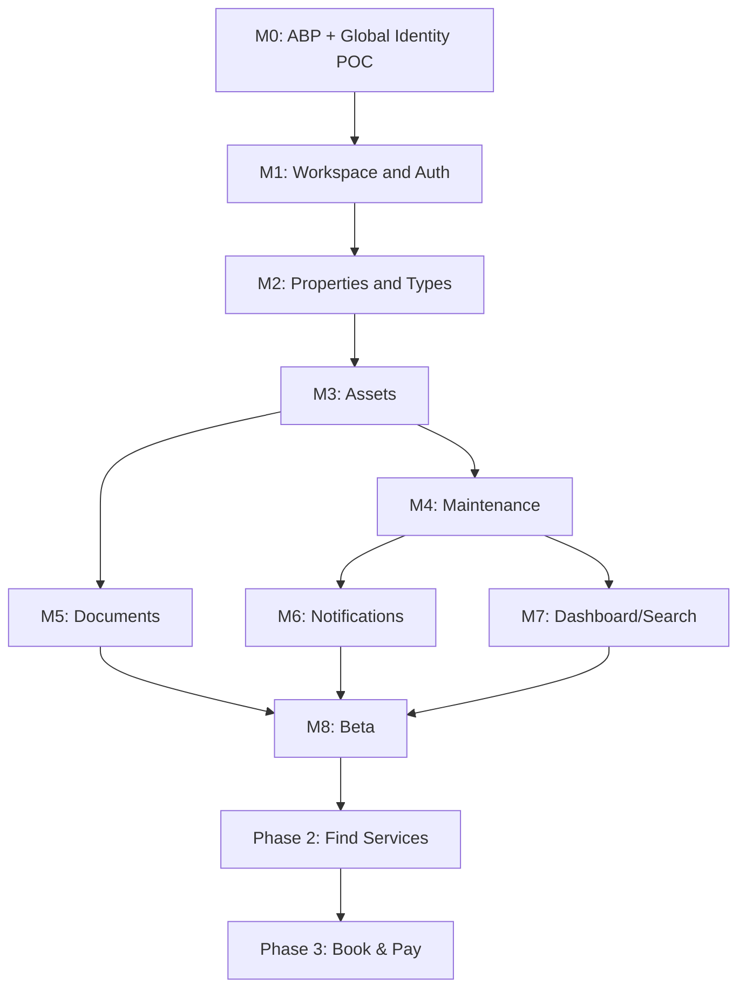

# Kepnora — Product Feature Matrix

**Canonical path:** `docs/product/feature-matrix.md`  
**Version:** 1.0-draft · **Updated:** 2026-10-29  
**Status:** Product/engineering planning baseline; not implementation evidence  
**Audience:** Product, engineering, design, QA and AI coding agents

---
## 1. Purpose and scope

This is the cross-functional feature register for Kepnora. It maps product outcomes to phases, milestones, dependencies, implementation owners, and test evidence. **Planned** is not **implemented**. It is a working planning baseline and does not override the canonical database, API, or feature specs.

**Phase 1:** Own & Maintain. **Phase 2:** Find Services. **Phase 3:** Book & Pay. **M0–M8** are Phase 1 engineering milestones, not calendar dates.

## 2. Status vocabulary

| Status | Meaning |
|---|---|
| Proposed | Candidate; product decision pending |
| Specified | Requirements documented, no implementation claim |
| Blocked | Dependency or proof of concept unresolved |
| In progress | Code changes actively underway; must be verified in repository |
| Implemented | Code merged and verified against acceptance tests |
| Released | Shipped and measured in the intended environment |
| Deferred | Explicitly outside current phase |

All rows below are **Specified** or **Proposed** unless the actual repository and CI evidence establish a later state.

## 3. Non-negotiable invariants

1. Workspace equals one ABP Tenant; ABP Tenant Management is authoritative.
2. A single global user may belong to multiple workspaces; membership and permission are checked per operation.
3. `ICurrentTenant` and `IMultiTenant` do not constitute authorization.
4. `Asset.PropertyId` is nullable; a standalone vehicle must work.
5. Published asset type versions are immutable; custom fields use validated JSONB.
6. Maintenance occurrence persisted states are `Open`, `Completed`, `Skipped`, `Cancelled` only.
7. `Upcoming`, `Due`, `Overdue` are derived display states.
8. Mileage is entered as an actual reading; never forecast or inferred.
9. Maintenance generation/completion and outbox dispatch are concurrency-safe and idempotent.
10. S3 is private and uploads follow intent → PUT → finalize.
11. Push is best effort / at least once; never promise exactly-once delivery.
12. Tenant-scoped mobile caches are isolated on workspace switching and logout.
13. .NET 10 + pinned ABP and global identity must be proven in M0.
14. OpenAPI from running backend is source of truth for generated mobile client.
15. Phase 2 discovery and Phase 3 booking/payments must not creep into Phase 1.

## 4. Master feature matrix

| ID | Capability | Phase | Milestone | Primary dependency | Status |
|---|---|---|---|---|---|
| F001 | Global sign-in and sign-out | P1 | M0–M1 | Identity provider, OIDC/PKCE, SecureStore | Specified |
| F002 | Session recovery and refresh | P1 | M1 | F001 | Specified |
| F003 | Global user and ABP tenant POC | P1 | M0 | Pinned ABP/.NET 10 compatibility | Specified |
| F004 | Create workspace | P1 | M1 | F003 | Specified |
| F005 | Select/switch workspace | P1 | M1 | F003,F004 | Specified |
| F006 | Workspace members and roles | P1 | M1,M7 | F004 | Specified |
| F007 | Property CRUD | P1 | M2 | F005 | Specified |
| F008 | Optional property association | P1 | M2–M3 | F007,F010 | Specified |
| F009 | Global versioned asset templates | P1 | M2 | F003 | Specified |
| F010 | Asset CRUD and archive | P1 | M3 | F005,F009 | Specified |
| F011 | Workspace custom asset types | P1 | M2–M3 | F009 | Specified |
| F012 | Dynamic custom field forms | P1 | M3 | F009,F011 | Specified |
| F013 | Maintenance rule CRUD | P1 | M4 | F010 | Specified |
| F014 | Time-based recurrence | P1 | M4 | F013 | Specified |
| F015 | Mileage-based recurrence | P1 | M4 | F013,F017 | Specified |
| F016 | Occurrence lifecycle and history | P1 | M4 | F013 | Specified |
| F017 | Manual odometer entry | P1 | M4 | F010 | Specified |
| F018 | Private photo/receipt/manual upload | P1 | M5 | F010 | Specified |
| F019 | Document retrieval and metadata | P1 | M5 | F018 | Specified |
| F020 | Warranty document classification | P1 | M5 | F018 | Specified |
| F021 | Push token registration | P1 | M6 | F001 | Specified |
| F022 | Reminder planning and outbox | P1 | M6 | F014,F015,F016 | Specified |
| F023 | Quiet hours and preferences | P1 | M6–M7 | F022 | Specified |
| F024 | Dashboard summary | P1 | M7 | F010,F016 | Specified |
| F025 | Asset/maintenance search | P1 | M7 | F010,F016 | Specified |
| F026 | Workspace and profile settings | P1 | M7 | F004,F006 | Specified |
| F027 | Accessibility and offline states | P1 | M3–M8 | Mobile foundations | Specified |
| F028 | Observability and audit | P1 | M0–M8 | Backend and worker baseline | Specified |
| F029 | Real PostgreSQL tenant tests | P1 | M0–M8 | Migrations and test containers | Specified |
| F030 | Beta release readiness | P1 | M8 | F001–F029 | Specified |
| F031 | Service provider discovery | P2 | Post-MVP | P1 adoption and provider source | Deferred |
| F032 | Provider search/map and filters | P2 | Post-MVP | F031 | Deferred |
| F033 | Provider profile and contact | P2 | Post-MVP | F031 | Deferred |
| F034 | Provider onboarding and moderation | P2 | Post-MVP | F031 | Deferred |
| F035 | Service booking | P3 | Future | F031–F034 | Deferred |
| F036 | Scheduling and rescheduling | P3 | Future | F035 | Deferred |
| F037 | Payments and refunds | P3 | Future | F035 | Deferred |
| F038 | Provider payouts and fees | P3 | Future | F037 | Deferred |
| F039 | Subscriptions and paid tiers | Proposed | Unscheduled | Pricing validation and legal review | Proposed |
| F040 | Admin operations portal | Proposed | Post-MVP | Operational need and ABP gap | Proposed |

## 5. Backend/mobile acceptance crosswalk

| ID | Backend deliverable | Mobile deliverable | Acceptance evidence | Source spec |
|---|---|---|---|---|
| F001 | Auth API, session, token validation | Expo AuthSession and protected navigation | Successful login; revoked token denied | `authentication-onboarding.md` |
| F002 | Refresh/revoke behavior | Secure session rehydration | Expired sessions recover or reauthenticate | `authentication-onboarding.md` |
| F003 | Membership mapping, tenant resolution | Two-workspace sign-in test harness | One user accesses A and B without leakage | `authentication-onboarding.md` |
| F004 | ABP tenant provisioning, owner membership | Workspace create flow | Exactly one tenant and owner membership | `settings-members.md` |
| F005 | Membership and permission enforcement | Workspace picker, query cancellation | No stale cross-workspace data | `authentication-onboarding.md` |
| F006 | TenantMembers, named permissions | Member list and role controls | Revoked member denied despite valid JWT | `settings-members.md` |
| F007 | Properties, archive, version check | List/detail/form | Create/edit/archive, tenant-safe | `property-management.md` |
| F008 | Nullable Asset.PropertyId, composite FK | No property picker option | Standalone assets usable | `property-management.md` |
| F009 | AssetTypeDefinitions/Versions | Template picker | Published versions immutable | `custom-asset-types.md` |
| F010 | Asset AppService and JSONB validation | Asset list/detail/form | Assets isolated and searchable | `asset-management.md` |
| F011 | Tenant-owned definitions and versions | Schema-driven type editor | Cross-tenant type access denied | `custom-asset-types.md` |
| F012 | Server schema validation | RHF/Zod schema renderer | Old asset retains its schema version | `custom-asset-types.md` |
| F013 | Rules, anchors, interval policies | Rule forms and details | Deterministic schedule definitions | `maintenance-management.md` |
| F014 | Recurrence generator and unique key | Upcoming/due labels | Month-end/DST tests pass | `maintenance-scheduling-engine.md` |
| F015 | Actual readings only | Mileage progress UI | No projected odometer | `maintenance-scheduling-engine.md` |
| F016 | Open/Completed/Skipped/Cancelled | History and action controls | Idempotent completion, no duplicate | `maintenance-management.md` |
| F017 | Actual reading audit/validation | Mileage entry and history | No estimated values stored | `maintenance-management.md` |
| F018 | S3 intent/PUT/finalize | Picker, progress, retry | No public S3 objects or leaked URLs | `documents-warranties.md` |
| F019 | Signed access, tenant checks | Document list/viewer | Expired URL handled, cross-tenant denied | `documents-warranties.md` |
| F020 | Document type metadata | Warranty category/filter | No unsupported expiry field assumed | `documents-warranties.md` |
| F021 | Device registration and token lifecycle | Permission request, deep link | Revoked device cannot receive new pushes | `notifications-reminders.md` |
| F022 | Eligibility, outbox, dedupe | Reminder settings | Completed occurrence suppresses stale push | `notification-engine.md` |
| F023 | Timezone-aware preference checks | Preference controls | DST and quiet-hour tests pass | `notification-engine.md` |
| F024 | Tenant-filtered aggregates | Home cards | Standalone assets counted correctly | `dashboard.md` |
| F025 | Tenant-safe search and pagination | Search/filter UI | No cross-tenant results | `dashboard-search.md` |
| F026 | Authorized settings APIs | Settings screens | Member/role boundaries enforced | `settings-members.md` |
| F027 | Backend deliverable TBD | Error/empty/offline and a11y support | Screen readers, tenant-safe cache | `UI docs` |
| F028 | Backend deliverable TBD | Safe user error messaging | No secrets/addresses in logs | `deployment-guide.md` |
| F029 | Backend deliverable TBD | E2E workspace switching | Composite FK and membership tests | `test-strategy.md` |
| F030 | CI/CD, migrations, monitoring | EAS builds, store beta | Release checklist evidence | `mvp-scope.md` |
| F031 | Provider discovery abstraction | Find Services flow | Provider relevance and privacy validated | `future-features.md` |
| F032 | Provider search endpoints | Nearby/provider list UI | Verified provider sources | `future-features.md` |
| F033 | Provider profile model | Profile/contact UI | No false provider availability claims | `future-features.md` |
| F034 | Moderation, verification, abuse prevention | Provider-facing surfaces TBD | Operational review criteria approved | `future-features.md` |
| F035 | Availability/booking consistency | Booking flow | No double booking; cancellations tested | `future-features.md` |
| F036 | Calendar/timezone model | Appointment management | Timezone/availability conflicts handled | `future-features.md` |
| F037 | Payment provider, ledger, compliance | Checkout and receipt | Refund/dispute handling audited | `future-features.md` |
| F038 | Payout compliance, reconciliation | Provider billing views | Reconciled financial records | `future-features.md` |
| F039 | Entitlements and billing TBD | Paywall TBD | Explicit approval required | `pricing.md` |
| F040 | Support-only APIs with audit | Separate admin UI if needed | Not a default Phase 1 requirement | `admin-project-structure.md` |

## 6. M0 — Foundation and identity proof

**Entry criteria:** prerequisite milestones completed; ABP identity/tenant proof remains a blocking prerequisite.

**In-scope IDs:** F003, F028, F029.

**Deliverables:**
- **F003 — Global user and ABP tenant POC:** Membership mapping, tenant resolution; mobile: Two-workspace sign-in test harness.
- **F028 — Observability and audit:** Backend deliverable TBD; mobile: Safe user error messaging.
- **F029 — Real PostgreSQL tenant tests:** Backend deliverable TBD; mobile: E2E workspace switching.

**Exit gate:** migrations and permissions verified, generated OpenAPI client synchronized, real PostgreSQL integration tests and relevant mobile states pass. Capture demo/CI evidence and record open decisions.

## 7. M1 — Authentication and workspace

**Entry criteria:** prerequisite milestones completed; ABP identity/tenant proof remains a blocking prerequisite.

**In-scope IDs:** F001, F002, F004, F005, F006.

**Deliverables:**
- **F001 — Global sign-in and sign-out:** Auth API, session, token validation; mobile: Expo AuthSession and protected navigation.
- **F002 — Session recovery and refresh:** Refresh/revoke behavior; mobile: Secure session rehydration.
- **F004 — Create workspace:** ABP tenant provisioning, owner membership; mobile: Workspace create flow.
- **F005 — Select/switch workspace:** Membership and permission enforcement; mobile: Workspace picker, query cancellation.
- **F006 — Workspace members and roles:** TenantMembers, named permissions; mobile: Member list and role controls.

**Exit gate:** migrations and permissions verified, generated OpenAPI client synchronized, real PostgreSQL integration tests and relevant mobile states pass. Capture demo/CI evidence and record open decisions.

## 8. M2 — Properties and asset type schemas

**Entry criteria:** prerequisite milestones completed; ABP identity/tenant proof remains a blocking prerequisite.

**In-scope IDs:** F007, F008, F009, F011.

**Deliverables:**
- **F007 — Property CRUD:** Properties, archive, version check; mobile: List/detail/form.
- **F008 — Optional property association:** Nullable Asset.PropertyId, composite FK; mobile: No property picker option.
- **F009 — Global versioned asset templates:** AssetTypeDefinitions/Versions; mobile: Template picker.
- **F011 — Workspace custom asset types:** Tenant-owned definitions and versions; mobile: Schema-driven type editor.

**Exit gate:** migrations and permissions verified, generated OpenAPI client synchronized, real PostgreSQL integration tests and relevant mobile states pass. Capture demo/CI evidence and record open decisions.

## 9. M3 — Asset management

**Entry criteria:** prerequisite milestones completed; ABP identity/tenant proof remains a blocking prerequisite.

**In-scope IDs:** F010, F012, F027.

**Deliverables:**
- **F010 — Asset CRUD and archive:** Asset AppService and JSONB validation; mobile: Asset list/detail/form.
- **F012 — Dynamic custom field forms:** Server schema validation; mobile: RHF/Zod schema renderer.
- **F027 — Accessibility and offline states:** Backend deliverable TBD; mobile: Error/empty/offline and a11y support.

**Exit gate:** migrations and permissions verified, generated OpenAPI client synchronized, real PostgreSQL integration tests and relevant mobile states pass. Capture demo/CI evidence and record open decisions.

## 10. M4 — Maintenance and actual mileage

**Entry criteria:** prerequisite milestones completed; ABP identity/tenant proof remains a blocking prerequisite.

**In-scope IDs:** F013, F014, F015, F016, F017.

**Deliverables:**
- **F013 — Maintenance rule CRUD:** Rules, anchors, interval policies; mobile: Rule forms and details.
- **F014 — Time-based recurrence:** Recurrence generator and unique key; mobile: Upcoming/due labels.
- **F015 — Mileage-based recurrence:** Actual readings only; mobile: Mileage progress UI.
- **F016 — Occurrence lifecycle and history:** Open/Completed/Skipped/Cancelled; mobile: History and action controls.
- **F017 — Manual odometer entry:** Actual reading audit/validation; mobile: Mileage entry and history.

**Exit gate:** migrations and permissions verified, generated OpenAPI client synchronized, real PostgreSQL integration tests and relevant mobile states pass. Capture demo/CI evidence and record open decisions.

## 11. M5 — Private documents

**Entry criteria:** prerequisite milestones completed; ABP identity/tenant proof remains a blocking prerequisite.

**In-scope IDs:** F018, F019, F020.

**Deliverables:**
- **F018 — Private photo/receipt/manual upload:** S3 intent/PUT/finalize; mobile: Picker, progress, retry.
- **F019 — Document retrieval and metadata:** Signed access, tenant checks; mobile: Document list/viewer.
- **F020 — Warranty document classification:** Document type metadata; mobile: Warranty category/filter.

**Exit gate:** migrations and permissions verified, generated OpenAPI client synchronized, real PostgreSQL integration tests and relevant mobile states pass. Capture demo/CI evidence and record open decisions.

## 12. M6 — Reminders and push

**Entry criteria:** prerequisite milestones completed; ABP identity/tenant proof remains a blocking prerequisite.

**In-scope IDs:** F021, F022, F023.

**Deliverables:**
- **F021 — Push token registration:** Device registration and token lifecycle; mobile: Permission request, deep link.
- **F022 — Reminder planning and outbox:** Eligibility, outbox, dedupe; mobile: Reminder settings.
- **F023 — Quiet hours and preferences:** Timezone-aware preference checks; mobile: Preference controls.

**Exit gate:** migrations and permissions verified, generated OpenAPI client synchronized, real PostgreSQL integration tests and relevant mobile states pass. Capture demo/CI evidence and record open decisions.

## 13. M7 — Dashboard, search, settings

**Entry criteria:** prerequisite milestones completed; ABP identity/tenant proof remains a blocking prerequisite.

**In-scope IDs:** F024, F025, F026.

**Deliverables:**
- **F024 — Dashboard summary:** Tenant-filtered aggregates; mobile: Home cards.
- **F025 — Asset/maintenance search:** Tenant-safe search and pagination; mobile: Search/filter UI.
- **F026 — Workspace and profile settings:** Authorized settings APIs; mobile: Settings screens.

**Exit gate:** migrations and permissions verified, generated OpenAPI client synchronized, real PostgreSQL integration tests and relevant mobile states pass. Capture demo/CI evidence and record open decisions.

## 14. M8 — Hardening and beta

**Entry criteria:** prerequisite milestones completed; ABP identity/tenant proof remains a blocking prerequisite.

**In-scope IDs:** F027, F028, F029, F030.

**Deliverables:**
- **F027 — Accessibility and offline states:** Backend deliverable TBD; mobile: Error/empty/offline and a11y support.
- **F028 — Observability and audit:** Backend deliverable TBD; mobile: Safe user error messaging.
- **F029 — Real PostgreSQL tenant tests:** Backend deliverable TBD; mobile: E2E workspace switching.
- **F030 — Beta release readiness:** CI/CD, migrations, monitoring; mobile: EAS builds, store beta.

**Exit gate:** migrations and permissions verified, generated OpenAPI client synchronized, real PostgreSQL integration tests and relevant mobile states pass. Capture demo/CI evidence and record open decisions.

## 15. Phase 2 discovery gates

Provider discovery requires explicit privacy and data-source decisions, source attribution, abuse controls, location consent, provider identity quality, and a service abstraction. Do not infer provider availability or promise booking. Phase 2 must not alter Phase 1 maintenance lifecycle invariants.

## 16. Phase 3 booking and payment gates

Before booking: availability consistency, cancellation and refund rules, provider contracts, notifications, time zones, support escalation and data retention. Before payments: legal/tax/payment processor selection, reconciliation, dispute handling, idempotency and payout obligations. None are MVP commitments.

## 17. Dependency graph

The diagram is a logical dependency overview; workstreams may overlap when their contracts and test fixtures are stable.

## 18. Backend modules to feature mapping

| Backend module | Feature IDs | Notes |
|---|---|---|
| Identity/Workspace | F001–F006 | Global user across ABP tenants is M0 proof |
| Properties | F007–F008 | Property optional for assets |
| AssetTypes/Assets | F009–F012 | JSONB and immutable versions |
| Maintenance | F013–F017 | Deterministic recurrence; actual mileage |
| Documents | F018–F020 | Private S3; intent/PUT/finalize |
| Notifications | F021–F023 | Durable outbox and recheck |
| Dashboard/Search/Settings | F024–F026 | Tenant-filtered projections |
| Infrastructure | F027–F030 | Security, CI, observability, beta |

## 19. Mobile feature modules mapping

| Mobile feature folder | Feature IDs | Core screens |
|---|---|---|
| `auth`, `workspaces` | F001–F006 | Login, workspace picker, onboarding |
| `properties` | F007–F008 | List, detail, form |
| `assetTypes`, `assets` | F009–F012 | Asset list/detail, dynamic form |
| `maintenance`, `odometer` | F013–F017 | Schedule, completion, mileage |
| `documents` | F018–F020 | Upload, document list/view |
| `notifications` | F021–F023 | Preferences, deep-link target |
| `dashboard`, `search`, `settings` | F024–F026 | Tabs and settings |
| Shared `components`, `providers`, `api` | F027–F030 | UI states, secure tenant cache |

## 20. Data ownership and cross-tenant constraints

| Entity/group | Ownership | Isolation check |
|---|---|---|
| ABP Tenant | Workspace | Authoritative tenant registry |
| Global user | Host/global | Membership per workspace |
| TenantMembers | User-to-tenant association | Active membership and permission |
| Properties, Assets, Rules | Tenant | TenantId and composite FKs |
| Asset type definitions | Global or tenant | Version ownership and visibility |
| Occurrences, readings, history | Tenant through asset | Composite tenant/asset integrity |
| Documents and S3 objects | Tenant and resource | Authorized signed access |
| Outbox/reminder records | Tenant | Tenant-aware worker context |
| Mobile cache | Active workspace | Tenant in query key; clear on switch |

## 21. Derived versus persisted state

| Domain | Persisted | Derived/presentation |
|---|---|---|
| Maintenance occurrence | Open, Completed, Skipped, Cancelled | Upcoming, Due, Overdue |
| Mileage | User-entered actual odometer readings | Distance since last service, if calculable |
| Property | IsArchived | Archived badge and grouping |
| Push | Intent/ticket/receipt status per design | User-visible reminder state |

Never persist `Due`/`Overdue` as occurrence lifecycle statuses. Never project future mileage.

## 22. API and contract alignment

Proposed `/api/v1/workspaces/{workspaceId}/...` routes are planning contracts only. ABP controller conventions and actual OpenAPI output must be checked in M0. Generated TypeScript types are based on the running backend's OpenAPI document, not handwritten approximations. Changes to response DTOs require contract tests and mobile regeneration.

## 23. Security and privacy gates

Every tenant operation requires active membership and named permission. No public S3 bucket; presigned URLs must not be logged. Mobile auth tokens live in secure storage. Notification deep links reauthorize on open. A user's role can differ across workspaces. Log structured identifiers without full addresses, credentials or sensitive file URLs.

## 24. Nonfunctional requirements

| Area | Baseline gate |
|---|---|
| Reliability | Retry-safe writes and outbox processing |
| Performance | Bounded pagination and measured PostgreSQL queries |
| Accessibility | iOS VoiceOver, Android TalkBack, readable labels |
| Offline | Safe read-only cache policy; no unapproved mutation queue |
| Observability | Correlation IDs, safe logs, alertable worker failures |
| Deployment | Environment-specific secrets and migration review |
| Data integrity | Composite tenant FKs and concurrency protection |
| Testing | Unit, PostgreSQL integration, API contract, mobile E2E |

## 25. Release evidence checklist

- [ ] Pinned .NET 10 and ABP combination builds and global identity POC passes.
- [ ] One user has different permissions in two workspaces without leakage.
- [ ] Every Phase 1 row has test evidence and owner.
- [ ] Real PostgreSQL migration/integration tests pass.
- [ ] OpenAPI and mobile generated client are synchronized.
- [ ] Assets without properties work end-to-end.
- [ ] Maintenance recurrence, month-end, DST, duplicate completion and actual mileage tests pass.
- [ ] Private S3 upload/download and finalize failure paths tested.
- [ ] Outbox retries and stale reminders tested.
- [ ] Workspace switch and logout clear sensitive cache.
- [ ] Loading/empty/error/offline/a11y states reviewed.
- [ ] Observability, rollback and beta feedback path approved.

## 26. Decision log and unresolved questions

| Question | Current stance | Required before |
|---|---|---|
| Identity provider and ABP integration | M0 proof, not assumed | M1 |
| Schema dialect and versioning policy | Immutable published versions | M2 |
| Archive/restore semantics | Archive; restore TBD | M2–M3 |
| Maintenance anchor and overdue policy | Documented in scheduling engine | M4 |
| Push quiet hours and receipt handling | Policy and worker tests | M6 |
| Warranty expiry metadata | Not assumed in current DB | M5 |
| Paid plan limits/prices | Hypotheses only | Commercial launch |
| Provider discovery data source | Not selected | Phase 2 |
| Payment processor and compliance | Not selected | Phase 3 |
| Dedicated admin portal | Deferred unless need proven | Post-MVP |

## 27. Change control

When a feature changes: (1) update its canonical spec; (2) update this row, phase and milestone; (3) update database/API contract and ADR if needed; (4) regenerate OpenAPI mobile client; (5) add negative and cross-tenant tests; (6) update release checklist and roadmap. A checkbox in this matrix is not evidence that code exists.

## 28. Canonical references

- `docs/product/README.md`
- `docs/product/mvp-scope.md`
- `docs/product/roadmap.md`
- `docs/product/pricing.md`
- `docs/mvp-build-order.md`
- `docs/database-overview.md`
- `docs/api/api-contracts-master.md`
- `docs/architecture/tenant-isolation.md`
- `docs/architecture/maintenance-scheduling-engine.md`
- `docs/architecture/notification-engine.md`
- `docs/implementation/backend-project-structure.md`
- `docs/implementation/mobile-project-structure.md`
- `docs/testing/test-strategy.md`
