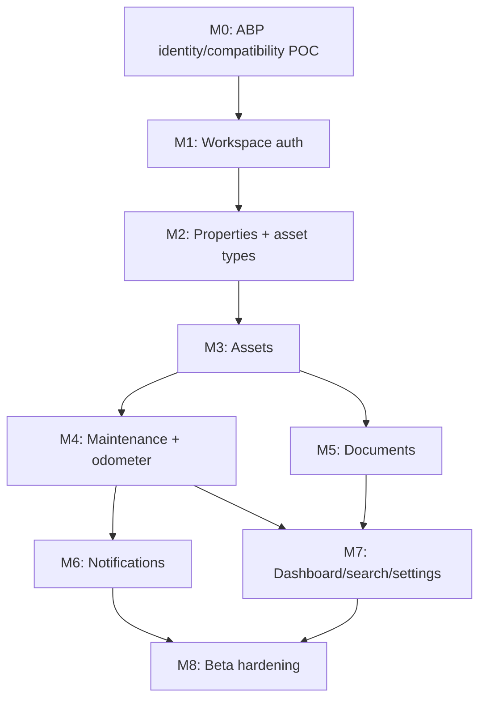

# Kepnora — Product Roadmap

**Canonical path:** `docs/product/roadmap.md`  
**Version:** 1.0-draft · **Updated:** 2026-10-29  
**Status:** Proposed sequencing and release gates; not a delivery commitment  
**Audience:** Product, engineering, design, QA, operations and AI coding agents

**Related:** `docs/product/mvp-scope.md`, `docs/mvp-build-order.md`, `docs/architecture-overview.md`, `docs/api/api-contracts-master.md`, `docs/architecture/maintenance-scheduling-engine.md`.

---

## 1. Purpose and status

This roadmap translates the Phase 1 MVP scope and M0–M8 build order into a delivery sequence, dependency graph, quality gates, and later-phase decision framework. It is a **planning baseline**, not evidence that work has shipped. No calendar dates or staffing commitments are assumed.

**Authority order:** approved product scope and architecture decisions → canonical database/API/feature specs → this roadmap. Any conflict must be resolved in the authoritative spec and documented, not silently overridden here.

## 2. Product direction

**Phase 1 — Own & Maintain:** Securely track household/small-team assets, maintenance, history, manually entered mileage, private documents and reminders.

**Phase 2 — Find Services:** Provider discovery and comparison in Kepnora, potentially behind an `IProviderDiscoveryService` abstraction. Provider data, licensing, coverage, ranking, and monetization are undecided.

**Phase 3 — Book & Pay:** Scheduling, booking, checkout and payments after service discovery is validated. No bookings or payment integrations in MVP.

The app must be valuable for one user with one car and **no property**.

## 3. Planning principles

1. Deliver vertical slices with working API, persistence, authorization, mobile state, tests and documentation.
2. Never use a UI demo as the sole milestone exit criterion.
3. Keep a single global user able to access multiple workspace tenants, subject to M0 proof.
4. `ICurrentTenant` scopes data; it does **not** authorize workspace membership.
5. `Asset.PropertyId` is nullable.
6. Persist only `Open`, `Completed`, `Skipped`, `Cancelled` for maintenance occurrences; compute Due/Upcoming/Overdue for display.
7. Mileage reminders use **actual recorded readings** only; no estimation.
8. Use private S3 and a durable outbox/worker for notifications.
9. Generated mobile API contracts must match running backend OpenAPI.
10. Scope additions require a recorded trade-off and release-gate review.

## 4. Release trains and milestones

| Track | Milestones | Primary deliverable | Exit criterion |
|---|---|---|---|
| Foundation | M0 | ABP/.NET 10 compatibility + global identity proof | Reproducible POC accepted |
| Account | M1 | Login, workspace membership and authorization | Cross-tenant denial tests pass |
| Catalog | M2 | Properties and asset type definitions/versions | Real PostgreSQL schema and forms pass |
| Inventory | M3 | Assets, optional property, search-ready data | Standalone asset end-to-end |
| Maintenance | M4 | Rules, occurrences, history, odometer | Deterministic lifecycle and no mileage projection |
| Evidence | M5 | Private document upload/download | Intent/PUT/finalize and access tests |
| Engagement | M6 | Reminder planner, outbox, Expo Push | Duplicate prevention and cancellation tests |
| Usability | M7 | Dashboard, search, settings/members | All core navigation flows pass |
| Beta | M8 | Security, resilience, E2E, release readiness | Signed release checklist and rollback plan |

Milestone labels are dependencies, not promises of calendar duration.

## 5. Dependency graph

Some independent tasks may run in parallel after prerequisites, but integration and release gates remain mandatory.

## 6. M0 — Technical proof of concept

**Objective:** Remove architectural uncertainty before building feature services.

**Deliverables**
- Pin .NET 10, ABP Framework, EF Core, PostgreSQL, Expo SDK and compatible dependencies in a reproducible build.
- Prove a **single global identity** can authenticate and access two ABP tenant workspaces with different memberships/permissions.
- Verify login, OIDC authorization-code flow with PKCE, refresh/logout and mobile deep-link return in a development build.
- Demonstrate tenant resolution, explicit active membership check, permission check, and tenant-filtered PostgreSQL access.
- Demonstrate EF migrations and OpenAPI client generation.
- Record architectural decisions and unresolved compatibility gaps.

**Exit gate:** User A belongs to Tenant X as Owner and Tenant Y as Member; the same credentials work, permissions differ, and a forged workspace ID is denied. Failure blocks M1 rather than being hidden behind a workaround.

## 7. M1 — Identity, workspaces and onboarding

**Deliverables**
- Global account sign-in and session recovery using platform-secure token storage.
- Workspace create/list/select; ABP Tenant Management is authoritative tenant registry, not a parallel custom Tenants table.
- `TenantMembers` membership and Owner/Member permission policy.
- First-run onboarding that can skip property creation and proceed to standalone assets.
- Safe workspace switch: cancel/partition TanStack Query caches and reset tenant-specific UI state.

**Acceptance:** revoked members cannot access tenant data despite a still-valid JWT; a user sees only their workspaces; workspace switching cannot display stale data; permissions are checked on every relevant API request.

## 8. M2 — Properties and versioned asset types

**Deliverables**
- Property create/list/detail/update/archive, optional address/timezone.
- `AssetTypeDefinitions` global and tenant-specific definitions, `AssetTypeVersions` immutable published schemas, JSONB field validation.
- Schema-driven mobile forms with field types and clear validation.
- Migration constraints, indexes and tenant-safe foreign keys.

**Acceptance:** global templates are readable as approved, tenant custom types do not leak, existing assets remain pinned to their schema version, archived property does not delete assets, and no property is required to create a future asset.

## 9. M3 — Asset inventory

**Deliverables**
- Asset CRUD with nullable `PropertyId`, active/archived behavior according to asset spec.
- Property picker with No property, tenant-scoped list and optional grouping.
- Asset type version selection, custom JSONB fields, server validation.
- Asset detail navigation and basic linked information.

**Acceptance:** one user can create a vehicle without a property; cross-tenant property/type IDs are rejected; list/detail/edit handle empty/loading/offline/permission states; OpenAPI generated types match DTOs.

## 10. M4 — Maintenance and actual mileage

**Deliverables**
- Time-based and mileage-based maintenance rule definitions and scheduling anchors.
- Deterministic occurrence generation with stable schedule key, uniqueness and retry safety.
- Lifecycle `Open`, `Completed`, `Skipped`, `Cancelled`; display `Upcoming`, `Due`, `Overdue` derived at read time.
- Manual odometer readings, monotonicity policy, history and concurrency protection.
- Background generation worker and transactional safeguards.

**Acceptance:** January 31 monthly schedules handle short months without drift; concurrent worker runs do not duplicate occurrences; completion/retry is idempotent; mileage thresholds use only user-entered readings; history survives property archive.

## 11. M5 — Documents and warranties

**Deliverables**
- Private S3 object storage and tenant-safe document metadata.
- Upload intent → presigned PUT → finalize; download with short-lived access.
- Supported receipt/manual/photo/warranty document types and associations already present in canonical schema.
- MIME/size policy, upload expiry, orphan cleanup and failure recovery.

**Acceptance:** wrong-tenant access fails; presigned URLs are not persisted or logged; incomplete uploads are not presented as finalized; expired intents and retries are handled; warranty expiration fields are not invented without approved schema change.

## 12. M6 — Notification engine

**Deliverables**
- Reminder eligibility planner for derived due/overdue states.
- Workspace/user preferences, device token registration and Expo Push integration.
- Durable outbox, worker lease/retry, provider ticket/receipt handling, deduplication and observability.
- Quiet hours and timezone/DST policy; safe deep-link handling.

**Acceptance:** no stale push is sent for completed/cancelled maintenance after final eligibility recheck; revoked membership is respected; repeated worker runs do not create duplicate logical reminders; push provider acceptance is not represented as device delivery.

## 13. M7 — Dashboard, search and settings

**Deliverables**
- Workspace dashboard summaries and counts, including standalone assets.
- Tenant-scoped search and pagination.
- Workspace settings and member management consistent with Owner/Member permissions.
- Notification preferences, profile/account controls and navigation polish.

**Acceptance:** counts reflect archived filters correctly, no cross-tenant cache leakage, asset details can be reached from reminders/search, and all settings mutations enforce permissions.

## 14. M8 — Beta hardening

**Deliverables**
- Security review of global identity, authorization, tenant-scoped SQL and S3.
- Real PostgreSQL integration tests, mobile E2E, notification retry tests and data migration rehearsal.
- Performance checks for high-volume assets/occurrences, query plans, worker throughput and rate limits.
- Logs, metrics, alert thresholds, dashboards, backup/restore and rollback runbooks.
- EAS staging/prod build and controlled beta release.

**Exit gate:** Every MVP story meets Definition of Done; unresolved severity-1/security blockers are zero; release and rollback steps are documented; known limitations disclosed.

## 15. Critical path and parallelizable work

**Critical path:** M0 global identity POC → M1 tenant authorization → M2 type schemas → M3 assets → M4 maintenance → M6 notifications → M8 beta.

**Parallel after prerequisites:** design tokens/screen prototypes, M5 S3 after M3 associations, API contract tests, accessibility review, observability scaffolding, and M7 dashboard design. Parallelism never bypasses integration or tenant checks.

**Avoid:** implementing payment/provider schemas early, building a separate admin portal in Phase 1, or creating a parallel tenant registry.

## 16. Delivery workstreams

| Workstream | Lead artifact | Cross-cutting concern |
|---|---|---|
| Architecture | ADRs + database overview | ABP, identity, tenancy |
| Backend | AppServices + migrations | Authorization, concurrency |
| Mobile | Expo feature modules | Tenant cache, secure session |
| Infrastructure | IaC + S3 + worker | Environments, secrets, backups |
| Quality | Test strategy + CI | Real DB, E2E, security |
| Product/design | Scope + UI specs | Acceptance, accessibility |

A single engineer/agent may own multiple workstreams; table does not assume a team size.

## 17. Cross-cutting Definition of Done

For **each** feature slice:

- [ ] Approved behavior and acceptance criteria recorded.
- [ ] Build passes with pinned dependencies.
- [ ] EF migration reviewed and applied against PostgreSQL.
- [ ] ABP AppService membership + permission checks present.
- [ ] Composite tenant FKs / query scoping verified.
- [ ] OpenAPI and generated TypeScript client match.
- [ ] Error mapping for validation, conflict, not-found and forbidden verified.
- [ ] Unit and real PostgreSQL integration tests pass.
- [ ] Mobile loading/empty/success/validation/offline/error states covered.
- [ ] Structured logs avoid tokens, addresses, file URLs and secrets.
- [ ] Retries cannot create duplicate logical side effects.
- [ ] Documentation/ADRs updated with demo evidence.

## 18. Phase 1 product release gate

| Gate | Required evidence | Blocker |
|---|---|---|
| G1 Identity | Multi-workspace POC and auth tests | Yes |
| G2 Isolation | Cross-tenant read/write negative tests | Yes |
| G3 Data | Migrations, backup/restore rehearsal | Yes |
| G4 Core loop | Create asset → schedule → complete → history | Yes |
| G5 Evidence | Private S3 upload/download and access tests | Yes |
| G6 Reminder | Durable outbox, retry/dedupe, stale-state check | Yes |
| G7 Mobile | Device E2E, accessibility, offline states | Yes |
| G8 Operations | Alerts, rollback, incident ownership | Yes |

No marketing/public launch commitment before all blocking gates are satisfied.

## 19. Phase 1 user journey proof

1. Register/sign in.
2. Create or select a workspace.
3. Skip property setup.
4. Create a vehicle asset from a versioned template.
5. Record an actual odometer reading.
6. Configure a maintenance rule.
7. Observe an eligible due occurrence and reminder.
8. Mark service completed and attach a receipt.
9. Review service history and asset detail.
10. Switch to another workspace; verify no prior workspace data appears.

This journey is the minimum cohesive product demo; partial endpoints alone are not sufficient.

## 20. Phase 2 — Find Services discovery

**Entry prerequisites:** Phase 1 is stable; user research confirms service discovery is a high-value next step; data/provider licensing and privacy requirements are understood.

**Candidate capabilities (not committed):** Search nearby providers by service type, provider detail, hours, location, call/directions links, filters, service category mapping and saved providers. A provider abstraction such as `IProviderDiscoveryService` may isolate external APIs.

**Not included by default:** real-time booking slots, payments, guaranteed pricing, ratings ingestion without license, background location tracking.

**Exit criteria:** Users can discover a relevant service provider from an asset/maintenance context, results are labeled with their source/freshness and external provider data usage complies with terms.

## 21. Phase 2 experiment plan

| Experiment | Hypothesis | Measure | Decision rule |
|---|---|---|---|
| Contextual Find Services CTA | Users prefer service search near due tasks | CTA engagement, task completion | Continue only with meaningful use |
| Category mapping | Asset/rule type improves relevance | Relevant result rate | Revise taxonomy if poor |
| Location permission | Approximate search works without always-on GPS | Permission denial and completion | Default to explicit location |
| Provider data source | Data coverage meets launch needs | Coverage, freshness, costs | Reassess provider before scaling |

Metrics and thresholds require baseline data; do not invent numeric targets.

## 22. Phase 3 — Book & Pay

**Entry prerequisites:** Phase 2 discovery is validated, providers support booking integrations, consumer protection and payments requirements are reviewed.

**Candidate capabilities (not committed):** Appointment request, slot availability, confirmation/cancellation, booking status, secure checkout, receipts, refunds, provider payout, dispute support.

**Major new responsibilities:** Payment processor integration, webhooks/idempotency, PCI scope, fraud/risk, taxes/fees, refunds, chargebacks, marketplace/provider agreements and customer support.

Keep these separate from Phase 1 maintenance records; do not equate a maintenance occurrence with a provider booking.

## 23. Non-goals and guardrails

Phase 1 excludes: provider discovery, booking, checkout, payment, smart-device mileage ingestion, mileage projection, AI maintenance diagnosis, automatic warranties from receipts, real estate valuation, property maps, enterprise CMMS, separate custom admin portal, and offline mutation queues without an explicit design.

Phase 2 excludes payments by default. Phase 3 cannot be pulled into Phase 1 as a “small API addition” without revisiting security, privacy, data and operating costs.

## 24. Roadmap prioritization rubric

Score each proposed addition 1–5 on user value, MVP dependency, risk reduction and implementation effort (higher effort = less attractive). Evaluate against tenant security and data correctness as non-negotiable constraints, not tradeable scores.

**Suggested priority:** P0 release blocker, P1 core user workflow, P2 usability/observability, P3 post-MVP experiment. A feature that improves appearance but blocks core data correctness should not outrank M0–M4.

## 25. Risk register

| Risk | Likelihood | Impact | Mitigation |
|---|---|---|---|
| ABP global identity mismatch | Unknown until POC | Critical | M0 gate, ADR, spike |
| Tenant data leakage | Must assume possible | Critical | Membership + permission + DB tests |
| Schema-version corruption | Medium | High | Immutable published versions, JSONB validation |
| Duplicate maintenance occurrences | Medium | High | Deterministic keys + DB uniqueness |
| False mileage reminders | Medium | High | Actual readings only |
| S3 access leaks | Medium | High | Private bucket, short-lived URLs, auth |
| Duplicate/stale push | High under retries | Medium | Durable outbox + final recheck |
| Mobile offline confusion | Medium | Medium | Explicit read-only state, safe retry |
| Scope creep | High | High | Phase gates and change control |
| Vendor cost surprise | Unknown | Medium | Budget/usage monitoring, pricing ADR |

## 26. Decision register

| Decision | Required by | Owner | Current state |
|---|---|---|---|
| ABP version compatible with .NET 10 | M0 | Engineering | Unverified |
| Global identity model across tenants | M0 | Architecture | POC required |
| Permission matrix for Owner/Member | M1 | Product/security | Proposed |
| Asset type JSON schema dialect | M2 | Architecture | To approve |
| Maintenance anchor and timezone policy | M4 | Product/engineering | To confirm in engine spec |
| Mileage correction and monotonicity | M4 | Product | To approve |
| S3 MIME/size limits | M5 | Security/product | To approve |
| Quiet hours, DST and reminders | M6 | Product | To approve |
| Beta cohort, support and retention | M8 | Product/ops | To approve |
| Phase 2 provider API/license | Post-MVP | Product/legal | Not selected |
| Phase 3 processor/provider model | Post-Phase 2 | Product/legal | Not selected |

## 27. Release management

Use `dev`, `staging`, `production` environments with distinct AWS resources and credentials. Promote database migrations with reviewed forward/rollback plan; deploy backend and workers with backward-compatible API contracts; release mobile via EAS build profiles and store-managed staged rollout.

OTA updates must respect native runtime compatibility. Do not embed server secrets in `EXPO_PUBLIC_*` values. Publish incident contacts, restore process, and rollback criteria before beta.

## 28. Quality and performance baselines

Measure actual query latency, API error rates, crash-free sessions, notification queue lag, outbox retries, storage costs and asset/occurrence growth. Establish numeric SLOs only after a representative staging load test; no arbitrary claims of scalability.

Performance tests should cover tenant-scoped asset lists, search, due occurrence scans, dashboard aggregates and worker batch processing. Use PostgreSQL `EXPLAIN (ANALYZE, BUFFERS)` with safe staging data.

## 29. Privacy and security checkpoints

- No cross-tenant data in API, push payload, cache, logs or S3 paths.
- User token storage uses SecureStore/approved platform facilities.
- Notification text avoids sensitive details where device lock-screen exposure matters.
- Presigned S3 URLs expire quickly and are not stored in analytics.
- Address and document metadata access is membership-gated.
- Retention/deletion/export policies are product/legal decisions requiring separate approval.
- Operator/admin tooling is deferred unless needed for a secure launch.

## 30. Product analytics and feedback loop

Instrument privacy-conscious funnel events: workspace created, first asset created, first maintenance rule created, first completed occurrence, document upload finalized, reminder opt-in, reminder tap, search use, and workspace switch. Avoid sending addresses, VINs, document filenames or raw notes to analytics.

After beta, review task success, support tickets, retention, opt-in rates, failure modes and qualitative interviews. Use evidence to decide whether Phase 2 deserves investment.

## 31. Go/no-go review template

**Release:** [candidate] · **Date:** [TBD] · **Reviewers:** [TBD]

| Category | Evidence | Decision |
|---|---|---|
| Scope | M0–M8 acceptance checklist | Pass / Fail |
| Security | Cross-tenant and auth review | Pass / Fail |
| Data | Migration/restore rehearsal | Pass / Fail |
| Mobile | iOS/Android E2E | Pass / Fail |
| Reliability | Worker/outbox and S3 failure tests | Pass / Fail |
| Operations | Monitoring, rollback, support | Pass / Fail |
| Known issues | Severity, owner, mitigation | Accept / Block |

**Outcome:** Go / No-Go, recorded with owners and follow-up actions.

## 32. Change control process

1. Record request, user problem and target phase.
2. Identify affected canonical specs, schema, APIs, UI, privacy and tests.
3. Estimate critical-path impact and new dependencies.
4. Decide: include in current milestone, defer, or reject.
5. Update ADRs, acceptance criteria and milestone gate.
6. Re-run regression tests for impacted areas.

Do not redefine Phase 1 by quietly moving Phase 2/3 work into technical foundations.

## 33. Artifact handoff map

| Milestone | Primary docs |
|---|---|
| M0 | `architecture-overview.md`, `architecture/authentication-authorization.md`, `architecture/architecture-decision-records.md` |
| M1 | `features/authentication-onboarding.md`, `features/settings-members.md` |
| M2 | `features/property-management.md`, `features/custom-asset-types.md` |
| M3 | `features/asset-management.md`, `api/api-contracts-master.md` |
| M4 | `architecture/maintenance-scheduling-engine.md`, `features/maintenance-management.md` |
| M5 | `architecture/file-storage.md`, `features/documents-warranties.md` |
| M6 | `architecture/notification-engine.md`, `features/notifications-reminders.md` |
| M7 | `features/dashboard.md` or `features/dashboard-search.md`, `features/settings-members.md` |
| M8 | `testing/test-strategy.md`, `deployment/deployment-guide.md`, `ui/README.md` |

Confirm canonical filenames when packaging the repository; some prior drafts use alternative paths.

## 34. Definition of roadmap completion

The roadmap is ready for execution when all M0–M8 deliverables are linked to owned implementation tickets, open decisions are tracked, acceptance tests are traceable to canonical specs, and a release review can determine go/no-go from evidence rather than subjective confidence.

**This roadmap does not assert the project is implemented or the beta is ready.**

## 35. Appendix A — Example backlog decomposition

| Epic | Example implementation slices |
|---|---|
| Identity | Auth POC, global user resolution, membership service, permission tests |
| Workspace | Create/select, Owner/Member, switching cache reset |
| Property | CRUD, archive, picker, tenant FK |
| Asset types | Global template, tenant custom, immutable version, JSONB validator |
| Asset | Create/edit, standalone asset, list/detail, archive |
| Maintenance | Rule CRUD, occurrence generation, complete/skip/cancel, history |
| Mileage | Reading CRUD/correction policy, threshold evaluation |
| Documents | Intent, S3 PUT, finalize, signed download, cleanup |
| Push | Device registration, preferences, planner, outbox, worker |
| Experience | Dashboard, search, settings, onboarding, accessibility |
| Release | Migrations, load tests, backup/restore, beta build, support |

## 36. Appendix B — Dependency acceptance checklist

- [ ] M0 completed before identity-dependent feature APIs.
- [ ] M1 authorization completed before tenant-owned data endpoints.
- [ ] M2 schema and type validation completed before asset create.
- [ ] M3 asset identity completed before maintenance and documents.
- [ ] M4 scheduling completed before reminder planner.
- [ ] M5 document finalization complete before UI promises uploaded evidence.
- [ ] M6 push retry and dedupe complete before enabling notifications in beta.
- [ ] M7 search/dashboard permission tested before beta.
- [ ] M8 security, migration and operational gates passed before production rollout.

## 37. Appendix C — Explicitly deferred research questions

- Which user segment is the best initial beta cohort?
- How much should the free plan support, and when should billing begin?
- What service provider dataset has appropriate coverage and licensing?
- Which markets and countries should Phase 2 support?
- Is booking an external handoff or a native integrated flow?
- What refund/dispute/support model is required for payments?
- Is a dedicated web admin UI ever necessary beyond ABP/operations tooling?

These questions inform later `product/pricing.md` and `product/feature-matrix.md`; they must not be treated as implemented features.
