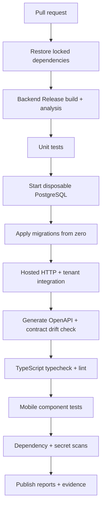

# Kepnora — Test Strategy & Quality Gates

**Intended path:** `docs/testing/test-strategy.md`  
**Version:** 1.0-draft · **Date:** 2026-10-29  
**Scope:** Phase 1 MVP (M0–M8) · **Status:** Proposed implementation-ready strategy

**Primary references:** `docs/mvp-build-order.md`, `docs/database-overview.md`, `docs/architecture/tenant-isolation.md`, `docs/architecture/authentication-authorization.md`, `docs/architecture/api-design.md`, `docs/architecture/background-jobs-and-outbox.md`, `docs/architecture/file-storage.md`, `docs/architecture/mobile-app-architecture.md`, `docs/features/asset-management.md`, `docs/features/maintenance-management.md`, `docs/features/notification-reminders.md`, `docs/features/dashboard-search.md`, `docs/features/workspace-settings.md`, `docs/ui/screen-specifications.md`.

**Guiding principle:** A feature is not done when its happy-path UI works. It is done when authorization, persistence, concurrency, recovery, contract behavior, accessibility and failure cases have repeatable evidence. Tests must validate the **actual pinned ABP/.NET 10 implementation**, not hypothetical framework behavior.

---
## 1. Objectives and success criteria

The quality program must prevent cross-workspace data exposure, corrupted maintenance history, duplicate jobs/reminders, unsafe S3 access and mobile regressions. The release candidate must reproduce every milestone's acceptance criteria and all fifteen invariant checks (`INV-01`–`INV-15`) in `mvp-build-order.md`. No test coverage percentage alone proves release readiness.


## 2. Scope and boundaries

| In scope | Out of scope for Phase 1 |
|---|---|
| .NET domain/application/HTTP/EF Core tests | Phase 2 provider discovery contracts |
| Real PostgreSQL migrations, constraints and queries | Phase 3 bookings/payments |
| Global identity, membership and tenant isolation | Unsupported ABP conventions |
| Expo UI, navigation, offline/cache and E2E | Fake live S3/Expo delivery assertions |
| S3 private upload/finalize and cleanup | AI semantic search |
| Durable jobs, outbox and push retry | Production data copied into test environments |

Future-phase functionality must not be a blocker for Phase 1 unless it is explicitly pulled into scope.


## 3. Test pyramid and ownership

| Layer | Primary owner | What it proves | What it does not prove |
|---|---|---|---|
| Domain unit | Backend | Pure invariants and recurrence math | DB constraints or authorization pipeline |
| Application tests | Backend | Use-case orchestration, permission decisions | Actual ABP middleware unless hosted |
| PostgreSQL integration | Backend/DB | Migrations, FK, concurrency, transactions | Mobile UX |
| Hosted HTTP contract | Backend | Real auth, status, DTO, OpenAPI | OS push delivery |
| Worker/recovery | Backend/infra | Retries, idempotency, isolation | Exactly-once external effects |
| React Native unit/component | Mobile | Validation, states, accessibility | Native OS integration |
| Device E2E | Mobile/QA | End-to-end critical flows | All concurrency races |
| Security/performance | Cross-functional | Abuse cases, scaling evidence | Functional completeness alone |

Keep most cases at the lowest layer that can actually prove the claim, but **never** replace real database and HTTP security tests with mocks.


## 4. Repository and project layout

Proposed solution layout from the build-order specification (verify actual ABP scaffold):

```text
backend/
  test/
    Kepnora.Domain.Tests/
    Kepnora.Application.Tests/
    Kepnora.EntityFrameworkCore.Tests/
    Kepnora.HttpApi.Tests/
mobile/
  src/**/__tests__/
  e2e/
infra/
  test/
docs/testing/
  test-strategy.md
  test-cases/
  release-checklist.md
```

A dedicated worker test project may be added if workers are separate executables. Do not create redundant projects solely to mirror this tree.


## 5. Tooling recommendations and compatibility gate

- **Backend:** xUnit or NUnit, FluentAssertions (license review), Microsoft test host, `WebApplicationFactory` if compatible with the pinned ABP host, Npgsql, EF Core, Testcontainers for .NET.
- **Database:** disposable PostgreSQL matching the production major version; real migrations and constraint checks.
- **Mobile:** Jest or Vitest selected based on Expo compatibility, React Native Testing Library, TypeScript strict mode, ESLint.
- **Device E2E:** Maestro or Detox after a small real-device POC; do not assume both are needed.
- **CI:** GitHub Actions or the selected pipeline; lock dependency versions, cache safely, publish JUnit/TRX and coverage artifacts.
- **Security:** dependency/license/secret scanning and targeted HTTP authorization tests.

These are recommendations, **not claims that the tools are already installed**. M0 must pin ABP, .NET, EF Core, Npgsql, OpenIddict/OIDC, test host, Expo and React Native compatibility.


## 6. Deterministic fixtures and clocks

Every test that compares due dates must inject a fixed clock and a documented timezone. Never depend on `DateTime.Now`, local CI runner timezone, real Expo tokens or public S3. Use deterministic UUIDs, stable sample names, seeded timestamps and explicit calendar boundaries.

Fixture identities: global users **Alice** and **Bob**; workspaces **X** and **Y**; Alice Owner in X and Member in Y; Bob Member in X only. Include revoked membership, invited membership, standalone vehicle, property-linked HVAC, global asset type, X-only custom type, Y-only custom type, archived asset, time and mileage rules, missing odometer and completed service history. Use synthetic, non-sensitive data.


## 7. Environment matrix

| Environment | Data | Purpose |
|---|---|---|
| Local unit | In-memory pure objects | Fast logic feedback |
| Local integration | Disposable PostgreSQL + test ABP host | Constraints/auth/transaction |
| CI pull request | Fresh isolated DB per suite | Repeatable gates |
| Staging | Synthetic seeded tenants and private S3 test bucket | Full system, push sandbox/device |
| Beta | Approved non-production user data | Real device/release validation |

Use separate credentials, buckets, push projects and databases. Never point automated destructive tests at production.


## 8. Test isolation and cleanup

Create isolated databases/schemas or reset verified test data between integration suites. Parallel tests must not share mutable global singleton tenant context. Use test-scoped service providers and explicit tenant restoration. Avoid broad `TRUNCATE CASCADE` against a shared environment. Dispose workers, containers and clients; ensure failed tests still clean up temporary S3 objects.


## 9. Coverage and quality thresholds

Proposed starting thresholds (approval required): 80% line coverage on **pure domain logic**, 90% on recurrence/authorization-critical branch logic, and mandatory scenario coverage for every invariant. Coverage numbers must exclude generated code, migrations and DTO boilerplate according to a documented rule. A 95% mocked service test suite cannot substitute for one real cross-tenant exploit test. Track mutation-test results on critical calculators if tooling permits.


## 10. M0 framework and identity proof

M0 blocks downstream development until tests prove: chosen ABP version compiles on .NET 10; global user ID is stable across tenant X/Y; role and permissions differ by tenant; tenant switch cannot elevate privileges; `TenantMembers` references actual identity and ABP tenant registry; no duplicate tenant table exists; refresh/revocation works; OpenAPI reflects actual routes and error envelope; chosen outbox/worker strategy is viable.

Evidence: exact dependency versions, executable POC, migration snapshot, passing hosted integration tests, and ADRs. Do not assume ABP default tenant-local Identity supports global users without explicit validation.


## 11. Core tenant-isolation suite

| ID | Scenario | Expected |
|---|---|---|
| SEC-001 | Alice Owner X reads X asset | Allowed |
| SEC-002 | Alice Member Y uses X Owner action in Y | Denied |
| SEC-003 | Bob guesses Y asset UUID | Neutral 404 or safe denial |
| SEC-004 | Bob changes workspace header/path to Y | Membership denied |
| SEC-005 | Foreign `PropertyId` in create asset | Rejected |
| SEC-006 | Foreign tenant asset type/version | Rejected |
| SEC-007 | Foreign maintenance rule linked to X asset | Rejected |
| SEC-008 | Foreign document finalize token | Rejected |
| SEC-009 | Background worker switches X→Y | No context leakage |
| SEC-010 | Removed member uses valid old access token | Denied on next request |
| SEC-011 | Search UNION branch missing tenant filter | Test fails; no leakage |
| SEC-012 | TanStack Query X→Y switch | No X content flashes |
| SEC-013 | Deep link to former workspace | Denied |
| SEC-014 | Member role claims cached after demotion | Server denies |
| SEC-015 | Last active Owner removed concurrently | At least one request rejected |

Run security tests against the **hosted HTTP application** and actual PostgreSQL, not only direct repository calls.


## 12. Database schema and migration tests

1. Apply migrations to an empty PostgreSQL database.
2. Verify ABP tenant registry is authoritative; assert no custom parallel `Tenants` table.
3. Inspect FK targets for actual global identity table after M0.
4. Validate `(TenantId, Id)` composite unique/FK patterns for tenant-owned parents.
5. Assert nullable `Assets.PropertyId` and standalone asset insertion.
6. Assert `CustomFields` is JSONB object, not array/null.
7. Assert maintenance lifecycle CHECK accepts only Open/Completed/Skipped/Cancelled.
8. Assert `(TenantId, RuleId, ScheduleKey)` occurrence uniqueness.
9. Assert one `MaintenanceRecord` per non-null occurrence.
10. Assert nonnegative purchase price, cost/mileage constraints as defined.
11. Test migration forward compatibility with a database from prior version.
12. Test documented rollback **or forward-fix**, especially destructive schema changes.

PostgreSQL quoted PascalCase identifiers are intentional; do not copy SQL Server/T-SQL syntax into migrations.


## 13. Asset type and JSONB tests

| ID | Case | Expected |
|---|---|---|
| AST-001 | Global published type | Usable by X and Y |
| AST-002 | X custom type | Usable only by X |
| AST-003 | Y tries X custom type | Rejected |
| AST-004 | Definition/version mismatch | Rejected |
| AST-005 | Published schema update | Prohibited |
| AST-006 | Old asset after new schema publish | Remains pinned/readable |
| AST-007 | Missing required field | Validation error |
| AST-008 | Unknown JSONB key | Rejected by approved policy |
| AST-009 | Invalid integer/enum/date | Validation error |
| AST-010 | JSONB array payload | DB/API rejection |
| AST-011 | Optional property null | Success |
| AST-012 | Archived asset | Excluded from active list |
| AST-013 | Stale asset Version | Conflict |
| AST-014 | Asset type change without migration | Not silently allowed |
| AST-015 | Asset search | Tenant-scoped and paginated |


## 14. Maintenance recurrence unit tests

| ID | Case | Expected |
|---|---|---|
| REC-001 | Every 30 days | Deterministic dates |
| REC-002 | Jan 31 monthly | No unintended drift |
| REC-003 | Feb 29 yearly/monthly | Approved leap policy |
| REC-004 | Scheduled vs Completion | Correct anchor distinction |
| REC-005 | Mileage baseline 20,000 + 5,000 | Correct 25k/30k thresholds |
| REC-006 | Missing observed reading | Unknown, not zero |
| REC-007 | At threshold | Due |
| REC-008 | Above threshold | Due/past threshold by miles |
| REC-009 | Open due yesterday | Derived Overdue |
| REC-010 | Completed due yesterday | Not overdue |
| REC-011 | Invalid zero/negative interval | Rejected |
| REC-012 | Hybrid time/mileage | Not supported in Phase 1 |
| REC-013 | Timezone boundary | Correct local date |
| REC-014 | DST gap/overlap | Approved policy |
| REC-015 | Historic anchor | Bounded generation |
| REC-016 | Completion without mileage | Explicit policy, no guess |
| REC-017 | Skip occurrence | No false completion record |
| REC-018 | Cancel occurrence | No false completion record |
| REC-019 | Rule edit after occurrence | Preserve history per policy |
| REC-020 | Duplicate schedule key | One occurrence |


## 15. Maintenance atomicity and concurrency

Use real PostgreSQL concurrent transactions and a barrier to race two requests against one Open occurrence. Assert exactly one successful completion, exactly one linked `MaintenanceRecord`, consistent `LastCompletedOn`/`LastCompletedMileage`, correct lifecycle and one logical next obligation. Simulate failure between each logical write and verify full rollback or durable outbox recovery. Do not claim exactly-once external notifications; distinguish database idempotency from push delivery retries.


## 16. Odometer and service-history tests

Test nonnegative manual readings, latest **valid observed** reading by event time, late historical insertion, lower corrected readings, odometer replacement/reset policy, missing reading, mileage-unit conversion if approved, same-tenant service record/asset match, ad hoc record with null `OccurrenceId`, history pagination, archived asset history retention, and prevention of duplicate scheduled history. A completed service must not automatically invent an odometer value.


## 17. S3 document lifecycle tests

| ID | Scenario | Expected |
|---|---|---|
| DOC-001 | Authorized upload intent | Scoped short-lived PUT URL |
| DOC-002 | Foreign asset upload intent | Denied |
| DOC-003 | Oversize/wrong MIME | Rejected |
| DOC-004 | Successful PUT without finalize | Not visible as attached |
| DOC-005 | Finalize with matching metadata/object | Attached once |
| DOC-006 | Finalize foreign tenant object | Denied |
| DOC-007 | Duplicate finalize | Idempotent or safe conflict |
| DOC-008 | Orphan upload cleanup | Removes only eligible unfinalized objects |
| DOC-009 | Download link expiry | Private access expires |
| DOC-010 | Archived asset attachment | Retained per policy |
| DOC-011 | Presigned URL in logs | Prohibited |
| DOC-012 | S3 transient failure | Recoverable, no false success |

Use local S3-compatible integration tests for object flow, plus a narrowly scoped staging smoke test against actual AWS S3 semantics. Local emulators do not prove AWS IAM policies.


## 18. Outbox, jobs and reminder recovery

Test transactional outbox insertion, concurrent workers, lease expiry, duplicate event delivery, crash before/after DB commit, poison messages, bounded retry/backoff, dead-letter visibility, tenant context restoration and idempotent occurrence generation. A reminder queued before completion must recheck current occurrence state, membership and preferences at dispatch and suppress stale messages. Expo provider acceptance is **not** proof of device delivery.


## 19. Push registration and preferences

Test global-user device registration, token rotation, encrypted token storage, invalid token deactivation, user logout, per-workspace `NotificationPreferences`, 0–365 reminder lead days, quiet hours crossing midnight, OS permission denied while backend preference enabled, revoked membership, and deep links. Do not send real push in ordinary CI; use a fake adapter with recorded requests and a separate staging device test.


## 20. Dashboard and search correctness

Assert active asset counts include standalone assets, exclude archived assets, and are scoped to the workspace. Verify only Open occurrences contribute to derived Due/Overdue. Mileage without reading is Unknown. Search must handle exact/prefix/substring matches, escaped `%` and `_`, stable pagination, cursor reuse across tenants, rapid typing cancellation, 0-result state, and permission checks at destination. Benchmark with representative data using `EXPLAIN (ANALYZE, BUFFERS)`.


## 21. Workspace and settings tests

Test Owner X/Member Y, member revocation, last-owner concurrency, workspace provisioning partial failure, duplicate create retries, role update version conflicts, timezone validation, per-workspace notification preferences, global device ownership, secure sign-out, and workspace switch during mutations. Do not test an invitation email workflow as shipped unless its full contract/migration is approved; `Invited` status alone is not a finished feature.


## 22. HTTP API and contract tests

Run against the actual ABP HTTP host with authenticated and unauthenticated clients. Validate 400/401/403/404/409/413/422/429/500 cases as applicable, stable correlation IDs, safe error messages, validation field mapping, pagination, ETag/version concurrency policy, file-intent responses, and idempotent retry behavior. Capture generated OpenAPI and compare to a reviewed baseline; regenerate TypeScript client and compile the Expo app. **Do not hardcode guessed ABP auto-controller routes or error envelopes.**


## 23. Sample .NET integration test pattern

```csharp
// Illustrative only: adapt to the actual ABP host and test base.
[Fact]
public async Task Member_Of_X_Cannot_Read_Asset_From_Y()
{
    var client = await TestHost.CreateAuthenticatedClientAsync(
        user: "bob", workspace: "X");

    var response = await client.GetAsync(
        $"/api/v1/workspaces/{WorkspaceX}/assets/{AssetOwnedByY}");

    Assert.Contains(response.StatusCode,
        new[] { HttpStatusCode.NotFound, HttpStatusCode.Forbidden });

    // Also assert that response body contains no Y asset data.
}
```

`TestHost`, fixture constants and route are examples, not existing code. Use the actual generated route and selected concealment policy; never let a test pass merely because the server returns 500.


## 24. Mobile unit and component tests

Cover React Hook Form/Zod dynamic fields, validation, loading/success/error/empty/offline states, skeletons, screen reader labels, reduced motion, image fallback, optional property, missing odometer, due labels, disabled submit, double tap, stale conflict, and server error mapping. Mock the generated API client at the UI boundary; keep core recurrence logic on the backend rather than duplicating it in React Native.


## 25. Mobile navigation and cache security

Use two-workspace fixtures and deliberately delay responses: request X asset list, switch to Y, resolve X response last. Assert X content never appears in Y. Repeat for dashboard, search, maintenance detail, notifications and document thumbnails. Test logout/back navigation, expired session, revoked membership, deep links to unauthorized resources, and pending upload/completion bound to original tenant. Test on iOS and Android.


## 26. Device E2E critical journeys

1. First launch → global login → workspace create/select → Home.
2. Create standalone vehicle → select type → custom fields → save → detail.
3. Create property → create HVAC linked to property → asset list filter.
4. Add time maintenance rule → see occurrence → complete → history.
5. Add mileage rule → record actual mileage → due state changes.
6. Attach receipt through private upload/finalize → reopen document.
7. Enable notification preference → receive controlled staging push → deep link.
8. Search asset/property/maintenance → open authorized result.
9. Switch X→Y → verify data and permissions differ.
10. Revoke membership from second device → protected navigation denied.
11. Offline while editing → no false success; recover draft.
12. Sign out → protected screens and cached data unavailable.

Use stable test accounts and synthetic fixtures; avoid production pushes or real customer assets.


## 27. Accessibility and localization

Test VoiceOver/TalkBack, dynamic text scaling, focus order, semantic status announcements, contrast in light/dark themes, minimum touch target size, reduced-motion behavior, safe areas, screen rotation where supported, date and number localization, and explicit mileage units. Urgency must be conveyed by text, not color alone. Check English labels and any approved localized strings without assuming Vietnamese is shipped in MVP.


## 28. Performance and load plan

Benchmark with small, medium and large synthetic tenants (for example 10/1,000/100,000 assets) **as test fixtures, not product SLAs**. Exercise dashboard aggregation, global search, type/version lookup, maintenance generator, due queries, history pagination, membership list and document metadata. Record p50/p95, CPU, memory, DB query count, slow queries, lock waits and queue lag. Define performance budgets from measured baseline and target devices before making them release gates. Verify bounded pagination and no N+1 queries.


## 29. Reliability, chaos and recovery

Inject DB connection loss before commit, S3 PUT timeout, S3 finalize failure, Expo 429/5xx, worker crash, outbox lease expiry, app termination during upload, network switch, device clock skew, duplicate button taps and stale tokens. Expected results: no cross-tenant leakage, no fabricated completion, no duplicate service history, recoverable retry or visible safe error, and structured correlation evidence. Re-run the same operation after recovery to prove idempotency.


## 30. Security checks beyond tenant isolation

Threat-focused tests: IDOR, mass assignment of `TenantId`/role/server-managed fields, token audience/issuer/expiry, unsafe CORS, over-permissive S3 IAM, presigned URL scope/expiry, JSONB schema injection, SQL injection, log redaction, rate limiting, device token disclosure, invitation abuse **if implemented**, CSRF considerations for any cookie-based flows, and sensitive local storage. Use an approved security checklist and independent review before beta.


## 31. CI pipeline — minimum PR gates



Fail the PR on build errors, migration errors, cross-tenant leaks, critical test failures, TypeScript contract drift and secret findings. Device E2E and load suites can run on scheduled/release pipelines with an explicit release gate.


## 32. Illustrative GitHub Actions skeleton

```yaml
name: kepnora-ci
on:
  pull_request:
  push:
    branches: [main]
jobs:
  verify:
    runs-on: ubuntu-latest
    services:
      postgres:
        image: postgres:17
        env:
          POSTGRES_USER: kepnora_test
          POSTGRES_PASSWORD: test-only-secret
          POSTGRES_DB: kepnora_test
        ports: ["5432:5432"]
        options: >-
          --health-cmd "pg_isready -U kepnora_test"
          --health-interval 10s
          --health-timeout 5s
          --health-retries 5
    steps:
      - uses: actions/checkout@v4
      - uses: actions/setup-dotnet@v4
        with:
          dotnet-version: '10.0.x'
      - run: dotnet restore --locked-mode
      - run: dotnet build --configuration Release --no-restore
      - run: dotnet test --configuration Release --no-build
```

**Skeleton only.** Pin action SHAs/versions, PostgreSQL version, solution path, environment secrets and mobile jobs after the repository is scaffolded. The sample is not a claim that ABP/.NET 10 compatibility has been proven or that this workflow is production-ready.


## 33. Test result and evidence format

Each failed/passed gate should produce machine-readable test reports and a human-readable summary containing commit SHA, dependency lockfile, test environment, PostgreSQL version, migration hash, OpenAPI hash, number of tests, failures/flakes, coverage, security scan summary, performance baseline and links to redacted logs. Store screenshots/videos for device E2E failures without leaking personal data.


## 34. Flaky-test policy

A flaky test is a defect in the quality signal. Quarantine only with a ticket, owner, expiry and risk assessment. Never auto-retry cross-tenant security tests until green and call that a pass. Reproduce clock, async worker and network races with deterministic barriers and fake clocks; record seeds and timing. Track flake rate and restore quarantined tests before release.


## 35. Pull-request review checklist

- [ ] Invariant or ADR affected identified.
- [ ] Authorization and active membership checks tested.
- [ ] Tenant-owned FK/query scoped correctly.
- [ ] DB migration reviewed and tested on fresh database.
- [ ] DTO/OpenAPI/client drift checked.
- [ ] Validation, conflict, retry and error states tested.
- [ ] No secrets, private S3 URLs or push tokens logged.
- [ ] Mobile workspace cache keys and navigation tested.
- [ ] Observability/correlation added.
- [ ] Evidence linked to milestone acceptance item.


## 36. Release candidate gates — M8

Release candidate is blocked by: any known cross-tenant leak; broken global identity/role separation; unreviewed destructive migration; non-atomic maintenance completion; duplicate history under race; publicly readable S3 objects; unbounded worker retry or generator; missing notification dispatch revalidation; leaked secrets/tokens; critical mobile logout/cache exposure; or untested recovery of failed provisioning.

Other defects should be risk-ranked with owner, workaround, target fix and explicit acceptance. A successful demo is not a substitute for these gates.


## 37. Traceability — milestone to test evidence

| Milestone | Mandatory evidence |
|---|---|
| M0 | Global identity POC, ABP schema inspection, auth/tenant tests |
| M1 | Workspace create/switch, roles, last Owner, revocation |
| M2 | Property ownership, global/tenant asset types, immutable versions |
| M3 | Asset CRUD/archive, optional property, JSONB, concurrency |
| M4 | Recurrence, mileage, occurrence uniqueness, atomic completion |
| M5 | S3 private access, intent/PUT/finalize, orphan cleanup |
| M6 | Outbox, push preference, retry, suppression and deep links |
| M7 | Dashboard, search, settings, pagination, cache isolation |
| M8 | Full regression, security, performance, recovery, device E2E |


## 38. Invariants verification matrix

| ID | Test mechanism |
|---|---|
| INV-01 | ABP Tenant Management migration + provisioning test |
| INV-02 | Forged tenant context with no membership |
| INV-03 | One global subject, Owner X / Member Y hosted POC |
| INV-04 | Schema assertion: no parallel tenant registry |
| INV-05 | Composite FK negative insert + service validation |
| INV-06 | Standalone vehicle create/read/edit |
| INV-07 | Published schema mutation rejection |
| INV-08 | DB CHECK + DTO lifecycle tests |
| INV-09 | Fake clock/timezone derived urgency tests |
| INV-10 | Missing/corrected mileage observation tests |
| INV-11 | Concurrent completion, one history record, rollback |
| INV-12 | Private S3 IAM + finalize + orphan cleanup |
| INV-13 | Push/outbox crash and duplicate retry |
| INV-14 | Delayed X response after switching to Y |
| INV-15 | Real PostgreSQL migration execution and SQL review |


## 39. Cross-feature regression catalog

| ID | Scenario | Result |
|---|---|---|
| REG-001 | Create asset, add rule, complete, view dashboard | Consistent counts/history |
| REG-002 | Archive asset with open maintenance | Approved policy, no lost history |
| REG-003 | Update asset schema version | Old assets remain pinned |
| REG-004 | Upload receipt after service completion | Finalized attachment only |
| REG-005 | Complete occurrence before reminder dispatch | Reminder suppressed |
| REG-006 | Revoke member with pending push | Push/deep link denied/suppressed |
| REG-007 | Switch workspace mid-search | No stale results |
| REG-008 | Switch workspace mid-upload | No cross-tenant finalize |
| REG-009 | Missing mileage on Home | Unknown, not zero |
| REG-010 | New odometer reading crosses threshold | Correct derived due state |
| REG-011 | Duplicate generator run | One occurrence |
| REG-012 | Concurrent completion from two devices | One history row |
| REG-013 | Search result archived before open | Safe unavailable |
| REG-014 | Sign out then push deep link | Login required |
| REG-015 | Migration upgrade from previous release | Data preserved |
| REG-016 | Rebuild from clean DB | Migrations/seed idempotent |
| REG-017 | Device token rotation | No token leak |
| REG-018 | Last Owner attempts removal | Rejected |
| REG-019 | Timezone change near midnight | Defined urgency policy |
| REG-020 | Offline form retry | No duplicate mutation |


## 40. Open decisions

1. Pinned ABP/.NET/EF Core/Npgsql/Expo versions and test-host compatibility.
2. xUnit vs NUnit; Jest vs Vitest; Maestro vs Detox.
3. PostgreSQL major version and migration rollback/forward-fix policy.
4. Exact HTTP route/error-envelope baselines from generated OpenAPI.
5. Coverage thresholds and exclusions.
6. Performance SLOs based on measured baseline and target devices.
7. Timezone, recurrence first-occurrence, skip, archive and mileage correction policies.
8. Idempotency-key persistence for retried mutations.
9. Workspace provisioning recovery strategy and test hooks.
10. S3 local emulator vs AWS staging test boundaries.
11. Notification receipt/delivery monitoring scope.
12. Test report retention, secrets scanning and CI permissions.
13. Beta device matrix, accessibility target and supported OS versions.
14. Flaky test quarantine approval and maximum lifetime.

Record chosen decisions in ADRs and update the corresponding test assertions before treating them as fixed behavior.


## 41. Definition of Done for the testing program

- [ ] Every `INV-01`–`INV-15` has an executable verification.
- [ ] M0 global identity/tenant POC passes before dependent features.
- [ ] Fresh PostgreSQL migrations and tenant-aware FKs are tested.
- [ ] Real hosted HTTP cross-tenant negative tests pass.
- [ ] Maintenance recurrence and concurrent completion are deterministic.
- [ ] S3 access is private and attachment requires finalize.
- [ ] Outbox/reminder retries are safe and stale pushes are suppressed.
- [ ] Expo mobile flows include loading, empty, error, offline and accessibility states.
- [ ] Workspace switching/logging out never leaks cached private data.
- [ ] OpenAPI/TypeScript contracts match the running API.
- [ ] PR CI gates and release E2E/security gates publish evidence.
- [ ] M8 release blocker checklist is clean or explicitly resolved.


## 42. Final engineering rule

**Test the boundary where failure matters.** Unit tests establish calculations; real PostgreSQL tests establish constraints and atomicity; hosted HTTP tests establish authorization; device tests establish mobile behavior; controlled recovery tests establish durability. No one layer substitutes for the others.

